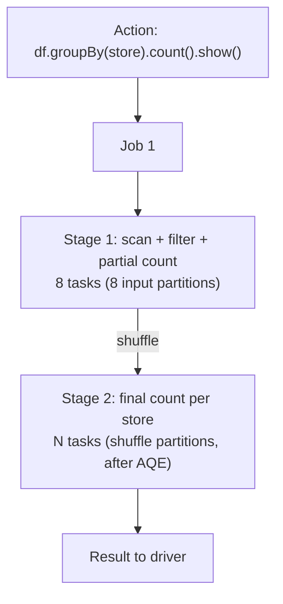

# Jobs Stages and Tasks

Mastery: `INPUT[inlineSelect(option(new), option(learning), option(solid)):mastery]`

> [!story] Context
> [[Shuffles]] require upstream work to finish before downstream work starts. Spark uses these boundaries to structure execution: each action becomes a **job**, each shuffle divides a job into **stages**, and each stage runs one **task** per [[Partitions|partition]].

> [!eli5] Summary
> When you ask Spark for a result, it creates a unit of work, divides it into steps that run in order, and divides each step into small pieces that run on many computers at once. You can monitor each level in the Spark UI.

## Background

The driver needs a way to turn your plan into units it can schedule, retry, and measure. The hierarchy follows the plan's natural breaks:

- **Actions** are where you asked for a result, so each one gets its own **job**.
- **Shuffles** are where all upstream work must finish before downstream work can start, so they become **stage boundaries**.
- **Partitions** are independent, so each one is a **task** that can run on any free core and be retried alone if it fails.

[[MapReduce]] had a fixed two-stage shape (map, then reduce). Spark's scheduler builds any number of stages as a [[DAG]], which is how one Spark job can replace a chain of MapReduce jobs.

## Overview

| Unit | Created by | How many | Spark UI tab |
|---|---|---|---|
| **Job** | One action (`count`, `show`, `write`, ...). Some actions and AQE re-planning create extra jobs. | One or more per action | **Jobs** |
| **Stage** | A section of the plan between shuffles. All its narrow steps run pipelined in one pass. | Number of shuffles + 1 (roughly) | **Stages** |
| **Task** | One partition in one stage. The smallest unit, run in one core. | = partitions in that stage | Stage detail page |

Two kinds of stages: **shuffle map stages** write shuffle files for a later stage, and the **result stage** produces the action's output.

## How it works



Run the following code, then open the [[Spark UI]] (on Databricks, expand **Spark Jobs** under the cell output, or open the compute resource's **Spark UI** tab):

```python
from pyspark.sql import functions as F

spark.sparkContext.setJobDescription("demo: sales per store")  # classic compute only

df = (spark.range(0, 20_000_000, numPartitions=8)
           .withColumn("store", F.col("id") % 25)
           .filter(F.col("id") % 2 == 0))          # narrow: stays in stage 1

result = df.groupBy("store").count()               # wide: creates a stage boundary
result.show()                                      # action: creates the job
```

What you should see:

- **Jobs tab:** one job (possibly with an extra small job from AQE), named after your description.
- **Stages for that job:** a first stage with **8 tasks** (one per input partition) that writes shuffle data, then a second stage that reads it. With AQE on, the second stage often runs far fewer than 200 tasks because small shuffle partitions are coalesced.
- **Stage detail:** a summary table of task durations (min, 25th percentile, median, 75th percentile, max), plus shuffle read/write, spill, and GC time.

A SQL query works the same way. Each `SELECT` you run is an action, and the **SQL / DataFrame** tab links the query to the jobs it launched.

### Reading the numbers

Databricks' guide to diagnosing slow jobs starts here:

1. Find the longest **job**, then the longest **stage** in it.
2. On that stage, check **spill** (data written to disk because memory ran out).
3. Check **skew**: compare the max task duration with the 75th percentile. Databricks suggests that a max 50% or more above the 75th percentile may indicate skew.
4. If there is no skew or spill, check whether the stage is I/O bound (mostly reading data).
5. A stage with **only one task** is a warning sign. Causes Databricks lists include a window function without `PARTITION BY`, an unsplittable gzip file, and `coalesce(1)`.

## Small-business considerations

> [!smallbiz] Small-business considerations
> This level of detail matters when a job is slow or costs more than expected. A quick check: open the Spark UI, find the stage that took longest, and see whether one task took far longer than the others (skew), whether there is spill, or whether the stage has only one task. Those three patterns explain most slow jobs.

> [!bridge]- In Databricks today
> Classic compute shows jobs, stages, and tasks in the standard [[Spark UI]], linked from each notebook cell. Databricks documents a step-by-step Spark UI guide built on exactly this hierarchy. On [[Serverless Compute]] the Spark UI is not available; you inspect queries through query history and the query profile instead. Do not confuse Spark jobs with [[Lakeflow Jobs]] (Databricks' scheduler): one Lakeflow job run can launch many Spark jobs.

## Cloud differences

> [!note] No cloud differences
> The scheduler and the Spark UI are identical on Azure, AWS, and Google Cloud.

## Advanced topics

> [!deepdive]- Advanced topics (301–401)
> - **DAGScheduler and TaskScheduler:** The DAGScheduler on the driver splits a job into stages at shuffle dependencies and submits stages whose parents are done. The TaskScheduler hands tasks to free executor slots, preferring data locality.
> - **Skipped stages:** If a stage's shuffle output already exists from an earlier job, the UI shows it as "skipped." That is reuse, not an error.
> - **Retries:** A failed task is retried, up to a configurable limit (`spark.task.maxFailures`). A lost shuffle output triggers a re-run of the parent stage (a "stage retry").
> - **AQE and job counts:** With [[Adaptive Query Execution]], Spark runs a query stage by stage, re-optimizing after each shuffle, so a single SQL query can appear as several jobs with plans that change while it runs.
> - **Speculation:** `spark.speculation` launches backup copies of very slow tasks on other executors and takes whichever finishes first. It helps with bad machines, not with skew (both copies would be slow).
> - **Task metrics worth knowing:** Scheduler delay (waiting for a slot or for task data), deserialization time, GC time, shuffle read blocked time, and peak execution memory. High GC time points to memory pressure; high shuffle read blocked time points to network or a slow upstream executor.

## Common misconceptions

> [!confusion] A Spark job is not a Databricks job
> A **Spark job** is the work for one action inside a running application. A **[[Lakeflow Jobs|Lakeflow job]]** is a scheduled workflow of tasks (notebooks, SQL, pipelines). One Lakeflow job run may create hundreds of Spark jobs.

> [!confusion] Stages are not lines of code
> One line can create several stages (a join plus an aggregation), and many lines can fuse into one stage (a chain of `select`, `filter`, `withColumn`).

## Recall

What creates a Spark job?::An action (count, show, write, collect...), plus occasional extra jobs from sampling or AQE.
What creates a stage boundary?::A shuffle (wide dependency).
How many tasks run in a stage?::One per partition in that stage.
What is a skipped stage in the Spark UI?::A stage whose shuffle output was reused from an earlier job, so it did not need to run.
What does Databricks suggest comparing to detect skew in a stage?::The max task duration vs the 75th percentile; a max 50% or more above it may indicate skew.
Name two causes of a stage with only one task.::A window function without PARTITION BY, an unsplittable gzip file, or coalesce(1).
How is a Spark job different from a Lakeflow job?::A Spark job is the work for one action; a Lakeflow job is a scheduled workflow that may launch many Spark jobs.

## Next steps

> [!path] Learning path
> **Needs first:** [[Shuffles]], [[Partitions]], [[Transformations and Actions]]
> **Unlocks next:** [[Spark UI]], [[Adaptive Query Execution]]

> [!nextup] Next
> [[PySpark]] covers the Python API that most Spark users write against.

> [!sources]- Sources (last verified: 2026-10-25)
> - [Diagnose cost and performance issues using the Spark UI (AWS)](https://docs.databricks.com/aws/en/optimizations/spark-ui-guide/)
> - [Diagnosing a long job in Spark (AWS)](https://docs.databricks.com/aws/en/optimizations/spark-ui-guide/long-spark-stage)
> - [Skew and spill (AWS)](https://docs.databricks.com/aws/en/optimizations/spark-ui-guide/long-spark-stage-page)
> - [Long Spark stage with one task (AWS)](https://docs.databricks.com/aws/en/optimizations/spark-ui-guide/one-spark-task)
> - [Debugging with the Spark UI (Azure)](https://learn.microsoft.com/en-us/azure/databricks/compute/troubleshooting/debugging-spark-ui)
> - [Serverless compute limitations (AWS)](https://docs.databricks.com/aws/en/compute/serverless/limitations)
> - [Adaptive query execution (AWS)](https://docs.databricks.com/aws/en/optimizations/aqe)
> - [Configuration (Spark 4.2)](https://spark.apache.org/docs/latest/configuration.html)
