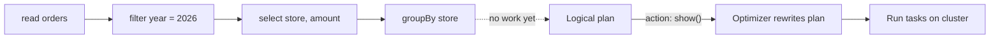

# Lazy Evaluation

Mastery: `INPUT[inlineSelect(option(new), option(learning), option(solid)):mastery]`

> [!story] Context
> [[RDDs]] are defined by their lineage, a record of the transformations that produce them. Spark treats that record as a plan and does not execute it until a result is requested.

> [!eli5] Summary
> Spark does not start working as soon as you give it an instruction. It records the instructions, and when you ask for a result, it reviews the full list, finds an efficient way to carry it out, and runs it.

## Background

If Spark ran each line the moment you typed it, it would:

- **Read data it does not need:** A `filter` written three lines after a `read` would come too late to skip any files.
- **Do work twice:** Intermediate results would be computed and stored even if a later step threw most of them away.
- **Miss better plans:** Spark could not reorder steps, combine them, or choose a smarter [[Join|join]], because it would never see the whole job.

On a cluster, wasted work means wasted machine hours. Waiting until the end lets Spark treat your code as one big plan and optimize it as a whole.

## Overview

In Spark, operations split into two kinds (see [[Transformations and Actions]]):

- **Transformations** (`select`, `filter`, `join`, `groupBy`, `withColumn`) return a new DataFrame or RDD and only add a step to the plan. They are lazy.
- **Actions** (`count`, `collect`, `show`, `write`, `toPandas`) need a real answer, so they trigger execution of the whole plan up to that point.

Lazy evaluation is the rule that **nothing runs until an action is called**. Between actions, Spark holds a logical plan: a graph of operations, technically a [[DAG]] (directed acyclic graph).

## How it works



The following example shows the difference in timing:

```python
import time
from pyspark.sql import functions as F

t = time.time()
df = (spark.range(0, 50_000_000)                      # transformation
           .withColumn("bucket", F.col("id") % 10)    # transformation
           .filter("bucket = 3")                      # transformation
           .groupBy("bucket").count())                # transformation
print(f"defined in {time.time() - t:.3f}s")           # near zero: nothing ran

df.explain()        # prints the optimized plan, still runs nothing

t = time.time()
df.show()           # ACTION: now Spark reads, filters, and aggregates
print(f"ran in {time.time() - t:.3f}s")
```

The first timer reports almost zero, because only a plan was built. The work happens at `show()`.

The same applies to SQL. In the following query, Spark pushes the filter down into the file scan, so with a partitioned or clustered table it reads only the matching files ([[Partition Pruning]] and [[Data Skipping]]):

```sql
EXPLAIN FORMATTED
SELECT o_orderpriority, SUM(o_totalprice)
FROM samples.tpch.orders              -- Databricks sample data; use any table you have
WHERE o_orderdate >= '1998-01-01'
GROUP BY o_orderpriority;
-- Look for "PushedFilters" (or "DataFilters"/"PartitionFilters") on the scan node.
```

### Caching breaks the laziness on purpose

If you will reuse a DataFrame in several actions, `df.cache()` marks it to be kept in memory the first time an action computes it. Later actions start from the cached copy instead of re-reading the source. See [[Caching]].

## Small-business considerations

> [!smallbiz] Small-business considerations
> Lazy evaluation explains two common observations:
> 1. **A cell that defines a DataFrame completes immediately:** It only builds a plan. The cell that calls an action does the work and takes the time.
> 2. **Errors can appear at the action:** A misspelled column name may only raise an error when an action runs, several lines after the mistake.
>
> Avoid adding `display()` or `count()` after every step while building a pipeline. Each one is an action that reruns the plan from the source and consumes compute time.

> [!bridge]- In Databricks today
> Lazy evaluation is unchanged on Databricks, but it matters more on [[Serverless Compute]], which runs through [[Spark Connect]]. Databricks notes that Spark Connect defers analysis and name resolution until execution, so a misspelled column may not raise an error until an action runs, where Spark Classic would have caught it when you defined the DataFrame. [[Photon]] and [[Adaptive Query Execution]] both work on the plan that lazy evaluation produces. [[Lakeflow Spark Declarative Pipelines]] apply the same idea to whole pipelines: you declare tables, and the engine works out order and execution.

## Cloud differences

> [!note] No cloud differences
> Lazy evaluation is part of the Spark engine and behaves identically on Azure Databricks, Databricks on AWS, and Databricks on Google Cloud.

## Advanced topics

> [!deepdive]- Advanced topics (301–401)
> - **Plans have stages:** A DataFrame goes through a parsed (unresolved) logical plan, an analyzed plan, an optimized logical plan, and a physical plan. `df.explain(mode="extended")` prints all four. See [[Catalyst Optimizer]].
> - **Spark Classic analyzes eagerly, Spark Connect lazily:** In Classic, each transformation is analyzed immediately, so schema errors appear early. In Connect, the client builds an unresolved plan and the server analyzes it only on execution. Calling `df.columns` or `df.schema` in a loop on Connect sends a round trip to the server each time; cache the schema in a variable instead.
> - **Repeated actions repeat work:** Without caching, two actions on the same DataFrame run the full lineage twice. Check the [[Spark UI]]: you will see two jobs that each scan the source.
> - **Some "transformations" are not fully lazy:** Reading a CSV with schema inference, or calling `sortBy` on an RDD, may launch a small job to sample the data.

## Common misconceptions

> [!confusion] Lazy does not mean slow
> Lazy evaluation usually makes jobs faster, because Spark sees the whole plan and skips unneeded work. The work takes place at the action rather than at each transformation.

> [!confusion] `cache()` is lazy too
> Calling `df.cache()` does nothing on its own. The data is cached the first time an action computes that DataFrame.

## Recall

What is lazy evaluation in Spark?::Transformations only add steps to a plan; nothing executes until an action is called.
What triggers execution in Spark?::An action, such as count, collect, show, write, or toPandas.
Name two benefits of lazy evaluation.::Spark can optimize the whole plan (push filters down, prune columns, pick join strategies) and avoid computing results that are never used.
Why can a column-name typo surface late on serverless compute?::Serverless uses Spark Connect, which defers analysis and name resolution until an action runs.
Is df.cache() executed immediately?::No. It marks the DataFrame for caching; data is cached when the next action computes it.
What does df.explain() do?::Prints the query plan without running the query.

## Next steps

> [!path] Learning path
> **Needs first:** [[RDDs]], [[Apache Spark]]
> **Unlocks next:** [[Transformations and Actions]], [[Catalyst Optimizer]], [[Jobs Stages and Tasks]]

> [!nextup] Next
> [[Transformations and Actions]] covers the two categories of Spark operations: those that add steps to the plan and those that run it.

> [!sources]- Sources (last verified: 2026-10-25)
> - [Compare Spark Connect to Spark Classic (GCP)](https://docs.databricks.com/gcp/en/spark/connect-vs-classic)
> - [Serverless compute limitations (AWS)](https://docs.databricks.com/aws/en/compute/serverless/limitations)
> - [Spark Connect overview (Spark 4.2)](https://spark.apache.org/docs/latest/spark-connect-overview.html)
> - [Resilient Distributed Datasets (USENIX NSDI 2012)](https://www.usenix.org/conference/nsdi12/technical-sessions/presentation/zaharia)
> - [Spark SQL: Relational Data Processing in Spark (SIGMOD 2015)](https://people.csail.mit.edu/matei/papers/2015/sigmod_spark_sql.pdf)
