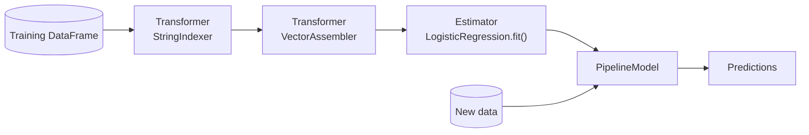

# MLlib

Mastery: `INPUT[inlineSelect(option(new), option(learning), option(solid)):mastery]`

> [!story] Context
> [[Structured Streaming]] extended Spark's DataFrame engine to continuous data. Iterative machine-learning algorithms were one of the original reasons Spark kept data in memory (see [[AMPLab and the Birth of Spark]]). MLlib is the library that runs those algorithms across a cluster.

> [!eli5] Summary
> MLlib is a set of ready-made tools inside Spark for teaching computers to spot patterns in data, such as predicting which customers might leave. It works on data too large for one computer by splitting the work across many.

> [!analogy]- Analogy: a factory production line
> | Production line | MLlib |
> |---|---|
> | Stations that clean and cut raw material | Transformers (`StringIndexer`, `VectorAssembler`) |
> | A station that is calibrated on sample material | An estimator that `fit`s and returns a model |
> | The whole line, saved as a blueprint | A `Pipeline` / `PipelineModel` |
> | Quality inspection | Evaluators and `CrossValidator` |

## Background

Before MLlib, training a model on cluster-scale data meant [[MapReduce]]-based libraries such as Apache Mahout, where every iteration of an algorithm wrote to disk. Spark's in-memory model made iterative algorithms (gradient descent, k-means, alternating least squares) much faster, and MLlib packaged them as a library.

The first MLlib API (`spark.mllib`) was built on [[RDDs]]. Spark later added a [[DataFrames|DataFrame]]-based API (`spark.ml`) with ML Pipelines. As of Spark 2.0, the RDD-based API is in maintenance mode: it receives bug fixes but no new features.

## Overview

MLlib is Spark's machine-learning library. The DataFrame-based `spark.ml` package is the primary API.

| Area | Examples |
|---|---|
| **Feature engineering** | `VectorAssembler`, `StringIndexer`, `OneHotEncoder`, `StandardScaler`, `Tokenizer`, `HashingTF`, `Imputer` |
| **Classification** | Logistic regression, decision trees, random forests, gradient-boosted trees, linear SVM, naive Bayes |
| **Regression** | Linear, generalized linear, tree-based, isotonic |
| **Clustering** | k-means, bisecting k-means, Gaussian mixture, LDA |
| **Recommendation** | Alternating least squares (ALS) |
| **Pipelines and tuning** | `Pipeline`, `CrossValidator`, `TrainValidationSplit`, `ParamGridBuilder` |
| **Persistence** | `model.save(path)` / `PipelineModel.load(path)` |

The Spark documentation states that neither API is deprecated, and that the RDD-based `spark.mllib` package will be deprecated once the DataFrame API reaches feature parity.

## How it works



The core abstractions:

- **Transformer:** takes a DataFrame and returns a new one with added columns (`transform()`).
- **Estimator:** learns from a DataFrame and returns a Transformer (`fit()`). A model is the Transformer produced by an estimator.
- **Pipeline:** an ordered list of stages. Fitting a pipeline returns a `PipelineModel` that applies the same steps to new data.

Example: predict customer churn from a small table.

```python
from pyspark.ml import Pipeline
from pyspark.ml.feature import StringIndexer, VectorAssembler
from pyspark.ml.classification import LogisticRegression
from pyspark.ml.evaluation import BinaryClassificationEvaluator

df = spark.createDataFrame(
    [("basic", 3, 12.0, 1), ("pro", 24, 49.0, 0), ("basic", 1, 12.0, 1),
     ("pro", 36, 49.0, 0), ("basic", 18, 12.0, 0), ("pro", 2, 49.0, 1),
     ("basic", 30, 12.0, 0), ("pro", 6, 49.0, 1)],
    "plan STRING, tenure_months INT, monthly_fee DOUBLE, churned INT")

pipeline = Pipeline(stages=[
    StringIndexer(inputCol="plan", outputCol="plan_idx"),
    VectorAssembler(inputCols=["plan_idx", "tenure_months", "monthly_fee"],
                    outputCol="features"),
    LogisticRegression(featuresCol="features", labelCol="churned"),
])

train, test = df.randomSplit([0.75, 0.25], seed=42)
model = pipeline.fit(train)
preds = model.transform(test)
preds.select("plan", "tenure_months", "probability", "prediction").show()

auc = BinaryClassificationEvaluator(labelCol="churned").evaluate(preds)
print("AUC:", auc)
```

## Small-business considerations

> [!smallbiz] Small-business considerations
> MLlib is relevant when training data does not fit on one machine. Most small-business datasets (thousands to a few million rows) train faster with scikit-learn, XGBoost, or LightGBM on a single node. A practical approach:
> 1. Use Spark to prepare and aggregate features from large raw data.
> 2. Convert the training set with `toPandas()` and train with a single-node library.
> 3. Track runs and register models with [[MLflow]] either way.
>
> [[AutoML]] can produce a baseline model without writing training code.

> [!bridge]- In Databricks today
> MLlib is included in the [[Databricks Runtime]] and in Databricks Runtime for Machine Learning, which also preinstalls common single-node ML libraries. Databricks recommends tracking MLlib and other training runs with [[MLflow]] ([[Experiment Tracking]]), registering models in [[Models in Unity Catalog]], and serving them with [[Model Serving]]. Feature pipelines usually live in [[Feature Engineering and Feature Store]]. Check the [[Serverless Compute]] limitations page before running MLlib training on serverless.

## Cloud differences

> [!note] No cloud differences
> MLlib behaves identically on Azure, AWS, and Google Cloud. [[AI Runtime|GPU instance]] availability differs by cloud and region, but MLlib's algorithms run on CPUs.

## Advanced topics

> [!deepdive]- Advanced topics (301–401)
> - **Vectors:** Features are stored in a single vector column (dense or sparse `pyspark.ml.linalg` vectors). `VectorAssembler` builds it; most estimators read `featuresCol`.
> - **Distributed algorithm cost:** Tree ensembles and logistic regression scale well. Some algorithms require many passes over the data, so caching the training DataFrame (`df.cache()`) avoids rereading the source per iteration.
> - **[[Hyperparameter]] tuning:** `CrossValidator` with a `ParamGridBuilder` trains *k × grid-size* models. `setParallelism(n)` trains several in parallel.
> - **Persistence format:** Saved pipelines are directories of metadata and Parquet files, readable from Scala, Java, and Python. With MLflow, `mlflow.spark.log_model` stores the pipeline with environment information.
> - **Alternatives for deep learning:** MLlib does not cover deep learning. For neural networks, use a deep-learning framework on [[AI Runtime]].

## Common misconceptions

> [!confusion] `spark.mllib` and `spark.ml` are not the same API
> `spark.mllib` is the RDD-based API, in maintenance mode since Spark 2.0. `spark.ml` is the DataFrame-based API with Pipelines, and all new features go there. "MLlib" refers to the library as a whole.

> [!confusion] MLlib is not MLflow
> MLlib trains models. [[MLflow]] tracks experiments, packages models, and manages their lifecycle. They are commonly used together.

## Recall

What is MLlib?::Spark's built-in machine-learning library for distributed feature engineering, training, and tuning.
Which MLlib API is primary today?::The DataFrame-based spark.ml API.
What is the status of the RDD-based spark.mllib API?::Maintenance mode since Spark 2.0: bug fixes only, no new features.
What is the difference between a Transformer and an Estimator?::A Transformer maps a DataFrame to a new DataFrame (transform); an Estimator learns from data (fit) and returns a Transformer (model).
What does fitting a Pipeline return?::A PipelineModel that applies all fitted stages to new data.
What does VectorAssembler do?::Combines multiple columns into a single feature vector column.
When should a small team prefer scikit-learn over MLlib?::When the training data fits comfortably on one machine.

## Next steps

> [!path] Learning path
> **Needs first:** [[Machine Learning Basics]], [[DataFrames]], [[PySpark]]
> **Unlocks next:** [[MLflow]], [[Feature Engineering and Feature Store]], [[Experiment Tracking]]

> [!nextup] Next
> [[Adaptive Query Execution]] covers how Spark 3.0 and later re-optimize a query plan at runtime using statistics collected during execution.

> [!sources]- Sources (last verified: 2026-10-25)
> - [MLlib main guide (Spark 4.2)](https://spark.apache.org/docs/latest/ml-guide.html)
> - [MLlib RDD-based API (Spark 4.2)](https://spark.apache.org/docs/latest/mllib-guide.html)
> - [ML Pipelines (Spark 4.2)](https://spark.apache.org/docs/latest/ml-pipeline.html)
> - [MLlib (DataFrame-based) PySpark reference (Spark 4.2)](https://spark.apache.org/docs/latest/api/python/reference/pyspark.ml.html)
> - [Migration guide: MLlib (Spark 4.2)](https://spark.apache.org/docs/latest/ml-migration-guide.html)
> - [Serverless compute limitations (AWS)](https://docs.databricks.com/aws/en/compute/serverless/limitations)
