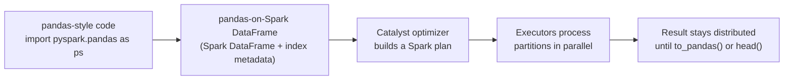

# Pandas API on Spark

Mastery: `INPUT[inlineSelect(option(new), option(learning), option(solid)):mastery]`

> [!story] Context
> The [[Spark UI]] showed how Spark spreads a query across [[Partitions|partitions]] and executors. Many Python users, however, write their analysis in [[Pandas|pandas]], which runs on one machine. The pandas API on Spark lets that pandas-style code run on the same distributed engine.

> [!eli5] Summary
> pandas is a popular Python tool for working with tables, but it only uses one computer, so it fails when the data no longer fits in that computer's memory. The pandas API on Spark keeps the familiar pandas commands and runs them across many computers instead.

> [!renamed] Renamed: Koalas is now the pandas API on Spark
> Databricks released the open-source **Koalas** project in April 2019. It was merged into Apache Spark 3.2 (October 2021) as the `pyspark.pandas` module, called the **pandas API on Spark**. The import changed from `databricks.koalas` to `pyspark.pandas`, and Koalas is no longer developed separately.

## Background

[[Pandas|pandas]] is the standard Python library for tabular analysis. It loads the whole dataset into the memory of one process, so it is limited by the RAM of a single machine and uses one CPU core for most operations.

[[PySpark]] removes that limit, but its [[DataFrames|DataFrame]] API is different from pandas. A data scientist moving a notebook from pandas to PySpark has to rewrite most of it: `df.groupby("a").sum()` in pandas becomes `df.groupBy("a").agg(F.sum(...))` in PySpark, and pandas concepts such as the row index have no PySpark equivalent.

Databricks started Koalas in 2019 to close that gap. The Spark project accepted it through an improvement proposal (SPIP) as part of Project Zen, an effort to make PySpark more Pythonic, and shipped it in Spark 3.2. Databricks Runtime 10.0 was the first runtime to include it.

## Overview

The pandas API on Spark is a module of PySpark, `pyspark.pandas`, that implements the pandas API on top of Spark DataFrames.

| Capability | Detail |
|---|---|
| pandas-compatible API | `DataFrame`, `Series`, and `Index` objects with pandas method names and semantics. At the Spark 3.2 release, Databricks reported 83% coverage of the pandas API |
| Distributed execution | Operations compile to Spark plans and run across executors, so data size is limited by the cluster, not one machine |
| Conversion | Move between pandas, pandas-on-Spark, and PySpark DataFrames with one method call |
| Spark features | Run SQL over pandas-on-Spark frames with `ps.sql`, and pass data to Spark ML |
| Readers | `ps.read_csv`, `ps.read_parquet`, `ps.read_delta`, `ps.read_table`, and others |

The three DataFrame types and how to move between them:

| From | To | Method |
|---|---|---|
| pandas | pandas-on-Spark | `ps.from_pandas(pdf)` |
| pandas-on-Spark | pandas | `psdf.to_pandas()` (collects all rows to the driver) |
| pandas-on-Spark | PySpark | `psdf.to_spark()` |
| PySpark | pandas-on-Spark | `sdf.pandas_api(index_col="id")` (formerly `to_pandas_on_spark()` and, in Koalas, `to_koalas()`) |

## How it works



A pandas-on-Spark DataFrame wraps a Spark DataFrame plus metadata that maps one or more columns to a pandas-style index. Each pandas method you call is translated into Spark DataFrame operations, which the [[Catalyst Optimizer]] plans and the executors run. Like PySpark, execution is lazy until a result is needed (see [[Lazy Evaluation]]).

### Example: daily revenue with pandas syntax

```python
import pyspark.pandas as ps

# Use a fully distributed default index (see "Default index" below)
ps.set_option("compute.default_index_type", "distributed")

# Read a Unity Catalog table into a pandas-on-Spark DataFrame
orders = ps.read_table("shop.sales.orders")

completed = orders[orders["status"] == "complete"]
daily = completed.groupby("order_date")["amount"].sum().sort_index()

daily.head(10)            # pandas-style preview, computed by Spark

# Run SQL over the same frame
ps.sql("SELECT count(*) AS n FROM {orders}", orders=orders)

# Hand off to PySpark, or bring a small result back to pandas
sdf = completed.to_spark()
small = daily.tail(30).to_pandas()   # only 30 rows reach the driver
```

### Default index

pandas always has a row index. Spark DataFrames do not, so when you create a pandas-on-Spark DataFrame without naming an index column, Spark must generate one. The option `compute.default_index_type` controls how:

| Index type | How it is built | Trade-off |
|---|---|---|
| `sequence` | A window function over all rows, increasing one by one | Can move the whole dataset into one partition on one node. Avoid for large data |
| `distributed-sequence` (default) | A globally sequential index computed in a distributed way | Sequential, but the row-to-index mapping is not guaranteed stable across operations such as `apply()`, `groupby()`, and `transform()` |
| `distributed` | `monotonically_increasing_id` | Fully distributed with little overhead. Values are unique but not consecutive |

The Spark best-practices guide recommends naming an index column when converting from Spark (`sdf.pandas_api(index_col="order_id")`), because a real column is cheaper than any generated index.

## Small-business considerations

> [!smallbiz] Small-business considerations
> Most small companies do not need the pandas API on Spark. If your largest dataset fits comfortably in a laptop's memory, plain pandas (or SQL on a [[SQL Warehouses|SQL warehouse]]) is simpler and starts faster.
>
> Use it when an existing pandas notebook starts failing with out-of-memory errors as data grows, and you want to scale it with minimal rewriting. Change the import, set the index type, and test.
>
> For new work on Databricks, prefer SQL or the PySpark DataFrame API. They are more widely documented, and behavior is easier to predict. Cost is the compute that runs the code; see [[How Databricks Pricing Works]].

> [!bridge]- In Databricks today
> The pandas API on Spark ships with every [[Databricks Runtime]] (since 10.0) and runs in [[Notebooks|notebooks]] and jobs without installation. Databricks documents it on its "Pandas API on Spark" page. Notes for current compute types:
> - **Standard access mode (classic):** Databricks lists pandas on Spark as requiring Databricks Runtime 14.3 or above on standard compute.
> - **Serverless:** [[Serverless Compute]] supports only [[Spark Connect]] APIs, which defers analysis to execution time and enables ANSI mode by default. Test pandas-on-Spark code on serverless before migrating it, because errors that were silent on classic compute can surface.
> - **Alternatives in the same notebook:** For logic that must run as real pandas on each group, PySpark's `applyInPandas` and pandas UDFs run pandas code inside Spark tasks. See [[UDF]].

## Cloud differences

The API is identical on every cloud. Only the storage paths you pass to readers differ. For governed data, read tables by name with `ps.read_table` and let [[Unity Catalog]] resolve storage.

> [!azure]- Azure Databricks
> File paths use ADLS Gen2: `ps.read_parquet("abfss://container@account.dfs.core.windows.net/path")`. See [[Azure Data Lake Storage]].

> [!aws]- Databricks on AWS
> File paths use S3: `ps.read_parquet("s3://bucket/path")`. See [[Amazon S3]].

> [!gcp]- Databricks on Google Cloud
> File paths use Cloud Storage: `ps.read_parquet("gs://bucket/path")`. See [[Google Cloud Storage]].

## Advanced topics

> [!deepdive]- Advanced topics (301–401)
> - **Operations on different frames:** Combining two pandas-on-Spark objects that come from different DataFrames (for example, `psdf1["a"] + psdf2["b"]`) requires a join on the index, which is expensive. It is disabled by default and enabled with `compute.ops_on_diff_frames`. Do not combine it with the `distributed` index type, because the generated indexes do not line up.
> - **Single-partition traps:** Some pandas operations have no distributed equivalent and pull data into one partition, for example a global `sequence` index or certain window-style operations. The Spark best-practices guide lists these. Check the [[Spark UI]] for stages with one task.
> - **Index stability with `apply`:** With `distributed-sequence`, functions applied with `apply()`, `groupby().apply()`, or `transform()` can produce a new index that does not match the original row order. Set an explicit index, persist the frame first, or switch to `sequence` when exact alignment matters.
> - **Inspecting plans:** `psdf.spark.explain()` prints the Spark plan behind a pandas-on-Spark expression. Use it to see [[Shuffles|shuffles]] that a pandas operation introduces.
> - **Type hints:** Functions passed to `apply` and `transform` can declare return types with Python type hints so Spark does not need to run the function on a sample to infer the schema.
> - **Coverage gaps:** Not every pandas method is implemented, and some behave differently (for example, ordering is not guaranteed unless you sort). Check the `pyspark.pandas` API reference for the Spark version in your runtime.

## Common misconceptions

> [!confusion] pandas on Spark is not a faster pandas
> It is a reimplementation of the pandas API on Spark. Small data often runs slower than plain pandas, because each operation becomes a distributed Spark job. The benefit is scale, not speed on small inputs.

> [!confusion] `to_pandas()` is not a free conversion
> `to_pandas()` collects every row to the driver. On a large table it fails with an out-of-memory error, which is the problem the API exists to avoid. Filter or aggregate first.

> [!confusion] Koalas is not a separate product to install
> Koalas was merged into PySpark. Use `import pyspark.pandas as ps`; the `databricks.koalas` package is legacy.

## Recall

What is the pandas API on Spark?::A PySpark module, `pyspark.pandas`, that implements the pandas API on top of Spark DataFrames so pandas-style code runs distributed.
What was the pandas API on Spark called before it joined Apache Spark?::Koalas, an open-source project started by Databricks in 2019.
In which Spark release did Koalas become `pyspark.pandas`?::Apache Spark 3.2 (Databricks Runtime 10.0).
How do you convert a PySpark DataFrame to a pandas-on-Spark DataFrame with an explicit index?::`sdf.pandas_api(index_col="column_name")`.
Which default index type should you avoid for large data, and why?::`sequence`, because it can move all rows into one partition on one node.
What is the default value of `compute.default_index_type`?::`distributed-sequence`.
Why is `to_pandas()` risky on large data?::It collects every row into the driver's memory.
Which option allows operations between two different pandas-on-Spark DataFrames?::`compute.ops_on_diff_frames`.

## Next steps

> [!path] Learning path
> **Needs first:** [[Pandas]], [[PySpark]], [[DataFrames]]
> **Unlocks next:** [[Notebooks]], [[Feature Engineering and Feature Store]]

> [!nextup] Next
> Spark addressed processing speed but not storage reliability or governance. [[Chapter 04 - The Modern Data Stack]] covers the data warehouses, data lakes, and tools that formed around Spark, and the two-tier architecture they produced.

> [!sources]- Sources (last verified: 2026-10-25)
> - [Pandas API on Spark (Databricks, AWS)](https://docs.databricks.com/aws/en/pandas/pandas-on-spark)
> - [pandas_api (Databricks PySpark reference, GCP)](https://docs.databricks.com/gcp/en/pyspark/reference/classes/dataframe/pandas_api)
> - [Pandas API on Spark user guide (PySpark docs)](https://spark.apache.org/docs/latest/api/python/tutorial/pandas_on_spark/index.html)
> - [Best Practices: pandas API on Spark (PySpark docs)](https://spark.apache.org/docs/latest/api/python/tutorial/pandas_on_spark/best_practices.html)
> - [Options and settings: pandas API on Spark (PySpark docs)](https://spark.apache.org/docs/latest/api/python/tutorial/pandas_on_spark/options.html)
> - [From/to pandas and PySpark DataFrames (PySpark docs)](https://spark.apache.org/docs/latest/api/python/tutorial/pandas_on_spark/pandas_pyspark.html)
> - [Migrating from Koalas to pandas API on Spark (PySpark 3.5.2 docs)](https://spark.apache.org/docs/3.5.2/api/python/migration_guide/koalas_to_pyspark.html)
> - [Pandas API on Upcoming Apache Spark 3.2 (Databricks blog)](https://www.databricks.com/blog/2021/10/04/pandas-api-on-upcoming-apache-spark-3-2.html)
> - [Koalas: Easy Transition from pandas to Apache Spark (Databricks blog)](https://www.databricks.com/blog/2019/04/24/koalas-easy-transition-from-pandas-to-apache-spark.html)
> - [Standard compute requirements and limitations (AWS)](https://docs.databricks.com/aws/en/compute/standard-limitations)
> - [Serverless compute limitations (AWS)](https://docs.databricks.com/aws/en/compute/serverless/limitations)
