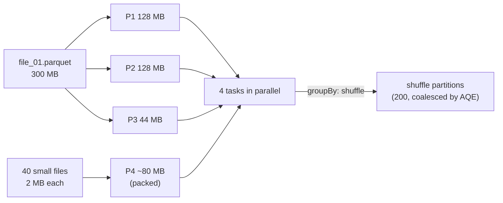

# Partitions

Mastery: `INPUT[inlineSelect(option(new), option(learning), option(solid)):mastery]`

> [!story] Context
> [[Driver and Executors]] run tasks in parallel, one per core. Parallelism requires data divided into independent units; in Spark, those units are partitions.

> [!eli5] Summary
> Spark splits a large dataset into smaller pieces so many computers can each process a piece at the same time. The number and size of the pieces affect how quickly the work finishes.

## Background

Parallel processing needs independent units of work. Spark inherited this idea from [[HDFS]] and [[MapReduce]], where each file block became one map task. A partition is Spark's unit: **one task processes one partition**. The number and size of partitions therefore decide how much of your cluster is actually used, how much memory each task needs, and how many small tasks the driver has to schedule.

## Overview

A partition is a chunk of rows from a DataFrame or RDD that lives on one executor at a time. The word appears in three different places, and it helps to keep them apart:

| Kind | When it happens | Controlled by |
|---|---|---|
| **Input partitions** | Reading files | File sizes and `spark.sql.files.maxPartitionBytes` (default **128 MB**). Small files are packed together; large splittable files are split. |
| **Shuffle partitions** | After a wide operation (`groupBy`, `join`, `distinct`) | `spark.sql.shuffle.partitions` (default **200**), adjusted at runtime by [[Adaptive Query Execution]] (target about **64 MB** each by default). |
| **Output files** | Writing | Usually one file per partition per write task, unless the writer or table layout optimizes it. |

And a separate idea with the same name: **table partitioning** (Hive-style `PARTITIONED BY (date)`) splits a table's files into folders on disk, so queries can skip folders ([[Partition Pruning]]). That is about storage layout, not about in-memory partitions. On Databricks, [[Liquid Clustering]] has largely replaced it for new tables.

## How it works



Inspect and change partitioning:

```python
from pyspark.sql import functions as F

df = spark.range(0, 10_000_000, numPartitions=8)

# Count rows per partition (works on classic and serverless)
(df.withColumn("pid", F.spark_partition_id())
   .groupBy("pid").count().orderBy("pid").show())

# On classic compute you can also ask directly:
# print(df.rdd.getNumPartitions())

wide   = df.repartition(64)                 # full shuffle into 64 even partitions
byKey  = df.repartition(16, "id")           # shuffle so equal keys land together
narrow = df.coalesce(2)                     # merge to 2 partitions, no shuffle

# Writing: many partitions -> many files; few partitions -> few big files
narrow.write.mode("overwrite").format("delta").saveAsTable("main.default.demo_ids")
```

The SQL equivalents are hints:

```sql
SELECT /*+ REPARTITION(64) */ * FROM main.default.demo_ids;
SELECT /*+ COALESCE(4) */     * FROM main.default.demo_ids;
SELECT /*+ REBALANCE */       * FROM main.default.demo_ids;   -- even out sizes before a write
```

**Sizing rules of thumb**

- Aim for partitions of roughly **100–200 MB** in memory for scans, and for at least 2–3 tasks per core so [[Straggler Task|stragglers]] do not idle the cluster.
- If a stage has **fewer tasks than cores**, you are leaving the cluster idle.
- If a stage has **tens of thousands of tiny tasks** (a few KB each), scheduling overhead dominates.
- If one task is far slower than the rest, look for [[Data Skew|skew]], not for a partition count.

## Small-business considerations

> [!smallbiz] Small-business considerations
> On Databricks, partition counts rarely need manual changes. [[Adaptive Query Execution]] adjusts shuffle partitions automatically, and Delta tables with [[OPTIMIZE and VACUUM|OPTIMIZE]] or predictive optimization keep file sizes in a good range. The main issue to avoid is the **small-files problem**: a job that writes thousands of tiny files every hour (for example, one per customer). Write in larger batches, or let Delta compaction combine them.

> [!bridge]- In Databricks today
> Partitions work exactly as in open-source Spark, with more automation. [[Adaptive Query Execution]] is on by default and coalesces shuffle partitions. Databricks also offers auto-optimized shuffle partitions, which its Spark UI guide recommends when stages [[Spill|spill]]. For storage layout, Databricks recommends [[Liquid Clustering]] over Hive-style table partitioning for new Delta tables, and Delta's optimized writes and auto compaction reduce small files. On [[Serverless Compute]], `df.rdd.getNumPartitions()` is unavailable; use `spark_partition_id()` or the query profile.

## Cloud differences

> [!note] No cloud differences
> Partitioning behaves the same on Azure, AWS, and Google Cloud. Object stores on all three handle many tiny files poorly, so the small-files advice applies everywhere.

## Advanced topics

> [!deepdive]- Advanced topics (301–401)
> - **Splittable vs unsplittable files:** Parquet, ORC, and uncompressed or bzip2 text can be split across tasks. A single large `.csv.gz` cannot: it becomes one partition and one task, however big it is. Databricks' Spark UI guide lists unsplittable gzip files as a cause of "long stage with one task."
> - **Input packing:** `spark.sql.files.openCostInBytes` (default 4 MB) is the estimated cost of opening a file, used when packing small files into one partition.
> - **`repartition` vs `coalesce`:** `coalesce(n)` avoids a shuffle by merging neighbouring partitions, but it can also reduce the parallelism of upstream steps in the same stage. `coalesce(1)` before a heavy transformation forces all that work into one task. Use `repartition` when you need balanced output.
> - **Partitioning by key:** `repartition(n, col)` hash-partitions so equal keys co-locate, which lets later joins or aggregations on that key avoid another shuffle. Spark tracks this as the plan's output partitioning.
> - **Over-partitioned tables:** Hive-style partitioning on a high-cardinality column (customer ID, timestamp) creates millions of folders and tiny files. A common guideline is to partition only on low-cardinality columns with at least about 1 GB per partition, which is why Liquid Clustering is now preferred.

## Common misconceptions

> [!confusion] Spark partitions are not table partitions
> Spark partitions are in-memory chunks processed by tasks. Table partitions (`PARTITIONED BY`) are folders on disk. A table with 3 date folders can still be read as 300 Spark partitions.

> [!confusion] More partitions is not always faster
> Past the number of cores (times a small factor), extra partitions only add scheduling overhead and small output files.

## Recall

What is a Spark partition?::A chunk of a DataFrame's rows processed by one task on one executor.
How many tasks does Spark run for a stage with 300 partitions?::300 tasks, one per partition.
What is the default spark.sql.files.maxPartitionBytes?::128 MB.
What is the default spark.sql.shuffle.partitions?::200 (adjusted at runtime by AQE when enabled).
What is the difference between repartition and coalesce?::repartition does a full shuffle and can increase or decrease partitions evenly; coalesce merges partitions without a shuffle and can only decrease them.
Why can a single .csv.gz file make a job slow?::Gzip is not splittable, so the whole file becomes one partition processed by one task.
What does Databricks recommend instead of Hive-style table partitioning for new Delta tables?::Liquid clustering.
How can you count rows per partition on serverless compute?::Group by spark_partition_id().

## Next steps

> [!path] Learning path
> **Needs first:** [[Driver and Executors]], [[RDDs]]
> **Unlocks next:** [[Shuffles]], [[Jobs Stages and Tasks]], [[Adaptive Query Execution]], [[Liquid Clustering]]

> [!nextup] Next
> [[Shuffles]] covers how Spark moves data between partitions when an operation needs related rows together.

> [!sources]- Sources (last verified: 2026-10-25)
> - [Performance tuning (Spark 4.2)](https://spark.apache.org/docs/latest/sql-performance-tuning.html)
> - [Configuration (Spark 4.2)](https://spark.apache.org/docs/latest/configuration.html)
> - [Hints (Spark 4.2)](https://spark.apache.org/docs/latest/sql-ref-syntax-qry-select-hints.html)
> - [Adaptive query execution (AWS)](https://docs.databricks.com/aws/en/optimizations/aqe)
> - [Long Spark stage with one task (AWS)](https://docs.databricks.com/aws/en/optimizations/spark-ui-guide/one-spark-task)
> - [Skew and spill (AWS)](https://docs.databricks.com/aws/en/optimizations/spark-ui-guide/long-spark-stage-page)
> - [Serverless compute limitations (AWS)](https://docs.databricks.com/aws/en/compute/serverless/limitations)
