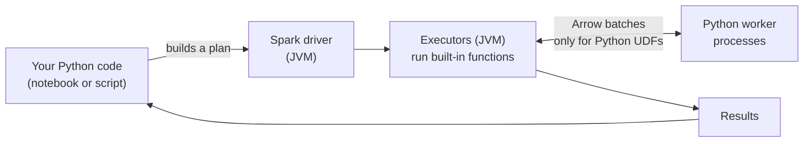

# PySpark

Mastery: `INPUT[inlineSelect(option(new), option(learning), option(solid)):mastery]`

> [!story] Context
> [[Jobs Stages and Tasks]] described how Spark executes work. Spark is written in [[Scala]] and runs on the [[JVM]], while most data practitioners work in [[Python for Data|Python]]. PySpark is the Python API for Spark.

> [!eli5] Summary
> PySpark lets you control Spark using Python, a widely used programming language. You write Python commands, and Spark carries out the processing across many computers.

## Background

Many data scientists and analysts work in Python with [[Pandas]], NumPy, and scikit-learn rather than in Scala or Java. PySpark gives Python users the full DataFrame and SQL engine with Python syntax. On Databricks, Python and SQL are the most common notebook languages.

## Overview

PySpark is the Python [[APIs|API]] for Apache Spark, installed with `pip install pyspark`. Its main pieces:

| Module | What it is for |
|---|---|
| `pyspark.sql` | `SparkSession`, [[DataFrames]], SQL, built-in functions (`pyspark.sql.functions as F`) |
| `pyspark.sql.streaming` | [[Structured Streaming]] |
| `pyspark.ml` | [[MLlib]] machine learning on DataFrames |
| `pyspark.pandas` | The pandas API on Spark: pandas-style code that runs distributed |
| `pyspark.pipelines` | Spark Declarative Pipelines (new in Spark 4.1) |
| `pyspark.sql.connect` | The [[Spark Connect]] client used by thin Python clients |

The key thing to understand: **most PySpark code does not run in Python.** When you call `df.filter(...)`, Python only builds a plan. The plan runs in the JVM on the [[Driver and Executors|executors]] (the worker processes) (or in [[Photon]] on Databricks). Python code only runs on the cluster when you write a Python [[UDF]].

## How it works



The following example runs in a Databricks notebook or in local Python with `pip install pyspark`:

```python
from pyspark.sql import SparkSession, functions as F, Window

spark = SparkSession.builder.appName("first-pyspark").getOrCreate()  # `spark` already exists on Databricks

# 1. Data
sales = spark.createDataFrame(
    [("2026-10-01", "Main St", "coffee", 3.5, 40),
     ("2026-10-01", "Main St", "bagel",  2.0, 25),
     ("2026-10-01", "Airport", "coffee", 4.5, 90),
     ("2026-10-02", "Main St", "coffee", 3.5, 38),
     ("2026-10-02", "Airport", "bagel",  2.5, 30)],
    "day STRING, store STRING, item STRING, price DOUBLE, qty INT")

# 2. Columns and filters (built-in functions: fast, run in the engine)
sales = (sales.withColumn("day", F.to_date("day"))
              .withColumn("revenue", F.col("price") * F.col("qty")))

# 3. Aggregate
daily = sales.groupBy("day", "store").agg(F.sum("revenue").alias("revenue"))

# 4. Window function: running total per store
w = Window.partitionBy("store").orderBy("day")
daily = daily.withColumn("running_total", F.sum("revenue").over(w))

daily.orderBy("store", "day").show()

# 5. Mix in SQL whenever it is clearer
daily.createOrReplaceTempView("daily")
spark.sql("SELECT store, MAX(revenue) AS best_day FROM daily GROUP BY store").show()

# 6. Small results back to pandas for a chart or a spreadsheet
pdf = daily.toPandas()
```

When you need custom Python logic, prefer a **vectorized pandas UDF**, which processes whole batches instead of one row at a time:

```python
import pandas as pd
from pyspark.sql.functions import pandas_udf

@pandas_udf("double")
def with_tax(price: pd.Series) -> pd.Series:
    return price * 1.0825          # replace with real tax logic

sales.select("item", with_tax("price").alias("price_with_tax")).show()
```

## Small-business considerations

> [!smallbiz] Small-business considerations
> PySpark is a suitable choice when the team's data practitioner works in Python. Three practices keep it efficient:
> 1. **Use `pyspark.sql.functions` first.** Most operations (dates, strings, JSON, windows) are built in and runs at engine speed.
> 2. **Do heavy work in Spark, then `toPandas()` the small result** for charts or Excel export.
> 3. **Write code that works on serverless**: DataFrames and SQL, no `sparkContext` or RDDs. Such code runs on serverless compute without cluster management.

> [!bridge]- In Databricks today
> PySpark is the main Python interface on Databricks. In notebooks, `spark` is created for you and `display(df)` renders tables and charts. On [[Serverless Compute]] and standard access mode, PySpark runs through [[Spark Connect]], so only Spark Connect APIs work: no RDDs or `SparkContext`. From your laptop or IDE (code editor), [[Databricks Connect]] gives you the same PySpark API against Databricks compute. The same code runs in [[Lakeflow Jobs]] and [[Lakeflow Spark Declarative Pipelines]]. [[Photon]] speeds up DataFrame operations but does not accelerate Python UDFs.

## Cloud differences

> [!note] No cloud differences
> PySpark code is identical on Azure, AWS, and Google Cloud. Only storage paths differ if you read files directly; with [[Unity Catalog]] tables and `/Volumes/...` paths, even that difference disappears.

## Advanced topics

> [!deepdive]- Advanced topics (301–401)
> - **Py4J vs Spark Connect.** In Spark Classic, the Python process talks to the driver JVM through Py4J. In Spark Connect, the Python client sends protobuf plans over gRPC and gets Arrow results back, with no local JVM at all. That is why the Spark Connect Python client can be a small pure-Python package.
> - **UDF cost.** A row-at-a-time Python UDF serializes each row to a Python worker and back, blocks some optimizations, and is not accelerated by Photon. Pandas UDFs batch rows through Apache Arrow and are much faster. Built-in functions avoid Python entirely.
> - **`toPandas()` and Arrow.** Converting to pandas uses Arrow when enabled. It still pulls the full result into the client's memory, so limit or aggregate first.
> - **pandas API on Spark.** `import pyspark.pandas as ps` gives `ps.DataFrame` with pandas syntax, distributed. It is handy for porting pandas code, but some pandas behaviors (ordering, index semantics) are expensive at scale.
> - **Dependencies.** Python libraries must be available on every executor. On Databricks, use notebook-scoped `%pip install`, compute-scoped libraries, or serverless environments. See [[Libraries and Environments]].

## Common misconceptions

> [!confusion] PySpark is not "Spark rewritten in Python"
> The engine is still the JVM (or Photon). PySpark is an API that builds plans for that engine. That is why built-in PySpark functions are as fast as Scala.

> [!confusion] PySpark is not pandas
> PySpark DataFrames are lazy and distributed; pandas DataFrames are eager and on one machine. The pandas API on Spark tries to bridge the two, but it is a separate module.

## Recall

What is PySpark?::The Python API for Apache Spark.
When you call df.filter() in PySpark, where does the filtering run?::In the Spark engine on the executors (JVM or Photon), not in Python.
When does Python code actually run on executors?::When you use a Python UDF or pandas UDF.
Why prefer a pandas UDF over a regular Python UDF?::It processes batches of rows via Apache Arrow instead of one row at a time, so it is much faster.
Which PySpark APIs are unavailable on Databricks serverless compute?::RDD APIs and SparkContext (only Spark Connect APIs are supported).
What tool lets you run PySpark from your IDE against Databricks compute?::Databricks Connect.
What does df.toPandas() do?::Collects the full result to the client as a pandas DataFrame, so it should only be used on small results.

## Next steps

> [!path] Learning path
> **Needs first:** [[Python for Data]], [[DataFrames]]
> **Unlocks next:** [[Structured Streaming]], [[MLlib]], [[Databricks Connect]], [[Notebooks]]

> [!nextup] Next
> [[Structured Streaming]] covers how the same DataFrame API processes data that arrives continuously.

> [!sources]- Sources (last verified: 2026-10-25)
> - [Databricks Connect (AWS)](https://docs.databricks.com/aws/en/dev-tools/databricks-connect)
> - [Databricks Connect (Azure)](https://learn.microsoft.com/en-us/azure/databricks/dev-tools/databricks-connect/)
> - [Limitations with Databricks Connect for Python (AWS)](https://docs.databricks.com/aws/en/dev-tools/databricks-connect/python/limitations)
> - [Serverless compute limitations (AWS)](https://docs.databricks.com/aws/en/compute/serverless/limitations)
> - [Migrate from classic compute to serverless compute (AWS)](https://docs.databricks.com/aws/en/compute/serverless/migration)
> - [Compare Spark Connect to Spark Classic (GCP)](https://docs.databricks.com/gcp/en/spark/connect-vs-classic)
> - [What is Photon? (AWS)](https://docs.databricks.com/aws/en/compute/photon)
> - [Lakeflow pipelines Python language reference (AWS)](https://docs.databricks.com/aws/en/ldp/developer/python-ref)
> - [PySpark overview (Spark 4.2)](https://spark.apache.org/docs/latest/api/python/index.html)
> - [Upgrading PySpark (Spark 4.2)](https://spark.apache.org/docs/latest/api/python/migration_guide/pyspark_upgrade.html)
> - [Spark Declarative Pipelines programming guide (Spark 4.2)](https://spark.apache.org/docs/latest/declarative-pipelines-programming-guide.html)
> - [Spark Release 4.2.0](https://spark.apache.org/releases/spark-release-4-2-0.html)
