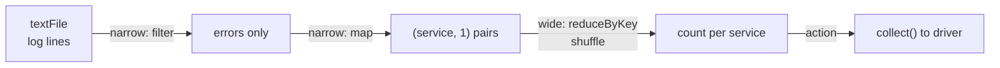

# RDDs

Mastery: `INPUT[inlineSelect(option(new), option(learning), option(solid)):mastery]`

> [!story] Context
> [[Apache Spark]] keeps working data in memory across a cluster. Memory contents are lost when a machine fails, so Spark needs a way to recover data without replicating it. The resilient distributed dataset (RDD) provides that mechanism.

> [!eli5] Summary
> An RDD is a large collection of records split into pieces and spread across many computers. Each piece records the steps used to create it, so if a computer fails, Spark repeats those steps to rebuild only the lost piece.

## Background

Before Spark, cluster frameworks had two ways to share data between steps, and both were slow:

- **Write to stable storage:** [[MapReduce]] wrote every intermediate result to [[HDFS]], which replicates each block (typically 3 times) across the network. Safe, but every step paid for disk and network.
- **Distributed shared memory:** Some research systems let any machine update any piece of memory. Fast, but recovering from a crash meant checkpointing or logging every tiny update.

The 2012 NSDI paper *Resilient Distributed Datasets: A Fault-Tolerant Abstraction for In-Memory Cluster Computing* by Matei Zaharia and colleagues proposed a middle path. Restrict the programming model to **coarse-grained transformations** (apply the same operation to every record) and you only need to log the *operation*, not the data. Recovery becomes cheap, so keeping data in memory becomes safe. The paper reported up to roughly 10x speedups for iterative and interactive jobs.

## Overview

An RDD is:

| Property | Meaning |
|---|---|
| **Resilient** | Lost partitions can be rebuilt from lineage. |
| **Distributed** | Split into [[Partitions\|partitions]], spread across executors. |
| **Dataset** | A collection of records of any type (Python objects, Java objects, tuples). |
| **Immutable** | Every operation produces a new RDD; the old one is unchanged. |
| **Lazy** | Transformations only record lineage. Work runs when an action is called ([[Lazy Evaluation]]). |

Internally, every RDD is described by five things: a list of partitions, a function to compute each partition, a list of dependencies on parent RDDs, and optionally a partitioner and a list of preferred locations (where the data lives).

Dependencies come in two kinds, and the difference shapes all of Spark:

- **Narrow:** each child partition depends on a small, fixed set of parent partitions (`map`, `filter`). No data moves between machines.
- **Wide:** a child partition depends on many parent partitions (`groupByKey`, `reduceByKey`, `join`). Data must be redistributed: a [[Shuffles|shuffle]]. Wide dependencies are where [[Jobs Stages and Tasks|stages]] begin and end.

## How it works



The classic word-count, written with the RDD API:

```python
# Classic PySpark RDD code. Works on open-source Spark and Databricks classic
# compute in dedicated access mode. It does NOT run on Databricks serverless or
# standard access mode, which do not support RDD APIs.
sc = spark.sparkContext

lines = sc.parallelize([
    "ERROR db timeout", "INFO ok", "ERROR db timeout", "ERROR auth failed",
])
errors   = lines.filter(lambda l: l.startswith("ERROR"))          # narrow
pairs    = errors.map(lambda l: (l.split()[1], 1))                # narrow
counts   = pairs.reduceByKey(lambda a, b: a + b)                  # wide: shuffle

print(counts.toDebugString().decode())   # prints the lineage graph
print(counts.collect())                  # action: [('db', 2), ('auth', 1)]
```

The same job with [[DataFrames]], which is what you should write today:

```python
from pyspark.sql import functions as F
df = spark.createDataFrame([(l,) for l in
      ["ERROR db timeout", "INFO ok", "ERROR db timeout", "ERROR auth failed"]], ["line"])
(df.filter(F.col("line").startswith("ERROR"))
   .select(F.split("line", " ")[1].alias("service"))
   .groupBy("service").count()
   .show())
```

The DataFrame version is shorter, runs through the [[Catalyst Optimizer]], and works on every Databricks compute type.

## Small-business considerations

> [!smallbiz] Small-business considerations
> New code does not need the RDD API. Treat RDDs as background knowledge that explains *why* Spark recovers from failures and *why* shuffles are expensive. If a tutorial or an old script uses `sc.parallelize` or `rdd.map`, rewrite it with DataFrames or SQL. That also keeps it compatible with [[Serverless Compute]], which is often the simplest way for a small team to run Spark.

> [!bridge]- In Databricks today
> RDDs still sit underneath every DataFrame, but Databricks steers you away from using them directly. [[Serverless Compute]] and standard access mode support only [[Spark Connect]] APIs, and RDD APIs and `SparkContext` are not available there. [[Photon]] also does not accelerate RDD code. Databricks' migration guide maps `sc.parallelize` and `rdd.map` to DataFrame APIs. If you truly need RDDs (old libraries, custom partitioners), use classic compute in dedicated access mode.

## Cloud differences

> [!note] No cloud differences
> RDD behavior and the serverless restriction are identical on Azure, AWS, and Google Cloud.

## Advanced topics

> [!deepdive]- Advanced topics (301–401)
> - **Lineage versus checkpointing:** Very long lineage chains (for example, an iterative algorithm with hundreds of steps) make recovery slow and can overflow the driver's stack. `rdd.checkpoint()` writes the RDD to reliable storage and cuts the lineage. See [[Checkpoint]].
> - **Persistence levels:** `persist()` takes a storage level such as `MEMORY_ONLY`, `MEMORY_AND_DISK`, or serialized variants. `cache()` is shorthand for the default level. Cached partitions that are evicted are recomputed from lineage, not lost. See [[Caching]].
> - **`groupByKey` versus `reduceByKey`:** `reduceByKey` combines values on each machine before the shuffle (a map-side combine); `groupByKey` ships every value across the network. This was the classic RDD performance trap. DataFrames make the optimizer handle it.
> - **Why RDDs lost:** An RDD holds opaque objects and opaque functions (lambdas). Spark cannot see inside them, so it cannot reorder filters, prune columns, or pick a join strategy. Python RDDs also pay to [[Serialization|serialize]] every record between the [[JVM]] and Python. [[DataFrames]] fixed both by giving Spark a [[Schema|schema]] and a declarative plan.
> - **Still the physical layer:** A DataFrame's physical plan ends in RDD operations. In the [[Spark UI]], DAG visualizations still show RDD names such as `MapPartitionsRDD`.

## Common misconceptions

> [!confusion] "Resilient" does not mean "replicated"
> Spark does not keep extra copies of RDD partitions by default. It rebuilds lost ones from lineage. The input files in storage are what is replicated.

> [!confusion] An RDD is not the data itself
> An RDD is a description of how to compute data. Until an action runs, nothing has been read or computed, and even afterwards the data is only kept if you cache it.

## Recall

What does RDD stand for?::Resilient Distributed Dataset.
How does an RDD recover a lost partition?::It recomputes it from its lineage, the recorded chain of transformations from the source data.
What is the difference between narrow and wide dependencies?::Narrow: each child partition needs few parent partitions, no data movement. Wide: a child needs many parents, so a shuffle is required.
Name two narrow and two wide RDD operations.::Narrow: map, filter. Wide: reduceByKey, groupByKey (also join).
Why is reduceByKey usually better than groupByKey?::It combines values locally before the shuffle, so less data crosses the network.
Which paper introduced RDDs, and where?::"Resilient Distributed Datasets: A Fault-Tolerant Abstraction for In-Memory Cluster Computing," NSDI 2012.
Can you use RDD APIs on Databricks serverless compute?::No. Serverless supports only Spark Connect APIs; use DataFrames or classic compute in dedicated access mode.
Why did DataFrames replace RDDs as the main API?::DataFrames have a schema and a declarative plan, so the Catalyst optimizer can optimize them; RDD lambdas are opaque.

## Next steps

> [!path] Learning path
> **Needs first:** [[Apache Spark]], [[Distributed Systems]]
> **Unlocks next:** [[Lazy Evaluation]], [[Transformations and Actions]], [[DataFrames]]

> [!nextup] Next
> [[Lazy Evaluation]] covers why Spark records transformations as a plan and defers execution until a result is requested.

> [!sources]- Sources (last verified: 2026-10-25)
> - [Resilient Distributed Datasets (USENIX NSDI 2012)](https://www.usenix.org/conference/nsdi12/technical-sessions/presentation/zaharia)
> - [RDD paper PDF (Databricks-hosted)](https://databricks.com/wp-content/uploads/2018/12/nsdi_spark.pdf)
> - [Serverless compute limitations (AWS)](https://docs.databricks.com/aws/en/compute/serverless/limitations)
> - [Serverless compute limitations (GCP)](https://docs.databricks.com/gcp/en/compute/serverless/limitations)
> - [Migrate from classic compute to serverless compute (Azure)](https://learn.microsoft.com/en-us/azure/databricks/compute/serverless/migration)
> - [Standard compute requirements and limitations (Azure)](https://learn.microsoft.com/en-us/azure/databricks/compute/standard-limitations)
> - [What is Photon? (AWS)](https://docs.databricks.com/aws/en/compute/photon)
