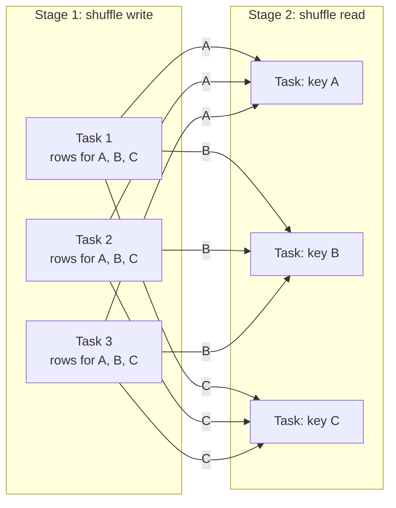

# Shuffles

Mastery: `INPUT[inlineSelect(option(new), option(learning), option(solid)):mastery]`

> [!story] Context
> [[Partitions]] let executors process data independently. Operations such as grouping and joining need all rows with the same key in one place, which requires moving data between executors. That movement is a shuffle.

> [!eli5] Summary
> Some operations need matching records together, such as all sales for the same store. Spark then sends records between computers so that matching records end up on the same one. This transfer is slow, so efficient Spark code minimizes it.

## Background

Some operations cannot run one partition at a time:

- **Grouping and aggregating** (`GROUP BY store`): all rows with the same key must be in the same partition.
- **Joining** two large tables on a key: matching keys from both sides must be in the same partition.
- **Sorting** a whole dataset, `DISTINCT`, window functions with `PARTITION BY`, and `repartition()`.

This is the same "shuffle and sort" phase that sat between map and reduce in [[MapReduce]]. Spark retains it, reduces its cost, and with [[Adaptive Query Execution]] adjusts it at runtime.

## Overview

A shuffle redistributes rows across partitions, usually by hashing a key, so that all rows with the same key end up in the same partition. It has two halves:

| Half | What happens | Where it shows in the Spark UI |
|---|---|---|
| **Shuffle write** (map side) | Each task in the upstream stage sorts or hashes its rows by destination partition and writes shuffle files to local disk. | "Shuffle Write" on the upstream stage |
| **Shuffle read** (reduce side) | Each task in the downstream stage fetches its blocks from every upstream executor over the network. | "Shuffle Read" on the downstream stage |

Why it is expensive: every row may be [[Serialization|serialized]], written to local disk, sent over the network, and deserialized again. With *M* upstream and *N* downstream partitions there can be *M × N* blocks to move. A shuffle is also a **stage boundary**: the next stage cannot start until the shuffle files it needs are written (see [[Jobs Stages and Tasks]]).

In a physical plan, a shuffle appears as an **`Exchange`** operator (`Exchange hashpartitioning(store, 200)`).

## How it works



The following example shows a shuffle and then removes one with a broadcast join:

```python
from pyspark.sql import functions as F

sales  = spark.range(0, 5_000_000).select(
            (F.col("id") % 50).alias("store_id"), (F.rand() * 100).alias("amount"))
stores = spark.range(0, 50).select(
            F.col("id").alias("store_id"), F.concat(F.lit("Store "), F.col("id")).alias("name"))

# 1. Aggregation: one shuffle (look for "Exchange hashpartitioning")
sales.groupBy("store_id").agg(F.sum("amount")).explain()

# 2. Join where both sides could be shuffled (sort-merge join)...
#    ...but 'stores' is tiny, so tell Spark to broadcast it instead: no shuffle of 'sales'
sales.join(F.broadcast(stores), "store_id").explain()
# Look for "BroadcastHashJoin" and "BroadcastExchange" instead of two Exchanges + SortMergeJoin
```

The same in SQL:

```sql
-- Hint a broadcast to avoid shuffling the big table
SELECT /*+ BROADCAST(s) */ s.name, SUM(o.amount) AS revenue
FROM main.default.orders o JOIN main.default.stores s USING (store_id)
GROUP BY s.name;
```

**Ways to shuffle less**

1. **Filter and select early**, so less data enters the shuffle. Catalyst does much of this, but it cannot drop rows your logic needs.
2. **Broadcast small tables** in joins. Spark does this automatically below a size threshold; [[Adaptive Query Execution]] can also switch to a broadcast at runtime once it sees the real size.
3. **Aggregate before joining** when you only need totals.
4. **Avoid needless `repartition()`, `distinct()`, and global `orderBy()`.**
5. **Handle skew**: let AQE split skewed partitions, or salt a hot key. Databricks' Spark UI guide also lists pre-aggregating, clustering the source table, and the `REBALANCE` hint.

## Small-business considerations

> [!smallbiz] Small-business considerations
> At small-business data sizes (millions, not billions, of rows), shuffles are rarely the problem, and AQE handles most of them. Look for them only when one step of a job is clearly the slow one. Common fixes: join to small lookup tables (products, stores, customers) as broadcasts, and do totals before joins.

> [!bridge]- In Databricks today
> Shuffles work as in open-source Spark, with more automation. [[Adaptive Query Execution]] is on by default and coalesces small shuffle partitions, converts joins to broadcasts at runtime, and splits skewed partitions. Databricks' Spark UI guide recommends auto-optimized shuffle partitions when a stage spills. [[Photon]] runs shuffles and joins in native code. For tables you join often, [[Liquid Clustering]] on the join key reduces the data that each query reads before the shuffle.

## Cloud differences

> [!note] No cloud differences
> Shuffle behavior is the same on Azure, AWS, and Google Cloud. Shuffle files go to the workers' local disks, so instance types with fast local SSDs help shuffle-heavy jobs on any cloud.

## Advanced topics

> [!deepdive]- Advanced topics (301–401)
> - **Join strategies:** Broadcast hash join (no shuffle of the large side), shuffle hash join (both sides shuffled, hash table built per partition), sort-merge join (both sides shuffled and sorted; the default for large-large joins), plus nested-loop strategies for non-equi joins.
> - **Skew detection in AQE:** Databricks documents that a partition is treated as skewed when it is larger than both a factor (5×) of the median partition size and a byte threshold (256 MB). AQE splits it into smaller tasks and, where needed, replicates the matching side. AQE handles skew only in shuffle-based joins, not broadcast joins. See [[Adaptive Query Execution]].
> - **Spill:** If a shuffle's sort or hash buffers exceed execution memory, Spark [[Spill|spills]] to disk. The stage page shows "Spill (Memory)" and "Spill (Disk)". Databricks lists fixes: auto-optimized shuffle partitions, holding less data in memory, larger-memory executors.
> - **Salting:** For a hot key, add a random suffix (`key || '_' || floor(rand()*8)`) on the large side, explode the small side to all suffixes, join, then aggregate away the salt. Use only when AQE skew handling is not enough.
> - **Shuffle reuse:** Shuffle files persist on executors while the application runs. If a later job needs the same shuffle, the stage shows as "skipped" in the Spark UI because its output is reused.
> - **Fetch failures:** Losing an executor loses its shuffle files, so downstream tasks fail with `FetchFailedException` and Spark re-runs the upstream stage. Frequent fetch failures often point to spot-instance loss or memory pressure.

## Common misconceptions

> [!confusion] A shuffle is not the same as `repartition()`
> `repartition()` causes a shuffle, but so do `groupBy`, `join`, `distinct`, and `orderBy`. Most shuffles come from those, not from explicit repartitioning.

> [!confusion] "Exchange" in a plan means shuffle
> Physical plans call a shuffle an `Exchange`. A `BroadcastExchange` is different: it sends a small table to every executor, which avoids shuffling the large one.

## Recall

What is a shuffle in Spark?::Redistributing rows across partitions (usually by key) so related rows end up together, which moves data between executors.
Name four operations that usually trigger a shuffle.::groupBy/aggregation, join (non-broadcast), distinct, orderBy (also repartition and window functions with PARTITION BY).
Why are shuffles expensive?::Rows are serialized, written to local disk, sent over the network, and read back, and the next stage must wait for them.
What operator represents a shuffle in a physical plan?::Exchange.
How does a broadcast join avoid a shuffle?::It copies the small table to every executor, so the large table is joined in place.
What is shuffle write vs shuffle read?::Write: upstream tasks write partitioned shuffle files. Read: downstream tasks fetch their blocks from all upstream executors.
What is salting?::Adding a random suffix to a hot key to spread its rows across several partitions, then removing it after the join or aggregation.

## Next steps

> [!path] Learning path
> **Needs first:** [[Partitions]], [[Transformations and Actions]], [[Driver and Executors]]
> **Unlocks next:** [[Jobs Stages and Tasks]], [[Adaptive Query Execution]], [[Spark UI]]

> [!nextup] Next
> [[Jobs Stages and Tasks]] covers how shuffles divide a query into stages and how Spark schedules the resulting tasks.

> [!sources]- Sources (last verified: 2026-10-25)
> - [Adaptive query execution (AWS)](https://docs.databricks.com/aws/en/optimizations/aqe)
> - [Skew and spill (AWS)](https://docs.databricks.com/aws/en/optimizations/spark-ui-guide/long-spark-stage-page)
> - [Skew and spill (Azure)](https://learn.microsoft.com/en-us/azure/databricks/optimizations/spark-ui-guide/long-spark-stage-page)
> - [Diagnosing a long job in Spark (AWS)](https://docs.databricks.com/aws/en/optimizations/spark-ui-guide/long-spark-stage)
> - [Spark memory issues (GCP)](https://docs.databricks.com/gcp/en/optimizations/spark-ui-guide/spark-memory-issues)
> - [Adaptive Query Execution: Speeding Up Spark SQL at Runtime (Databricks blog)](https://www.databricks.com/blog/2020/05/29/adaptive-query-execution-speeding-up-spark-sql-at-runtime.html)
> - [What is Photon? (AWS)](https://docs.databricks.com/aws/en/compute/photon)
