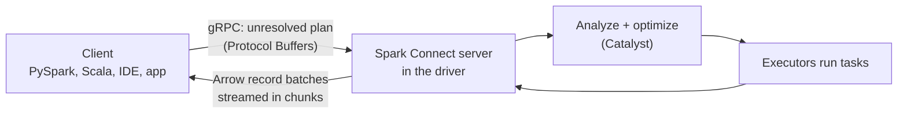

# Spark Connect

Mastery: `INPUT[inlineSelect(option(new), option(learning), option(solid)):mastery]`

> [!story] Context
> In the classic architecture described in [[Driver and Executors]], application code runs inside the driver process. Every client therefore needs a full Spark installation and a JVM, shares the driver's memory, and must match the server's Spark version. Spark Connect, introduced in Spark 3.4, separates the client from the server.

> [!eli5] Summary
> Spark Connect lets a small program on a laptop, in a code editor, or inside a web app send requests to a Spark engine running somewhere else, and get the answers back. The program does not need the full engine installed, and a problem in one program does not affect others using the same engine.

> [!analogy]- Analogy: ordering through a counter
> | Restaurant | Spark Connect |
> |---|---|
> | Customer writes an order on a slip | Client builds an unresolved logical plan |
> | Slip passed through the counter window | Plan sent over gRPC as Protocol Buffers |
> | Kitchen cooks the order | Server analyzes, optimizes, and executes the plan |
> | Food returned in containers | Results streamed back as Apache Arrow batches |

## Background

In Spark Classic, the client and the driver are the same process. This has several consequences:

- **Heavy clients.** Each application embeds the driver and its JVM. Python clients communicate with the JVM through Py4J.
- **Shared fate.** A memory-heavy operation in one user's code can crash the driver for everyone on a shared cluster.
- **Version coupling.** Client and cluster must run the same Spark version, so upgrades require upgrading every application.
- **Limited embedding.** Spark cannot easily be used from IDEs, notebooks outside the cluster, or applications in other languages.

Spark 3.4 introduced Spark Connect, a decoupled client-server architecture. Spark 4.0 added a lightweight Python client, a Spark Connect-enabled distribution, and the `spark.api.mode` setting to switch an application between Classic and Connect.

## Overview

Spark Connect is a protocol and server component that allows remote clients to use the DataFrame API with a Spark server.

| Aspect | Spark Classic | Spark Connect |
|---|---|---|
| Where client code runs | In the driver process | In a separate client process |
| Protocol | In-process (Py4J for Python) | gRPC; plans as Protocol Buffers, results as Apache Arrow |
| Supported APIs | DataFrame, SQL, RDD, `SparkContext` | DataFrame and SQL; no RDD API, no `SparkContext` |
| Analysis of plans | At each transformation (eager) | At execution on the server (deferred) |
| Client and server versions | Must match | Can be upgraded independently within compatibility rules |
| Authentication | Cluster-level | None built in; secured by a proxy or the platform |

The Spark documentation notes that Spark Connect does not support all Spark execution APIs, most importantly RDDs, and that clients cannot access static Spark configuration or `SparkContext`.

## How it works



1. The client builds a DataFrame as an **unresolved logical plan**. No data or schema lookups happen locally.
2. On an action, the client sends the plan to the server over gRPC.
3. The server converts it to Spark's logical operators and runs the normal analysis, optimization ([[Catalyst Optimizer]]), and execution path.
4. Results return as Apache Arrow record batches, streamed in partial chunks so large results do not exhaust memory.

Connecting to an open-source Spark Connect server (default port 15002):

```bash
# Start a local Spark Connect server from a Spark 4.x distribution
./sbin/start-connect-server.sh

# Install a Python client
pip install pyspark-client          # lightweight client (Spark 4.0+); or: pip install "pyspark[connect]"
```

```python
from pyspark.sql import SparkSession

spark = SparkSession.builder.remote("sc://localhost:15002").getOrCreate()
df = spark.range(10).selectExpr("id", "id * id AS square")
df.show()                     # plan is sent to the server; Arrow results come back
```

Connecting to Databricks compute with [[Databricks Connect]], which is built on Spark Connect:

```python
# pip install databricks-connect   (match the version to your Databricks Runtime)
from databricks.connect import DatabricksSession

spark = DatabricksSession.builder.serverless().getOrCreate()   # or .clusterId("...")
spark.read.table("samples.nyctaxi.trips").limit(5).show()
```

## Small-business considerations

> [!smallbiz] Small-business considerations
> Spark Connect is mostly invisible: it is the mechanism behind serverless notebooks and Databricks Connect. Two practical consequences for a small team:
> 1. **Write DataFrame and SQL code only.** Code that avoids RDDs and `spark.sparkContext` runs on [[Serverless Compute]], which removes cluster management.
> 2. **Develop locally.** With [[Databricks Connect]], you can write and debug PySpark in VS Code or PyCharm against Databricks compute, with no local Spark installation.

> [!bridge]- In Databricks today
> Spark Connect underpins several Databricks features. [[Serverless Compute]] for notebooks and jobs supports only Spark Connect APIs, and standard access mode clusters also run through it, which is why RDD APIs are unavailable there. [[Databricks Connect]] extends Spark Connect for Databricks Runtime 13.3 LTS and above, adding support for Databricks compute modes and [[Unity Catalog]]; Python serverless support in Databricks Connect reached GA with 17.3 LTS. Databricks documents behavior differences in "Compare Spark Connect to Spark Classic," including deferred analysis and name resolution.

## Cloud differences

> [!note] No cloud differences
> Spark Connect and Databricks Connect work the same on Azure, AWS, and Google Cloud. Authentication uses each workspace's normal methods (personal access tokens or [[OAuth]]); see [[Authentication - Tokens and OAuth]].

## Advanced topics

> [!deepdive]- Advanced topics (301–401)
> - **Deferred analysis.** Because the server analyzes plans only at execution, errors such as a missing column surface at the action, not at the transformation. Accessing `df.schema` or `df.columns` triggers a server round trip; cache the result in a variable inside loops.
> - **Temporary views and session state.** Temp views, UDFs, and SQL configurations live in the server session. A reconnecting client may get a new session and lose them.
> - **UDFs.** Python UDFs are serialized and executed on the server, so the server environment must contain the libraries the UDF imports.
> - **Version compatibility.** The Spark documentation states that applications can be forward-compatible as long as the server-side RPC definitions remain backward compatible. Databricks Connect requires a client version compatible with the target Databricks Runtime.
> - **Security.** Open-source Spark Connect has no built-in authentication. Because it uses gRPC over HTTP/2, an authenticating proxy can secure it. Databricks handles authentication at the platform level.

## Common misconceptions

> [!confusion] Spark Connect is not Databricks Connect
> **Spark Connect** is the open-source protocol in Apache Spark. **[[Databricks Connect]]** is Databricks' client library built on it, with additions for Databricks compute and Unity Catalog.

> [!confusion] Spark Connect does not make the client do the work
> The client only builds plans and receives results. All processing runs on the server and its executors.

## Recall

What is Spark Connect?::A client-server protocol that sends unresolved DataFrame plans from a thin client to a remote Spark server over gRPC and returns results as Arrow batches.
In which Spark version was Spark Connect introduced?::Spark 3.4.
What encoding does Spark Connect use for plans and for results?::Protocol Buffers for plans; Apache Arrow record batches for results.
Which major API does Spark Connect not support?::The RDD API (and SparkContext).
Why do Databricks serverless notebooks reject RDD code?::Serverless supports only Spark Connect APIs.
Why can a column-name error appear later on Spark Connect than on Spark Classic?::Spark Connect defers plan analysis and name resolution to execution time on the server.
What is Databricks Connect built on?::Spark Connect, for Databricks Runtime 13.3 LTS and above.
What setting in Spark 4.0 switches an application between Classic and Connect?::spark.api.mode.

## Next steps

> [!path] Learning path
> **Needs first:** [[Driver and Executors]], [[DataFrames]], [[Lazy Evaluation]]
> **Unlocks next:** [[Databricks Connect]], [[Serverless Compute]], [[Databricks Apps]]

> [!nextup] Next
> [[Spark UI]] covers the web interface for inspecting jobs, stages, tasks, and query plans, and how to use it to diagnose slow queries.

> [!sources]- Sources (last verified: 2026-10-25)
> - [Spark Connect overview (Spark 4.2)](https://spark.apache.org/docs/latest/spark-connect-overview.html)
> - [Spark Connect overview (Spark 3.5.6)](https://spark.apache.org/docs/3.5.6/spark-connect-overview.html)
> - [Application development with Spark Connect (Spark 4.2)](https://spark.apache.org/docs/latest/app-dev-spark-connect.html)
> - [Spark Release 4.0.0](https://spark.apache.org/releases/spark-release-4-0-0.html)
> - [Compare Spark Connect to Spark Classic (GCP)](https://docs.databricks.com/gcp/en/spark/connect-vs-classic)
> - [Databricks Connect (AWS)](https://docs.databricks.com/aws/en/dev-tools/databricks-connect)
> - [Advanced usage of Databricks Connect (AWS)](https://docs.databricks.com/aws/en/dev-tools/databricks-connect/advanced)
> - [Databricks Connect release notes (Azure)](https://learn.microsoft.com/en-us/azure/databricks/release-notes/dbconnect/)
> - [Serverless compute limitations (AWS)](https://docs.databricks.com/aws/en/compute/serverless/limitations)
> - [Standard compute requirements and limitations (Azure)](https://learn.microsoft.com/en-us/azure/databricks/compute/standard-limitations)
