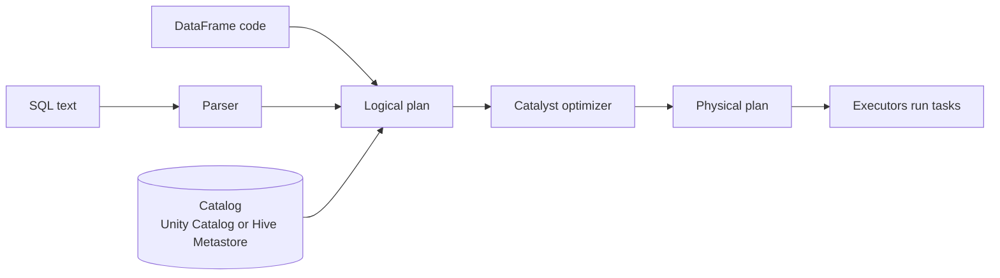

# Spark SQL

Mastery: `INPUT[inlineSelect(option(new), option(learning), option(solid)):mastery]`

> [!story] Context
> [[DataFrames]] give Spark data a tabular structure. [[SQL]] is the standard language for tables, and [[Apache Hive]] had brought SQL to Hadoop at [[MapReduce]] speed. Spark SQL runs SQL on Spark's engine.

> [!eli5] Summary
> Spark SQL lets you query very large datasets using SQL, the same language used with ordinary databases. Spark converts each query into work for many computers and returns the result as a table.

## Background

In the early 2010s, [[Apache Hive]] was the standard way to run SQL on Hadoop. It translated SQL into [[MapReduce]] jobs, so even simple queries took minutes. The AMPLab first built **Shark**, which ran Hive's query engine on Spark. Shark was much faster, but it was tied to Hive's internals, which were hard to optimize and hard to extend.

Spark SQL replaced Shark with a new design: its own SQL parser, its own optimizer (Catalyst), and tight integration with Spark programs. The SIGMOD 2015 paper *Spark SQL: Relational Data Processing in Spark* describes the design.

## Overview

Spark SQL is **the module that runs all structured work in Spark**, whether you write SQL or DataFrame code. It has four parts:

| Part | Job |
|---|---|
| **SQL parser** | Turns SQL text into a logical plan (a description of the steps needed, not yet how to run them) |
| **DataFrame API** | Builds the same kind of logical plan from code |
| **[[Catalyst Optimizer]]** | Rewrites the plan into a faster one |
| **Execution engine** | Runs the plan as tasks across the cluster ([[Tungsten]] code generation, or [[Photon]] on Databricks) |

It also includes a **catalog** that remembers table names, columns, and file locations. In [[Open Source|open-source]] Spark that is often the [[Hive Metastore]]. On Databricks it is [[Unity Catalog]].

Since Spark 4.0, Spark SQL follows the **ANSI SQL standard by default** (`spark.sql.ansi.enabled = true`), so errors such as dividing by zero or casting `'abc'` to a number raise an error instead of quietly returning `NULL`. Spark 4.1 made **SQL scripting** (variables, `IF`, loops inside SQL) generally available, and Spark 4.2 added clauses such as `QUALIFY` and a `CHANGES` clause for reading row-level changes.

## How it works



The following statements run as written. In a Databricks notebook, use a `%sql` cell; in plain PySpark, wrap it in `spark.sql("...")`.

```sql
-- Create a small table (a managed Delta table on Databricks)
CREATE OR REPLACE TABLE main.default.orders AS
SELECT * FROM VALUES
  (1, 'Main St', DATE'2026-10-01', 20.00),
  (2, 'Airport', DATE'2026-10-01', 55.00),
  (3, 'Main St', DATE'2026-10-02', 12.50),
  (4, 'Mall',    DATE'2026-10-02', 99.00)
AS t(order_id, store, order_day, amount);

-- Each store's best day (QUALIFY needs Databricks or open-source Spark 4.2+)
SELECT store, order_day, SUM(amount) AS revenue
FROM main.default.orders
GROUP BY store, order_day
QUALIFY ROW_NUMBER() OVER (PARTITION BY store ORDER BY SUM(amount) DESC) = 1;

-- Safe arithmetic under ANSI mode
SELECT try_divide(SUM(amount), COUNT(DISTINCT order_day)) AS avg_per_day
FROM main.default.orders;

-- See the plan Spark will run
EXPLAIN SELECT store, SUM(amount) FROM main.default.orders GROUP BY store;
```

Mixing SQL and Python in one program:

```python
top = spark.sql("""
    SELECT store, SUM(amount) AS revenue
    FROM main.default.orders GROUP BY store
""")
top.filter("revenue > 50").show()     # continue in DataFrame code
```

## Small-business considerations

> [!smallbiz] Small-business considerations
> Spark SQL is a direct entry point to Databricks for anyone who knows SQL from Excel Power Query, Access, or a reporting tool. You do not need Python. Your analyst can write SQL in the [[SQL Editor]] on a [[SQL Warehouses|SQL warehouse]] and connect Power BI or Tableau to the same tables. When a query is slow, run `EXPLAIN` or open the query profile before increasing the warehouse size.

> [!bridge]- In Databricks today
> Spark SQL is the engine under [[Databricks SQL]]. [[SQL Warehouses]] run Spark SQL with [[Photon]] on by default, tuned for many short [[BI Tools|BI]] queries, and BI tools connect over [[JDBC and ODBC]]. The catalog is [[Unity Catalog]] instead of a Hive metastore, so table names use the [[Three-Level Namespace]] `catalog.schema.table`. Databricks SQL adds its own functions and features on top, such as [[AI Functions in SQL]] and [[Metric Views]]. Old Hive SQL mostly runs unchanged; see [[Hive Metastore Migration to Unity Catalog]] for moving the tables.

## Cloud differences

> [!note] No cloud differences
> Spark SQL syntax and behavior are the same on Azure, AWS, and Google Cloud. Differences are only in storage paths for external tables and in which BI tools are most common (Power BI on Azure; see [[Power BI on Azure Databricks]]).

## Advanced topics

> [!deepdive]- Advanced topics (301–401)
> - **One engine, no speed difference.** A SQL query and the equivalent DataFrame code produce the same optimized plan. Choose by readability, not performance.
> - **ANSI migration.** When upgrading code written for Spark 3.x, ANSI mode is the most common source of new errors. You can set `spark.sql.ansi.enabled = false` for a session while you fix the code, but the long-term fix is `try_cast`, `try_divide`, and similar functions.
> - **Hints.** `/*+ BROADCAST(t) */`, `/*+ REPARTITION(n) */`, `/*+ REBALANCE */` and others steer the planner. A `BROADCAST` hint overrides `spark.sql.autoBroadcastJoinThreshold` (10 MB by default). See [[Broadcast Join]].
> - **Thrift server.** Open-source Spark ships a JDBC/ODBC Thrift server so BI tools can send SQL to a Spark cluster. Databricks replaces it with SQL warehouses and its own drivers.
> - **Semi-structured data.** The `VARIANT` type (added in 4.0, GA in 4.1 with shredding) stores JSON efficiently and is queried with functions such as `variant_get` (Databricks also offers path syntax such as `payload:customer.id`).

## Common misconceptions

> [!confusion] Spark SQL is not a separate database
> Spark SQL has no storage of its own. Tables are files (usually [[Delta Lake]] or [[Apache Parquet]]) plus an entry in a catalog.

> [!confusion] Spark SQL vs Databricks SQL
> **Spark SQL** is the open-source module. **[[Databricks SQL]]** is Databricks' product for analysts and BI (SQL warehouses, editor, dashboards) built on Spark SQL and Photon.

## Recall

What is Spark SQL?::The Spark module that runs all structured work, whether written as SQL or DataFrame code, through the Catalyst optimizer.
What did Spark SQL replace?::Shark, and more broadly Apache Hive on MapReduce, as the way to run SQL on big data.
Which Spark version made ANSI SQL mode the default?::Spark 4.0.
Is a SQL query faster or slower than the same DataFrame code?::Neither; both compile to the same optimized plan.
How do you run SQL from PySpark?::spark.sql("SELECT ...") returns a DataFrame.
What catalog does Spark SQL use on Databricks?::Unity Catalog (the legacy Hive metastore appears as the hive_metastore catalog).
What Databricks product is built on Spark SQL for analysts and BI?::Databricks SQL, running on SQL warehouses with Photon.

## Next steps

> [!path] Learning path
> **Needs first:** [[SQL]], [[DataFrames]], [[Apache Hive]]
> **Unlocks next:** [[Catalyst Optimizer]], [[Databricks SQL]], [[SQL Editor]]

> [!nextup] Next
> [[Catalyst Optimizer]] covers how Spark SQL rewrites each query plan into a more efficient one.

> [!sources]- Sources (last verified: 2026-10-25)
> - [Spark SQL: Relational Data Processing in Spark (SIGMOD 2015)](https://people.csail.mit.edu/matei/papers/2015/sigmod_spark_sql.pdf)
> - [Spark Release 4.0.0](https://spark.apache.org/releases/spark-release-4-0-0.html)
> - [Spark Release 4.1.0](https://spark.apache.org/releases/spark-release-4.1.0.html)
> - [Spark Release 4.2.0](https://spark.apache.org/releases/spark-release-4-2-0.html)
> - [Hints (Spark 4.2)](https://spark.apache.org/docs/latest/sql-ref-syntax-qry-select-hints.html)
> - [Performance tuning (Spark 4.2)](https://spark.apache.org/docs/latest/sql-performance-tuning.html)
> - [What is Photon? (AWS)](https://docs.databricks.com/aws/en/compute/photon)
> - [Spark research page](https://spark.apache.org/research.html)
