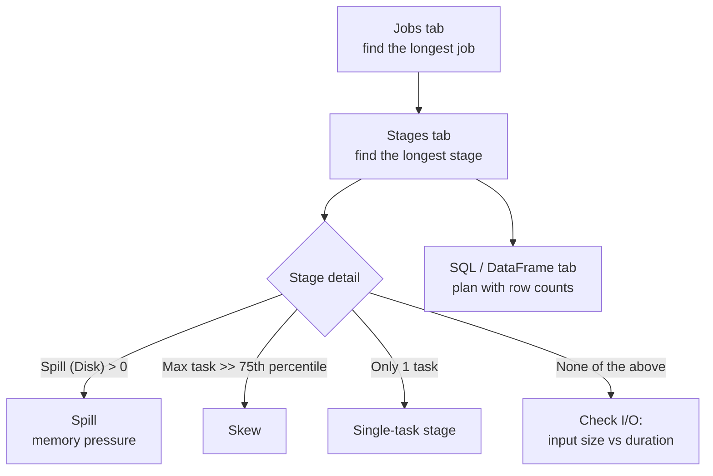

# Spark UI

Mastery: `INPUT[inlineSelect(option(new), option(learning), option(solid)):mastery]`

> [!story] Context
> [[Jobs Stages and Tasks]] described how Spark divides work, and [[Shuffles]], [[Data Skew|skew]], and [[Spill|spill]] described what makes it slow. The Spark UI is where those concepts become visible for a specific query.

> [!eli5] Summary
> The Spark UI is a web page that every Spark program creates while it runs. It shows each piece of work, how long it took, and how much data it moved, so you can find the step that is slowing everything down.

## Background

A distributed job can be slow for many reasons: too little parallelism, one oversized partition, memory pressure, a large shuffle, or slow storage reads. Logs alone do not show which. Spark's driver records metrics for every job, stage, and task and serves them through a web interface, the Spark UI. After an application ends, the Spark History Server can display the same pages from saved event logs.

## Overview

The Spark UI is organized into tabs:

| Tab | What it shows | Use it to |
|---|---|---|
| **Jobs** | Each job (one per action), with an event timeline, duration, and stage counts | Find the slowest job; see executors being added or removed |
| **Stages** | Each stage, with task counts, input, output, shuffle read/write, and spill | Find the longest stage and check its data volumes |
| **Stage detail** | Summary metrics (min, 25th, median, 75th, max) per task metric, plus a per-task table | Detect skew, spill, GC pressure, and stragglers |
| **Storage** | Cached DataFrames/RDDs, size in memory and on disk | Confirm that `cache()` worked and what it costs |
| **Environment** | Spark properties, JVM and system settings | Verify configuration values in effect |
| **Executors** | Each executor's cores, memory, task counts, GC time, failures, logs, and thread dumps | Find unhealthy or overloaded executors |
| **SQL / DataFrame** | Each query with its plan graph, per-operator metrics, and linked jobs | Read the physical plan with real row counts and timings |
| **Structured Streaming** | Each streaming query's input rate, processing rate, and batch durations | Check whether a stream keeps up with its input |

Spark 4.2 introduced a modernized Spark Web UI with a dark mode.

## How it works



### Opening the Spark UI

| Environment | How to open it |
|---|---|
| Local PySpark | Open the URL printed at startup, or `spark.sparkContext.uiWebUrl` (typically `http://localhost:4040`) |
| Databricks notebook (classic compute) | Expand **Spark Jobs** under a cell's output and select a job's **View** link, or open the compute resource and select the **Spark UI** tab |
| Databricks job run (classic compute) | Open the run, then the compute's **Spark UI** |
| Databricks serverless | The Spark UI is not available; use the query profile from the query history |

### Diagnostic procedure

The Databricks guide "Diagnose cost and performance issues using the Spark UI" uses this order:

1. **Jobs tab:** Review the event timeline. Gaps between jobs indicate driver-side work (Python code, planning, or collecting results), not cluster work.
2. **Longest stage:** Open the longest job, then its longest stage.
3. **Spill:** At the top of the stage page, check **Spill (Memory)** and **Spill (Disk)**. Spill means execution memory (used for shuffles, joins, sorts, and aggregations) was exhausted.
4. **Skew:** In **Summary Metrics**, compare **Max** task duration with the **75th percentile**. Databricks suggests that a max 50% or more above the 75th percentile may indicate skew.
5. **Single task:** A stage with one task is a warning sign. Listed causes include a window function without `PARTITION BY`, an unsplittable gzip file, and `coalesce(1)`.
6. **I/O:** If none of the above applies, compare input size and duration to determine whether the stage is I/O bound.
7. **Executors:** If executors are removed and tasks retried, check for out-of-memory errors (see Databricks' "Spark memory issues" page).

### Example: produce and read a skewed stage

```python
from pyspark.sql import functions as F

# 90% of rows share key 0
df = spark.range(0, 20_000_000).withColumn(
    "k", F.when(F.rand() < 0.9, F.lit(0)).otherwise((F.rand() * 1000).cast("int")))

spark.conf.set("spark.sql.adaptive.enabled", "false")   # disable AQE to make skew visible
other = spark.range(0, 1000).withColumnRenamed("id", "k")
spark.conf.set("spark.sql.autoBroadcastJoinThreshold", "-1")   # force a shuffle join
df.join(other, "k").groupBy("k").count().collect()
```

In the Spark UI, the join stage's **Summary Metrics** show a **Max** duration far above the **75th percentile**, and the task table shows one task with most of the shuffle read. Re-enable AQE (`spark.sql.adaptive.enabled = true`) and rerun: the SQL / DataFrame tab then shows the skewed partition split into several tasks. Reset both settings afterwards:

```python
spark.conf.unset("spark.sql.adaptive.enabled")
spark.conf.unset("spark.sql.autoBroadcastJoinThreshold")
```

### Reading the SQL / DataFrame tab

Each node in the plan graph corresponds to a physical operator and shows metrics such as **number of output rows**, **time**, **data size**, and **spill size**. Compare row counts between adjacent nodes to find the operator where data explodes (for example, a join that multiplies rows) or where a filter fails to reduce data. `WholeStageCodegen` boxes group fused operators ([[Tungsten]]); `Exchange` nodes are [[Shuffles|shuffles]]; `AQEShuffleRead` nodes show [[Adaptive Query Execution]] changes.

## Small-business considerations

> [!smallbiz] Small-business considerations
> Open the Spark UI when a scheduled job is slower or more expensive than expected. Steps 2 to 5 of the diagnostic procedure identify most problems in a few minutes. On [[Serverless Compute]], use the query profile instead. Compute cost is driven by run time, so a fix found here reduces cost directly; see [[Cost Optimization Checklist]].

> [!bridge]- In Databricks today
> Classic Databricks compute exposes the standard Spark UI, linked from notebook cells and from each compute resource, along with driver logs and compute metrics. Databricks publishes a step-by-step Spark UI diagnostic guide (skew and spill, single-task stages, memory issues, and debugging with thread dumps from the **Executors** tab). [[Serverless Compute]] does not provide the Spark UI; query history and the query profile serve that role. [[SQL Warehouses]] also use the query profile. For account-wide trends rather than single queries, use [[System Tables]].

## Cloud differences

> [!note] No cloud differences
> The Spark UI and the Databricks diagnostic guide are the same on Azure, AWS, and Google Cloud. Azure Databricks can additionally send diagnostic logs to Azure Monitor; see [[Azure Monitor and Diagnostic Logs]].

## Advanced topics

> [!deepdive]- Advanced topics (301–401)
> - **Thread dumps:** For a hanging or slow task, find its task ID and executor ID in the stage's task table, then open that executor's thread dump from the **Executors** tab. Repeated dumps showing the same stack identify where the task is stuck.
> - **Task metrics:** *Scheduler delay* indicates waiting for a slot or for task data to be sent. High *GC time* relative to task time indicates memory pressure. *Shuffle read blocked time* indicates waiting on remote executors or the network.
> - **Event timeline:** Long periods with few active tasks indicate low parallelism (too few partitions) or driver-side work between jobs.
> - **History Server:** In open-source Spark, set `spark.eventLog.enabled=true` and `spark.eventLog.dir`, then run the History Server (typically on port 18080) to view finished applications.
> - **Skipped stages:** Stages marked "skipped" reused shuffle output from an earlier job; this is expected.

## Common misconceptions

> [!confusion] Job duration is not the same as cluster time
> A notebook cell can take minutes while the Jobs tab shows short jobs. The difference is driver-side work: Python code, planning, or `toPandas()` collection.

> [!confusion] The Spark UI is not available on serverless
> Serverless compute does not expose the Spark UI. Use the query profile for per-query details.

## Recall

What is the Spark UI?::A web interface served by the Spark driver that shows jobs, stages, tasks, storage, environment, executors, and SQL plans for an application.
Which tab shows physical plans with per-operator row counts?::The SQL / DataFrame tab.
How do you check a stage for skew in the Spark UI?::Compare the Max task duration with the 75th percentile in Summary Metrics; a max 50% or more higher may indicate skew.
Where do you see spill?::On the stage page, as Spill (Memory) and Spill (Disk).
Name a cause of a stage with only one task.::A window function without PARTITION BY, an unsplittable gzip file, or coalesce(1).
Is the Spark UI available on Databricks serverless compute?::No; use query history and the query profile.
What do gaps between jobs in the event timeline usually indicate?::Driver-side work such as Python code, planning, or collecting results.
Where do you find an executor's thread dump?::In the Executors tab.

## Next steps

> [!path] Learning path
> **Needs first:** [[Jobs Stages and Tasks]], [[Shuffles]], [[Driver and Executors]]
> **Unlocks next:** [[Query Performance and Caching]], [[Cost Optimization Checklist]]

> [!nextup] Next
> Spark addressed processing speed but not storage reliability or governance. [[Chapter 04 - The Modern Data Stack]] covers the data warehouses, data lakes, and tools that formed around Spark, and the two-tier architecture they produced.

> [!sources]- Sources (last verified: 2026-10-25)
> - [Diagnose cost and performance issues using the Spark UI (AWS)](https://docs.databricks.com/aws/en/optimizations/spark-ui-guide/)
> - [Diagnosing a long job in Spark (AWS)](https://docs.databricks.com/aws/en/optimizations/spark-ui-guide/long-spark-stage)
> - [Skew and spill (AWS)](https://docs.databricks.com/aws/en/optimizations/spark-ui-guide/long-spark-stage-page)
> - [Skew and spill (Azure)](https://learn.microsoft.com/en-us/azure/databricks/optimizations/spark-ui-guide/long-spark-stage-page)
> - [Skew and spill (GCP)](https://docs.databricks.com/gcp/en/optimizations/spark-ui-guide/long-spark-stage-page)
> - [Long Spark stage with one task (AWS)](https://docs.databricks.com/aws/en/optimizations/spark-ui-guide/one-spark-task)
> - [Spark memory issues (GCP)](https://docs.databricks.com/gcp/en/optimizations/spark-ui-guide/spark-memory-issues)
> - [Debugging with the Spark UI (AWS)](https://docs.databricks.com/aws/en/compute/troubleshooting/debugging-spark-ui)
> - [Debugging with the Spark UI (Azure)](https://learn.microsoft.com/en-us/azure/databricks/compute/troubleshooting/debugging-spark-ui)
> - [Serverless compute limitations (AWS)](https://docs.databricks.com/aws/en/compute/serverless/limitations)
> - [Spark Release 4.2.0](https://spark.apache.org/releases/spark-release-4-2-0.html)
