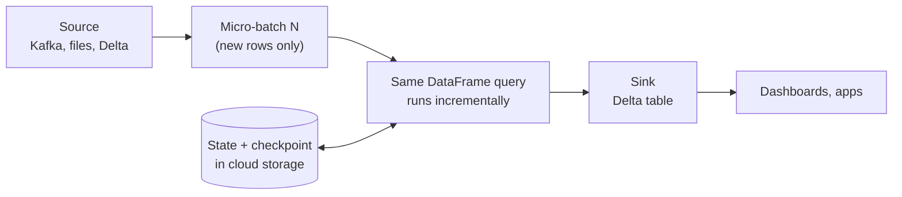

# Structured Streaming

Mastery: `INPUT[inlineSelect(option(new), option(learning), option(solid)):mastery]`

> [!story] Context
> [[PySpark]] and [[DataFrames]] process data that already exists. Many sources produce data continuously, such as transactions, clicks, and sensor readings (see [[Batch vs Streaming]]). Structured Streaming runs DataFrame queries incrementally on that data.

> [!eli5] Summary
> Structured Streaming keeps a query's result up to date as new data arrives. You write the query once, and Spark processes only the new records each time, without starting over or counting records twice.

## Background

Spark's first streaming library (Spark Streaming, or DStreams) divided streams into small RDD batches and used a separate API from batch code.

Structured Streaming, introduced with Spark 2.0, replaced that model with one idea: **a stream is a table that keeps growing.** You write a normal DataFrame or SQL query, and Spark runs it incrementally. The same code can run as a batch job or a stream.

## Overview

Structured Streaming is a streaming engine built on the [[Spark SQL]] engine. Its building blocks:

| Piece | What it is | Common choices |
|---|---|---|
| **Source** | Where events come from | [[Apache Kafka]], Azure Event Hubs, Amazon Kinesis, files, [[Delta Lake]] tables, [[Auto Loader]] on Databricks |
| **Query** | Ordinary DataFrame or SQL transformations | `select`, `filter`, `groupBy(window(...))`, joins |
| **Sink** | Where results go | Delta tables, Kafka, `foreachBatch` for custom writes |
| **Trigger** | When to run | Default micro-batches back to back; a fixed interval; *available now* (process everything available, then stop); real-time mode |
| **Output mode** | What gets written each time | *Append* (new rows only), *Update* (changed rows), *Complete* (whole result) |
| **Checkpoint** | Saved progress and state | A folder in cloud storage per query |

With replayable sources, idempotent sinks such as Delta, and a checkpoint, Structured Streaming provides [[Exactly-Once Processing|exactly-once]] results end to end.

**Real-time mode.** By default the engine processes data in micro-batches, which typically gives latencies from around a second upward. Spark 4.1 added a real-time mode for sub-second, operational workloads. On Databricks, real-time mode requires Databricks Runtime 16.4 LTS or above, classic compute, and update output mode; Databricks says it can reach end-to-end latency as low as about five milliseconds. The Azure Databricks documentation labels it Public Preview; check its current status before relying on it.

## How it works



A runnable example using the built-in `rate` test source (no Kafka needed):

```python
from pyspark.sql import functions as F

# 1. Source: generates (timestamp, value) rows, 10 per second
events = (spark.readStream.format("rate").option("rowsPerSecond", 10).load()
               .withColumn("store", (F.col("value") % 3).cast("string")))

# 2. Query: revenue per store per 1-minute window, tolerate 2 minutes of lateness
per_minute = (events
    .withWatermark("timestamp", "2 minutes")
    .groupBy(F.window("timestamp", "1 minute"), "store")
    .agg(F.count("*").alias("orders")))

# 3. Sink: a Delta table, with a checkpoint so restarts resume exactly
query = (per_minute.writeStream
    .format("delta")
    .outputMode("append")                       # emit each window once it is final
    .option("checkpointLocation", "/Volumes/main/default/checkpoints/per_minute")
    .trigger(processingTime="30 seconds")
    .toTable("main.default.orders_per_minute"))

# Later: query.status, query.lastProgress, query.stop()
```

For a scheduled job that should process everything new and then stop (cheap "streaming in batches"), swap the trigger:

```python
.trigger(availableNow=True)
```

And the same pipeline in SQL with a streaming table on Databricks:

```sql
CREATE OR REFRESH STREAMING TABLE main.default.raw_orders
AS SELECT * FROM STREAM read_files('/Volumes/main/default/landing/orders/', format => 'json');
```

## Small-business considerations

> [!smallbiz] Small-business considerations
> Most small businesses do not need second-by-second data. A common, cost-effective pattern is **incremental batch**: a Structured Streaming query with `availableNow` run every hour or every night as a job. You get exactly-once processing of only the new files or events, without compute running continuously. Move to continuous streaming or real-time mode only when a person or system actually acts on the data within minutes.

> [!bridge]- In Databricks today
> Structured Streaming is the engine behind streaming on Databricks: [[Auto Loader]] for files, [[Streaming Tables]] and [[Lakeflow Spark Declarative Pipelines]] for declarative pipelines, and [[Lakeflow Connect]] for managed ingestion. Databricks adds real-time mode (DBR 16.4 LTS+), with Kafka, Event Hubs, Kinesis, and AWS MSK as sources. Real-time mode is not supported for direct queries on [[Serverless Compute]]. See [[Structured Streaming on Databricks]] for the platform details.

## Cloud differences

The engine is the same everywhere. The common event services differ:

> [!azure]- Azure Databricks
> Azure Event Hubs is the usual event source (it also offers a Kafka-compatible endpoint). Real-time mode supports Event Hubs as a source and sink. Checkpoints live in ADLS Gen2 or a Unity Catalog volume.

> [!aws]- Databricks on AWS
> Amazon Kinesis and Amazon MSK (managed Kafka) are the usual sources; real-time mode supports both. Checkpoints live in S3 or a volume.

> [!gcp]- Databricks on Google Cloud
> Kafka (self-managed or a managed Kafka service) is the usual source; Google Pub/Sub can be read with a connector. Checkpoints live in GCS or a volume. Real-time mode's documented source list does not name a Google-native service.

## Advanced topics

> [!deepdive]- Advanced topics (301–401)
> - **State.** Aggregations, deduplication, and stream-stream joins keep state between batches. Without a watermark, state grows forever. On Databricks, the RocksDB state store keeps large state off the JVM heap.
> - **Output mode rules.** Append needs results that never change (windowed aggregations with a watermark, or no aggregation). Complete keeps the entire result, so it only suits small aggregations. Update emits only changed rows and is the mode real-time mode requires.
> - **Checkpoints are tied to the query.** Changing the query's shape (adding an aggregation, changing keys) can make an old checkpoint incompatible. Plan for a new checkpoint and a [[Backfill|backfill]] when you change logic.
> - **`foreachBatch`.** Gives you each micro-batch as a normal DataFrame, so you can `MERGE` into a Delta table (upserts), write to several sinks, or call APIs. Make it idempotent, since a batch can be retried.
> - **Real-time mode mechanics.** Databricks describes long-running batches (five minutes by default) with all stages scheduled at once and a streaming shuffle between them, which means you need enough task slots for every task. Photon and autoscaling must be off, and spot instances are discouraged.

## Common misconceptions

> [!confusion] Structured Streaming is not Spark Streaming (DStreams)
> DStreams is the older RDD-based API. Structured Streaming is the DataFrame-based engine you should use for all new work.

> [!confusion] "Streaming" does not mean "always on"
> With `availableNow`, a streaming query processes what is new and shuts down. Many production "streams" run this way on a schedule.

## Recall

What is the core idea of Structured Streaming?::Treat a stream as an unbounded table that keeps growing, and run ordinary DataFrame or SQL queries on it incrementally.
What three output modes does Structured Streaming have?::Append, Update, and Complete.
What does trigger(availableNow=True) do?::Processes all data available at start, in one or more batches, then stops the query.
What is a checkpoint used for in streaming?::Storing progress and state so a restarted query resumes exactly where it stopped.
What does a watermark do?::Tells Spark how late data can arrive, so it can finalize windows and drop old state.
Which Spark version introduced real-time mode for Structured Streaming?::Spark 4.1.
What does Databricks real-time mode require?::Databricks Runtime 16.4 LTS or above, classic compute, update output mode (Photon and autoscaling off).
What old streaming API did Structured Streaming replace?::Spark Streaming (DStreams), based on RDDs.

## Next steps

> [!path] Learning path
> **Needs first:** [[Batch vs Streaming]], [[DataFrames]], [[PySpark]]
> **Unlocks next:** [[Structured Streaming on Databricks]], [[Auto Loader]], [[Streaming Tables]]

> [!nextup] Next
> [[MLlib]] covers Spark's library for distributed machine learning.

> [!sources]- Sources (last verified: 2026-10-25)
> - [Structured Streaming concepts (AWS)](https://docs.databricks.com/aws/en/structured-streaming/concepts)
> - [Real-time mode concepts (AWS)](https://docs.databricks.com/aws/en/structured-streaming/real-time/concepts)
> - [Real-time mode reference (AWS)](https://docs.databricks.com/aws/en/structured-streaming/real-time/reference)
> - [Set up real-time mode (AWS)](https://docs.databricks.com/aws/en/structured-streaming/real-time/setup)
> - [Real-time mode in Structured Streaming (Azure)](https://learn.microsoft.com/en-us/azure/databricks/structured-streaming/real-time/)
> - [Get started with real-time mode (Azure)](https://learn.microsoft.com/en-us/azure/databricks/structured-streaming/real-time-get-started)
> - [Real-time mode in Structured Streaming (GCP)](https://docs.databricks.com/gcp/en/structured-streaming/real-time/concepts)
> - [Introducing Apache Spark 2.0 (Databricks blog)](https://www.databricks.com/blog/2016/07/26/introducing-apache-spark-2-0.html)
> - [Structured Streaming programming guide (Spark 4.2)](https://spark.apache.org/docs/latest/streaming/apis-on-dataframes-and-datasets.html)
> - [Structured Streaming programming guide (Spark 3.5.6)](https://spark.apache.org/docs/3.5.6/structured-streaming-programming-guide.html)
> - [DataStreamWriter.trigger (PySpark 4.2)](https://spark.apache.org/docs/latest/api/python/reference/pyspark.ss/api/pyspark.sql.streaming.DataStreamWriter.trigger.html)
> - [Spark Release 4.1.0](https://spark.apache.org/releases/spark-release-4.1.0.html)
