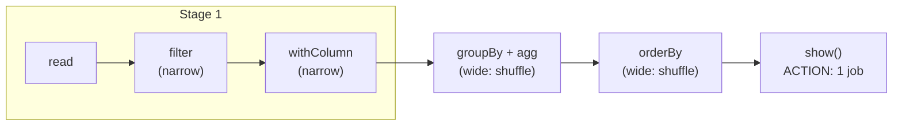

# Transformations and Actions

Mastery: `INPUT[inlineSelect(option(new), option(learning), option(solid)):mastery]`

> [!story] Context
> [[Lazy Evaluation]] requires Spark to distinguish operations that describe work from operations that request a result. These are transformations and actions.

> [!eli5] Summary
> Some Spark instructions describe what to do with the data, such as keeping only certain rows. Others ask for a result, such as a count or a saved table. Only the second kind makes Spark do the work.

## Background

The split is what makes Spark's planning possible. Because transformations only describe work, Spark can collect a long chain of them and optimize it before running. Because actions are explicit, you control *when* the cluster spends time and money. In [[MapReduce]], by contrast, each job ran as soon as it was submitted, so there was no chance to plan across steps.

## Overview

| | Transformation | Action |
|---|---|---|
| **Returns** | A new DataFrame (or RDD) | A value, a printout, or files written |
| **Runs work?** | No, adds to the plan | Yes, runs the plan |
| **Examples (DataFrame)** | `select`, `filter`/`where`, `withColumn`, `join`, `groupBy().agg()`, `orderBy`, `distinct`, `union`, `repartition` | `show`, `display`, `count`, `collect`, `take`, `first`, `toPandas`, `write...save/saveAsTable`, `foreach` |
| **Shows up in Spark UI** | Inside a job's stages | As a new job |

Transformations come in two shapes:

- **Narrow:** each output [[Partitions|partition]] depends on one input partition. `select`, `filter`, `withColumn`, `map`. Spark chains many narrow steps into one stage and runs them in a single pass.
- **Wide:** an output partition needs rows from many input partitions. `groupBy`, `join` (unless broadcast), `distinct`, `orderBy`, `repartition`. These require a [[Shuffles|shuffle]] and create a stage boundary.

## How it works



In the following example, each line is labeled as a transformation (T) or an action (A):

```python
from pyspark.sql import functions as F

orders = spark.createDataFrame(
    [(1, "Main St", 20.0, "2026-10-01"), (2, "Airport", 55.0, "2026-10-01"),
     (3, "Main St", 12.5, "2026-10-02"), (4, "Mall",    99.0, "2026-10-02")],
    ["id", "store", "amount", "day"])

big    = orders.filter(F.col("amount") > 15)                 # T (narrow)
taxed  = big.withColumn("with_tax", F.col("amount") * 1.08)  # T (narrow)
totals = taxed.groupBy("store").agg(F.sum("with_tax").alias("total"))  # T (wide)
ranked = totals.orderBy(F.desc("total"))                     # T (wide)

ranked.show()            # A -> job 1
print(ranked.count())    # A -> job 2 (re-runs everything unless cached)
ranked.write.mode("overwrite").saveAsTable("main.default.store_totals")  # A -> job 3
```

Three actions mean three runs of the plan. If the source is large, add `ranked.cache()` before the first action, or better, write once and read the saved table.

In SQL, every statement you run is effectively an action. `CREATE VIEW` is the closest thing to a pure transformation: it saves a plan and computes nothing.

```sql
CREATE OR REPLACE TEMP VIEW big_orders AS            -- like a transformation
SELECT * FROM VALUES (1,'Main St',20.0),(2,'Airport',55.0) AS t(id, store, amount)
WHERE amount > 15;

SELECT store, SUM(amount) FROM big_orders GROUP BY store;  -- runs: like an action
```

## Small-business considerations

> [!smallbiz] Small-business considerations
> Use **`collect()` and `toPandas()`** with care. They pull every result row into one machine (the [[Driver and Executors|driver]]), and on large tables they can exhaust its memory. Use `display()` or `show()` to look at a sample, `limit(1000).toPandas()` if you need pandas, and `write` to save full results to a table.

> [!bridge]- In Databricks today
> The same split applies everywhere in Databricks. In notebooks, `display(df)` is an action that renders a table or chart. In [[Lakeflow Spark Declarative Pipelines]], you only write transformations (the queries that define each table) and the pipeline engine decides when to run them. On [[Serverless Compute]], which runs through [[Spark Connect]], each action becomes a request from your notebook to the server, and results stream back as Arrow batches.

## Cloud differences

> [!note] No cloud differences
> Transformations and actions are part of the Spark API and work the same on Azure, AWS, and Google Cloud.

## Advanced topics

> [!deepdive]- Advanced topics (301–401)
> - **One action can create several jobs:** Some operations, such as `orderBy` (which samples to choose range boundaries) or reading with schema inference, start extra small jobs. With [[Adaptive Query Execution]], a query may also show several jobs as it re-plans after each shuffle.
> - **Narrow chains fuse:** Consecutive narrow transformations in a stage are pipelined, and with whole-stage code generation ([[Tungsten]]) they may compile into one Java function.
> - **`repartition` vs `coalesce`:** `repartition(n)` is a wide transformation (full shuffle). `coalesce(n)` merges partitions without a shuffle, so it is narrow, but reducing to very few partitions also reduces parallelism for the steps before it.
> - **`foreachBatch` in streaming:** In [[Structured Streaming]], `writeStream.start()` is the action; inside `foreachBatch` you can run ordinary batch actions on each micro-batch.

## Common misconceptions

> [!confusion] `display()` is not free
> In a notebook, `display(df)` looks like a peek, but it is an action that runs the plan (usually limited to the first rows). Running it on every cell of a large pipeline multiplies compute time.

> [!confusion] Wide does not mean "many columns"
> "Wide transformation" refers to data moving between partitions, not to the number of columns.

## Recall

What is a transformation in Spark?::An operation that returns a new DataFrame or RDD and only adds a step to the plan, without running anything.
What is an action in Spark?::An operation that returns a result or writes data, which triggers execution of the plan.
Is groupBy a transformation or an action?::A (wide) transformation.
Is count() a transformation or an action?::An action.
What makes a transformation "wide"?::Output partitions need data from many input partitions, so a shuffle is required.
Why can collect() crash a notebook?::It pulls every row of the result into the driver's memory.
If you call two actions on the same uncached DataFrame, how many times is the plan computed?::Twice, once per action.

## Next steps

> [!path] Learning path
> **Needs first:** [[Lazy Evaluation]], [[RDDs]]
> **Unlocks next:** [[DataFrames]], [[Shuffles]], [[Jobs Stages and Tasks]]

> [!nextup] Next
> [[DataFrames]] covers the table-based API that replaced RDDs as the primary way to write transformations.

> [!sources]- Sources (last verified: 2026-10-25)
> - [Resilient Distributed Datasets (USENIX NSDI 2012)](https://www.usenix.org/conference/nsdi12/technical-sessions/presentation/zaharia)
> - [Spark Connect overview (Spark 4.2)](https://spark.apache.org/docs/latest/spark-connect-overview.html)
> - [Compare Spark Connect to Spark Classic (GCP)](https://docs.databricks.com/gcp/en/spark/connect-vs-classic)
> - [Performance tuning (Spark 4.2)](https://spark.apache.org/docs/latest/sql-performance-tuning.html)
> - [Spark Declarative Pipelines programming guide (Spark 4.2)](https://spark.apache.org/docs/latest/declarative-pipelines-programming-guide.html)
