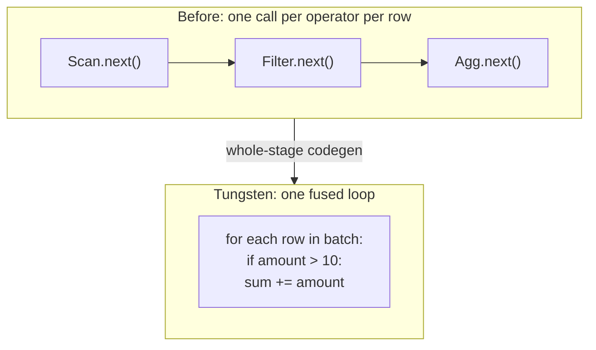

# Tungsten

Mastery: `INPUT[inlineSelect(option(new), option(learning), option(solid)):mastery]`

> [!story] Context
> The [[Catalyst Optimizer]] produces efficient plans. By 2015, CPU and memory overhead on the [[JVM]], rather than disk or network I/O, limited many Spark workloads. Project Tungsten addressed that overhead.

> [!eli5] Summary
> Tungsten is a set of improvements to how Spark uses a computer's memory and processor. It stores data more compactly and generates custom code for each query so the processor spends less time on overhead.

## Background

Databricks' 2015 Tungsten announcement argued that for many Spark workloads, CPU and memory efficiency, not disk or network I/O, had become the main limit. Three sources of JVM overhead were significant:

- **Object overhead.** A Java object for a short string can use several times more memory than the characters themselves, which wastes cache and memory.
- **Garbage collection.** Millions of short-lived row objects make the JVM garbage collector pause the program.
- **Virtual function calls.** The classic "Volcano" execution model calls `next()` on each operator for each row. Each call is cheap, but billions of unpredictable virtual calls carry a measurable cost.

## Overview

**Project Tungsten** was a multi-release effort, announced by Databricks in April 2015, to bring Spark "closer to bare metal." It had three parts:

| Part | What it does | Arrived |
|---|---|---|
| **Memory management and binary processing** | Stores rows in Spark's own compact binary format (`UnsafeRow`), often off-heap, managed by Spark instead of the JVM garbage collector | Spark 1.4–1.5 |
| **Cache-aware computation** | Sorts and hashes laid out to fit CPU caches (for example, storing a key prefix next to a pointer when sorting) | Spark 1.5 |
| **Code generation** | First per-expression codegen (1.5), then **whole-stage code generation** in Spark 2.0 (2016), which fuses a chain of operators into one generated Java function | Spark 1.5, 2.0 |

Spark 2.0 also added a **vectorized Parquet reader** that decodes columns in batches, which is the other half of fast scans.

## How it works



With whole-stage code generation, a plan like `scan → filter → aggregate` becomes roughly the loop a person would write by hand: intermediate values stay in CPU registers, and there are no per-row virtual calls. Databricks' 2016 "Spark as a compiler" post showed joins of about a billion rows per second on a laptop with this approach.

You can see it in any physical plan. Operators prefixed with `*` (and an ID like `*(1)`) are inside a generated code stage:

```python
from pyspark.sql import functions as F

df = (spark.range(0, 100_000_000)
           .filter(F.col("id") % 3 == 0)
           .agg(F.sum("id")))
df.explain()
# == Physical Plan ==
# *(2) HashAggregate(keys=[], functions=[sum(id)])
# +- Exchange SinglePartition
#    +- *(1) HashAggregate(keys=[], functions=[partial_sum(id)])
#       +- *(1) Filter ((id % 3) = 0)
#          +- *(1) Range (0, 100000000, ...)
```

Everything marked `*(1)` runs as one generated function. You can print the generated Java:

```python
df.explain(mode="codegen")      # shows generated code per WholeStageCodegen subtree
```

Compare the speed with code generation switched off (for learning only):

```python
import time
for flag in ["true", "false"]:
    spark.conf.set("spark.sql.codegen.wholeStage", flag)
    t = time.time(); df.collect(); print(flag, round(time.time() - t, 2), "s")
spark.conf.set("spark.sql.codegen.wholeStage", "true")
```

In SQL, `EXPLAIN CODEGEN SELECT ...` shows the same thing. In the [[Spark UI]]'s SQL/DataFrame tab, fused operators appear inside boxes labeled `WholeStageCodegen (n)` with their own timing.

## Small-business considerations

> [!smallbiz] Small-business considerations
> Tungsten requires no configuration and is always enabled. The practical guidance matches Catalyst's: **built-in functions are fast, custom Python functions are slow**, because a Python [[UDF]] breaks the generated code loop and ships rows to a Python process. On Databricks, turning on [[Photon]] (or using serverless or a SQL warehouse, where it is on by default) provides further speedups without code changes.

> [!bridge]- In Databricks today
> Tungsten is still the execution engine in every [[Databricks Runtime]] cluster without Photon, and the fallback when [[Photon]] meets an operation it does not support. Photon is its successor: a native vectorized engine written in C++ that processes data in columnar batches, avoids the JVM's limits altogether, and is directly compatible with Spark APIs. Databricks' docs say Photon is the default on SQL warehouses, became generally available in Databricks Runtime 11.1, and does not support UDFs, RDD APIs, or Dataset APIs, which then run on the Tungsten path.

## Cloud differences

> [!note] No cloud differences
> Tungsten is part of the Spark engine and identical on Azure, AWS, and Google Cloud. CPU type (for example AWS Graviton) affects raw speed but not how Tungsten works.

## Advanced topics

> [!deepdive]- Advanced topics (301–401)
> - **UnsafeRow layout.** A null bitmap, then fixed-width 8-byte slots for each field, then a variable-length region for strings and nested data. Fixed-width slots let Spark compare and hash rows as raw bytes without deserializing.
> - **Off-heap memory.** `spark.memory.offHeap.enabled` and `spark.memory.offHeap.size` let Tungsten allocate outside the JVM heap, reducing GC pressure. Execution and storage memory share a unified pool (`spark.memory.fraction`), and execution can evict cached storage blocks. When execution memory runs out, Spark [[Spill|spills]] sorted runs to disk.
> - **Codegen limits.** The JVM will not JIT-compile methods over 8,000 bytes of bytecode, and very wide plans (hundreds of columns or huge `CASE` expressions) can exceed limits. Spark then falls back to non-generated execution for that subtree (`spark.sql.codegen.hugeMethodLimit`, `spark.sql.codegen.maxFields`). A warning in the driver log mentions "whole-stage codegen disabled."
> - **Row-at-a-time vs vectorized.** Whole-stage codegen processes one row at a time inside a tight loop. Vectorized engines (Photon, Velox, DuckDB) process a column batch at a time and can use SIMD instructions. Native vectorized execution also avoids JVM codegen limits and garbage collection entirely, which is the design choice Photon made.
> - **Where it shows.** In the Spark UI, look at "duration" per `WholeStageCodegen` node and at "peak memory" and spill metrics per stage.

## Common misconceptions

> [!confusion] Tungsten is not a separate product or setting
> It is the name of a set of engine improvements that have been part of Spark since 1.5 and 2.0. There is nothing to install or turn on.

> [!confusion] Tungsten vs Photon
> Tungsten is open-source Spark's JVM-based execution. [[Photon]] is Databricks' proprietary C++ engine that replaces it where it can. Both execute plans from the same [[Catalyst Optimizer]].

## Recall

What was Project Tungsten?::A 2015–2016 effort to make Spark's execution CPU- and memory-efficient through binary memory management, cache-aware algorithms, and code generation.
What is whole-stage code generation?::Fusing a chain of physical operators into one generated Java function, removing per-row virtual calls (Spark 2.0).
How do you spot whole-stage codegen in a physical plan?::Operators prefixed with *(n), grouped under WholeStageCodegen.
Why did JVM objects hurt Spark performance?::Object overhead wastes memory and cache, and many short-lived objects cause garbage-collection pauses.
What Databricks engine succeeded Tungsten?::Photon, a native vectorized C++ engine compatible with Spark APIs.
Name a common thing that breaks Tungsten's fast path.::A Python UDF, or a plan too large for code generation limits.
What command shows the generated code in SQL?::EXPLAIN CODEGEN.

## Next steps

> [!path] Learning path
> **Needs first:** [[Catalyst Optimizer]], [[JVM]], [[Columnar Storage]]
> **Unlocks next:** [[Photon]], [[Driver and Executors]], [[Spark UI]]

> [!nextup] Next
> [[Driver and Executors]] covers the processes that run a Spark application and how work is distributed between them.

> [!sources]- Sources (last verified: 2026-10-25)
> - [Project Tungsten: bringing Spark closer to bare metal (Databricks blog, 2015)](https://www.databricks.com/blog/2015/04/28/project-tungsten-bringing-spark-closer-to-bare-metal.html)
> - [Announcing Apache Spark 1.5 (Databricks blog)](https://www.databricks.com/blog/2015/09/09/announcing-apache-spark-1-5.html)
> - [Introducing Apache Spark 2.0 (Databricks blog)](https://www.databricks.com/blog/2016/07/26/introducing-apache-spark-2-0.html)
> - [Apache Spark as a compiler: joining a billion rows per second on a laptop (Databricks blog)](https://www.databricks.com/blog/2016/05/23/apache-spark-as-a-compiler-joining-a-billion-rows-per-second-on-a-laptop.html)
> - [Processing a trillion rows per second on a single machine (Databricks blog)](https://www.databricks.com/blog/2017/02/16/processing-trillion-rows-per-second-single-machine-can-nested-loop-joins-fast.html)
> - [What is Tungsten? (Databricks glossary)](https://www.databricks.com/glossary/tungsten)
> - [What is Photon? (AWS)](https://docs.databricks.com/aws/en/compute/photon)
> - [Databricks Runtime 11.1 (Azure, archived)](https://learn.microsoft.com/en-us/azure/databricks/archive/runtime-release-notes/11.1)
