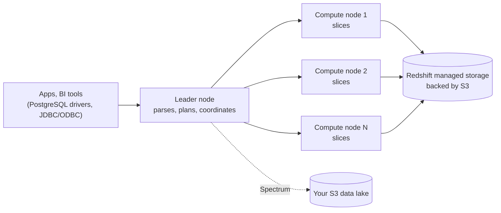

# Amazon Redshift

Mastery: `INPUT[inlineSelect(option(new), option(learning), option(solid)):mastery]`

> [!story] Context
> [[Data Warehouses]] provide fast SQL over modeled data, but on-premises warehouses require purchased hardware sized for peak load. Amazon Redshift offers a warehouse as a managed AWS service, billed by usage.

> [!eli5] Summary
> Amazon Redshift is a data warehouse that AWS runs for you. Instead of buying servers, you create a warehouse in the AWS console, load business data into it, and pay while it runs.

## Background

Before cloud warehouses, an organization that needed a warehouse bought an appliance: a large upfront purchase, a long setup, and a fixed capacity that was either too large or eventually too small.

AWS announced Redshift as a limited preview at re:Invent in **November 2012** and made it generally available in **February 2013**. It provides a [[Columnar Storage|columnar]], massively parallel processing (MPP) warehouse that is provisioned from the AWS console and billed by usage. Redshift uses a PostgreSQL-based SQL dialect and connects through PostgreSQL, JDBC, and ODBC drivers.

Redshift was the first cloud data warehouse offered by a major cloud provider.

## Overview

Redshift today comes in two deployment shapes:

| Option | How you size it | How you pay (the meter) | Good for |
|---|---|---|---|
| **Provisioned clusters** | Pick a node type (current generation is RA3) and a number of nodes | Per node-hour while the cluster runs, or reserved | Steady, predictable workloads |
| **Redshift Serverless** | Set a base capacity; AWS scales it | Per unit of compute used, while queries run | Spiky or occasional workloads, small teams |

Key features you will hear about:

- **Managed storage (RA3 and Serverless).** Data is stored in Redshift managed storage. AWS states that this lets you scale and pay for compute and storage independently, which removes the classic MPP constraint of adding compute to gain disk capacity.
- **Redshift Spectrum.** Queries files in an S3 data lake as external tables, with no loading or ETL required.
- **Concurrency scaling.** Adds transient compute capacity for bursts of queries. In March 2026 AWS announced general availability of concurrency scaling for auto-copy and zero-ETL ingestion.
- **Zero-ETL integrations.** Managed replication from supported AWS databases into Redshift without a separate pipeline.

Prices are on the official [Amazon Redshift pricing page](https://aws.amazon.com/redshift/pricing/).

## How it works



A provisioned cluster has a **leader node** that receives SQL, builds a plan, and sends compiled steps to **compute nodes**. Each compute node is split into slices, and each slice holds part of every table. Two table settings carry most of the tuning:

```sql
-- Distribute rows by customer so joins on customer_id stay local,
-- and sort by date so date filters can skip blocks.
CREATE TABLE sales (
  sale_id     BIGINT,
  customer_id BIGINT,
  sale_date   DATE,
  amount      DECIMAL(12,2)
)
DISTSTYLE KEY
DISTKEY (customer_id)
SORTKEY (sale_date);

-- Load from S3 in parallel (the usual way data gets in)
COPY sales
FROM 's3://my-bucket/sales/2026/'
IAM_ROLE 'arn:aws:iam::123456789012:role/RedshiftLoadRole'
FORMAT AS PARQUET;
```

Modern Redshift can pick distribution and sort keys automatically (`AUTO`), but the concepts still explain why a slow query is slow: rows that must meet for a [[Join|join]] live on different nodes and have to be moved.

## Small-business considerations

> [!smallbiz] Small-business considerations
> For an AWS-based company whose main need is SQL reporting, Redshift Serverless has low operational overhead and bills for compute only while queries run. Consider two factors: data must be loaded into Redshift (a second copy if the files are already in S3), and Python or machine learning work typically runs on a separate system. If both BI and data science will use the same data, compare options in [[Databricks vs Alternatives for Small Teams]].

> [!bridge]- In Databricks today
> The warehouse job Redshift does maps to [[Databricks SQL]] on [[SQL Warehouses]] over [[Delta Lake]] tables in your own S3 bucket. Redshift's `COPY` from S3 maps to [[COPY INTO]] and [[Auto Loader]]; Querying lake files in place, which Redshift Spectrum adds, is the default behavior in a lakehouse.
>
> Redshift remains accessible from Databricks:
> - **[[Lakehouse Federation]]** lists Amazon Redshift as a query federation source. You create a connection and a foreign catalog in [[Unity Catalog]], and Databricks pushes queries (including joins, which are GA and on by default for Redshift) down to Redshift over JDBC. One documented limit: foreign tables with case-sensitive identifiers cannot be federated from Redshift.
> - **Migration** with [[Lakebridge]] and the playbook in [[Migrating from Amazon Redshift]].

## Cloud differences

> [!aws]- Databricks on AWS
> Redshift is AWS-only. On Databricks on AWS you can federate it, read the S3 data it unloads, or migrate from it. See [[S3 Access via Unity Catalog]] and [[AWS Glue and Lake Formation Federation]].

> [!azure]- Azure Databricks
> Redshift does not run on Azure. Lakehouse Federation can still reach a Redshift endpoint over the network if routing allows, but [[Egress|egress]] and latency make this a migration path rather than a design. Azure's own equivalent is Synapse or the Microsoft Fabric warehouse.

> [!gcp]- Databricks on Google Cloud
> Same as Azure: Redshift is AWS-only. Google's equivalent is [[Google BigQuery]].

## Advanced topics

> [!deepdive]- Advanced topics (301–401)
> - **Distribution styles.** `KEY`, `EVEN`, `ALL`, and `AUTO`. `ALL` copies a small dimension table to every node to avoid data movement during joins, similar to a Spark [[Broadcast Join|broadcast join]].
> - **Zone maps.** Redshift keeps min/max values per storage block, so a sort key on date lets a filter skip blocks. Delta Lake's file statistics and [[Liquid Clustering]] do the same job; see [[Data Skipping]].
> - **VACUUM and ANALYZE.** Deleted rows are only marked, and sort order degrades as data arrives. Redshift runs automatic vacuum and analyze now, but the parallel to Delta's [[OPTIMIZE and VACUUM]] is direct.
> - **WLM.** Workload management queues separate ETL from dashboards. Concurrency scaling is attached per queue on provisioned clusters.
> - **Lock-in shape.** Data in managed storage is in Redshift's format. Getting it out for other engines means `UNLOAD` to Parquet in S3, which is the additional ETL step described in the [[The Lakehouse Paper|lakehouse paper]].

## Common misconceptions

> [!confusion] Redshift Spectrum is not a separate warehouse
> Spectrum is a feature of Redshift that reads S3 files as external tables. With Redshift Serverless, Spectrum and concurrency scaling are included rather than billed separately.

> [!confusion] Redshift is not PostgreSQL
> Redshift uses a PostgreSQL-based dialect and drivers, but it is a columnar MPP engine. Many PostgreSQL features, including conventional indexes, do not apply.

## Recall

When was Amazon Redshift announced and when did it reach GA?::Announced as a limited preview at re:Invent in November 2012; generally available in February 2013.
What two deployment options does Redshift offer today?::Provisioned clusters (RA3 nodes) and Redshift Serverless.
What does RA3 managed storage change?::Data sits in Redshift managed storage, so compute and storage scale and are paid for independently.
What is Redshift Spectrum?::A Redshift feature that queries files in S3 directly as external tables, without loading them.
Which SQL dialect and drivers does Redshift use?::A PostgreSQL-based dialect, reachable with PostgreSQL, JDBC, and ODBC drivers.
What does a DISTKEY control?::Which node slice each row lives on, so rows joined on that key are co-located.
How can Databricks query Redshift tables without copying them?::Lakehouse Federation: a Unity Catalog connection and foreign catalog that pushes queries down to Redshift.

## Next steps

> [!path] Learning path
> **Needs first:** [[Data Warehouses]], [[Columnar Storage]], [[Storage vs Compute]]
> **Unlocks next:** [[Snowflake]], [[Lakehouse Federation]], [[Migrating from Amazon Redshift]]

> [!nextup] Next
> [[Snowflake]] covers a cloud warehouse designed from the start to separate storage from compute.

> [!sources]- Sources (last verified: 2026-10-25)
> - [Amazon Redshift: ten years of continuous reinvention (Amazon Science)](https://amazon.science/latest-news/amazon-redshift-ten-years-of-continuous-reinvention)
> - [Amazon Redshift FAQs](https://aws.amazon.com/redshift/faqs/)
> - [Amazon Redshift pricing](https://aws.amazon.com/redshift/pricing/)
> - [Amazon Redshift provisioned clusters (AWS docs)](https://docs.aws.amazon.com/redshift/latest/mgmt/working-with-clusters.html)
> - [Redshift RA3 nodes with managed storage (AWS)](https://aws.amazon.com/blogs/big-data/scale-your-cloud-data-warehouse-and-reduce-costs-with-the-new-amazon-redshift-ra3-nodes-with-managed-storage/)
> - [Amazon Redshift Spectrum (AWS)](https://aws.amazon.com/blogs/big-data/amazon-redshift-spectrum-extends-data-warehousing-out-to-exabytes-no-loading-required/)
> - [Concurrency scaling for auto-copy and zero-ETL (AWS, March 2026)](https://aws.amazon.com/about-aws/whats-new/2026/03/concurrency-scaling-auto-copy-zero-ETL/)
> - [Top 10 performance tuning techniques for Amazon Redshift (AWS)](https://aws.amazon.com/blogs/big-data/top-10-performance-tuning-techniques-for-amazon-redshift/)
> - [What is query federation? (AWS)](https://docs.databricks.com/aws/en/query-federation/database-federation)
> - [Lakehouse Federation performance recommendations (AWS)](https://docs.databricks.com/aws/en/query-federation/performance-recommendations)
>
> **Unconfirmed:** the specific distribution styles, zone-map behavior, and automatic vacuum/analyze details in Advanced topics, and the claim that Redshift was the first cloud warehouse from a major cloud provider, were not re-checked against the Redshift documentation in this pass.
