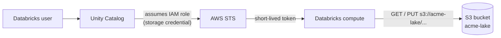

# Amazon S3

Mastery: `INPUT[inlineSelect(option(new), option(learning), option(solid)):mastery]`

> [!story] Context
> [[Object Storage]] describes the storage model: buckets of immutable objects addressed by key over HTTP. Amazon S3 is the implementation from Amazon Web Services (AWS), launched in 2006, and the service whose [[APIs|API]] other object stores follow.

> [!eli5] Summary
> Amazon S3 is Amazon's online storage service for files of any size and number. You create a named storage container, called a bucket, upload files to it, and Amazon keeps several copies to protect them. When Databricks runs on Amazon's cloud, this is where it keeps the data.

## Background

AWS launched **Amazon Simple Storage Service (S3)** on **14 March 2006**. AWS describes its origin in the storage needs of Amazon's retail website, most of which called for a simple object or key-value store rather than a file system.

S3 requires no capacity provisioning: you pay for what you store and the requests you make. It became a common destination for logs, backups, and exports, and the storage layer for cloud [[Data Lakes|data lakes]] read by engines such as [[Apache Spark]].

## Overview

Amazon S3 is the regional [[Object Storage|object storage]] service of Amazon Web Services. You create **buckets** in an AWS [[Region|region]] and store **objects** under **keys**.

The facts that matter for data work:

- **Durability:** designed for 99.999999999% (eleven nines) for every storage class except the legacy Reduced Redundancy class.
- **Consistency:** since **December 2020**, S3 delivers strong read-after-write consistency for all `PUT`s, overwrites, and `LIST`s, in all regions, at no extra cost. Replicated copies in other regions are still eventually consistent (they catch up after a delay).
- **Storage classes:**

| Class | Use it for | Notes |
|---|---|---|
| S3 Standard | Live tables and anything queried often | Designed for 99.99% availability |
| S3 Intelligent-Tiering | Data with unknown or changing access | Moves objects between tiers automatically |
| S3 Standard-IA / One Zone-IA | Infrequent access | Retrieval fees; One Zone lives in a single [[Availability Zone]] |
| S3 Express One Zone | Very [[Latency\|low-latency]] access in one zone | Single-AZ, not resilient to losing that zone |
| S3 Glacier (Instant, Flexible, Deep Archive) | Backups and archives | Some classes need a restore before reading |

- **Security:** private by default. Access is granted by [[IAM]] policies, bucket policies, and (for Databricks) a role that [[Unity Catalog]] assumes. [[Encryption at Rest|Encryption at rest]] is on by default: since January 5, 2023, S3 encrypts all new uploads with S3-managed keys (SSE-S3), with optional KMS keys (keys held in AWS Key Management Service).
- **Pricing:** per GB-month stored, per request, and per GB transferred out. See the official Amazon S3 pricing page (linked from the [S3 FAQs](https://aws.amazon.com/s3/faqs/)).

## How it works



### The URI scheme

On Databricks, S3 paths use `s3://`:

```text
s3://acme-lake/curated/orders/order_date=2026-10-24/part-0000.snappy.parquet
└─┬─┘ └───┬───┘ └──────────────────────────┬───────────────────────────────┘
scheme  bucket                            key
```

You may also see `s3a://` (the open-source Hadoop S3A connector's scheme) in older code. On Databricks, use `s3://`.

Connecting a bucket the governed way:

```sql
-- 1. An admin creates a storage credential that holds an IAM role ARN
--    (done in Catalog Explorer or via the API), then:
CREATE EXTERNAL LOCATION IF NOT EXISTS acme_lake
  URL 's3://acme-lake/'
  WITH (STORAGE CREDENTIAL acme_lake_role);

GRANT READ FILES ON EXTERNAL LOCATION acme_lake TO `data_engineers`;

-- 2. Read raw files, or build a governed table on top
SELECT * FROM read_files('s3://acme-lake/raw/shopify/orders/', format => 'json') LIMIT 10;
```

And from the AWS CLI:

```bash
aws s3 mb s3://acme-lake --region us-east-1        # make a bucket
aws s3 cp orders.csv s3://acme-lake/raw/orders/     # upload a file
aws s3 ls s3://acme-lake/raw/orders/ --recursive    # list keys under a prefix
```

## Small-business considerations

> [!smallbiz] Small-business considerations
> A Databricks on AWS deployment uses at least two buckets: the [[Workspace Storage Bucket|workspace storage bucket]] Databricks uses for its own files, and one (or more) for your data. Keep them in the same region as the workspace. Enable versioning on the data bucket so accidental overwrites are recoverable, and keep public access blocked. Do not distribute AWS access keys to users; let [[Unity Catalog]] broker access through an IAM role.

> [!bridge]- In Databricks today
> S3 is the storage layer of Databricks on AWS. Your [[Delta Lake]] tables, [[Volumes]], and checkpoints all live in S3. The modern access path is a Unity Catalog storage credential (an IAM role with an external ID and trust policy) plus [[Storage Credentials and External Locations|external locations]]; see [[S3 Access via Unity Catalog]]. That replaced the older pattern of attaching [[Instance Profiles|instance profiles]] to clusters, and the even older one of mounting buckets with `dbutils.fs.mount`. Ingest new files from S3 with [[Auto Loader]] or [[COPY INTO]].

## Cloud differences

> [!aws]- Databricks on AWS
> This is the home cloud for S3. See [[S3 Access via Unity Catalog]], [[Workspace Storage Bucket]], [[Customer-Managed Keys on AWS]] for KMS keys, and [[AWS PrivateLink]] for keeping traffic off the public internet.

> [!azure]- Azure Databricks
> The equivalent is [[Azure Data Lake Storage]] (`abfss://`). Azure Databricks can read S3 with credentials if needed, but cross-cloud reads incur AWS [[Egress|egress]] charges. For sharing across clouds, prefer [[OpenSharing]].

> [!gcp]- Databricks on Google Cloud
> The equivalent is [[Google Cloud Storage]] (`gs://`). Same advice on cross-cloud egress applies.

## Advanced topics

> [!deepdive]- Advanced topics (301–401)
> - **The 2020 consistency change** removed a class of lake errors, such as a newly written file missing from a listing. Delta Lake does not rely on listings for correctness, because the [[Delta Transaction Log]] says exactly which files make up each version.
> - **Concurrent writes:** Delta Lake commits require that two writers cannot create the same log entry, and S3 lacks the needed mutual exclusion. Open-source Delta Lake supports multi-cluster S3 writes only with an experimental LogStore that uses DynamoDB. On Databricks, a commit service in the control plane coordinates writes to S3 from multiple clusters.
> - **Request rate scaling:** S3 supports at least 3,500 write and 5,500 read requests per second per partitioned prefix, with no limit on the number of prefixes. Spreading data across many prefixes (as partitioned and Delta layouts naturally do) avoids hot spots.
> - **Lifecycle and versioning:** With versioning enabled, files removed by `VACUUM` remain as noncurrent versions and continue to incur storage charges. Pair versioning with a lifecycle rule that expires noncurrent versions.

## Common misconceptions

> [!confusion] `s3://` vs `s3a://` vs `s3n://`
> All three name S3. `s3n` and `s3a` come from open-source Hadoop connectors; the `s3n` client is no longer available in Hadoop, and users must migrate to `s3a`. On Databricks, write `s3://`.

> [!confusion] Bucket names are global, buckets are regional
> A bucket name must be unique across all of AWS, but the bucket and its data live in one region.

## Recall

When did Amazon S3 launch?::14 March 2006, as AWS's first public service.
What durability is S3 designed for?::99.999999999% (eleven nines).
Since when has S3 offered strong read-after-write consistency?::December 2020, for all regions at no extra cost.
What URI scheme does Databricks use for S3?::`s3://bucket/key`.
How does Unity Catalog get access to an S3 bucket?::Through a storage credential holding an IAM role that Unity Catalog assumes, plus external locations.
What older Databricks access patterns does the Unity Catalog IAM role replace?::Instance profiles attached to clusters, and DBFS mounts.
What are S3's Azure and Google Cloud equivalents?::Azure Data Lake Storage (abfss://) and Google Cloud Storage (gs://).

## Next steps

> [!path] Learning path
> **Needs first:** [[Object Storage]], [[IAM]]
> **Unlocks next:** [[S3 Access via Unity Catalog]], [[Workspace Storage Bucket]], [[Delta Lake]]

> [!nextup] Next
> [[Azure Data Lake Storage]] covers Azure's equivalent, which adds a hierarchical namespace with real directories.

> [!sources]- Sources (last verified: 2026-10-25)
> - [What is Amazon S3? (AWS docs)](https://docs.aws.amazon.com/AmazonS3/latest/userguide/Welcome.html)
> - [Understanding and managing Amazon S3 storage classes (AWS docs)](https://docs.aws.amazon.com/AmazonS3/latest/userguide/storage-class-intro.html)
> - [Object storage classes (AWS)](https://aws.amazon.com/s3/storage-classes/)
> - [Amazon S3 FAQs (AWS)](https://aws.amazon.com/s3/faqs/)
> - [Amazon S3 now delivers strong read-after-write consistency (AWS, December 2020)](https://aws.amazon.com/about-aws/whats-new/2020/12/amazon-s3-now-delivers-strong-read-after-write-consistency-automatically-for-all-applications/)
> - [Amazon S3 update: strong read-after-write consistency (AWS News Blog)](https://aws.amazon.com/blogs/aws/amazon-s3-update-strong-read-after-write-consistency/)
> - [Twenty years of Amazon S3 (AWS News Blog)](https://aws.amazon.com/fr/blogs/aws/twenty-years-of-amazon-s3-and-building-whats-next/)
> - [Default encryption FAQ (Amazon S3 User Guide)](https://docs.aws.amazon.com/AmazonS3/latest/userguide/default-encryption-faq.html)
> - [Understanding and managing Amazon S3 storage classes (Amazon S3 User Guide)](https://docs.aws.amazon.com/AmazonS3/latest/userguide/storage-class-intro.html)
> - [Optimizing Amazon S3 performance (Amazon S3 User Guide)](https://docs.aws.amazon.com/AmazonS3/latest/userguide/optimizing-performance.html)
> - [Hadoop-AWS module: S3A connector (Apache Hadoop)](https://hadoop.apache.org/docs/stable/hadoop-aws/tools/hadoop-aws/index.html)
> - [Storage configuration: Amazon S3 multi-cluster setup (Delta Lake docs)](https://docs.delta.io/latest/delta-storage.html)
> - [Configure Databricks S3 commit service-related settings (AWS)](https://docs.databricks.com/aws/en/security/network/classic/s3-commit-service)
>
> The S3 access path through Unity Catalog follows [[S3 Access via Unity Catalog]].
