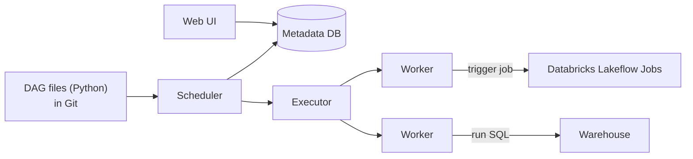

# Apache Airflow

Mastery: `INPUT[inlineSelect(option(new), option(learning), option(solid)):mastery]`

> [!story] Context
> [[Apache Kafka]] moves events between systems. Most data processing still runs as chains of batch steps: extract from a source, load the lake, rebuild warehouse tables, refresh dashboards. Each step must wait for its predecessors, retry on failure, and alert on repeated failure. Apache Airflow is an open-source orchestrator for such workflows.

> [!eli5] Summary
> Airflow is a scheduler for data jobs. You define which jobs exist, which must finish before others start, and when the workflow runs. Airflow starts each job at the right time, retries failures, and shows the status of every run.

## Background

Data teams commonly run hundreds of scheduled jobs. `cron` can only run a command at a set time: it cannot express "run B after A succeeds", does not retry, keeps no run history, and does not alert on failure. The alternatives were custom wrapper scripts or enterprise schedulers configured in XML.

Maxime Beauchemin started Airflow at Airbnb in October 2014 to manage the company's increasingly complex workflows. It was open source from its first commit and was announced publicly in June 2015. It entered the Apache Incubator in March 2016 and became a top-level Apache project in January 2019. Its central design choice is that **pipelines are Python code**. A pipeline is a [[DAG]] (directed acyclic graph) of tasks, written in a `.py` file that can live in [[Git]], be reviewed, and be generated programmatically. Together with a large library of operators for external systems, this made Airflow the most widely used open-source [[Orchestration|orchestrator]] in the modern data stack.

## Overview

Airflow is a **workflow orchestrator**. It does not move or transform data itself; it tells other systems (Spark, warehouses, APIs, Databricks) what to do and when.

| Part | What it does |
|---|---|
| **DAG file** | Python that defines tasks, their dependencies, and a schedule |
| **Operator** | A reusable task type: run SQL, call an API, trigger a Databricks job, run a shell command |
| **Scheduler** | Decides which task instances are ready to run, based on schedule and dependencies |
| **Executor / workers** | Actually run the tasks (locally, on Celery workers, or as Kubernetes pods) |
| **Metadata database** | Stores every DAG run and task state |
| **Web UI** | Shows runs, logs, and lets you retry or backfill |
| **Providers** | Installable packages of operators and hooks for each external system (the Databricks provider is one) |

Airflow can be self-managed or run as a managed service from a cloud provider or a commercial vendor.

## How it works



A small DAG that runs an existing Databricks job each night, using the official Databricks provider (`apache-airflow-providers-databricks`):

```python
from datetime import datetime
from airflow import DAG
from airflow.providers.databricks.operators.databricks import DatabricksRunNowOperator

with DAG(
    dag_id="nightly_sales",
    start_date=datetime(2026, 10, 1),
    schedule="0 2 * * *",      # 02:00 every day
    catchup=False,
) as dag:

    refresh_sales = DatabricksRunNowOperator(
        task_id="refresh_sales",
        databricks_conn_id="databricks_default",
        job_name="nightly_sales_refresh",   # a job defined in Databricks
        job_parameters={"run_date": "{{ ds }}"},
    )
```

The provider's two main operators:

| Operator | What it does | When to use |
|---|---|---|
| `DatabricksRunNowOperator` | Triggers a job that already exists in the workspace | Recommended by Databricks: the job is defined once, and runs appear in the Jobs UI |
| `DatabricksSubmitRunOperator` | Submits a one-time run from a job spec in the DAG | When you do not want a predefined job; also the documented way to run a pipeline from Airflow |

A third, `DatabricksCreateJobsOperator`, creates or resets a job definition and pairs with `RunNow`.

## Small-business considerations

> [!smallbiz] Small-business considerations
> Do not deploy Airflow only to schedule Databricks work. Operating Airflow means maintaining a scheduler, workers, a metadata database, and upgrades, which is significant overhead for a team with one data person. [[Lakeflow Jobs]] is built into Databricks, schedules notebooks, SQL, pipelines, and dbt, retries, alerts, and has no extra infrastructure. Keep Airflow only if you already run it for many non-Databricks systems, and then let it trigger Databricks jobs rather than micromanage them.

> [!bridge]- In Databricks today
> Airflow's job lives in **[[Lakeflow Jobs]]** (formerly Databricks Workflows): multi-task jobs with dependencies, time-based schedules, table-update, file-arrival, and continuous triggers, retries, notifications, and run history, all inside the workspace. See [[Tasks Triggers and Schedules]]. Jobs can be defined as code with [[Declarative Automation Bundles]] and deployed through [[CI-CD for Data Pipelines|CI/CD]], which covers Airflow's "pipelines as code" strength.
>
> Airflow remains supported. Databricks documents orchestrating Lakeflow Jobs from Airflow with the Databricks provider: `DatabricksRunNowOperator` for existing jobs, `DatabricksSubmitRunOperator` for one-off runs and pipelines. A common pattern is to use Airflow for cross-system orchestration and Lakeflow Jobs for orchestration within Databricks. Moving off Airflow is covered in [[Migrating ETL Tools]].

## Cloud differences

> [!azure]- Azure Databricks
> The Databricks provider and the Lakeflow Jobs integration are the same. On Azure, many teams use [[Azure Data Factory with Databricks|Azure Data Factory]] as the cross-system orchestrator instead of Airflow, and Microsoft Fabric also offers Apache Airflow jobs that can trigger Azure Databricks jobs. Authenticate with a [[Users Groups and Service Principals|service principal]] through Microsoft Entra ID.

> [!aws]- Databricks on AWS
> Same provider and operators. AWS offers a managed Airflow service, Amazon Managed Workflows for Apache Airflow (MWAA). Use a Databricks service principal with OAuth for the Airflow connection, not a personal token.

> [!gcp]- Databricks on Google Cloud
> Same provider and operators. Google Cloud's managed Airflow is Managed Service for Apache Airflow (formerly Cloud Composer).

## Advanced topics

> [!deepdive]- Advanced topics (301–401)
> - **Durable runs:** Recent versions of the Databricks provider run `DatabricksRunNowOperator` in a *durable* mode by default: it saves the Databricks run ID before polling, so if the Airflow task is retried it reattaches to the existing run instead of launching a duplicate. The provider docs say this requires a recent Airflow 3 release; if you set `deferrable=True`, deferrable mode takes precedence.
> - **Deferrable operators** free the Airflow worker slot while a long Databricks job runs, using Airflow's triggerer.
> - **Idempotency:** Airflow will retry and backfill, so every task must be safe to run twice for the same date. With Delta, `MERGE` or `INSERT OVERWRITE ... WHERE date = ...` patterns give you that. See [[Idempotency]].
> - **API versions:** Older provider versions call the Jobs API 2.0 or 2.1; current ones use 2.2. Check your installed provider version when examples disagree.
> - **Avoid double orchestration:** If Airflow triggers a separate Databricks job for every small step, each step incurs startup time and loses Lakeflow Jobs features such as shared job compute and repair runs. Trigger one multi-task job and let Lakeflow Jobs manage the steps inside it.

## Common misconceptions

> [!confusion] Airflow does not process data
> Airflow schedules and monitors tasks. The work runs in the system each task calls, such as Databricks, a warehouse, or a script. Running heavy data processing inside Airflow workers is an anti-pattern.

> [!confusion] Airflow DAG vs Spark DAG
> Both are directed acyclic graphs, but at different levels. An Airflow DAG is a graph of *jobs* in a pipeline. A Spark DAG is the graph of *stages* inside one Spark job. See [[Jobs Stages and Tasks]].

## Recall

What is Apache Airflow?::An open-source workflow orchestrator that schedules and monitors pipelines written as Python DAGs.
Where and when did Airflow start?::At Airbnb, in October 2014.
What is a DAG in Airflow?::A directed acyclic graph of tasks and their dependencies, defined in a Python file.
Does Airflow transform data itself?::No. It triggers and monitors work done by other systems.
Which Databricks feature does Airflow's job today?::Lakeflow Jobs (formerly Databricks Workflows).
Which Airflow operator does Databricks recommend for triggering an existing job?::`DatabricksRunNowOperator`.
When would you use `DatabricksSubmitRunOperator` instead?::For a one-time run defined in the DAG without a predefined job, and to run a pipeline from Airflow.
Why must Airflow tasks be idempotent?::Airflow retries and backfills, so a task may run more than once for the same date.

## Next steps

> [!path] Learning path
> **Needs first:** [[Python for Data]], [[DAG]], [[Orchestration]]
> **Unlocks next:** [[Lakeflow Jobs]], [[Tasks Triggers and Schedules]], [[dbt]]

> [!nextup] Next
> [[dbt]] covers the transformation step itself: managing SQL transformations with version control, dependencies, and tests.

> [!sources]- Sources (last verified: 2026-10-25)
> - [Orchestrate Lakeflow Jobs with Apache Airflow (AWS)](https://docs.databricks.com/aws/en/jobs/how-to/use-airflow-with-jobs)
> - [Orchestrate Lakeflow Jobs with Apache Airflow (Azure Databricks)](https://learn.microsoft.com/en-us/azure/databricks/jobs/how-to/use-airflow-with-jobs)
> - [Run pipelines in a workflow (AWS)](https://docs.databricks.com/aws/en/ldp/workflows)
> - [Run pipelines in a workflow (Azure Databricks)](https://learn.microsoft.com/en-us/azure/databricks/ldp/workflows)
> - [Airflow project history (airflow.apache.org)](https://airflow.apache.org/docs/apache-airflow/1.10.14/project.html)
> - [DatabricksRunNowOperator (Airflow Databricks provider docs)](https://airflow.apache.org/docs/apache-airflow-providers-databricks/stable/operators/run_now.html)
> - [Databricks operators API reference (Airflow Databricks provider docs)](https://airflow.apache.org/docs/apache-airflow-providers-databricks/stable/_api/airflow/providers/databricks/operators/databricks/index.html)
> - [Databricks provider changelog (airflow.apache.org)](https://airflow.apache.org/docs/apache-airflow-providers-databricks/stable/changelog.html)
> - [Orchestrate an Azure Databricks job with an Apache Airflow job (Microsoft Fabric)](https://learn.microsoft.com/en-us/fabric/data-factory/apache-airflow-jobs-run-databricks-job)
> - [Automating jobs with schedules and triggers (AWS)](https://docs.databricks.com/aws/en/jobs/triggers)
> - [What is Amazon Managed Workflows for Apache Airflow? (AWS documentation)](https://docs.aws.amazon.com/mwaa/latest/userguide/what-is-mwaa.html)
> - [Managed Service for Apache Airflow overview (formerly Cloud Composer, Google Cloud)](https://cloud.google.com/composer/docs/composer-3/composer-overview)
