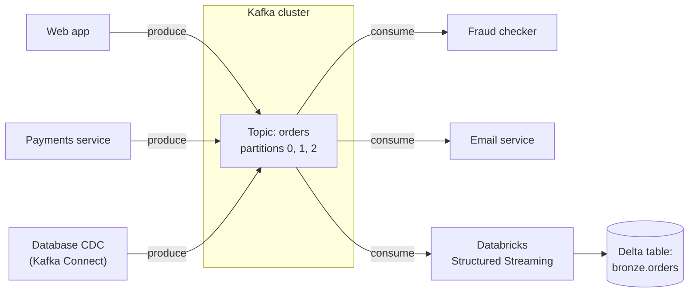

# Apache Kafka

Mastery: `INPUT[inlineSelect(option(new), option(learning), option(solid)):mastery]`

> [!story] Context
> [[Data Swamps]] and the warehouses before them assume data arrives in batches, often nightly. Websites, payment systems, and sensors produce a continuous stream of small events that other systems need within seconds. Apache Kafka is the standard system for moving such event streams between applications.

> [!eli5] Summary
> Kafka is a fast, reliable channel for messages between computer systems. One system adds a message such as "order 123 was paid", and any number of other systems can read a copy, immediately or later, in the order the messages were added.

> [!analogy]- Analogy: a newspaper archive with subscribers
> | Newspaper archive | Kafka |
> |---|---|
> | A newspaper title | Topic |
> | Parallel printing presses for one title | Partitions |
> | Reporters adding new articles at the end | Producers appending events |
> | Each subscriber's bookmark | Consumer offset |
> | How long back issues are kept | Retention |

## Background

Without a shared streaming system, each system that needs live data from another is connected to it directly. With *n* systems this can require up to *n × n* point-to-point integrations, each with its own format and failure modes. Traditional [[Message Queue|message queues]] typically remove a message once it is consumed and are not designed for very high volume or replay.

Kafka was developed at LinkedIn as a central, high-[[Throughput|throughput]] log of [[Event|events]] that any system can write to and read from. It entered the Apache Incubator in July 2011 and graduated to a top-level Apache project in October 2012. Kafka 4.0, released in March 2025, is the first major release that runs entirely without Apache ZooKeeper. Kafka is the most common entry point for streaming data into a lake or lakehouse.

## Overview

Kafka is a **distributed, append-only, replicated log**. Its core vocabulary:

| Term | Meaning |
|---|---|
| **Broker** | A Kafka server. A cluster has several, for capacity and [[Fault Tolerance\|fault tolerance]]. |
| **Topic** | A named stream of events, such as `orders` or `page_views`. |
| **Partition** | A topic is split into ordered partitions spread across brokers. Order is guaranteed *within* a partition. |
| **Offset** | An event's position in its partition. Consumers track offsets to know where they are. |
| **Producer / consumer** | Apps that write events / read events. |
| **Consumer group** | Consumers that share the work of reading a topic, each partition read by one member. |
| **Retention** | Events are kept for a set time or size, whether read or not, so new consumers can replay history. |

Around the core sit **Kafka Connect** (ready-made connectors that copy data between Kafka and databases or storage) and **Kafka Streams** (a library for processing streams inside Java apps).

Managed Kafka services are available from cloud providers and from Confluent, so many teams do not operate brokers themselves.

## How it works



On Databricks, you read Kafka with [[Structured Streaming on Databricks|Structured Streaming]]. The Databricks docs list `kafka.bootstrap.servers` (a comma-separated list of `host:port`) as the one required connection option:

```python
from pyspark.sql.functions import col, from_json

raw = (spark.readStream
    .format("kafka")
    .option("kafka.bootstrap.servers", "broker1:9092,broker2:9092")
    .option("subscribe", "orders")
    .option("startingOffsets", "earliest")
    .option("maxOffsetsPerTrigger", 10000)   # cap events per micro-batch
    .load())

# Kafka gives you binary key/value plus topic, partition, offset, timestamp
orders = (raw
    .select(from_json(col("value").cast("string"),
                      "order_id STRING, amount DOUBLE, ts TIMESTAMP").alias("o"))
    .select("o.*"))

(orders.writeStream
    .option("checkpointLocation", "/Volumes/main/bronze/checkpoints/orders")
    .trigger(processingTime="1 minute")
    .toTable("main.bronze.orders"))
```

Or in SQL, with the `read_kafka` table function:

```sql
CREATE OR REFRESH STREAMING TABLE bronze_orders AS
SELECT CAST(value AS STRING) AS payload, timestamp
FROM STREAM read_kafka(
  bootstrapServers => 'broker1:9092',
  subscribe        => 'orders'
);
```

The [[Checkpoint|checkpoint]] stores which offsets have been processed, so a restarted stream resumes exactly where it left off. Together with Delta's transactional writes, this gives [[Exactly-Once Processing|exactly-once]] results in the table.

## Small-business considerations

> [!smallbiz] Small-business considerations
> Most small businesses do not need Kafka. If data arrives as nightly exports, files in a bucket, or from SaaS tools such as Shopify or Salesforce, a scheduled batch job, [[Auto Loader]], or [[Lakeflow Connect]] is simpler and less expensive. Adopt Kafka when several systems must react to the same events within seconds, or when a vendor already delivers data as a Kafka stream. In that case, use a managed Kafka service rather than operating brokers.

> [!bridge]- In Databricks today
> Databricks does not replace Kafka; it **consumes from and produces to** it. Kafka stays the transport between systems, and Databricks is where events get processed and stored:
> - **Read and write Kafka** with [[Structured Streaming on Databricks|Structured Streaming]] (`format("kafka")`) or the SQL `read_kafka` function, including in [[Streaming Tables|streaming tables]] and [[Lakeflow Spark Declarative Pipelines]].
> - **Authenticate** with Unity Catalog service credentials (the `databricks.serviceCredential` option) instead of passwords in code, where your Kafka service supports it.
> - **Low-latency mode:** Structured Streaming's real-time mode supports Kafka-to-Kafka pipelines with a `realTime` trigger, for cases where micro-batch latency is too slow.
> - **Kafka Streams apps** that only transform and route data can often be rewritten as Structured Streaming jobs, which removes a separate service to run.

## Cloud differences

The Databricks Kafka connector works the same on every cloud. What differs is which managed Kafka service sits nearby and how the network reaches it.

> [!azure]- Azure Databricks
> Azure Event Hubs provides an Apache Kafka endpoint that speaks the Kafka protocol, so the same `format("kafka")` code can read it after you change the connection configuration. Confluent Cloud also runs on Azure. Make sure the brokers resolve and are reachable from your workspace's network ([[VNet Injection]], private endpoints).

> [!aws]- Databricks on AWS
> Amazon MSK (Managed Streaming for Apache Kafka) and Confluent Cloud are the usual choices. Keep the cluster in the same region and reach it over private networking ([[Customer-Managed VPC on AWS]], [[AWS PrivateLink]]).

> [!gcp]- Databricks on Google Cloud
> Google Cloud offers Managed Service for Apache Kafka, and Confluent Cloud runs there too. Same rule: same region, private connectivity ([[Customer-Managed VPC on Google Cloud]]).

## Advanced topics

> [!deepdive]- Advanced topics (301–401)
> - **Partitions cap parallelism:** By default Spark maps each Kafka topic partition to one Spark partition, so a stream reading a 6-partition topic gets 6 parallel reads. Setting `minPartitions` higher than the topic's partition count makes Spark split large Kafka partitions into smaller pieces (the value is a hint, not exact). Ordering is only guaranteed within a Kafka partition.
> - **Offsets live in the checkpoint, not in Kafka:** Structured Streaming tracks its own offsets in the checkpoint rather than committing consumer-group offsets. Deleting a checkpoint means re-deciding where to start (`startingOffsets`).
> - **Data loss on retention:** If a stream is stopped longer than the topic's retention, the oldest unread events are gone. The `failOnDataLoss` option (default `true`) controls whether the query fails when data may have been lost, for example when offsets are out of range or a topic was deleted. Set it to `false` to continue instead.
> - **Rate limiting:** `maxOffsetsPerTrigger` caps how much each micro-batch reads, which keeps the first run after a long outage from overwhelming the cluster.
> - **Troubleshooting connections:** The Databricks Kafka FAQ recommends first verifying that the bootstrap hostname and port are correct and resolve from the Databricks network. Connection timeouts are usually network configuration issues.
> - **KRaft replaces ZooKeeper:** Kafka 4.0 supports only KRaft mode; ZooKeeper mode is removed, and ZooKeeper-based clusters must migrate to KRaft before upgrading. Tools use `--bootstrap-server` instead of `--zookeeper`. Client applications, including Databricks, connect through bootstrap servers as before.

## Common misconceptions

> [!confusion] Kafka is not a database or a data lake
> Kafka keeps events for a retention window so consumers can catch up or replay, but it is not built for ad hoc queries or permanent storage. Land events in a [[Delta Lake]] table for that.

> [!confusion] Kafka vs Spark Structured Streaming
> Kafka **moves and stores** streams of events. [[Structured Streaming]] **processes** them (filter, join, aggregate, write to tables). They are partners, not rivals.

## Recall

What is Apache Kafka?::A distributed, append-only, replicated log that moves streams of events between systems.
Where was Kafka created?::At LinkedIn; it became a top-level Apache project in October 2012.
What is a Kafka topic?::A named stream of events, split into ordered partitions spread across brokers.
What is an offset?::An event's position within a partition; consumers track offsets to know where they are.
Within what scope does Kafka guarantee order?::Within a single partition.
Which option is required to read Kafka from Databricks?::`kafka.bootstrap.servers`, a comma-separated list of host:port broker addresses.
Where does a Databricks Kafka stream remember what it has processed?::In its Structured Streaming checkpoint.
Which Databricks SQL function reads Kafka?::`read_kafka`, used as `FROM STREAM read_kafka(...)`.
Does Databricks replace Kafka?::No. Kafka stays the transport; Databricks reads from and writes to it and stores the results in Delta tables.

## Next steps

> [!path] Learning path
> **Needs first:** [[Batch vs Streaming]], [[Event]], [[Distributed Systems]]
> **Unlocks next:** [[Structured Streaming on Databricks]], [[Streaming Tables]], [[Change Data Capture]]

> [!nextup] Next
> [[Apache Airflow]] covers orchestration: running batch and streaming jobs in the correct order, with retries and monitoring.

> [!sources]- Sources (last verified: 2026-10-25)
> - [Connect to Apache Kafka (AWS)](https://docs.databricks.com/aws/en/connect/streaming/kafka/)
> - [Kafka FAQ (AWS)](https://docs.databricks.com/aws/en/connect/streaming/kafka/faq)
> - [Query streaming data (AWS)](https://docs.databricks.com/aws/en/query/streaming)
> - [Query streaming data (GCP)](https://docs.databricks.com/gcp/en/query/streaming)
> - [Run your first Structured Streaming workload (AWS)](https://docs.databricks.com/aws/en/structured-streaming/tutorial)
> - [Set up real-time mode (AWS)](https://docs.databricks.com/aws/en/structured-streaming/real-time/setup)
> - [Real-time mode examples (Azure Databricks)](https://learn.microsoft.com/en-us/azure/databricks/structured-streaming/real-time-examples)
> - [Kafka incubation status (Apache Incubator)](https://incubator.apache.org/projects/kafka.html)
> - [Apache Kafka 4.0.0 release announcement (kafka.apache.org)](https://kafka.apache.org/blog/2025/03/18/apache-kafka-4.0.0-release-announcement/)
> - [Upgrading to Kafka 4.0 (kafka.apache.org)](https://kafka.apache.org/40/getting-started/upgrade/)
> - [KRaft vs ZooKeeper (kafka.apache.org)](https://kafka.apache.org/40/getting-started/zk2kraft/)
> - [Structured Streaming + Kafka Integration Guide (spark.apache.org)](https://spark.apache.org/docs/latest/streaming/structured-streaming-kafka-integration.html)
> - [Azure Event Hubs for Apache Kafka (Microsoft Learn)](https://learn.microsoft.com/en-us/azure/event-hubs/azure-event-hubs-apache-kafka-overview)
> - [What is Amazon MSK? (AWS documentation)](https://docs.aws.amazon.com/msk/latest/developerguide/what-is-msk.html)
> - [Managed Service for Apache Kafka overview (Google Cloud)](https://cloud.google.com/managed-service-for-apache-kafka/docs/overview)
