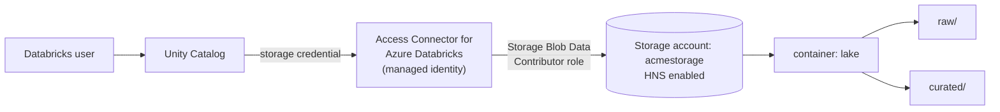

# Azure Data Lake Storage

Mastery: `INPUT[inlineSelect(option(new), option(learning), option(solid)):mastery]`

> [!story] Context
> [[Amazon S3]] uses a flat namespace: "folders" are key prefixes, so renaming a folder means copying every object in it. Azure Data Lake Storage adds a hierarchical namespace with real directories to Azure Blob Storage, which suits analytics workloads.

> [!eli5] Summary
> Azure Data Lake Storage is Microsoft's cloud storage for large amounts of analytics data. It works like online storage with real folders, so data tools can organize and move many files quickly, and access can be set per folder. It is the storage layer for Azure Databricks.

> [!renamed] Renamed
> - **Azure Data Lake Storage Gen1** is retired; Gen1 resources are no longer accessible.
> - **Azure Data Lake Storage Gen2 → Azure Data Lake Storage**: Microsoft's current overview drops "Gen2" from the name. The technology (Blob Storage with hierarchical namespace) is unchanged, and older docs and many users still say "ADLS Gen2".

## Background

Microsoft previously offered two separate products: **Azure Blob Storage** (general [[Object Storage|object storage]], comparable to S3) and **Azure Data Lake Storage Gen1** (a store for analytics workloads).

**ADLS Gen2** combines their capabilities. It is not a separate service. In Microsoft's words, it is "a set of capabilities that you use with the Blob Storage service of your Azure Storage account", unlocked by turning on the **hierarchical namespace** setting. You get Blob prices, tiers, and lifecycle rules, plus real directories, atomic directory operations (a folder rename or delete completes fully or not at all), and file-level access control. Microsoft's current documentation simply calls it **Azure Data Lake Storage**; "Gen2" appears in older pages and in most people's vocabulary.

Gen1 is retired, so current ADLS accounts use the Gen2 design.

## Overview

Azure Data Lake Storage (ADLS) is Azure's storage for analytics data: Azure Blob Storage with a hierarchical namespace (real folders) turned on.

Technically, ADLS is an **Azure Storage account** (StorageV2, general purpose v2) with **hierarchical namespace (HNS) enabled**. Inside it:

| Concept | What it is | S3 / GCS equivalent |
|---|---|---|
| Storage account | The top-level resource, with a globally unique name, in one Azure [[Region\|region]] | (closest: an AWS account's S3 in a region) |
| Container (or *file system*) | A top-level folder that holds data | Bucket |
| Directory | A real directory (requires HNS) | Key prefix |
| File / blob | The object itself | Object |
| ACLs | POSIX-style (Unix-style) access control lists on directories and files, assigned to [[Microsoft Entra ID Integration\|Entra ID]] identities | IAM/bucket policies (no per-file ACL model) |

Because it is still Blob Storage underneath, Blob features carry over: access tiers (hot, cool, cold, archive), lifecycle management, soft delete, and diagnostic logging. Blob APIs and Data Lake APIs work on the same data. Pricing is at Blob Storage levels; see Azure's official storage pricing page.

## How it works



**The URI scheme.** Databricks addresses ADLS with `abfss://` (the Azure Blob File System driver over TLS, an encrypted connection; plain `abfs://` is the non-TLS variant):

```text
abfss://lake@acmestorage.dfs.core.windows.net/curated/orders/part-0000.parquet
└─┬──┘ └┬─┘ └────┬────┘ └────────┬─────────┘ └─────────────┬──────────────┘
scheme container account   DFS endpoint                  path
```

Note the endpoint is **`dfs.core.windows.net`** (the Data Lake endpoint), not `blob.core.windows.net`. A container comes *before* the `@`, the storage account after it.

Setting it up the governed way:

```bash
# Create a storage account with hierarchical namespace enabled
az storage account create \
  --name acmestorage --resource-group rg-data --location eastus2 \
  --sku Standard_LRS --kind StorageV2 --hns true

az storage container create --account-name acmestorage --name lake --auth-mode login
```

```sql
-- After creating a storage credential from an Access Connector:
CREATE EXTERNAL LOCATION IF NOT EXISTS acme_lake
  URL 'abfss://lake@acmestorage.dfs.core.windows.net/'
  WITH (STORAGE CREDENTIAL acme_connector_cred);

SELECT * FROM read_files('abfss://lake@acmestorage.dfs.core.windows.net/raw/orders/', format => 'csv', header => true);
```

## Small-business considerations

> [!smallbiz] Small-business considerations
> On Azure Databricks you need one storage account with **hierarchical namespace turned on** (a setting chosen when you create the account; turning it on later is a one-way upgrade). Put it in the same region as your workspace. Use one container per purpose (`raw`, `lake`, or per environment), give access through the Access Connector rather than storage keys, and enable soft delete. Storage cost is the Blob meter: per GB-month, per operation, and per GB out.

> [!bridge]- In Databricks today
> ADLS is the storage layer of Azure Databricks. [[Delta Lake]] tables and [[Volumes]] live in ADLS containers. The modern access path is an **Access Connector for Azure Databricks**, whose [[Managed Identity|managed identity]] gets the *Storage Blob Data Contributor* role on the account, wrapped in a Unity Catalog storage credential and [[Storage Credentials and External Locations|external locations]]. See [[ADLS and Access Connectors]].
>
> Older patterns that appear in legacy notebooks: DBFS mounts (`dbutils.fs.mount`), service principal secrets in Spark config, and Entra ID credential passthrough. Databricks now recommends Unity Catalog external locations and volumes instead; mounts that rely on secrets do not refresh when those secrets rotate.

## Cloud differences

> [!azure]- Azure Databricks
> The home cloud for ADLS. Hierarchical namespace is a prerequisite for both mounts and Unity Catalog external locations. Pair with [[ADLS and Access Connectors]], [[Azure Private Link]] for private access, and [[Customer-Managed Keys on Azure]]. Microsoft Fabric's OneLake is also built on ADLS; see [[Microsoft Fabric and OneLake vs Databricks]].

> [!aws]- Databricks on AWS
> The equivalent is [[Amazon S3]] (`s3://`). Reading ADLS from AWS is possible with credentials but incurs Azure [[Egress|egress]] charges; use [[OpenSharing]] for cross-cloud sharing.

> [!gcp]- Databricks on Google Cloud
> The equivalent is [[Google Cloud Storage]] (`gs://`).

## Advanced topics

> [!deepdive]- Advanced topics (301–401)
> - **Atomic directory operations.** With HNS, renaming or deleting a directory is a single metadata operation. Hadoop-style job commits that rename a temporary directory into place are fast and safe on ADLS, unlike flat object stores.
> - **ACLs vs RBAC.** Azure role assignments (RBAC) grant access at account or container level; POSIX ACLs refine it per directory and file. With Unity Catalog, you normally grant the Access Connector broad RBAC on the container and do fine-grained control in Unity Catalog instead of in ACLs.
> - **Error to recognize.** "Unsupported Azure Scheme: abfss" usually means the account lacks HNS or the endpoint is wrong.
> - **Multi-protocol access.** Blob APIs and Data Lake APIs can address the same data in an HNS account, so non-Databricks tools can drop files where Databricks ingests them with [[Auto Loader]].
> - **Account-level limits** (maximum request rate, ingress and egress throughput, capacity) apply per storage account. You can request higher capacity and ingress limits from Azure Support. Very large platforms spread data over several accounts.

## Common misconceptions

> [!confusion] ADLS is not a separate service from Blob Storage
> It is a Blob Storage account with hierarchical namespace enabled. Without HNS, you have plain Blob Storage, and `abfss://` external locations will not work.

> [!confusion] `wasbs://` vs `abfss://`
> `wasbs://` uses the Windows Azure Storage Blob (WASB) driver, which Microsoft has deprecated in favor of the Azure Blob Filesystem (ABFS) driver. For Databricks and ADLS, use `abfss://` with the `dfs.core.windows.net` endpoint.

> [!confusion] An ADLS "container" is not a Docker container
> In Azure Storage, a container is a top-level folder in a storage account. It has nothing to do with the software [[Container|containers]] used to package apps.

## Recall

What is ADLS (Gen2) technically?::An Azure Storage account (Blob Storage) with the hierarchical namespace setting enabled.
What does the hierarchical namespace add?::Real directories, atomic directory rename and delete, and POSIX-style ACLs on directories and files.
What happened to ADLS Gen1?::It is retired; Gen1 resources are no longer accessible.
What is the ABFS URI format Databricks uses?::`abfss://container@account.dfs.core.windows.net/path`.
Which endpoint does abfss use, blob or dfs?::The Data Lake endpoint, `dfs.core.windows.net`.
How does Unity Catalog get access to ADLS?::Through an Access Connector for Azure Databricks whose managed identity has a storage role (such as Storage Blob Data Contributor), wrapped in a storage credential.
What are ADLS's AWS and Google Cloud equivalents?::Amazon S3 (s3://) and Google Cloud Storage (gs://).

## Next steps

> [!path] Learning path
> **Needs first:** [[Object Storage]], [[Managed Identity]]
> **Unlocks next:** [[ADLS and Access Connectors]], [[Azure Databricks Overview]], [[Delta Lake]]

> [!nextup] Next
> [[Google Cloud Storage]] covers Google Cloud's equivalent object store.

> [!sources]- Sources (last verified: 2026-10-25)
> - [Azure Data Lake Storage overview (Microsoft Learn)](https://learn.microsoft.com/en-us/azure/storage/blobs/data-lake-storage-introduction)
> - [Use the Azure Data Lake Storage URI (ABFS) (Microsoft Learn)](https://learn.microsoft.com/en-us/azure/storage/blobs/data-lake-storage-introduction-abfs-uri)
> - [Guidelines for migrating ADLS Gen1 to Gen2 (Microsoft Learn)](https://learn.microsoft.com/en-us/azure/storage/blobs/data-lake-storage-migrate-gen1-to-gen2)
> - [Migrate from ADLS Gen1 to Gen2 using the Azure portal (Microsoft Learn)](https://learn.microsoft.com/en-us/azure/storage/blobs/data-lake-storage-migrate-gen1-to-gen2-azure-portal)
> - [Connect to an ADLS external location (Azure Databricks)](https://learn.microsoft.com/en-us/azure/databricks/connect/unity-catalog/cloud-storage/external-locations-adls)
> - [Mounting cloud object storage on Azure Databricks](https://learn.microsoft.com/en-us/azure/databricks/dbfs/mounts)
> - [Access ADLS using Entra ID credential passthrough (legacy) (Azure Databricks)](https://learn.microsoft.com/en-us/azure/databricks/archive/credential-passthrough/adls-passthrough)
> - [What is Azure Data Lake Storage Gen1? (retirement notice, Microsoft Learn)](https://learn.microsoft.com/en-us/azure/data-lake-store/data-lake-store-overview)
> - [az storage account (Azure CLI reference)](https://learn.microsoft.com/en-us/cli/azure/storage/account)
> - [Create a storage account (Microsoft Learn)](https://learn.microsoft.com/en-us/azure/storage/common/storage-account-create)
> - [Upgrading Azure Blob Storage with Azure Data Lake Storage capabilities (Microsoft Learn)](https://learn.microsoft.com/en-us/azure/storage/blobs/upgrade-to-data-lake-storage-gen2)
> - [Connect to Azure Blob Storage with WASB (legacy) (Azure Databricks)](https://learn.microsoft.com/en-us/azure/databricks/archive/storage/wasb-blob)
> - [Scalability and performance targets for standard storage accounts (Microsoft Learn)](https://learn.microsoft.com/en-us/azure/storage/common/scalability-targets-standard-account)
