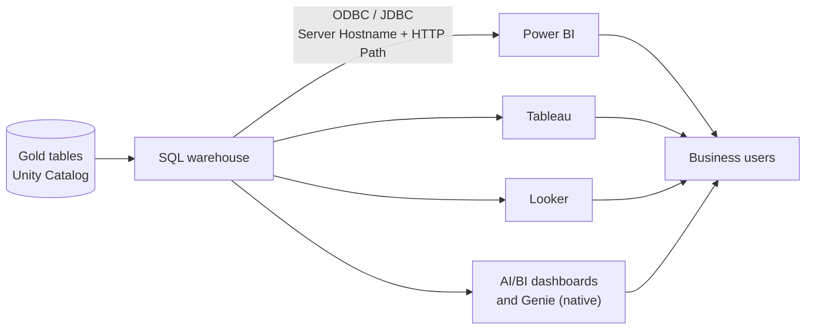

# BI Tools

Mastery: `INPUT[inlineSelect(option(new), option(learning), option(solid)):mastery]`

> [!story] Context
> [[Fivetran and ELT Tools]] load raw data and [[dbt]] models it into clean tables. Business intelligence (BI) tools are the last layer of the stack: they query those tables and present the results to people who do not write SQL.

> [!eli5] Summary
> BI tools turn tables of numbers into charts, dashboards, and reports that anyone in a company can read. They connect to where the data is stored, fetch the figures, and refresh them on a schedule.

## Background

Before BI tools, reports were built by hand in [[Spreadsheets|spreadsheets]] from exported data, or written by IT as fixed reports that took weeks to change. Self-service BI tools let analysts connect directly to a database or [[Data Warehouses|warehouse]], drag fields onto a canvas, and publish interactive [[Dashboard|dashboards]] to the rest of the company.

The main products in this category:

| Tool | Vendor | Notes |
|---|---|---|
| **Power BI** | Microsoft | Desktop authoring app plus the Power BI service; part of Microsoft Fabric |
| **Tableau** | Salesforce | Desktop and server/cloud editions; strong visual exploration |
| **Looker** | Google Cloud | Defines metrics in a modeling language (LookML) before charting |
| **Others** | Various | Qlik, Sigma, ThoughtSpot, Apache Superset, Metabase, and many more |

## Overview

A business intelligence (BI) tool is software that queries stored data and presents the results as charts, dashboards, and reports for people who do not write code.

A BI tool has four parts:

| Part | What it does |
|---|---|
| **Connector** | Connects to a data source, usually over [[JDBC and ODBC]] or a vendor-specific driver |
| **Data model / semantic layer** | Defines tables, relationships, and measures such as "revenue" so every chart uses the same definition. See [[Semantic Layer]]. |
| **Visualization layer** | Charts, tables, filters, and dashboards |
| **Sharing and refresh** | Publishing, permissions, scheduled refresh, alerts, and embedding |

BI tools access data in one of two ways:

| Mode | How it works | Trade-off |
|---|---|---|
| **Import / extract** | The tool copies data into its own in-memory store on a schedule | Fast interactions; data is only as fresh as the last refresh; a second copy to govern |
| **Live / DirectQuery** | Each interaction sends a query to the source | Always current; depends on source performance and generates compute cost on the source |

## How it works

All external BI tools connect to Databricks through a [[SQL Warehouses|SQL warehouse]] identified by two values from its **Connection details** tab:

| Field | Example |
|---|---|
| Server Hostname | `adb-1234567890123456.7.azuredatabricks.net` |
| HTTP Path | `/sql/1.0/warehouses/abcdef1234567890` |

### Connect Power BI Desktop

Databricks documents three methods: Partner Connect, a manual connection, and the Power BI OpenSharing connector. The manual method:

1. In Power BI Desktop, select **Get data**, then search for and select the Databricks connector (**Azure Databricks** on Azure).
2. Enter the **Server Hostname** and **HTTP Path** of the SQL warehouse.
3. Choose **Import** or **DirectQuery**.
4. Sign in with [[OAuth]] (Microsoft Entra ID on Azure) or a personal access token (see [[Authentication - Tokens and OAuth]]).
5. Select tables from the [[Unity Catalog]] navigator.

### Connect Tableau

Databricks provides a Partner Connect guide for Tableau Desktop, and Tableau's Databricks connector supports Unity Catalog. Tableau takes the same Server Hostname and HTTP Path. See [[Connecting Tableau and Other BI Tools]].

## Small-business considerations

> [!smallbiz] Small-business considerations
> - **Start with the tool the business already owns.** If the company has Microsoft 365 licenses that include Power BI, use Power BI against a Databricks SQL warehouse.
> - **Consider native dashboards first.** [[AI-BI Dashboards]] and [[Genie Agents]] are built into Databricks, so there is no second license or second copy of data, and sharing uses Unity Catalog permissions.
> - **Define metrics once.** Put shared definitions in the gold tables or in [[Metric Views]], not separately in each report.
> - **Control refresh cost.** Every DirectQuery interaction or scheduled refresh runs on the SQL warehouse. Set an auto-stop on the warehouse and schedule refreshes no more often than needed.

> [!bridge]- In Databricks today
> Databricks provides native BI features and also serves external BI tools:
> - **Native:** [[AI-BI Dashboards]] for dashboards and [[Genie Agents]] for natural-language questions over governed tables, both running on SQL warehouses. [[Metric Views]] define business metrics in Unity Catalog so that native and external tools use the same definitions.
> - **External tools:** Power BI, Tableau, Looker, and other tools connect through SQL warehouses. Power BI and Tableau tiles are available in [[Partner Connect]]. See [[Connecting Power BI]] and [[Connecting Tableau and Other BI Tools]].
> - **Migration:** moving reports between tools is covered in [[Migrating BI Reports]].

## Cloud differences

> [!azure]- Azure Databricks
> Power BI connects with Microsoft Entra ID single sign-on, and Microsoft-specific integration (including publishing to the Power BI service) is covered in [[Power BI on Azure Databricks]]. The Azure version of the Partner Connect steps uses Entra ID sign-in instead of generic OAuth.

> [!aws]- Databricks on AWS
> Power BI, Tableau, and other tools connect with OAuth or tokens. If the workspace uses Private Link or IP access lists, the Power BI service may need a Power BI on-premises data gateway to reach it.

> [!gcp]- Databricks on Google Cloud
> Looker is Google Cloud's BI product and connects to Databricks SQL warehouses like other tools. Otherwise nothing differs.

## Advanced topics

> [!deepdive]- Advanced topics (301–401)
> - **DirectQuery limits.** The Databricks connector's `Databricks.Query` data source does not support DirectQuery mode. Use the navigator-based table selection for DirectQuery models.
> - **Metric views and Power BI.** Microsoft removed the *Metric View BI Compatibility Mode* option from the Databricks connector for Power BI; check the current Databricks Power BI docs for how metric views are exposed.
> - **Query caching.** SQL warehouses cache query results, which reduces cost for dashboards that issue identical queries. See [[Query Performance and Caching]].
> - **Semantic models vs metric views.** A Power BI semantic model or LookML project defines metrics inside one tool. [[Metric Views]] define them in the catalog for all tools. Choose one primary location to avoid drift.
> - **Service principals for refresh.** Scheduled refreshes should authenticate as a service principal (OAuth machine-to-machine), not a person, so that refreshes continue when staff change.

## Common misconceptions

> [!confusion] A BI tool is not a database
> BI tools store extracts for speed, but the governed copy of record lives in the platform. Treat imported datasets as caches.

> [!confusion] More dashboards do not mean better reporting
> Without shared metric definitions, each dashboard can calculate the same figure differently. A [[Semantic Layer|semantic layer]] or metric views address this.

## Recall

What does a BI tool do?::Connects to data sources and turns query results into charts, dashboards, and reports for business users.
Name three widely used BI tools.::Microsoft Power BI, Tableau, and Looker.
What is the difference between Import and DirectQuery in Power BI?::Import copies data into Power BI on a refresh schedule; DirectQuery sends a query to the source on each interaction.
Which Databricks compute do external BI tools connect to?::A SQL warehouse.
Which two connection values identify a SQL warehouse?::Server Hostname and HTTP Path.
What are Databricks' native BI features?::AI/BI dashboards and Genie, with Metric Views for shared metric definitions.
Which three ways does Databricks document for connecting Power BI Desktop?::Partner Connect, a manual connection, and the Power BI OpenSharing connector.

## Next steps

> [!path] Learning path
> **Needs first:** [[SQL]], [[Star Schema]], [[Data Warehouses]]
> **Unlocks next:** [[AI-BI Dashboards]], [[Connecting Power BI]], [[The Two-Tier Architecture Problem]]

> [!nextup] Next
> [[The Two-Tier Architecture Problem]] describes the cost of running this whole stack as two separate systems: a data lake and a data warehouse.

> [!sources]- Sources (last verified: 2026-10-25)
> - [Power BI with Databricks (AWS)](https://docs.databricks.com/aws/en/partners/bi/power-bi/)
> - [Connect Power BI Desktop to Databricks (AWS)](https://docs.databricks.com/aws/en/partners/bi/power-bi/desktop)
> - [Connect Power BI Desktop to Azure Databricks](https://learn.microsoft.com/en-us/azure/databricks/partners/bi/power-bi/desktop)
> - [Business intelligence tools (AWS)](https://docs.databricks.com/aws/en/ai-bi/tools)
> - [Business intelligence tools (Azure Databricks)](https://learn.microsoft.com/en-us/azure/databricks/ai-bi/tools)
> - [Business intelligence tools (GCP)](https://docs.databricks.com/gcp/en/ai-bi/tools)
> - [Technology partners (AWS)](https://docs.databricks.com/aws/en/integrations)
> - [Troubleshoot Power BI with Databricks (AWS)](https://docs.databricks.com/aws/en/partners/bi/power-bi/troubleshooting)
> - [Publish to the Power BI service from Databricks (AWS)](https://docs.databricks.com/aws/en/partners/bi/power-bi/service)
> - [What is Microsoft Fabric? (Power BI workload, Microsoft Learn)](https://learn.microsoft.com/en-us/fabric/fundamentals/microsoft-fabric-overview)
> - [Salesforce completes acquisition of Tableau (Salesforce press release, 2019)](https://www.salesforce.com/news/press-releases/2019/08/01/salesforce-completes-acquisition-of-tableau/)
> - [What is LookML? (Looker documentation, Google Cloud)](https://cloud.google.com/looker/docs/what-is-lookml)
