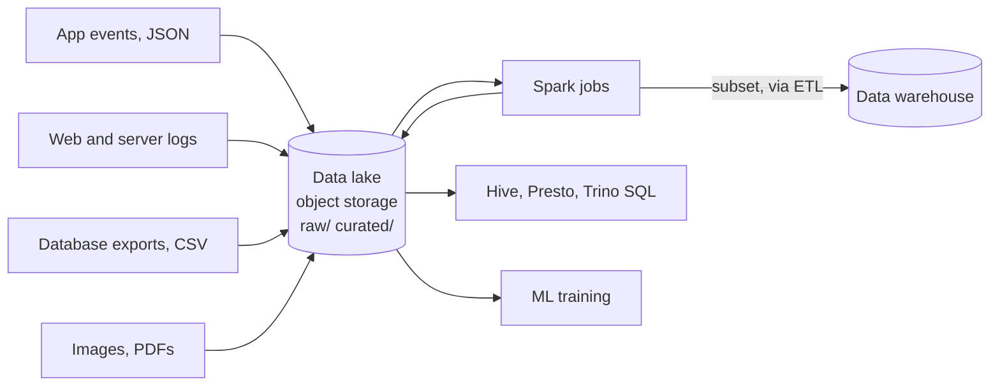

# Data Lakes

Mastery: `INPUT[inlineSelect(option(new), option(learning), option(solid)):mastery]`

> [!story] Context
> Cloud warehouses such as [[Google BigQuery]] serve SQL over structured, modeled tables. Data that does not fit a fixed table structure, such as logs, sensor readings, images, and raw JSON, needs a different store. [[Apache Hadoop]] showed that such data could be kept at low cost on commodity storage. A data lake applies that approach deliberately.

> [!eli5] Summary
> A data lake is a single, inexpensive storage location where a company keeps all of its data files in their original form, without cleaning them first. Teams then read and organize the data when they need it.

## Background

Three requirements drove the data lake pattern:

1. **Variety.** Much new data is semi-structured or unstructured (see [[Structured vs Unstructured Data]]). Loading it into warehouse tables requires defining its structure in advance and discarding anything that does not fit.
2. **Volume.** Warehouse storage is priced for curated data, which makes retaining years of raw logs costly. See [[The Three Vs of Big Data]].
3. **New users.** Data scientists need raw, detailed data for [[Machine Learning Basics|machine learning]], not pre-aggregated summaries.

The term "data lake" is generally attributed to James Dixon, then CTO of Pentaho, around 2010, who contrasted it with the [[Data Mart|data mart]] (this attribution was not confirmed against a primary source for this note). Early data lakes ran on [[HDFS]] in Hadoop clusters. Most later moved to cloud [[Object Storage|object storage]] such as [[Amazon S3]], [[Azure Data Lake Storage]], and [[Google Cloud Storage]], which costs less and does not require a running cluster to retain data.

## Overview

A data lake is **a storage pattern, not a product**: a central repository of raw files in open formats, plus engines that read them on demand.

| | Data warehouse | Data lake |
|---|---|---|
| **What goes in** | Cleaned, modeled tables | Everything, raw, as-is |
| **When structure is applied** | On write ([[Schema\|schema]]-on-write) | On read (schema-on-read) |
| **Formats** | Vendor's internal format | Open files: CSV, JSON, [[Apache Parquet\|Parquet]], [[Apache ORC\|ORC]], Avro, images, logs |
| **Storage cost** | High | Low (object storage) |
| **Who reads it** | Analysts and BI | Engineers and data scientists, with [[Apache Spark\|Spark]], [[Apache Hive\|Hive]], Presto/Trino |
| **Reliability** | Transactions, constraints | None built in: files can be half-written or contradictory |
| **Governance** | Built in | Bolted on, if at all |

The lake's strengths are **low cost, open formats, and flexibility**: any engine can read Parquet, and no data is discarded. Its weakness is the absence of database guarantees: no transactions, no row-level updates, no constraints, and no guarantee that a folder holds one consistent version of a table.

## How it works



A lake is mostly folder conventions. A typical layout:

```text
s3://acme-lake/
  raw/shopify/orders/ingest_date=2026-10-24/part-0000.json
  raw/web_logs/2026/10/24/access.log.gz
  curated/orders/order_date=2026-10-24/part-0000.snappy.parquet
```

Engines apply structure when they read. With Spark:

```python
# Schema-on-read: the structure is inferred (or declared) at query time
orders = spark.read.json("s3://acme-lake/raw/shopify/orders/")
orders.printSchema()

# Write a cleaner, columnar copy into the curated zone, partitioned by date
(orders.selectExpr("id AS order_id", "customer.id AS customer_id",
                   "total_price AS amount", "to_date(created_at) AS order_date")
       .write.mode("overwrite")
       .partitionBy("order_date")
       .parquet("s3://acme-lake/curated/orders/"))
```

This code has no transactional guarantees. If the `overwrite` fails partway, readers see a mix of old and new files. Two concurrent writers can overwrite each other's output. Updating or deleting one customer's rows requires rewriting files. These gaps cause the problems described in [[Data Swamps]].

## Small-business considerations

> [!smallbiz] Small-business considerations
> A dedicated data lake project is rarely necessary for a small company. The useful part of the pattern still applies: keep raw exports, CSVs, and PDFs in one central, inexpensive location before cleaning them, so the originals are always available. On Databricks that place is a [[Volumes|volume]] or the bronze layer of the [[Medallion Architecture]], and unlike a plain lake it comes with permissions and transactions.

> [!bridge]- In Databricks today
> Databricks keeps the data lake and adds a reliability and governance layer. On Databricks, your data still lives as open Parquet files in your own object storage, but wrapped in [[Delta Lake]] (or [[Apache Iceberg]]) tables that add [[ACID Transactions|ACID transactions]], updates and deletes, [[Schema Enforcement and Evolution|schema enforcement]], and [[Time Travel|time travel]]. [[Unity Catalog]] adds the catalog, permissions, and lineage that lakes lacked, and [[Volumes]] govern non-tabular files such as images and PDFs. That combination is the [[The Lakehouse Idea|lakehouse]] of chapter 05.
>
> Existing lakes connect directly: point a Unity Catalog [[Storage Credentials and External Locations|external location]] at the bucket, then read the files, register them as external tables, or ingest them with [[Auto Loader]].

## Cloud differences

> [!azure]- Azure Databricks
> Azure lakes live in [[Azure Data Lake Storage]] (a storage account with hierarchical namespace enabled), addressed as `abfss://container@account.dfs.core.windows.net/path`.

> [!aws]- Databricks on AWS
> AWS lakes live in [[Amazon S3]] buckets, addressed as `s3://bucket/path`. AWS Glue Data Catalog and Lake Formation often act as the lake's catalog; see [[AWS Glue and Lake Formation Federation]].

> [!gcp]- Databricks on Google Cloud
> Google Cloud lakes live in [[Google Cloud Storage]] buckets, addressed as `gs://bucket/path`.

## Advanced topics

> [!deepdive]- Advanced topics (301–401)
> - **Directory-as-table.** Hive established the convention that a folder of files is a table and subfolders like `order_date=2026-10-24` are partitions, with the [[Hive Metastore]] recording the mapping. Every lake engine inherited it, including its weaknesses: listing millions of files is slow, and the metastore and the files can disagree.
> - **Small files.** Streaming and frequent appends create thousands of tiny files, which kills read performance. Lakes needed periodic compaction jobs; Delta automates this with [[OPTIMIZE and VACUUM]] and auto-compaction.
> - **No isolation.** Without a transaction log, readers can observe partial writes, and concurrent writers can corrupt a table. This is the core technical gap the [[Delta Transaction Log]] closes.
> - **Zones.** Lakes were often organized as landing/raw, cleansed, and curated zones. The [[Medallion Architecture]] (bronze, silver, gold) is the same idea on reliable tables.
> - **Lake plus warehouse.** Because lakes were unreliable for BI, companies copied a curated subset into a warehouse, creating [[The Two-Tier Architecture Problem]].

## Common misconceptions

> [!confusion] A data lake is not a product you buy
> It is a pattern: raw files in cheap storage plus engines that read them. "Azure Data Lake Storage" is a storage product you can build a lake on, but the name does not make it a lake on its own.

> [!confusion] Schema-on-read does not mean "no schema"
> The data still has structure; it is declared or inferred at read time rather than enforced at write time. Someone still has to understand and document it, or the lake becomes a swamp. See [[Data Lake vs Data Swamp]].

## Recall

What is a data lake?::A central store of raw files in open formats, kept as they arrived, with structure applied when they are read.
What is schema-on-read?::Applying structure to data at query time rather than enforcing it when the data is written.
What did data lakes first run on, and what did they move to?::Hadoop's HDFS at first, then cloud object storage such as S3, ADLS, and GCS.
Name three things a plain data lake lacks compared with a warehouse.::ACID transactions, updates and deletes on rows, and built-in governance (catalog, permissions, quality).
Why did companies copy lake data into a warehouse?::Because BI needed reliable, fast, governed tables that the lake could not provide, creating a two-tier architecture.
How does Databricks fix the data lake's reliability gap?::It stores lake files as Delta Lake (or Iceberg) tables with a transaction log, governed by Unity Catalog.

## Next steps

> [!path] Learning path
> **Needs first:** [[Structured vs Unstructured Data]], [[Files and File Formats]], [[Data Warehouses]]
> **Unlocks next:** [[Object Storage]], [[Data Swamps]], [[The Two-Tier Architecture Problem]]

> [!nextup] Next
> [[Object Storage]] covers the cloud storage service that most data lakes are built on.

> [!sources]- Sources (last verified: 2026-10-25)
> - [Lakehouse: A New Generation of Open Platforms (CIDR 2021)](https://vldb.org/cidrdb/2021/lakehouse-a-new-generation-of-open-platforms-that-unify-data-warehousing-and-advanced-analytics.html)
> - [Lakehouse paper PDF (Databricks)](https://www.databricks.com/wp-content/uploads/2020/12/cidr_lakehouse.pdf)
> - [Connect to an ADLS external location (Azure Databricks)](https://learn.microsoft.com/en-us/azure/databricks/connect/unity-catalog/cloud-storage/external-locations-adls)
>
> **Unconfirmed:** the attribution of the term "data lake" to James Dixon (around 2010).
