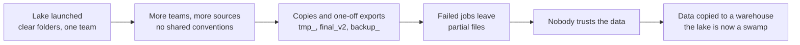

# Data Swamps

Mastery: `INPUT[inlineSelect(option(new), option(learning), option(solid)):mastery]`

> [!story] Context
> [[Google Cloud Storage]], [[Amazon S3]], and [[Azure Data Lake Storage]] make storing files inexpensive and effectively unlimited. The [[Data Lakes|data lake]] pattern encourages keeping all data and organizing it later. Without [[Data Governance|governance]], many lakes became difficult to use.

> [!eli5] Summary
> A data swamp is a company's data storage after years of files being added with no labels, owners, or checks. The data exists, but people cannot find the right files or trust the numbers in them.

## Background

The data lake moves structural work from **write time** to **read time**. Warehouses reject data that does not fit; lakes accept everything. That flexibility has costs that appear as the lake grows:

- **No inventory.** Folders such as `s3://lake/tmp_final_v2/` accumulate. There is no searchable [[Data Catalog|catalog]], or a [[Hive Metastore]] that disagrees with the actual files.
- **No provenance.** Several copies of the same dataset have different row counts, and there is no record of which job produced which file from which inputs (no [[Data Lineage|lineage]]).
- **Unreliable files.** Without transactions, a job that fails partway leaves a mix of old and new files, concurrent writers can corrupt a table, and readers can see incomplete data.
- **No in-place changes.** Deleting one customer's data for a [[GDPR]] request requires rewriting entire folders of files.
- **Coarse security.** Access is granted per bucket or per cluster, not per table or column, so anyone with bucket access can read every file in it.

As a result, analysts stop relying on the lake and request that data be copied into a warehouse instead, which leads to [[The Two-Tier Architecture Problem]]. The term "data swamp" describes a lake in this state.

## Overview

A data swamp is a **failure state** of a data lake, not a technology: the files exist, but they cannot be found, trusted, or safely changed. A lake is in this state when most of the following symptoms apply:

| Symptom | What is missing |
|---|---|
| "Which table is the real one?" | A catalog and naming conventions |
| "Who made this, and is it up to date?" | Ownership and lineage |
| "The numbers changed overnight and nobody knows why." | [[ACID Transactions\|Transactions]] and [[Time Travel\|versioning]] |
| "This column is sometimes a number, sometimes text." | [[Schema Enforcement and Evolution\|Schema enforcement]] and [[Data Quality\|quality checks]] |
| "We can't delete that customer's data." | Row-level `DELETE` and `MERGE` |
| "Who can see payroll data?" | Fine-grained access control and [[Audit Logs\|auditing]] |
| "Storage costs keep climbing." | Retention rules and confidence to delete |

The glossary entry [[Data Lake vs Data Swamp]] gives the one-line version.

## How it works

A typical progression from lake to swamp:



The following operations have no safe equivalent on plain files in a lake:

```sql
-- Fix one customer's email and delete another, atomically, with history
UPDATE sales.customers SET email = 'new@example.com' WHERE customer_id = 42;
DELETE FROM sales.customers WHERE customer_id = 99;  -- GDPR request

-- See exactly what changed and when, and who can read the table
DESCRIBE HISTORY sales.customers;
SHOW GRANTS ON TABLE sales.customers;
```

On Parquet files in a bucket, each of these statements requires a custom job that rewrites files without transactional protection. On a [[Delta Lake]] table governed by [[Unity Catalog]], each is one statement.

## Small-business considerations

> [!smallbiz] Small-business considerations
> The problem occurs at any scale. A shared drive containing `Customers_FINAL.xlsx`, `Customers_FINAL_v2.xlsx`, and `Customers (copy).xlsx` has the same issues. The remedy is the same at every size:
> 1. **One home per dataset**, with a clear name and an owner.
> 2. **Raw kept separate from clean**, so mistakes can be redone from the original (the [[Medallion Architecture]]).
> 3. **Permissions by group**, not by sharing links.
> 4. **A rule for deleting** old copies.
>
> On Databricks, Unity Catalog provides the catalog, permissions, and lineage by default, so these practices require little setup.

> [!bridge]- In Databricks today
> Databricks addresses each root cause with a specific feature, covered in later chapters:
> - **Unreliable files → [[Delta Lake]].** A transaction log turns a folder of Parquet into a table with [[ACID Transactions|ACID transactions]], `UPDATE`/`DELETE`/[[MERGE and Upserts|MERGE]], [[Schema Enforcement and Evolution|schema enforcement]], and [[Time Travel|time travel]].
> - **No governance → [[Unity Catalog]].** One account-level catalog with search, [[Privileges and Grants|grants]] down to [[Row Filters and Column Masks|rows and columns]], automatic [[Data Lineage|lineage]], [[Audit Logs|audit logs]], and [[Data Classification|data classification]] for finding sensitive columns.
> - **Untrusted pipelines → [[Expectations and Data Quality|expectations]]** in [[Lakeflow Spark Declarative Pipelines]] and [[Data Quality Monitoring]], which check data as it flows.

## Cloud differences

> [!azure]- Azure Databricks
> The swamp pattern and its cure are the same on every cloud. On Azure, a swamp usually looks like many ADLS containers with storage-key access shared around; the cure is Unity Catalog over [[ADLS and Access Connectors|Access Connectors]].

> [!aws]- Databricks on AWS
> Same pattern. On AWS, look for buckets accessed through broad [[Instance Profiles|instance profiles]] and an AWS Glue catalog out of sync with S3; see [[Hive Metastore Federation for AWS Glue]] for bringing Glue under Unity Catalog.

> [!gcp]- Databricks on Google Cloud
> Same pattern and cure; nothing GCP-specific differs.

## Advanced topics

> [!deepdive]- Advanced topics (301–401)
> - **Metadata drift.** In Hive-style lakes the metastore holds partitions and schemas while files live independently. Jobs that wrote files without updating the metastore (or vice versa) were a constant source of "missing" or phantom data. Table formats fix this by making the log, stored next to the data, the only source of truth.
> - **Governance is socio-technical.** Tools give you catalogs and grants; someone still has to own each dataset. [[Data Mesh]] is one organizational answer (domain ownership); Unity Catalog's domains and tags support either centralized or federated models.
> - **Swamps are expensive.** Undeletable copies grow storage and request costs forever. Lineage is what gives you the confidence to delete: if nothing downstream reads a table, it can go.
> - **Compliance risk.** Unknown copies of [[PII]] are the biggest danger for [[GDPR]] and [[HIPAA]]. Automated classification is how large estates find them.

## Common misconceptions

> [!confusion] A swamp is not caused by too much data
> Size is not the problem. Missing ownership, catalogs, quality checks, and transactions are. A small, ungoverned lake is a swamp; a huge, governed one is not.

> [!confusion] Copying data to a warehouse does not fix a swamp
> It addresses the problem only for the copied data and adds a second system to keep in sync. The lakehouse approach fixes the lake itself.

## Recall

What is a data swamp?::A data lake that has decayed into an unusable state: no catalog, no ownership, no quality, and no trust.
Name three causes of data swamps.::No catalog or ownership, no transactions (partial or conflicting writes), and no quality or schema checks; also coarse security.
Why did lake files become unreliable without a transaction log?::Failed or concurrent writes left mixed or corrupted files, and readers could see half-finished data.
Why was deleting one customer's data hard in a plain lake?::Files are immutable, so a row-level delete meant rewriting whole folders of files by hand.
How did analysts react to swamps?::They asked for curated data to be copied into a warehouse, creating the two-tier architecture.
Which two Databricks technologies answer the swamp's root causes?::Delta Lake (reliability) and Unity Catalog (governance).

## Next steps

> [!path] Learning path
> **Needs first:** [[Data Lakes]], [[Object Storage]]
> **Unlocks next:** [[The Two-Tier Architecture Problem]], [[Unity Catalog]], [[Delta Lake]]

> [!nextup] Next
> [[Apache Kafka]] covers the transport layer for data that arrives continuously as events rather than in nightly batches.

> [!sources]- Sources (last verified: 2026-10-25)
> - [Lakehouse: A New Generation of Open Platforms (CIDR 2021)](https://vldb.org/cidrdb/2021/lakehouse-a-new-generation-of-open-platforms-that-unify-data-warehousing-and-advanced-analytics.html)
> - [Lakehouse paper PDF (Databricks)](https://www.databricks.com/wp-content/uploads/2020/12/cidr_lakehouse.pdf)
> - [Lakehouse paper (Databricks research page)](https://www.databricks.com/research/lakehouse-a-new-generation-of-open-platforms-that-unify-data-warehousing-and-advanced-analytics)
