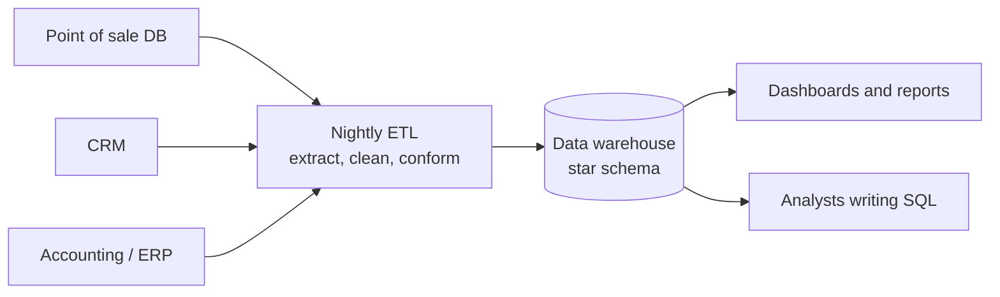

# Data Warehouses

Mastery: `INPUT[inlineSelect(option(new), option(learning), option(solid)):mastery]`

> [!story] Context
> [[Chapter 03 - Apache Spark|Chapter 03]] covered [[Apache Spark]], an engine for processing large files. Business reporting had long relied on a different system: the data warehouse, a database that serves clean, modeled tables to analysts through [[SQL]]. This chapter starts with that system.

> [!eli5] Summary
> A data warehouse is a separate copy of a company's business data, cleaned and organized so that questions such as "what were sales last month, by store?" return in seconds. The everyday systems record each transaction; the warehouse collects and arranges them for reporting.

## Background

Operational databases, such as those behind a point-of-sale system or an online shop, are built for [[OLTP vs OLAP|OLTP]]: many tiny reads and writes per second, each touching one row. Running a query such as "total revenue by region for the last three years" on the same database scans millions of rows and competes with live transactions, so reports are slow and degrade the application.

Data is also split across systems: sales in one, inventory in another, payroll in a third. Questions that span them require manual exports and joins in spreadsheets.

The data warehouse addresses both problems. It is a **separate database, built for [[OLTP vs OLAP|OLAP]]** (big read-only questions over lots of history), loaded on a schedule by [[ETL vs ELT|ETL]] jobs that pull from every source system, clean the data, and fit it into one agreed model. Most warehouses model data as a [[Star Schema|star schema]] of [[Fact Table|fact]] and [[Dimension Table|dimension]] tables.

## Overview

A data warehouse is a separate database that collects data from a company's operational systems and organizes it for reporting and analysis. It has four defining habits:

| Habit | What it means in practice |
|---|---|
| **[[Schema\|Schema]]-on-write** | Data must fit the table's columns and types *before* it is loaded. Bad rows are rejected at the door. |
| **Built for reads** | Storage, indexes, and query engine are tuned for scanning and [[Aggregation\|aggregating]] many rows, not updating one. Modern warehouses use [[Columnar Storage\|columnar storage]]. |
| **Integrated history** | Data from many source systems is merged into one model and kept for years, so you can compare this quarter with three years ago. |
| **SQL for everyone** | Analysts and [[BI Tools]] talk to it in standard [[SQL]] over [[JDBC and ODBC]]. |

The goal is a [[Single Source of Truth|single source of truth]]: one place where each business metric has one definition.

Two generations of warehouse are relevant to this chapter:

1. **On-premises systems and appliances** (for example Teradata, Oracle Exadata, IBM Netezza, and Microsoft's SQL Server Parallel Data Warehouse appliance). Hardware and software are purchased together, sized for peak load, and paid for whether busy or idle.
2. **Cloud warehouses** ([[Amazon Redshift]] in 2012–2013, [[Google BigQuery]], [[Snowflake]]). The vendor operates the infrastructure, and billing is by time or by query. The next three notes cover them.

## How it works



The moving parts:

- **Sources**: the operational systems. They are never queried directly for reports.
- **ETL**: scheduled jobs (classically nightly) that copy, clean, and reshape data. See [[ETL vs ELT]].
- **The model**: usually a star schema, with a central fact table of events (each sale) surrounded by dimension tables (product, store, date, customer).
- **Consumers**: [[BI Tools]] and analysts.

A typical warehouse question, against a star schema:

```sql
-- Revenue by store region and month, for the last 12 months
SELECT d.year_month,
       s.region,
       SUM(f.amount) AS revenue
FROM   fact_sales f
JOIN   dim_date  d ON f.date_key  = d.date_key
JOIN   dim_store s ON f.store_key = s.store_key
WHERE  d.full_date >= ADD_MONTHS(CURRENT_DATE, -12)
GROUP  BY d.year_month, s.region
ORDER  BY d.year_month, s.region;
```

The warehouse runs this efficiently because it reads only the four columns the query needs (columnar storage), skips blocks that cannot match the date filter, and runs the work in parallel across many disks or [[Node|nodes]].

## Small-business considerations

> [!smallbiz] Small-business considerations
> If reporting currently runs from shared spreadsheets or an Access database, the same two problems apply at small scale: slow or fragile reports, and figures from different systems that do not match. See [[Signs You Have Outgrown Spreadsheets]].
>
> A full warehouse project is not required. Apply the same practices: copy data out of operational systems, clean it in one place, model it as a small number of fact and dimension tables, and point every report at that copy. On Databricks, use [[SQL Warehouses]] and the [[Medallion Architecture]]. Prefer pay-per-use compute over fixed capacity sized for peak load.

> [!bridge]- In Databricks today
> The warehouse's job, fast SQL for analysts and BI over clean modeled tables, lives in [[Databricks SQL]], served by [[SQL Warehouses]] (serverless or classic) running the [[Photon]] engine over [[Delta Lake]] tables governed by [[Unity Catalog]]. The difference is where the data sits: in open files in your own [[Object Storage|object storage]], not in a proprietary store. This is the [[The Lakehouse Idea|lakehouse]] design described in chapter 05.
>
> Existing warehouses remain accessible. [[Lakehouse Federation]] lets Databricks query Amazon Redshift, Snowflake, Google BigQuery, Azure Synapse, SQL Server, Teradata, Oracle, and others in place, through Unity Catalog, without copying the data first. Moving off one for good is covered in [[Migration Strategy Overview]].

## Cloud differences

> [!azure]- Azure Databricks
> Microsoft's own warehouse lineage runs from SQL Server and its Parallel Data Warehouse appliance to Azure SQL Data Warehouse (now the dedicated SQL pool, formerly SQL DW, in Azure Synapse Analytics), and now Microsoft Fabric Data Warehouse. Lakehouse Federation lists Azure Synapse (SQL Data Warehouse) and SQL Server as query federation sources. See [[Microsoft Fabric and OneLake vs Databricks]].

> [!aws]- Databricks on AWS
> AWS's warehouse is [[Amazon Redshift]]. Federation and migration paths: [[Lakehouse Federation]], [[Hive Metastore Federation for AWS Glue]], [[Migrating from Amazon Redshift]].

> [!gcp]- Databricks on Google Cloud
> Google's warehouse is [[Google BigQuery]]. See [[BigQuery Integration]] and [[Migrating from Google BigQuery]].

## Advanced topics

> [!deepdive]- Advanced topics (301–401)
> - **Top-down vs bottom-up design:** A top-down design (Bill Inmon's approach) builds a normalized, enterprise-wide warehouse first and derives [[Data Mart|data marts]] from it as subsets. A bottom-up design (Ralph Kimball's approach) builds dimensional, star-schema marts for business units first and integrates them into a larger warehouse. Most systems combine both. The [[Medallion Architecture]] (bronze, silver, gold) applies similar layering on a lakehouse.
> - **[[MPP]]:** Warehouses from Teradata to Redshift are *massively parallel processing* systems: shared-nothing nodes, each owning a slice of every table, joined by a fast network. Choosing how rows are distributed across nodes (distribution keys) was the central tuning skill, because a bad choice forces a [[Shuffles|shuffle]] on every join.
> - **Coupled storage and compute:** In classic MPP, data lives on the compute nodes' disks. Adding storage means adding compute, and idle nodes still cost money. Snowflake, BigQuery, and later Redshift RA3 broke this coupling by keeping data in object storage or a managed storage layer. See [[Storage vs Compute]].
> - **Closed formats:** A warehouse stores data in its own internal format. Only its engine can read it at full speed, which is why machine learning teams had to export data to files. The [[The Lakehouse Paper|lakehouse paper]] calls this out as lock-in and a source of staleness.
> - **Denormalize for reads:** Warehouses deliberately repeat data ([[Denormalization]]) to avoid [[Join|joins]] at query time, the opposite of an OLTP design.

## Common misconceptions

> [!confusion] A data warehouse is not a big database
> Size is not the point. A warehouse is a database *organized for analysis*: historical, integrated, read-mostly, schema-on-write. A 10 TB order-processing database is still OLTP; a 50 GB sales mart is a warehouse.

> [!confusion] "SQL Warehouse" in Databricks is not a data warehouse product
> A Databricks [[SQL Warehouses|SQL warehouse]] is a *compute resource* that runs SQL. The data itself sits in Delta tables in object storage. The name borrows the job, not the architecture.

> [!confusion] Data warehouse vs data lake
> A warehouse stores cleaned, modeled tables and rejects what does not fit. A [[Data Lakes|data lake]] stores every file as-is and works out the structure later. Many organizations run both, which leads to [[The Two-Tier Architecture Problem]].

## Recall

What workload is a data warehouse built for?::OLAP: large read-mostly analytical queries over lots of history, not many small transactional writes.
What does schema-on-write mean?::Data must match the table's columns and types before it is loaded; rows that do not fit are rejected.
What is a star schema?::A central fact table of events joined to surrounding dimension tables such as date, product, and store.
Why do warehouses use columnar storage?::Analytical queries read a few columns across many rows, so storing each column together lets the engine read only what it needs and compress it well.
What does ETL feed into a classic warehouse?::Data extracted from operational systems, cleaned and reshaped to fit the warehouse model, usually on a nightly schedule.
Name two drawbacks of a classic warehouse.::It is expensive (especially when storage and compute are coupled), and it stores data in a closed format that ML tools cannot read directly.
Where does the data warehouse's job live in Databricks today?::Databricks SQL and SQL warehouses running over Delta tables in object storage, governed by Unity Catalog.
How can Databricks query an existing Snowflake or Redshift warehouse without copying the data?::Lakehouse Federation (query federation through Unity Catalog).

## Next steps

> [!path] Learning path
> **Needs first:** [[Relational Databases]], [[SQL]], [[OLTP vs OLAP]]
> **Unlocks next:** [[Amazon Redshift]], [[Snowflake]], [[Google BigQuery]], [[The Two-Tier Architecture Problem]]

> [!nextup] Next
> [[Amazon Redshift]] covers the first widely adopted cloud data warehouse, which replaced purchased hardware with hourly rental.

> [!sources]- Sources (last verified: 2026-10-25)
> - [Lakehouse: A New Generation of Open Platforms that Unify Data Warehousing and Advanced Analytics (CIDR 2021)](https://vldb.org/cidrdb/2021/lakehouse-a-new-generation-of-open-platforms-that-unify-data-warehousing-and-advanced-analytics.html)
> - [Connect to external databases and catalogs (AWS)](https://docs.databricks.com/aws/en/query-federation/)
> - [What is query federation? (Azure Databricks)](https://learn.microsoft.com/en-us/azure/databricks/query-federation/database-federation)
> - [Snowflake key concepts and architecture (Snowflake docs)](https://docs.snowflake.com/en/user-guide/intro-key-concepts)
> - [Amazon Redshift: ten years of continuous reinvention (Amazon Science)](https://amazon.science/latest-news/amazon-redshift-ten-years-of-continuous-reinvention)
> - [Redshift RA3 nodes with managed storage (AWS)](https://aws.amazon.com/blogs/big-data/scale-your-cloud-data-warehouse-and-reduce-costs-with-the-new-amazon-redshift-ra3-nodes-with-managed-storage/)
> - [Introduction to data warehouse architecture: Inmon vs. Kimball (Databricks)](https://www.databricks.com/discover/data-warehouse-architecture)
> - [Data warehouse modeling techniques on the Databricks lakehouse (Databricks blog)](https://www.databricks.com/blog/2022/06/24/data-warehousing-modeling-techniques-and-their-implementation-on-the-databricks-lakehouse-platform.html)
> - [Analytics Platform System (Parallel Data Warehouse) documentation (Microsoft Learn)](https://learn.microsoft.com/en-us/sql/analytics-platform-system/home-analytics-platform-system-aps-pdw)
> - [What is dedicated SQL pool (formerly SQL DW) in Azure Synapse Analytics? (Microsoft Learn)](https://learn.microsoft.com/en-us/azure/synapse-analytics/sql-data-warehouse/sql-data-warehouse-overview-what-is)
> - [Oracle Exadata (Oracle)](https://www.oracle.com/engineered-systems/exadata/)
> - [IBM Netezza Performance Server (IBM)](https://www.ibm.com/products/netezza)
