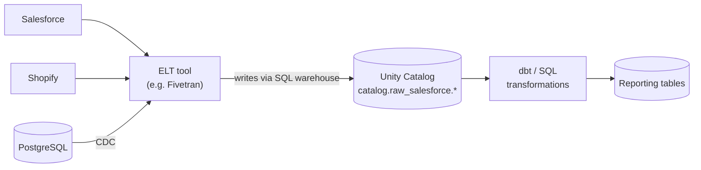

# Fivetran and ELT Tools

Mastery: `INPUT[inlineSelect(option(new), option(learning), option(solid)):mastery]`

> [!story] Context
> [[dbt]] transforms data that is already in the platform. Before that step, raw data has to be copied out of SaaS applications and operational databases. Managed ELT tools such as Fivetran perform that copy without custom code.

> [!eli5] Summary
> An ELT tool copies a company's data from the apps it uses (accounting, CRM, online store, databases) into one central place for reporting, and keeps the copy up to date automatically. You choose the source and the destination; the tool handles the rest.

> [!renamed] Company change
> Fivetran and dbt Labs completed an all-stock merger on 1 June 2026, after announcing it in October 2025. The combined company operates as Fivetran + dbt Labs. Both products remain available and both integrate with Databricks.

> [!analogy]- Analogy: a mail-forwarding service
> | Mail forwarding | ELT tool |
> |---|---|
> | Mail arriving at many old addresses | Data in many SaaS apps and databases |
> | Forwarding order per address | A connector per source |
> | Delivery to one new address | Loading into one destination (warehouse or lakehouse) |
> | Forwarding only new mail | Incremental sync |
> | Opening and sorting the mail | Transformation, done afterwards (for example with dbt) |

## Background

Each SaaS application exposes data through its own [[APIs|API]], with its own authentication, pagination, rate limits, and schema changes. A hand-written extraction script per source breaks whenever the source changes a field or an API version, and a small team can maintain only a few of them.

Cloud warehouses made it practical to load raw data first and transform it afterwards inside the warehouse: [[ETL vs ELT|ELT instead of ETL]]. Managed ELT vendors turned extraction and loading into a subscription service with prebuilt connectors. Fivetran is the best-known example; others include Airbyte, Stitch, Matillion, and Qlik. Together with [[dbt]] for transformation and [[BI Tools]] for reporting, these tools made up the core of the "modern data stack".

## Overview

A managed ELT tool provides:

| Capability | What it means |
|---|---|
| **Prebuilt connectors** | Source-specific code for SaaS apps (Salesforce, HubSpot, Shopify, NetSuite, Google Ads) and databases (PostgreSQL, MySQL, SQL Server, Oracle) |
| **Incremental sync** | After the first full load, only new and changed records are copied, using API cursors or database [[Change Data Capture\|change data capture]] |
| **Schema handling** | New source columns are added to destination tables automatically; deletes and renames are handled by documented rules |
| **Scheduling and retries** | Syncs run on a schedule with automatic retries and alerts |
| **Destinations** | Warehouses and lakehouses, including Databricks |
| **Usage-based billing** | Most vendors bill by volume of rows changed or synced; see each vendor's pricing page |

The tool does extraction and loading only. Cleaning and modeling happen afterwards, in SQL or [[dbt]].

## How it works



### Connect Fivetran to Databricks with Partner Connect

1. In the workspace, open **Marketplace**, then under **Partner Connect integrations** select **View all**, and select the **Fivetran** tile.
2. Choose a [[SQL Warehouses|SQL warehouse]] and, if the workspace uses [[Unity Catalog]], a target catalog.
3. Databricks provisions the credentials and opens Fivetran, where you finish creating or signing in to the Fivetran account.
4. In Fivetran, add connectors. Each connector writes into its own schema in the selected catalog.

Requirements from the Databricks docs:

- Workspace admin, or `CAN USE` on a SQL warehouse plus permission to use tokens.
- For Unity Catalog destinations: `USE CATALOG` and `CREATE SCHEMA` on the target catalog.
- If someone in the organization already connected Fivetran through Partner Connect, the tile shows a check mark and a Fivetran admin must add you to that account.

To connect manually instead, enter the SQL warehouse's **Server Hostname** and **HTTP Path** and a credential in Fivetran's Databricks destination settings. Databricks recommends OAuth or service principal tokens for automated tools rather than personal tokens.

### The native alternative: Lakeflow Connect

```sql
-- After a Lakeflow Connect pipeline lands Salesforce data, query it like any table
SELECT Name, AnnualRevenue
FROM   main.raw_salesforce.account
WHERE  AnnualRevenue > 1000000;
```

[[Lakeflow Connect]] provides Databricks-managed connectors that create ingestion pipelines directly in the workspace. See the bridge below.

## Small-business considerations

> [!smallbiz] Small-business considerations
> Managed ingestion is usually the highest-value purchase for a team with one data person, because it removes the most fragile code. Before choosing a tool:
> 1. **Check native coverage first.** If [[Lakeflow Connect]] supports your sources, use it; ingestion then runs and bills inside Databricks with no second vendor.
> 2. **Use an ELT vendor for the long tail.** Fivetran and similar tools cover far more SaaS sources than any platform's native connectors.
> 3. **Watch the meter.** ELT tools bill by data volume changed. A high-churn table (for example, an events table updated every minute) can dominate the bill. Sync only the tables you need.
> 4. **Keep raw separate.** Land each source in its own raw schema and transform from there (the [[Medallion Architecture]]).

> [!bridge]- In Databricks today
> The ELT tool's job is split between two Databricks features:
> - **[[Lakeflow Connect]]** offers managed connectors for SaaS applications (for example Salesforce, Workday, ServiceNow, Google Analytics) and databases (for example SQL Server, through change tracking or change data capture). SaaS connectors run on serverless compute and handle authentication, incremental reads, schema evolution, and retries. Connector status varies (some are GA, some in Public Preview); check the connector list in the docs for the current status of each source.
> - **Files** landing in cloud storage are ingested with [[Auto Loader]] or [[COPY INTO]].
>
> Third-party ELT tools still plug in. Fivetran is available through [[Partner Connect]] or as a manually configured Databricks destination, and other ELT vendors appear in the Databricks technology partners list. On Azure, [[Azure Data Factory with Databricks|Azure Data Factory]] is a common alternative for copy pipelines. Moving existing pipelines is covered in [[Migrating ETL Tools]].

## Cloud differences

> [!azure]- Azure Databricks
> Partner Connect requires the Premium plan on Azure Databricks and is not available in Azure China or Azure Government regions. Azure Data Factory is often used alongside or instead of a third-party ELT tool.

> [!aws]- Databricks on AWS
> Partner Connect and Lakeflow Connect work as described. Partner Connect is not available on FedRAMP workspaces. See [[Databricks on AWS GovCloud]] for regulated environments.

> [!gcp]- Databricks on Google Cloud
> Fivetran and Lakeflow Connect setup follow the same steps. Google Analytics and Google Ads data may also already be in BigQuery; see [[BigQuery Integration]].

## Advanced topics

> [!deepdive]- Advanced topics (301–401)
> - **CDC mechanics.** Database connectors read the source's change log (for example SQL Server change tracking or change data capture) rather than querying full tables. Enabling these features on the source is a prerequisite and requires a database administrator.
> - **Schema-change rules differ by connector.** For example, the Lakeflow Connect Salesforce connector treats a column rename as a delete plus an add, while the SQL Server connector requires a full refresh of affected tables after certain schema changes. Read the connector's limitations page before relying on automatic handling.
> - **Soft deletes.** Many ELT tools mark deleted source rows with a flag column instead of deleting them. Downstream models must filter on that flag.
> - **Destination writes.** Third-party tools write through a SQL warehouse, so the warehouse's size and auto-stop setting affect both sync speed and Databricks cost.
> - **Reverse direction.** Pushing modeled data back into SaaS tools is [[Reverse ETL]], a separate product category.

## Common misconceptions

> [!confusion] ELT tools do not transform data
> They copy data and apply light typing. Business logic (joins, cleaning, metrics) belongs in SQL, [[dbt]], or [[Lakeflow Spark Declarative Pipelines]].

> [!confusion] Partner Connect is not a connector
> [[Partner Connect]] is a setup shortcut that provisions credentials and compute for a partner tool. The connector itself runs in the partner's service.

## Recall

What does a managed ELT tool do?::Extracts data from SaaS apps and databases and loads it into a warehouse or lakehouse, keeping it in sync incrementally.
What is the difference between ETL and ELT?::ETL transforms data before loading; ELT loads raw data first and transforms it inside the destination platform.
What is Databricks' native equivalent of Fivetran?::Lakeflow Connect managed connectors.
What does Partner Connect set up for Fivetran?::A connection to a chosen SQL warehouse (and target catalog), with credentials, then opens Fivetran to finish setup.
Which Unity Catalog privileges does a Fivetran destination need on the target catalog?::`USE CATALOG` and `CREATE SCHEMA`.
What two values identify a SQL warehouse in a manual tool connection?::Server Hostname and HTTP Path.
On which compute do Lakeflow Connect SaaS connectors run?::Serverless compute.
When did Fivetran and dbt Labs complete their merger?::1 June 2026.

## Next steps

> [!path] Learning path
> **Needs first:** [[ETL vs ELT]], [[APIs]], [[Ingestion]]
> **Unlocks next:** [[Lakeflow Connect]], [[Partner Connect]], [[BI Tools]]

> [!nextup] Next
> [[BI Tools]] covers the final layer of the stack: the dashboards and reports that read the modeled tables.

> [!sources]- Sources (last verified: 2026-10-25)
> - [Connect to Fivetran (AWS)](https://docs.databricks.com/aws/en/partners/ingestion/fivetran)
> - [Connect to Fivetran (Azure Databricks)](https://learn.microsoft.com/en-us/azure/databricks/partners/ingestion/fivetran)
> - [Connect to Fivetran (GCP)](https://docs.databricks.com/gcp/en/partners/ingestion/fivetran)
> - [Walkthrough: Connect to Fivetran using Partner Connect (AWS)](https://docs.databricks.com/aws/en/partner-connect/walkthrough-fivetran)
> - [What is Databricks Partner Connect? (Azure Databricks)](https://learn.microsoft.com/en-us/azure/databricks/integrations/partner-connect)
> - [Technology partners (AWS)](https://docs.databricks.com/aws/en/integrations)
> - [What is Lakeflow Connect? (AWS)](https://docs.databricks.com/aws/en/ingestion/overview)
> - [What is Lakeflow Connect? (Azure Databricks)](https://learn.microsoft.com/en-us/azure/databricks/ingestion/overview)
> - [Lakeflow Connect connector concepts (AWS)](https://docs.databricks.com/aws/en/ingestion/lakeflow-connect/)
> - [Managed SaaS connectors (AWS)](https://docs.databricks.com/aws/en/ingestion/lakeflow-connect/saas-overview)
> - [SaaS connectors in Lakeflow Connect (GCP)](https://docs.databricks.com/gcp/en/ingestion/lakeflow-connect/saas-overview)
> - [Managed connector FAQs (AWS)](https://docs.databricks.com/aws/en/ingestion/lakeflow-connect/faq)
> - [Fivetran + dbt Labs complete merger (dbt Labs)](https://www.getdbt.com/blog/fivetran-dbt-labs-complete-merger-to-create-the-data-infrastructure-for-trusted-ai-agents)
>
> **Unconfirmed:** the list of other ELT vendors (Airbyte, Stitch, Matillion, Qlik), the soft-delete behavior, and the volume-based billing model are general industry knowledge, not checked against each vendor's docs.
