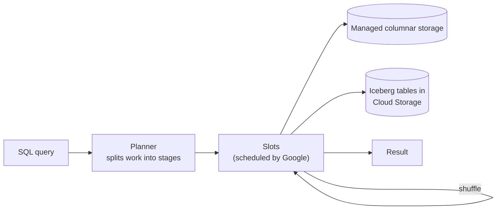

# Google BigQuery

Mastery: `INPUT[inlineSelect(option(new), option(learning), option(solid)):mastery]`

> [!story] Context
> [[Snowflake]] separates storage from compute, but users still choose and start virtual warehouses. Google BigQuery is a serverless warehouse: Google allocates compute for each query, and there is no cluster for the user to size or manage.

> [!eli5] Summary
> BigQuery is Google Cloud's data warehouse. You load data and run SQL; Google provides as much computing power as each query needs and releases it afterwards. There are no servers to set up.

## Background

BigQuery is based on Dremel, a Google system for interactive SQL-like queries over very large datasets, described in the paper "Dremel: Interactive Analysis of Web-Scale Datasets" (VLDB 2010). Dremel addressed a limitation of batch systems such as those in the [[Google File System and MapReduce Papers|GFS and MapReduce papers]]: MapReduce jobs took minutes to hours, while analysts needed interactive response times.

Google announced BigQuery in 2010 and made it generally available in 2011–2012; published accounts differ on the exact general-availability date, and these dates were not confirmed against a Google primary source for this note.

BigQuery's defining characteristic is that there are **no clusters to manage**: no nodes to size, no indexes, and no maintenance operations for the user to run.

## Overview

Google's documentation describes BigQuery as a fully managed, serverless warehouse whose architecture separates storage from compute.

| Part | What it is |
|---|---|
| **Storage** | Managed columnar storage, billed separately as *active* or *long-term*. A table unmodified for 90 days moves to the long-term rate, with no change in performance or durability. |
| **Compute** | Work is measured in **slots** (units of virtual CPU). Google schedules them for you. |
| **On-demand pricing** | The default: pay per TiB of data scanned by your queries. A project gets up to about 2,000 concurrent slots, with bursts. |
| **Capacity pricing** | Buy slot capacity through BigQuery *editions*, with autoscaling or commitments. |
| **Open tables** | Apache Iceberg managed tables keep data in Cloud Storage buckets you own, so other engines can read one copy. Google now brands this area *Lakehouse for Apache Iceberg* (formerly BigLake). |

Prices are on Google's official [BigQuery pricing page](https://cloud.google.com/bigquery/pricing).

## How it works



BigQuery divides each query into stages executed by slots in parallel, with data exchanged between stages. Because storage is separate from compute, any slot can read any table.

Because on-demand billing is by bytes scanned, query style matters for the bill:

```sql
-- Bad: SELECT * reads every column of every partition you touch
-- Better: name columns, and filter on the partition column
SELECT order_id, customer_id, amount
FROM `myproject.sales.orders`
WHERE order_date BETWEEN '2026-09-01' AND '2026-09-30';

-- Partition and cluster a table so filters scan less
CREATE TABLE `myproject.sales.orders`
PARTITION BY order_date
CLUSTER BY customer_id AS
SELECT * FROM `myproject.staging.orders_raw`;
```

## Small-business considerations

> [!smallbiz] Small-business considerations
> Companies that use Google Analytics 4 or Google Ads often already export that data to BigQuery, which makes it a practical starting point for SQL reporting.
>
> Monitor the on-demand meter. A dashboard that runs `SELECT *` over a large table every five minutes is billed for every scan. Partition tables, select only needed columns, and set a quota on bytes scanned. If you later need Python, ML, or AI on the same data, compare carefully in [[Databricks vs Alternatives for Small Teams]].

> [!bridge]- In Databricks today
> BigQuery's warehouse job maps to [[Databricks SQL]] on serverless [[SQL Warehouses]], which share BigQuery's "no cluster to manage" feel. Partitioning and clustering map to [[Liquid Clustering]] on [[Delta Lake]] tables.
>
> BigQuery remains accessible from Databricks:
> - **[[Lakehouse Federation]]** lists Google BigQuery as a query federation source. Databricks pushes queries, including joins (GA and on by default for BigQuery), down to BigQuery.
> - **[[BigQuery Integration]]** covers the Spark BigQuery connector for reading and writing BigQuery tables from Databricks jobs.
> - **Iceberg** tables in GCS are readable by both engines.
> - **Migration:** [[Migrating from Google BigQuery]].

## Cloud differences

> [!gcp]- Databricks on Google Cloud
> The natural pairing. Keep the Databricks workspace and BigQuery datasets in the same region, and use a [[Google Service Accounts|Google service account]] for the connection. See [[BigQuery Integration]] and [[GCS Access via Unity Catalog]].

> [!aws]- Databricks on AWS
> BigQuery is a Google Cloud service. You can federate to it from AWS, but cross-cloud [[Egress|egress]] and latency usually make this a migration or occasional-lookup path.

> [!azure]- Azure Databricks
> Same as AWS: use federation for occasional queries, or migrate.

## Advanced topics

> [!deepdive]- Advanced topics (301–401)
> - **Dremel's design** combined nested columnar storage (encoding repeated and nested fields in columns) with a multi-level execution tree for aggregation. [[Apache Parquet]]'s encoding of nested data is based on the Dremel paper.
> - **Slots and fairness.** Under capacity pricing, reservations are shared across projects, with idle slots lent to others. On-demand projects share a large pool with a per-project cap.
> - **Bytes scanned vs bytes billed.** Partition pruning and clustering reduce billed bytes; `LIMIT` on its own does not.
> - **Lock-in shape.** Native BigQuery tables are only readable through BigQuery's APIs. Iceberg managed tables are the escape hatch, and the reason the open table format debate matters.

## Common misconceptions

> [!confusion] "Serverless" does not mean "free when idle" for storage
> No compute bill while you are not querying, yes. But stored data is billed every month whether you query it or not.

> [!confusion] BigQuery is not Google Cloud Storage
> [[Google Cloud Storage]] is object storage for files. BigQuery is a warehouse with its own managed storage, though it can also read Iceberg and external tables in GCS.

## Recall

What internal Google system is BigQuery based on?::Dremel, described in the 2010 VLDB paper "Dremel: Interactive Analysis of Web-Scale Datasets".
What is a BigQuery slot?::A unit of virtual CPU used to execute queries, scheduled by Google.
What are BigQuery's two compute pricing models?::On-demand (per TiB scanned) and capacity (slots bought through editions).
What happens to the storage rate of a table untouched for 90 days?::It moves to the cheaper long-term storage rate, with no change in performance.
Why does SELECT * matter on BigQuery on-demand?::Billing is by bytes scanned, so reading unneeded columns raises the bill.
How can Databricks query BigQuery without copying data?::Lakehouse Federation query federation, or the Spark BigQuery connector.

## Next steps

> [!path] Learning path
> **Needs first:** [[Data Warehouses]], [[Columnar Storage]], [[Storage vs Compute]]
> **Unlocks next:** [[Data Lakes]], [[BigQuery Integration]], [[Migrating from Google BigQuery]]

> [!nextup] Next
> [[Data Lakes]] covers the alternative to loading everything into a warehouse: storing raw files of any format in inexpensive storage and applying structure when the data is read.

> [!sources]- Sources (last verified: 2026-10-25)
> - [BigQuery (Google Cloud)](https://cloud.google.com/bigquery)
> - [Understand slots (BigQuery docs)](https://docs.cloud.google.com/bigquery/docs/slots)
> - [Understand BigQuery editions (BigQuery docs)](https://docs.cloud.google.com/bigquery/docs/editions-intro)
> - [Introduction to workload management (BigQuery docs)](https://docs.cloud.google.com/bigquery/docs/reservations-intro)
> - [Estimate and control costs (BigQuery docs)](https://docs.cloud.google.com/bigquery/docs/best-practices-costs)
> - [BigQuery pricing](https://cloud.google.com/bigquery/pricing)
> - [Apache Iceberg managed tables (BigQuery docs)](https://docs.cloud.google.com/bigquery/docs/biglake-iceberg-tables-in-bigquery)
> - [Introduction to BigLake tables (BigQuery docs)](https://docs.cloud.google.com/bigquery/docs/biglake-intro)
> - [Lakehouse for Apache Iceberg, formerly BigLake (Google Cloud)](https://cloud.google.com/products/lakehouse)
> - [What is query federation? (AWS)](https://docs.databricks.com/aws/en/query-federation/database-federation)
> - [Connect to external databases and catalogs (GCP)](https://docs.databricks.com/gcp/en/query-federation)
>
> **Unconfirmed:** BigQuery's 2010 announcement and 2011–2012 general-availability dates, the Dremel paper details (VLDB 2010; Parquet's nested encoding derived from it), and the slot-fairness and `LIMIT` billing notes in Advanced topics were not confirmed against a Google primary source in this pass.
