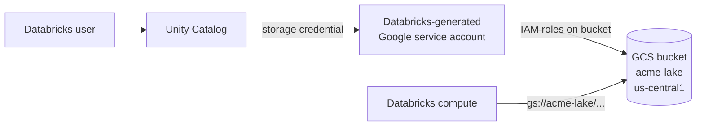

# Google Cloud Storage

Mastery: `INPUT[inlineSelect(option(new), option(learning), option(solid)):mastery]`

> [!story] Context
> [[Azure Data Lake Storage]] and [[Amazon S3]] are the object stores of Azure and AWS. Google Cloud Storage is Google Cloud's equivalent, using the same bucket-and-object model as S3. It holds lake files on Google Cloud, including the open tables that [[Google BigQuery]] can read.

> [!eli5] Summary
> Google Cloud Storage is Google Cloud's service for storing files of any size and number. You create a named bucket, upload files, and Google keeps them durable. Databricks on Google Cloud stores its data there.

## Background

Google's internal distributed storage, described in the [[Google File System and MapReduce Papers|Google File System paper]], predates its public cloud. Cloud Storage offers object storage as a public service using the model [[Amazon S3]] established: buckets, objects, and an HTTP API. On Google Cloud it fills the role S3 fills on AWS: durable, low-cost storage for raw files, exports, and [[Delta Lake]] or [[Apache Iceberg]] tables.

## Overview

Cloud Storage keeps **objects** in **buckets**. A bucket has a globally unique name, a **location**, and a **default storage class**. Objects inherit the bucket's class unless set otherwise.

**Locations:**

| Location type | Example | When to use |
|---|---|---|
| Region | `us-central1` | Default for analytics. Put it in the same region as your Databricks workspace. |
| Dual-region | a pair of regions | Higher availability with predictable placement |
| Multi-region | `US`, `EU`, `ASIA` | Content served widely; usually not needed for a lakehouse |

**Storage classes** (all four are available in every location type):

| Class | Minimum storage duration | Retrieval fee | Typical use |
|---|---|---|---|
| Standard | none | no | Live tables, anything queried often (the default) |
| Nearline | 30 days | yes | Accessed less than once a month |
| Coldline | 90 days | yes | Accessed less than once a quarter |
| Archive | 365 days | yes | Accessed less than once a year |

Access is controlled by Google Cloud [[IAM]], usually granted to [[Google Service Accounts|service accounts]]. Pricing is per GB-month by class and location, per operation, plus retrieval and network charges; see Google's official Cloud Storage pricing page.

## How it works



**The URI scheme.** Databricks and Spark address Cloud Storage as `gs://`:

```text
gs://acme-lake/curated/orders/order_date=2026-10-24/part-0000.parquet
└┬─┘ └───┬───┘ └──────────────────────┬──────────────────────────────┘
scheme bucket                   object name
```

As in S3, the slashes are part of the object name; "folders" are prefixes (GCS also offers an optional hierarchical namespace for buckets, but standard buckets are flat).

Creating a bucket and connecting it:

```bash
gcloud storage buckets create gs://acme-lake \
  --location=us-central1 --default-storage-class=STANDARD \
  --uniform-bucket-level-access

gcloud storage cp orders.csv gs://acme-lake/raw/orders/
gcloud storage ls gs://acme-lake/raw/orders/
```

```sql
-- After an admin creates a storage credential (Databricks generates a
-- Google service account for it) and grants that account roles on the bucket:
CREATE EXTERNAL LOCATION IF NOT EXISTS acme_lake
  URL 'gs://acme-lake/'
  WITH (STORAGE CREDENTIAL acme_gcs_cred);

SELECT * FROM read_files('gs://acme-lake/raw/orders/', format => 'csv', header => true) LIMIT 10;
```

## Small-business considerations

> [!smallbiz] Small-business considerations
> For most small teams, one regional bucket in the same region as the Databricks workspace is sufficient: Standard class, uniform bucket-level access, and soft delete or object versioning enabled. Do not store live tables in Nearline or colder classes, which have minimum storage durations and retrieval fees. If marketing data already flows into BigQuery from Google Analytics or Google Ads, account for that when deciding where tables live (see [[BigQuery Integration]]).

> [!bridge]- In Databricks today
> GCS is the storage layer of Databricks on Google Cloud. [[Delta Lake]] tables and [[Volumes]] live in GCS buckets. When you create a Unity Catalog storage credential on GCP, **Databricks generates a Google service account** for it; you grant that account roles on your bucket, then create [[Storage Credentials and External Locations|external locations]]. See [[GCS Access via Unity Catalog]]. Ingest new files with [[Auto Loader]] or [[COPY INTO]].

## Cloud differences

> [!gcp]- Databricks on Google Cloud
> The home cloud for GCS. See [[GCS Access via Unity Catalog]], [[Google Service Accounts]], [[Private Service Connect]] for private connectivity, and [[Customer-Managed Keys on Google Cloud]] for Cloud KMS keys.

> [!aws]- Databricks on AWS
> The equivalent is [[Amazon S3]] (`s3://`). Cross-cloud reads from GCS incur Google network egress; prefer [[OpenSharing]] for sharing across clouds.

> [!azure]- Azure Databricks
> The equivalent is [[Azure Data Lake Storage]] (`abfss://`).

## Advanced topics

> [!deepdive]- Advanced topics (301–401)
> - **Strong consistency.** Cloud Storage provides strong consistency for reads after writes and for listings.
> - **No atomic rename on flat buckets.** Renaming a prefix means copying and deleting every object, the same issue as S3. Delta's log-based commits avoid relying on rename.
> - **Uniform bucket-level access** disables per-object ACLs so that IAM alone governs the bucket. It simplifies audits and is the right default for a lakehouse bucket.
> - **BigQuery and GCS share data** through Apache Iceberg managed tables, whose files live in a bucket you own. This makes GCS a shared storage layer for BigQuery and Databricks. See [[Google BigQuery]].
> - **Lifecycle rules** can change class or delete objects by age. As on other clouds, never tier a live Delta table's files to a colder class.

## Common misconceptions

> [!confusion] Google Cloud Storage is not Google Drive
> Drive is for people sharing documents. Cloud Storage is for applications and data platforms, billed through a Google Cloud project, accessed by `gs://` paths and APIs.

> [!confusion] Storage class is not location
> Location (region, dual-region, multi-region) decides *where* data lives; storage class decides *how it is priced for access*. You choose both, separately.

## Recall

What URI scheme does Databricks use for Google Cloud Storage?::`gs://bucket/object-name`.
Name the four GCS storage classes.::Standard, Nearline, Coldline, Archive.
What are the minimum storage durations for Nearline, Coldline, and Archive?::30 days, 90 days, and 365 days.
What storage class does a new bucket get if you do not choose one?::Standard.
How does Unity Catalog get access to a GCS bucket?::Databricks generates a Google service account for the storage credential, and you grant that account roles on the bucket.
What are GCS's AWS and Azure equivalents?::Amazon S3 (s3://) and Azure Data Lake Storage (abfss://).
Where should a Databricks lakehouse bucket live?::In a single region, the same one as the Databricks workspace.

## Next steps

> [!path] Learning path
> **Needs first:** [[Object Storage]], [[Google Service Accounts]]
> **Unlocks next:** [[GCS Access via Unity Catalog]], [[Databricks on Google Cloud Overview]], [[Delta Lake]]

> [!nextup] Next
> [[Data Swamps]] describes what happens to data lakes on any of these stores when they lack catalogs, ownership, and quality controls.

> [!sources]- Sources (last verified: 2026-10-25)
> - [Storage classes (Google Cloud docs)](https://docs.cloud.google.com/storage/docs/storage-classes)
> - [Cloud Storage (Google Cloud)](https://cloud.google.com/storage)
> - [Create a bucket with options (Google Cloud docs)](https://docs.cloud.google.com/storage/docs/samples/storage-create-bucket-class-location)
> - [All you need to know about Cloud Storage (Google Cloud)](https://cloud.google.com/blog/topics/developers-practitioners/all-you-need-know-about-cloud-storage)
> - [How to save on Google Cloud Storage costs (Google Cloud)](https://cloud.google.com/blog/products/storage-data-transfer/how-to-save-on-google-cloud-storage-costs)
> - [Apache Iceberg managed tables (BigQuery docs)](https://docs.cloud.google.com/bigquery/docs/biglake-iceberg-tables-in-bigquery)
>
> **Unconfirmed:** dual-region locations, the optional hierarchical namespace for buckets, uniform bucket-level access behavior, strong consistency, and the exact `gcloud storage` flags were not confirmed against Google Cloud documentation in this pass. The Unity Catalog setup (a Databricks-generated service account) follows [[GCS Access via Unity Catalog]].
