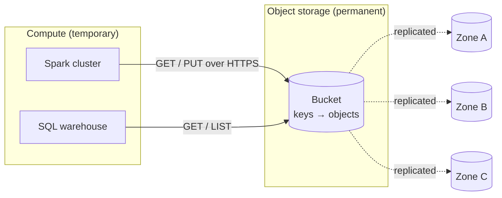

# Object Storage

Mastery: `INPUT[inlineSelect(option(new), option(learning), option(solid)):mastery]`

> [!story] Context
> [[Data Lakes]] need inexpensive, durable storage for large volumes of files. On [[HDFS]], storage is tied to a running Hadoop cluster. Cloud object storage provides storage as a service, billed by volume, with no servers for the user to run.

> [!eli5] Summary
> Object storage is a cloud service for keeping files of any size and number. You upload a file under a name, the provider stores several copies to protect it, and you pay monthly for the amount stored.

## Background

In [[Apache Hadoop]], storage ([[HDFS]]) and compute run on the same machines, which reduces network transfer. The cost is coupling: storing more data requires more servers, and the cluster cannot be shut down without losing access to the data.

Object storage removes that coupling. [[Amazon S3]] launched on **14 March 2006**, and Azure and Google Cloud offer equivalent services. The provider operates the disks, and you pay per gigabyte stored and per request. Engines read directly from object storage over the cloud network, so compute can be temporary: start a cluster, read from the bucket, and shut the cluster down. This [[Storage vs Compute|separation of storage and compute]] is the basis of modern data platforms, including Databricks.

## Overview

Object storage keeps **objects** (any bytes, plus [[Metadata|metadata]]) in a flat namespace of **keys** inside **buckets**. It is not a disk and not a traditional file system:

| Property | What it means for data work |
|---|---|
| **Flat namespace** | `raw/2026/10/file.json` is one key. The slashes resemble folders, but "folders" are shared key prefixes. Listing and renaming "folders" can be slow. (Azure's hierarchical namespace is the exception; see [[Azure Data Lake Storage]].) |
| **Immutable objects** | You write or replace a whole object. No editing byte 500 of a file. This is why table formats write new files rather than updating old ones. |
| **High durability** | Data is [[Replication\|replicated]] across devices and often across [[Availability Zone\|availability zones]]. AWS designs S3 for 99.999999999% (eleven nines) durability. |
| **HTTP [[APIs\|API]]** | Everything is a `PUT`, `GET`, `LIST`, or `DELETE` over HTTPS ([[REST]]). |
| **Pay as you go** | Billed per GB-month stored, per request, and for data leaving the cloud ([[Egress\|egress]]). See each provider's pricing page. |
| **Storage classes** | Hot, cool, cold, and archive tiers trade lower storage price for higher access cost. |

The three big clouds each have one, and each has its own path format:

| Cloud | Service | Container | URI scheme Databricks uses |
|---|---|---|---|
| AWS | [[Amazon S3]] | bucket | `s3://bucket/path/file.parquet` |
| Azure | [[Azure Data Lake Storage]] (Blob Storage with hierarchical namespace) | container in a storage account | `abfss://container@account.dfs.core.windows.net/path/file.parquet` |
| Google Cloud | [[Google Cloud Storage]] | bucket | `gs://bucket/path/file.parquet` |

## How it works



From Databricks you read objects by path, and [[Unity Catalog]] decides whether you may:

```python
# The same call on every cloud; only the URI scheme changes.
df_aws   = spark.read.parquet("s3://acme-lake/curated/orders/")
df_azure = spark.read.parquet("abfss://lake@acmestorage.dfs.core.windows.net/curated/orders/")
df_gcp   = spark.read.parquet("gs://acme-lake/curated/orders/")
```

```sql
-- Better: register the location once, then use governed tables and volumes
CREATE EXTERNAL LOCATION acme_lake
  URL 's3://acme-lake/'
  WITH (STORAGE CREDENTIAL acme_lake_cred);

LIST 's3://acme-lake/curated/orders/';
```

## Small-business considerations

> [!smallbiz] Small-business considerations
> Object storage is the lowest-cost durable option for keeping data. Recommended practices: keep raw exports in one bucket (or container) rather than on individual laptops; enable versioning or soft delete so accidental overwrites are recoverable; and keep storage in the same [[Region|region]] as compute, because cross-region and outbound transfer is billed. The meter is per GB-month, per request, and per GB transferred out; see your cloud provider's pricing page.

> [!bridge]- In Databricks today
> Object storage is where Databricks stores your data. [[Delta Lake]] tables are Parquet files plus a transaction log in a bucket; [[Volumes]] hold non-tabular files. You either bring your own bucket, connected through [[Storage Credentials and External Locations|storage credentials and external locations]], or, in serverless-first setups, use Databricks-managed default storage. Either way, [[Unity Catalog]] hands compute short-lived credentials for exactly the files a user is allowed to read. Databricks does not use cluster-local [[HDFS]] for table storage.

## Cloud differences

> [!azure]- Azure Databricks
> Use an ADLS storage account (hierarchical namespace on) and the `abfss://` scheme. Unity Catalog reaches it through an Access Connector's managed identity. See [[Azure Data Lake Storage]] and [[ADLS and Access Connectors]].

> [!aws]- Databricks on AWS
> Use S3 and the `s3://` scheme. Unity Catalog reaches it through an IAM role. See [[Amazon S3]], [[S3 Access via Unity Catalog]], and [[Workspace Storage Bucket]].

> [!gcp]- Databricks on Google Cloud
> Use GCS and the `gs://` scheme. Unity Catalog reaches it through a Databricks-generated Google service account. See [[Google Cloud Storage]] and [[GCS Access via Unity Catalog]].

## Advanced topics

> [!deepdive]- Advanced topics (301–401)
> - **Consistency.** Since December 2020, S3 provides strong read-after-write consistency for writes, overwrites, and listings. Before that, some operations were eventually consistent and lake engines needed workarounds. Delta Lake's transaction log does not rely on directory listings to determine table contents.
> - **No atomic rename.** On flat namespaces, "renaming a folder" means copying every object. Hadoop-era commit protocols that relied on rename were slow and unsafe on S3. Delta's log-based commits avoid rename entirely; ADLS's hierarchical namespace makes directory renames atomic.
> - **Request costs and small files.** Each `GET` and `LIST` is billed and has latency. Thousands of tiny files cost more and read slower than a few large ones, which is why compaction matters. See [[OPTIMIZE and VACUUM]].
> - **Throughput scales with parallelism.** Object stores serve high aggregate [[Throughput|throughput]] across many concurrent readers, which suits Spark's many-task model.
> - **Lifecycle rules** move old objects to colder tiers automatically. Never tier a live Delta table's files to an archive class; reads will fail or be slow until restored.

## Common misconceptions

> [!confusion] Folders in flat object storage are key prefixes
> In S3 and GCS, `a/b/c.csv` is one key; the "folders" `a/` and `a/b/` are prefixes that consoles display as folders. ADLS with hierarchical namespace is the exception: it has real directories.

> [!confusion] Object storage is not a database
> It stores bytes. It has no idea that a set of Parquet files is "a table" or that two writes conflict. Table formats such as [[Delta Lake]] add that knowledge on top.

## Recall

What are the three basic units of object storage?::Buckets (or containers), keys, and objects (bytes plus metadata).
Why can't you edit part of an object in place?::Objects are immutable; you replace the whole object.
What durability does AWS design S3 for?::99.999999999% (eleven nines).
What URI scheme does Databricks use for S3, ADLS, and GCS?::`s3://bucket/path`, `abfss://container@account.dfs.core.windows.net/path`, and `gs://bucket/path`.
What architectural shift did object storage enable?::Separating storage from compute, so clusters can be temporary while data persists.
What did object storage replace in the Hadoop world?::HDFS, which tied storage to the cluster's own disks.
Why are many small files bad on object storage?::Each request is billed and has latency, so many tiny files cost more and read slower than a few large ones.

## Next steps

> [!path] Learning path
> **Needs first:** [[Files and File Formats]], [[Servers and the Cloud]], [[Storage vs Compute]]
> **Unlocks next:** [[Amazon S3]], [[Azure Data Lake Storage]], [[Google Cloud Storage]], [[Delta Lake]]

> [!nextup] Next
> [[Amazon S3]] covers the first public cloud object storage service and the model the others follow.

> [!sources]- Sources (last verified: 2026-10-25)
> - [What is Amazon S3? (AWS docs)](https://docs.aws.amazon.com/AmazonS3/latest/userguide/Welcome.html)
> - [Understanding and managing Amazon S3 storage classes (AWS docs)](https://docs.aws.amazon.com/AmazonS3/latest/userguide/storage-class-intro.html)
> - [Amazon S3 strong read-after-write consistency (AWS, December 2020)](https://aws.amazon.com/about-aws/whats-new/2020/12/amazon-s3-now-delivers-strong-read-after-write-consistency-automatically-for-all-applications/)
> - [Twenty years of Amazon S3 (AWS News Blog)](https://aws.amazon.com/fr/blogs/aws/twenty-years-of-amazon-s3-and-building-whats-next/)
> - [Azure Data Lake Storage overview (Microsoft Learn)](https://learn.microsoft.com/en-us/azure/storage/blobs/data-lake-storage-introduction)
> - [Use the Azure Data Lake Storage URI (ABFS) (Microsoft Learn)](https://learn.microsoft.com/en-us/azure/storage/blobs/data-lake-storage-introduction-abfs-uri)
> - [Storage classes (Google Cloud docs)](https://docs.cloud.google.com/storage/docs/storage-classes)
> - [Connect to an ADLS external location (Azure Databricks)](https://learn.microsoft.com/en-us/azure/databricks/connect/unity-catalog/cloud-storage/external-locations-adls)
>
> **Unconfirmed:** the request-rate, throughput, and lifecycle notes in Advanced topics are general guidance not re-checked against each provider's documentation.
