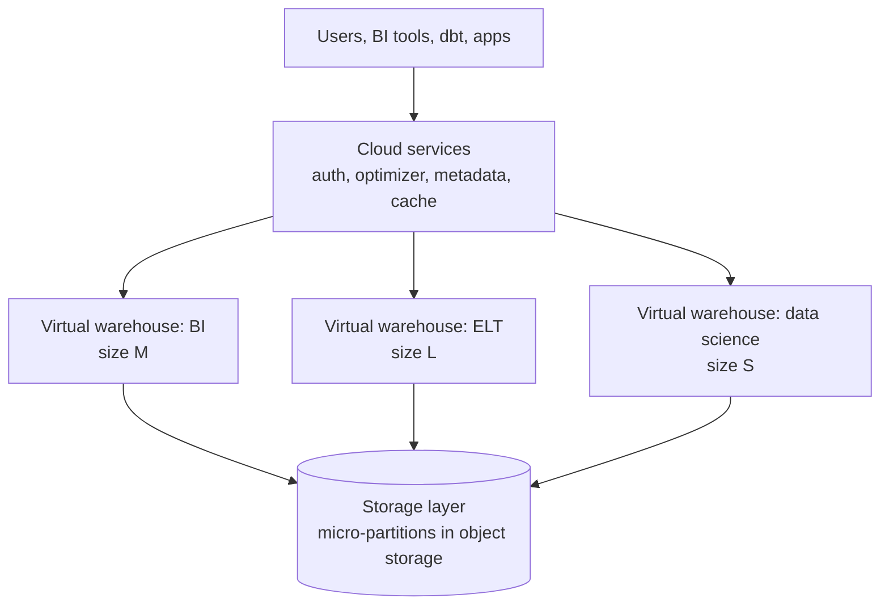

# Snowflake

Mastery: `INPUT[inlineSelect(option(new), option(learning), option(solid)):mastery]`

> [!story] Context
> [[Amazon Redshift]] moved the warehouse to the cloud, but its original node types stored data on the compute nodes, so storage and compute scaled together. Snowflake is a cloud warehouse designed to keep data in object storage and run independent compute clusters over it.

> [!eli5] Summary
> Snowflake is a cloud data warehouse. It keeps all data in one shared storage layer and lets each team run its own separately sized compute, which switches off when idle. One team's workload does not slow down another's.

> [!analogy]- Analogy: a shared archive with private reading rooms
> | Archive | Snowflake |
> |---|---|
> | One central collection of records | Database storage layer in cloud object storage |
> | Reading rooms booked by size and time | Virtual warehouses (independent compute clusters) |
> | Front desk that checks access and plans retrieval | Cloud services layer (authentication, optimizer, metadata) |

## Background

Classic warehouses, and early cloud warehouses, store data on the same machines that run queries. Adding storage means adding compute, and idle machines still cost money. In the cloud, [[Object Storage|object storage]] is inexpensive and effectively unlimited, and compute can be provisioned on demand. Snowflake's design keeps the two apart so each scales independently and compute can suspend when idle.

Snowflake was founded in 2012 (incorporated in Delaware in July 2012 as Snowflake Computing, Inc.), with Benoît Dageville among its co-founders, and first offered its platform for sale in 2014. It runs on AWS, Microsoft Azure, and Google Cloud.

## Overview

Snowflake's documentation describes a three-layer architecture that is a hybrid of shared-disk and shared-nothing designs:

| Layer | What it does | Databricks counterpart |
|---|---|---|
| **Database storage** | Tables are stored in the cloud provider's object storage, in Snowflake's own compressed columnar format, split into *micro-partitions* (50–500 MB uncompressed each) | [[Delta Lake]] tables (open Parquet files) in your bucket |
| **Compute (virtual warehouses)** | Independent clusters, sized XS upward, that run queries and loads. They do not share resources with each other. | [[SQL Warehouses]] and other [[Compute Types\|compute]] |
| **Cloud services** | Authentication, access control, query compilation and optimization, metadata, result caching | The Databricks control plane plus [[Unity Catalog]] |

Key characteristics:

- **Minimal tuning:** There are no user-managed indexes or distribution keys. Snowflake keeps value-range metadata per micro-partition and prunes automatically.
- **Elastic, isolated compute:** Separate warehouses per team; auto-suspend and auto-resume; multi-cluster warehouses for concurrency.
- **Billing by credits:** Each warehouse size consumes credits per hour while running, and each size step roughly doubles both compute power and credit rate. Storage is billed separately. See Snowflake's pricing documentation for rates.
- **Data sharing:** Snowflake accounts can share live data with each other without copying it.

Snowflake has expanded beyond SQL warehousing. Its documentation covers Apache Iceberg tables stored in customer-managed cloud storage, Snowflake Open Catalog for Iceberg, hybrid tables for transactional workloads, and programmatic interfaces for Python and other languages. Snowflake and Databricks now compete across most of these workloads.

## How it works



Day-to-day Snowflake SQL looks like this:

```sql
-- A small warehouse that sleeps after 60 seconds idle
CREATE WAREHOUSE bi_wh
  WAREHOUSE_SIZE = 'XSMALL'
  AUTO_SUSPEND   = 60
  AUTO_RESUME    = TRUE;

USE WAREHOUSE bi_wh;

-- Load Parquet files from an external stage (an S3/ADLS/GCS location)
COPY INTO raw.orders
FROM @raw.orders_stage
FILE_FORMAT = (TYPE = PARQUET)
MATCH_BY_COLUMN_NAME = CASE_INSENSITIVE;
```

This pattern, with data loaded into one platform and read by many independent compute clusters, is the core of the "modern data stack": [[Fivetran and ELT Tools|Fivetran]] loads raw data into Snowflake, [[dbt]] transforms it inside Snowflake, and [[BI Tools]] read the results.

## Small-business considerations

> [!smallbiz] Small-business considerations
> Snowflake has a short learning curve for SQL users, and auto-suspend limits compute charges for lightly used accounts. It is a reasonable choice when the main requirement is BI.
>
> When comparing Snowflake and Databricks, consider: whether Python, machine learning, or AI will run on the same data; whether data should be stored in open formats in your own storage; and who will monitor consumption. See [[Databricks vs Alternatives for Small Teams]].

> [!bridge]- In Databricks today
> Snowflake's warehouse job maps to [[Databricks SQL]] on serverless [[SQL Warehouses]] over [[Delta Lake]] or [[Apache Iceberg]] tables governed by [[Unity Catalog]]. Snowflake's data sharing maps to [[OpenSharing]], its marketplace to [[Databricks Marketplace]], and Snowpark to ordinary [[PySpark]] and notebooks.
>
> Snowflake connects to Databricks in two ways through [[Lakehouse Federation]]:
> - **Query federation:** Databricks pushes queries down to Snowflake over JDBC (join pushdown is GA and on by default for Snowflake). Snowflake compute runs the query.
> - **Catalog federation:** Databricks reads Snowflake-managed Iceberg tables directly from object storage, using Databricks compute only. The docs call this more cost-effective and performance-optimized than query federation.
>
> To move off Snowflake for good, see [[Migrating from Snowflake]] and [[Lakebridge]].

## Cloud differences

> [!azure]- Azure Databricks
> Snowflake runs on Azure too, so a Snowflake account and an Azure Databricks workspace can sit in the same Azure region. Keep them co-located to avoid [[Egress|egress]] charges when federating.

> [!aws]- Databricks on AWS
> Snowflake external stages and Iceberg tables on AWS point at S3 buckets, which Databricks can also reach through [[S3 Access via Unity Catalog]].

> [!gcp]- Databricks on Google Cloud
> Snowflake runs on Google Cloud. Keep both services in the same region, and use catalog federation for Iceberg data in GCS where possible.

## Advanced topics

> [!deepdive]- Advanced topics (301–401)
> - **Micro-partitions vs Delta files:** Both are immutable columnar chunks with per-column statistics used for pruning. The difference is openness: Delta files are Parquet in your bucket, readable by any engine; standard Snowflake tables are readable only through Snowflake.
> - **Clustering keys** in Snowflake (with Automatic Clustering, a Snowflake service that reclusters clustered tables in the background and consumes credits) play the role [[Liquid Clustering]] plays in Delta.
> - **Time travel and zero-copy cloning** are available on both platforms. A Snowflake zero-copy clone initially shares the underlying storage of its source object. See [[Time Travel]] and [[Zero-Copy]].
> - **Iceberg as common ground:** Both vendors support Apache Iceberg, so a table written by one engine can be read by another. Which catalog owns the table (a Snowflake catalog or Unity Catalog) becomes the main architectural decision. See [[Open Table Formats]] and [[Delta UniForm]].
> - **Cost models differ in shape:** Snowflake bills credits for the time each warehouse runs; Databricks bills [[DBUs]] per compute-second. Neither is cheaper in general; workload shape decides. See [[How Databricks Pricing Works]].

## Common misconceptions

> [!confusion] A Snowflake "virtual warehouse" is not a database
> It is a compute cluster. Your data is in databases and schemas in the storage layer; any warehouse with permission can query any of it. Databricks' [[SQL Warehouses|SQL warehouse]] borrows the same naming for the same idea.

> [!confusion] Snowflake does not store standard tables in your own storage
> Standard tables live in Snowflake-managed storage inside Snowflake's cloud account. Only Iceberg tables (and external tables) live in storage you own.

## Recall

What are Snowflake's three architectural layers?::Database storage, compute (virtual warehouses), and cloud services.
What is a Snowflake virtual warehouse?::An independent compute cluster that runs queries and loads, billed in credits while running.
What are micro-partitions?::Snowflake's immutable columnar storage units, 50–500 MB uncompressed, with metadata used to prune data.
Which clouds does Snowflake run on?::AWS, Microsoft Azure, and Google Cloud.
What are the two ways Lakehouse Federation connects to Snowflake?::Query federation (push SQL down to Snowflake over JDBC) and catalog federation (read Snowflake's Iceberg tables directly from object storage with Databricks compute).

## Next steps

> [!path] Learning path
> **Needs first:** [[Data Warehouses]], [[Storage vs Compute]], [[Object Storage]]
> **Unlocks next:** [[Google BigQuery]], [[Databricks vs Alternatives for Small Teams]], [[Migrating from Snowflake]]

> [!nextup] Next
> [[Google BigQuery]] covers a serverless warehouse in which no compute cluster is sized or started by the user.

> [!sources]- Sources (last verified: 2026-10-25)
> - [Snowflake key concepts and architecture (Snowflake docs)](https://docs.snowflake.com/en/user-guide/intro-key-concepts)
> - [Micro-partitions and data clustering (Snowflake docs)](https://docs.snowflake.com/en/user-guide/tables-clustering-micropartitions)
> - [Virtual warehouses (Snowflake docs)](https://docs.snowflake.com/en/user-guide/warehouses)
> - [Understanding compute cost (Snowflake docs)](https://docs.snowflake.com/en/user-guide/cost-understanding-compute)
> - [Hybrid tables (Snowflake docs)](https://docs.snowflake.com/en/user-guide/tables-hybrid)
> - [Snowflake Open Catalog overview (Snowflake docs)](https://docs.snowflake.com/en/user-guide/opencatalog/overview)
> - [What is query federation? (AWS)](https://docs.databricks.com/aws/en/query-federation/database-federation)
> - [Connect to external databases and catalogs (Azure Databricks)](https://learn.microsoft.com/en-us/azure/databricks/query-federation/)
> - [Connect to external databases and catalogs (GCP)](https://docs.databricks.com/gcp/en/query-federation)
> - [Snowflake Inc. final IPO prospectus, Form 424(b)(4), September 2020 (SEC)](https://www.sec.gov/Archives/edgar/data/1640147/000162828020013667/snowflake424b4.htm)
> - [Automatic Clustering (Snowflake docs)](https://docs.snowflake.com/en/user-guide/tables-auto-reclustering)
> - [Data storage considerations: cloned table, schema, and database storage (Snowflake docs)](https://docs.snowflake.com/en/user-guide/tables-storage-considerations)
> - [Cloning considerations (Snowflake docs)](https://docs.snowflake.com/en/user-guide/object-clone)
