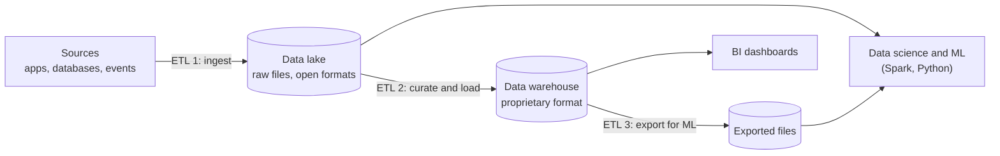

# The Two-Tier Architecture Problem

Mastery: `INPUT[inlineSelect(option(new), option(learning), option(solid)):mastery]`

> [!story] Context
> The previous notes in this chapter describe two kinds of systems: [[Data Lakes|data lakes]] for raw files, data science, and machine learning, and [[Data Warehouses|data warehouses]] for SQL and [[BI Tools|BI]]. Most organizations ran both, connected by [[ETL vs ELT|ETL]] pipelines. This note describes the costs of that arrangement.

> [!eli5] Summary
> Many companies kept two separate copies of their data: a cheap, messy store for raw files and a tidy, expensive one for reports. Keeping them in sync costs money and effort, the reports often lag behind, and the two copies can disagree.

## Background

Lakes and warehouses each solved half of the problem:

| Need | Data lake | Data warehouse |
|---|---|---|
| Cheap storage for all data, any format | Yes | No |
| Open formats readable by any engine | Yes | No (proprietary storage) |
| Machine learning and Python on raw data | Yes | Limited |
| [[ACID Transactions\|ACID transactions]], updates, deletes | No | Yes |
| Fast, concurrent SQL for BI | Limited | Yes |
| Built-in governance and access control | No | Yes |

Because neither covered every need, the common design was a **two-tier architecture**: land everything in the lake, then copy a curated subset into a warehouse for BI. The 2021 paper *Lakehouse: A New Generation of Open Platforms that Unify Data Warehousing and Advanced Analytics* (Armbrust, Ghodsi, Xin, and Zaharia, CIDR 2021) describes this pattern and lists its problems. See [[The Lakehouse Paper]].

## Overview

The two-tier architecture problem is the cost, delay, and inconsistency that come from keeping data in both a data lake and a separate data warehouse and copying it between them.

The lakehouse paper groups the problems of the two-tier design into five areas. In plain terms:

| Problem | What happens in practice |
|---|---|
| **Reliability** | Two systems must be kept consistent. Every ETL hop between them can fail, drift, or introduce bugs, so the lake and the warehouse disagree. |
| **Data staleness** | Warehouse data is only as fresh as the last ETL run from the lake, often hours or a day behind. |
| **Limited support for advanced analytics** | Machine learning tools need direct file access to large datasets. Warehouse data is in a proprietary format, so data scientists export it back to files (a further ETL step) or work from the lake, which lacks the warehouse's transactions and governance. |
| **Total cost of ownership** | Data is stored twice, ETL compute runs continuously, and two platforms need licenses, operations, and staff. See [[Total Cost of Ownership]]. |
| **Lock-in** | Curated data lives in a vendor's format, which makes changing engines costly. See [[Vendor Lock-In]]. |

There is also a [[Data Governance|governance]] cost. Permissions, [[Data Lineage|lineage]], and audit are configured separately in each system, so the same data can carry different access rules depending on where it is read.

## How it works

A concrete example for an online retailer:

1. Orders arrive from the store database and land in the lake as Parquet every hour (**ETL 1**).
2. A nightly job cleans orders and loads them into the warehouse (**ETL 2**).
3. The finance dashboard reads the warehouse, so it shows yesterday's data.
4. The data scientist trains a demand forecast on the lake's raw orders, which have not had finance's corrections applied, so the forecast and the dashboard use different figures.
5. To use the corrected figures, the data scientist exports them from the warehouse to files (**ETL 3**), creating a third copy.

Each arrow in the diagram is a pipeline to build, schedule ([[Apache Airflow]]), monitor, and pay for.

## Small-business considerations

> [!smallbiz] Small-business considerations
> A small company can reproduce the two-tier problem at small scale: data in a cloud bucket or shared drive for one purpose, and a separate warehouse or BI extract for reporting, with a scheduled copy between them. Signs of the problem:
> - Two reports show different totals for the same month.
> - Reports are a day behind and nobody can make them faster.
> - Storage and tool bills include the same data more than once.
>
> When choosing a platform, prefer one copy of the data that serves both reporting and any future Python or AI work. That is the design goal of the lakehouse in [[Chapter 05 - The Lakehouse]].

> [!bridge]- In Databricks today
> Databricks was designed to remove the second tier. [[Delta Lake]] tables in your own object storage provide warehouse features (transactions, updates, [[Schema Enforcement and Evolution|schema enforcement]], [[Time Travel|time travel]]) on open files. [[SQL Warehouses]] serve BI from those same tables, notebooks and ML read them directly, and [[Unity Catalog]] applies one set of permissions and lineage to every workload.
>
> Organizations that still run a separate warehouse can connect it rather than copy from it: [[Lakehouse Federation]] queries Amazon Redshift, Snowflake, Google BigQuery, Azure Synapse, and other systems in place through Unity Catalog. For Snowflake-managed Iceberg tables, catalog federation reads the data directly from object storage. Consolidating fully onto one platform is covered in [[Migration Strategy Overview]].

## Cloud differences

> [!azure]- Azure Databricks
> The problem and its resolution are the same on every cloud. On Azure the typical two-tier pairing was ADLS (lake) plus Azure Synapse Analytics (warehouse).

> [!aws]- Databricks on AWS
> On AWS the typical pairing was S3 (lake) plus Amazon Redshift (warehouse), sometimes with Redshift Spectrum to query the lake directly.

> [!gcp]- Databricks on Google Cloud
> On Google Cloud the typical pairing was Cloud Storage (lake) plus BigQuery (warehouse).

## Advanced topics

> [!deepdive]- Advanced topics (301–401)
> - **The paper's evidence:** The lakehouse paper reports that a Parquet-based lakehouse prototype achieved TPC-DS performance competitive with popular cloud data warehouses, which supports the claim that a second tier is not required for BI performance.
> - **Warehouses moving toward lakes:** Cloud warehouses added the ability to read and write open table formats such as [[Apache Iceberg]] in customer-owned storage. This narrows the lock-in problem, but whichever catalog owns a table still determines how it is governed.
> - **Federation is not consolidation:** [[Lakehouse Federation]] removes copies for occasional queries, but each query runs on the remote system's compute and is limited by its performance. Heavy, repeated workloads are usually migrated.
> - **Medallion layers are not tiers:** Bronze, silver, and gold in the [[Medallion Architecture]] are stages of refinement within one platform and one format, not separate systems.

## Common misconceptions

> [!confusion] "Two-tier" does not refer to the medallion layers
> The two tiers are two separate *systems* (lake and warehouse) with separate storage, formats, and governance. Bronze, silver, and gold are layers within one system.

> [!confusion] The problem is not that warehouses are slow
> Warehouses are fast for SQL. The problem is the cost and inconsistency of maintaining a second copy and system alongside the lake.

## Recall

What is the two-tier architecture?::A data lake for raw data and ML plus a separate data warehouse for BI, connected by ETL that copies a curated subset from the lake into the warehouse.
Name the five problems the lakehouse paper attributes to the two-tier design.::Reliability, data staleness, limited support for advanced analytics, total cost of ownership, and lock-in.
Why does warehouse data become stale in a two-tier design?::It is only as fresh as the last ETL run from the lake into the warehouse.
Why is ML hard on warehouse data?::Data is stored in a proprietary format, so ML tools must export it to files first, adding another ETL step and copy.
Which paper describes the two-tier problem and proposes the lakehouse?::"Lakehouse: A New Generation of Open Platforms that Unify Data Warehousing and Advanced Analytics", CIDR 2021.
How does Databricks query an existing warehouse without copying data?::Lakehouse Federation through Unity Catalog.

## Next steps

> [!path] Learning path
> **Needs first:** [[Data Lakes]], [[Data Warehouses]], [[ETL vs ELT]]
> **Unlocks next:** [[The Lakehouse Idea]], [[The Lakehouse Paper]], [[Chapter 05 - The Lakehouse]]

> [!nextup] Next
> [[Chapter 05 - The Lakehouse]] introduces the lakehouse: one copy of data in open formats with warehouse-grade reliability and performance.

> [!sources]- Sources (last verified: 2026-10-25)
> - [Lakehouse: A New Generation of Open Platforms that Unify Data Warehousing and Advanced Analytics (CIDR 2021)](https://vldb.org/cidrdb/2021/lakehouse-a-new-generation-of-open-platforms-that-unify-data-warehousing-and-advanced-analytics.html)
> - [Lakehouse paper (Databricks research page)](https://www.databricks.com/research/lakehouse-a-new-generation-of-open-platforms-that-unify-data-warehousing-and-advanced-analytics)
> - [Lakehouse paper PDF (Databricks)](https://www.databricks.com/wp-content/uploads/2020/12/cidr_lakehouse.pdf)
> - [Connect to external databases and catalogs (AWS)](https://docs.databricks.com/aws/en/query-federation/)
> - [What is query federation? (Azure Databricks)](https://learn.microsoft.com/en-us/azure/databricks/query-federation/database-federation)
