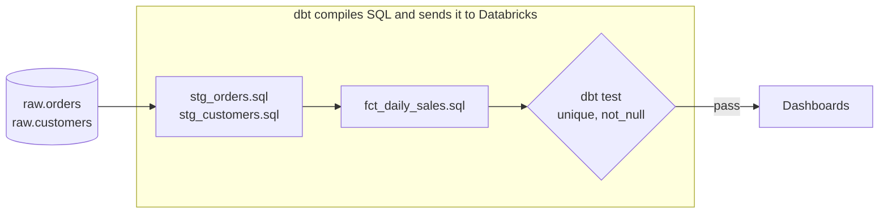

# dbt

Mastery: `INPUT[inlineSelect(option(new), option(learning), option(solid)):mastery]`

> [!story] Context
> [[Apache Airflow]] runs SQL scripts in dependency order, but does not manage the scripts themselves. Without version control, tests, and documentation, transformation SQL becomes difficult to change safely. dbt applies software engineering practices to SQL transformations.

> [!eli5] Summary
> dbt lets analysts build reporting tables the way programmers build software. Each table is defined in one small SQL file, files can refer to each other, dbt works out the build order, and tests check the results before anyone uses them.

> [!renamed] Renamed
> - **dbt Cloud → dbt platform**: Databricks' current docs call the corresponding job task the "dbt platform task".
> - **Fivetran + dbt Labs**: Fivetran and dbt Labs announced a merger on 13 October 2025 and completed it on 1 June 2026. The combined company operates as Fivetran + dbt Labs. dbt Core remains open source under the Apache 2.0 license.

## Background

Cloud warehouses such as [[Snowflake]], [[Google BigQuery]], and [[Amazon Redshift]] provide elastic compute, which favors [[ETL vs ELT|ELT over ETL]]: load raw data first (often with [[Fivetran and ELT Tools|Fivetran]]), then transform it inside the warehouse with SQL. Most transformation work then becomes SQL written by analysts, which needs the same structure as application code.

dbt ("data build tool") was created at the analytics consultancy that became dbt Labs, around 2016. It defined a discipline, *analytics engineering*, and a workflow: SQL models in a [[Git]] repository, dependencies declared with `ref()`, tests and docs next to the code, and environments for development and production. It is the transformation layer of the modern data stack.


## Overview

dbt is a **compiler and runner for SQL transformations**. It does not store or process data; it generates SQL and sends it to your platform.

| Piece | What it is |
|---|---|
| **dbt Core** | The open-source command-line tool (`dbt run`, `dbt test`, `dbt build`) |
| **dbt platform** (formerly dbt Cloud) | dbt Labs' hosted service: web IDE, scheduler, CI, docs hosting |
| **Adapter** | A plugin that teaches dbt one platform's SQL. For Databricks it is **`dbt-databricks`**. |
| **Model** | A `.sql` file with one `SELECT`; dbt turns it into a table or view |
| **`ref()` / `source()`** | Functions that link models to each other and to raw tables, building the [[DAG]] |
| **Materialization** | How a model is built: `view`, `table`, `incremental`, `materialized_view`, `streaming_table`, ... |
| **Tests** | Assertions on data (`unique`, `not_null`, `relationships`, custom SQL) |
| **Jinja** | A templating language for loops, variables, and macros inside SQL |

## How it works



A model, `models/marts/fct_daily_sales.sql`:

```sql
{{ config(materialized='incremental', unique_key='sale_date') }}

SELECT
  o.order_date        AS sale_date,
  c.region,
  SUM(o.amount)       AS revenue,
  COUNT(*)            AS orders
FROM {{ ref('stg_orders') }}    o
JOIN {{ ref('stg_customers') }} c USING (customer_id)

WHERE o.order_date >= (SELECT MAX(sale_date) FROM {{ this }})

GROUP BY 1, 2
```

Tests in `models/marts/schema.yml` ([[YAML]]):

```yaml
models:
  - name: fct_daily_sales
    columns:
      - name: sale_date
        tests: [not_null]
      - name: revenue
        tests: [not_null]
```

Connecting dbt Core to Databricks, in `~/.dbt/profiles.yml`:

```yaml
acme:
  target: dev
  outputs:
    dev:
      type: databricks
      catalog: dev
      schema: analytics
      host: <workspace-host>.cloud.databricks.com
      http_path: /sql/1.0/warehouses/<warehouse-id>
      auth_type: oauth          # Databricks recommends OAuth
```

```bash
pip install dbt-databricks
dbt build      # run models and tests in dependency order
```

## Small-business considerations

> [!smallbiz] Small-business considerations
> Adopt dbt when more than a few SQL transformations feed reports, or when more than one person edits them. It provides change history, tests that catch incorrect figures before they reach reports, and generated documentation. A one-person team with a few queries can start with SQL in Databricks and a [[Lakeflow Jobs|scheduled job]], and adopt dbt once queries depend on each other. dbt Core is free and open source; the hosted dbt platform has its own pricing.

> [!bridge]- In Databricks today
> dbt runs on Databricks as a supported integration rather than being replaced by a Databricks feature:
> - **`dbt-databricks`** is the adapter to use. The docs note it is the default for new dbt platform projects and supports [[Unity Catalog]] (the older `dbt-spark` adapter does not). Point it at a [[SQL Warehouses|SQL warehouse]].
> - **Run dbt Core inside Databricks** with the dbt task in [[Lakeflow Jobs]], which runs your project on Databricks compute. Databricks recommends pinning the `dbt-databricks` version (1.6.0 or later).
> - **Trigger the hosted dbt platform** with the separate *dbt platform task* in Lakeflow Jobs, or connect it through [[Partner Connect]], which sets up a service principal, token, and SQL warehouse (named `DBT_CLOUD_ENDPOINT` by default).
> - **The native alternative** is [[Lakeflow Spark Declarative Pipelines]] with [[Materialized Views|materialized views]], [[Streaming Tables|streaming tables]], and [[Expectations and Data Quality|expectations]], which does the same "declare tables, the engine works out the order" job, plus streaming. Many teams use both. See [[dbt on Databricks]].

## Cloud differences

> [!azure]- Azure Databricks
> Same adapter and tasks. dbt Core can sign in to Azure Databricks with Microsoft Entra ID OAuth (documented as Public Preview). Use a [[Users Groups and Service Principals|service principal]] for production runs.

> [!aws]- Databricks on AWS
> Nothing differs beyond the workspace host name format. OAuth for dbt Core is enabled as a partner OAuth application by default.

> [!gcp]- Databricks on Google Cloud
> Nothing differs; the Databricks dbt Core guide applies as written.

## Advanced topics

> [!deepdive]- Advanced topics (301–401)
> - **Materializations on Databricks.** Beyond `table`, `view`, and `incremental`, `dbt-databricks` can build Databricks [[Materialized Views|materialized views]] and [[Streaming Tables|streaming tables]], which are refreshed by Databricks' pipeline engine rather than by dbt rerunning SQL.
> - **Incremental strategies.** On Delta, `merge` (the default for many setups), `append`, `insert_overwrite`, and `replace_where` map to Delta's [[MERGE and Upserts|MERGE]] and partition overwrite. Pick based on whether late-arriving data can change old rows.
> - **Unity Catalog mapping.** dbt's `database` maps to a Unity Catalog *catalog*, and `schema` to a schema. Use separate catalogs (`dev`, `prod`) per target.
> - **Python models** are supported and run as Databricks jobs; useful for one or two steps that SQL cannot express.
> - **Lineage overlap.** dbt has its own model lineage; Unity Catalog captures column-level [[Data Lineage|lineage]] automatically from the queries dbt runs, including non-dbt consumers downstream.

## Common misconceptions

> [!confusion] dbt does not move data
> dbt only runs SQL inside one platform. Getting data from Salesforce into Databricks is [[Fivetran and ELT Tools|ingestion]]; dbt starts once the raw tables exist.

> [!confusion] dbt Core vs the dbt platform (dbt Cloud)
> dbt Core is the free, open-source engine you run anywhere. The dbt platform is dbt Labs' paid hosted service around it. Both use the same `dbt-databricks` adapter.

## Recall

What does dbt stand for?::data build tool.
What is a dbt model?::A SQL file containing one SELECT that dbt materializes as a table, view, or other object.
What does `ref()` do?::Refers to another model, letting dbt build the dependency DAG and run models in the right order.
Which adapter should you use for Databricks?::`dbt-databricks` (it supports Unity Catalog; `dbt-spark` does not).
How do you run a dbt Core project on Databricks compute?::With the dbt task in Lakeflow Jobs.
What is the hosted dbt service now called in Databricks' docs?::The dbt platform (formerly dbt Cloud); Lakeflow Jobs has a "dbt platform task" for it.
When did Fivetran and dbt Labs complete their merger?::1 June 2026 (announced October 2025).
Which Databricks feature overlaps most with dbt?::Lakeflow Spark Declarative Pipelines (materialized views, streaming tables, expectations).

## Next steps

> [!path] Learning path
> **Needs first:** [[SQL]], [[ETL vs ELT]], [[Git]]
> **Unlocks next:** [[dbt on Databricks]], [[Fivetran and ELT Tools]], [[Testing Data Pipelines]]

> [!nextup] Next
> [[Fivetran and ELT Tools]] covers the step before transformation: copying raw data from SaaS applications and databases into the platform.

> [!sources]- Sources (last verified: 2026-10-25)
> - [Connect to dbt Core (Azure Databricks)](https://learn.microsoft.com/en-us/azure/databricks/partners/prep/dbt)
> - [Connect to dbt Core (GCP)](https://docs.databricks.com/gcp/en/partners/prep/dbt)
> - [Connect to dbt Cloud (AWS)](https://docs.databricks.com/aws/en/partners/prep/dbt-cloud)
> - [Connect to dbt Cloud (Azure Databricks)](https://learn.microsoft.com/en-us/azure/databricks/partners/prep/dbt-cloud)
> - [dbt task for jobs (GCP)](https://docs.databricks.com/gcp/en/jobs/tasks/dbt)
> - [dbt platform task for jobs (AWS)](https://docs.databricks.com/aws/en/jobs/tasks/dbt-platform)
> - [Use dbt transformations in Lakeflow Jobs (Azure Databricks)](https://learn.microsoft.com/en-us/azure/databricks/jobs/how-to/use-dbt-in-workflows)
> - [Configure sign-on from dbt Core with Microsoft Entra ID (Azure Databricks)](https://learn.microsoft.com/en-us/azure/databricks/integrations/configure-oauth-dbt)
> - [Enable or disable partner OAuth applications (GCP)](https://docs.databricks.com/gcp/en/integrations/enable-disable-oauth)
> - [On two years of dbt (dbt Labs)](https://www.getdbt.com/blog/on-two-years-of-dbt)
> - [Fivetran + dbt Labs complete merger (dbt Labs)](https://www.getdbt.com/blog/fivetran-dbt-labs-complete-merger-to-create-the-data-infrastructure-for-trusted-ai-agents)
>
> **Unconfirmed:** the company's former name (Fishtown Analytics) and the year of its rename to dbt Labs; the list of `dbt-databricks` materializations and incremental strategies in Advanced topics, which is from general dbt knowledge rather than the adapter documentation.
