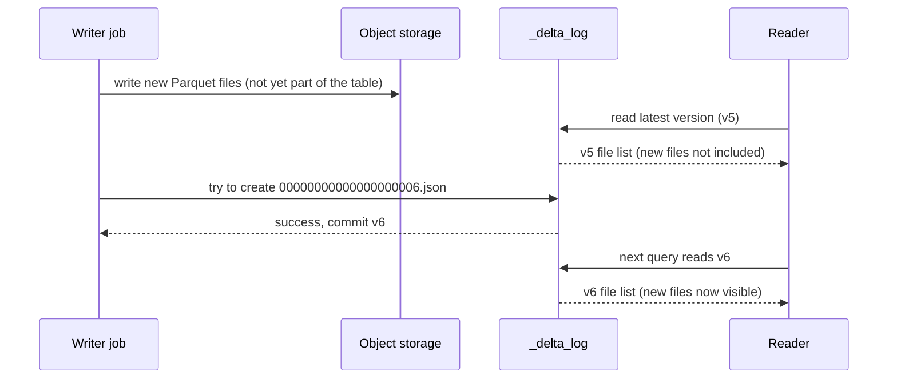

# ACID Transactions

Mastery: `INPUT[inlineSelect(option(new), option(learning), option(solid)):mastery]`

> [!story] Context
> [[The Lakehouse Paper]] requires warehouse-grade reliability on lake storage. In database terms, reliability means ACID transactions. Plain data lakes do not provide them, which is one reason they degrade into [[Data Swamps|data swamps]].

> [!eli5] Summary
> A transaction is a group of changes that the system treats as one unit. ACID guarantees that the whole change is saved or none of it is, that simultaneous changes do not interfere, and that saved changes survive failures.

> [!analogy]- Analogy: a bank transfer
> - **Atomicity:** moving 100 from savings to checking is one action. The money is never removed from savings without arriving in checking.
> - **Consistency:** the bank's rules hold before and after. No account goes below its overdraft limit because of a half-finished step.
> - **Isolation:** if you and your partner both move money at the same moment, the bank processes them as if one happened first. Neither sees the other's half-done work.
> - **Durability:** once the receipt prints, the transfer survives a crash in the bank's data center.

## Background

Consider a data lake folder `sales/2026-10-24/` that a nightly job fills with 200 Parquet files. Without transactions:

- **The job crashes at file 137.** The folder now holds a partial day. Dashboards that read it report revenue that is too low, with no indication that the data is incomplete.
- **Someone reads during the write.** A query running at 2:03 a.m. sees 90 files, another at 2:05 sees 160. Two reports, two answers.
- **Two jobs write at once.** A backfill and the regular load both write to the folder. Duplicate rows appear, or one job's cleanup deletes the other's files.
- **An update is impossible to do safely.** To fix one wrong row you must rewrite the file it lives in. If the rewrite fails halfway, the row is gone or doubled.

[[Relational Databases|Relational databases]] solved these problems decades ago with transactions. Data lakes built on plain files in [[Object Storage|object storage]] had none of it, because object stores only promise that a single object write is atomic. They know nothing about "these 200 files belong together."

## Overview

ACID is four guarantees a system makes about every **transaction** (a group of changes treated as one unit):

| Letter | Guarantee | Without it on a lake |
|---|---|---|
| **A**tomicity | All of a transaction's changes take effect, or none do. | Crashed jobs leave partial data. |
| **C**onsistency | Each transaction moves the data from one valid state to another, respecting the rules (types, constraints). | Bad columns and wrong types slip in. |
| **I**solation | Concurrent transactions do not see each other's in-progress work. The result is as if they ran one after another. | Readers see half-written tables. Writers clobber each other. |
| **D**urability | Once committed, a change survives crashes. | Usually fine on object storage, which is highly durable. |

On Databricks, tables are Delta Lake tables unless you choose otherwise (managed Iceberg is the other option), and every write to a Delta table is a transaction.

## How it works

Lakehouse formats get ACID with one trick: **a table's current state is defined by a log, and a change only "counts" once a single new log entry is written.** Data files are written first, invisible to readers. Then one small commit file is added to the log. Writing that one file is atomic, so the whole change appears at once.



- **Atomicity:** if the writer crashes before the commit, the new files are orphans that no version references. [[OPTIMIZE and VACUUM|VACUUM]] cleans them up later.
- **Isolation:** readers always read one complete version. Writers use **optimistic concurrency control**: each writer assumes no conflict, and at commit time checks whether someone else committed changes to the same data first. If so, it retries or fails with a conflict error.
- **Consistency:** the log also stores the schema and table constraints, so writes that break them are rejected (see [[Schema Enforcement and Evolution]]).
- **Durability:** the commit file sits in the same durable object storage as the data.

In SQL, you do not do anything special. Each statement is its own transaction:

```sql
-- One atomic transaction: all matching rows change, or none do
UPDATE shop.sales.orders
SET    status = 'refunded'
WHERE  order_id IN (1001, 1002, 1003);

-- One atomic transaction that inserts, updates, and deletes together
MERGE INTO shop.sales.orders t
USING shop.sales.order_updates s
ON t.order_id = s.order_id
WHEN MATCHED AND s.is_cancelled THEN DELETE
WHEN MATCHED THEN UPDATE SET *
WHEN NOT MATCHED THEN INSERT *;
```

## Small-business considerations

> [!smallbiz] Small-business considerations
> ACID transactions let a nightly load run while dashboards stay available. A dashboard reads the previous complete version until the new load commits, then reads the new complete version. It never reads a partial load.
>
> It also makes reruns safe. If a job fails, you fix it and rerun. Nothing partial was ever published, so there is nothing to clean up by hand. Pair that with [[Idempotency|idempotent]] pipelines (often built with [[MERGE and Upserts|MERGE]]) and a failed run can be retried without manual cleanup.

## Cloud differences

> [!aws]- All clouds
> Nothing differs for users. The same SQL gives the same guarantees on Azure, AWS, and Google Cloud. The way a commit is made atomic does differ by object store (see the deep dive), but Databricks handles that for you.

## Advanced topics

> [!todo] Verification pending
> The optimistic-concurrency description in "How it works" and the isolation-level and conflict-detection details below are not confirmed by the sources listed for this note. Treat them as unconfirmed.

> [!deepdive]- Advanced topics (301–401)
> - **Isolation levels (unconfirmed).** Delta tables on Databricks support `WriteSerializable` (the default) and `Serializable`. WriteSerializable guarantees that writes are serializable but lets a reader see a snapshot that does not correspond to any serial order of all operations. It allows more concurrency. Set the stricter level with the table property `delta.isolationLevel`.
> - **Conflict detection (unconfirmed).** Two writers conflict when they touch the same files. Layout features help: with [[Liquid Clustering]] and [[Deletion Vectors]], Databricks can detect conflicts at the row level for many operations, so two `UPDATE`s on different rows of the same file no longer collide.
> - **The commit step depends on the object store.** A commit must fail if another writer already created the same version. How that is guaranteed differs between object stores, and on Databricks the platform handles it for you on every cloud.
> - **Multi-statement and multi-table transactions.** Classic Delta transactions cover one statement on one table. Databricks now documents transactions that span several statements and tables (see the transactions page in the sources). Check the docs for the current status and limits on your runtime before relying on them.

## Common misconceptions

> [!confusion] "Consistency" in ACID is not "eventual consistency"
> ACID consistency means data obeys its rules after every transaction. Eventual consistency is a distributed-systems term about replicas catching up over time. Same word, different idea.

> [!confusion] ACID does not make data correct
> It guarantees that what you wrote is written completely and in isolation. If your code computes revenue wrong, ACID will faithfully store the wrong number. Data quality checks are a separate job (see [[Expectations and Data Quality]]).

## Recall

What do the letters in ACID stand for?::Atomicity, Consistency, Isolation, Durability.
What does atomicity guarantee?::All of a transaction's changes take effect, or none do.
Why did plain data lakes lack ACID?::Object storage only makes single-object writes atomic. It has no way to commit a group of files together or isolate readers from in-progress writes.
How does a lakehouse table format make a multi-file write atomic?::It writes the data files first, then commits by atomically adding one new entry to the transaction log. The change is visible only once that entry exists.
What concurrency approach does Delta Lake use?::Optimistic concurrency control: writers check for conflicting commits at commit time and retry or fail.
What happens to files written by a job that crashes before committing?::They are never referenced by any table version, so readers ignore them, and VACUUM later deletes them.

## Next steps

> [!path] Learning path
> **Needs first:** [[Relational Databases]], [[Object Storage]]
> **Unlocks next:** [[Open Table Formats]], [[Delta Transaction Log]], [[MERGE and Upserts]]

> [!nextup] Next
> [[Open Table Formats]] describes the metadata layer that adds ACID transactions to files in object storage.

> [!sources]- Sources (last verified: 2026-10-25)
> - [Transactions (Azure Databricks)](https://learn.microsoft.com/en-us/azure/databricks/transactions/)
> - [Transactions (Databricks, AWS)](https://docs.databricks.com/aws/en/transactions/)
> - [MERGE INTO (Databricks SQL reference, AWS)](https://docs.databricks.com/aws/en/sql/language-manual/delta-merge-into)
> - [Delta Lake protocol specification (delta-io GitHub)](https://github.com/delta-io/delta/blob/4277443703c5ab59a567c1e80189bbcdb7495817/PROTOCOL.md)
