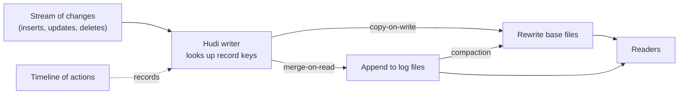

# Apache Hudi

Mastery: `INPUT[inlineSelect(option(new), option(learning), option(solid)):mastery]`

> [!story] Context
> [[Apache Iceberg]] is the most widely adopted alternative to Delta. Apache Hudi, created at Uber, is the third major open table format. Its design centers on [[MERGE and Upserts|upserts]] and incremental reads of changed records.

> [!eli5] Summary
> Apache Hudi is a third open table format. It was designed for data that changes after it is first written, and for reading only the records that changed since a given point.

> [!analogy]- Analogy: a ledger with sticky notes
> - **The bound ledger pages** are the base data files.
> - **Sticky notes on a page** ("row 14's price is now 18.20") are change logs waiting to be folded in. This is the *merge-on-read* style: cheap to write, a bit more work to read.
> - **Rewriting the page cleanly** is *copy-on-write*: more work to write, easy to read.
> - **A periodic clean-up session that copies sticky notes into fresh pages** is compaction.

## Background

Classic [[Apache Hadoop|Hadoop]] and [[Apache Hive|Hive]] tables were built for append-only data. Updating a row meant rewriting a whole partition. For a business where records change after they are written, such as trips, payments, or orders, that meant either huge rewrites or stale tables.

Hudi was designed to make **upserts and incremental reads** cheap on lake storage: apply a stream of changes to a large table quickly, and let downstream jobs ask for only the records that changed since a given point.

## Overview

Hudi is an open table format, like [[Delta Lake]] and [[Apache Iceberg]] (see [[Open Table Formats]]). Uber developed it in 2016 (pronounced "hoodie"), open-sourced it in 2017, and submitted it to the Apache Incubator in January 2019. It became an Apache top-level project on 4 June 2020. Hudi 1.0 was announced in December 2024 and redesigned the timeline as an LSM (log-structured merge) tree.

The concepts that set it apart:

| Concept | What it means |
|---|---|
| **Record keys** | Every table has a key, so an upsert knows which existing row to replace |
| **Timeline** | An ordered log of actions (commits, compactions, cleanups) on the table |
| **Copy-on-write (CoW) tables** | Updates rewrite the affected base files. Reads are simple and fast. Suits read-heavy tables |
| **Merge-on-read (MoR) tables** | Updates go to small log files next to base files and are merged at read time, then folded in by compaction. Suits frequently changing data |
| **Incremental queries** | Read only records changed after a given commit |

### How this maps to Databricks features

The problems Hudi targets are solved on Databricks with Delta (and Iceberg) features:

| Hudi idea | Databricks equivalent |
|---|---|
| Record-key upserts | [[MERGE and Upserts\|MERGE INTO]] |
| Merge-on-read style cheap updates | [[Deletion Vectors]] (mark rows deleted instead of rewriting files) |
| Incremental queries | [[Change Data Feed]] |
| Compaction and cleaning | [[OPTIMIZE and VACUUM]], run by predictive optimization |
| Timeline | [[Delta Transaction Log]] |

## How it works



There is no Hudi SQL on Databricks to show, because Databricks does not offer Hudi as a Unity Catalog table type. The Databricks way to do the same job is a keyed merge on a Delta table, with deletion vectors on and the change data feed for downstream readers:

```sql
-- Delta table tuned for frequent upserts
CREATE TABLE shop.sales.trips (
  trip_id    BIGINT,
  updated_at TIMESTAMP,
  fare       DECIMAL(10,2),
  status     STRING
)
CLUSTER BY AUTO
TBLPROPERTIES ('delta.enableDeletionVectors' = true);

MERGE INTO shop.sales.trips t
USING shop.staging.trip_changes s
ON t.trip_id = s.trip_id
WHEN MATCHED AND s.updated_at > t.updated_at THEN UPDATE SET *
WHEN NOT MATCHED THEN INSERT *;

-- Rows changed since version 41 (the Delta equivalent of a Hudi incremental query)
SELECT * FROM table_changes('shop.sales.trips', 42);
```

(`table_changes` requires the change data feed; see [[Change Data Feed]].)

## Small-business considerations

> [!smallbiz] Small-business considerations
> You can skip Hudi. It matters only if you are moving off an existing Hadoop or AWS EMR setup that already stores tables in Hudi. In that case, plan to convert those tables to Delta (or Iceberg) as part of the migration. See [[Migrating from Hadoop]].

## Cloud differences

> [!aws]- All clouds
> Nothing differs on Databricks: Hudi is not a Unity Catalog table type on any cloud. Hudi tables most often appear in AWS estates built on EMR, which is why they come up in [[Migrating from Hadoop|Hadoop migrations]].

## Advanced topics

> [!deepdive]- Advanced topics (301–401)
> - **The design trade-off is write cost vs. read cost:** Copy-on-write pays at write time; merge-on-read pays at read time until compaction runs. Delta's deletion vectors make the same trade inside one table: deletes and updates are cheap to write, and reads apply the vectors until a rewrite (OPTIMIZE or REORG) folds them in.
> - **Incremental processing is the lasting idea:** Hudi popularized reading only what changed. Databricks generalized it in the change data feed, the newer automatic change data feed (built on row tracking), and incremental refresh for [[Materialized Views]].
> - **Interoperability:** Projects have appeared that translate metadata between Hudi, Delta, and Iceberg. This vault has not confirmed Databricks support for any of them; for Databricks, the supported bridge is [[Delta UniForm]] (Delta to Iceberg).

## Common misconceptions

> [!confusion] "Merge-on-read" is not the same as SQL MERGE
> Merge-on-read is a storage strategy (apply changes when reading). `MERGE INTO` is a SQL statement for upserts. A Delta table uses `MERGE INTO` and, with deletion vectors, gets merge-on-read-like behavior.

## Recall

Where and when was Apache Hudi created?::At Uber, in 2016; open-sourced in 2017 and an Apache top-level project since June 2020.
What problem was Hudi designed to make cheap?::Upserts and incremental reads on large lake tables whose records change after they are written.
Copy-on-write vs merge-on-read: which is cheaper to write?::Merge-on-read, because updates go to small log files instead of rewriting base files.
Is Hudi a Unity Catalog table type on Databricks?::No. Databricks' managed table formats are Delta Lake and Apache Iceberg.
Which Delta feature plays the role of Hudi's incremental queries?::The change data feed (`table_changes`).
Which Delta feature gives merge-on-read-like cheap updates?::Deletion vectors.

## Next steps

> [!path] Learning path
> **Needs first:** [[Open Table Formats]], [[MERGE and Upserts]]
> **Unlocks next:** [[Delta UniForm]], [[Migrating from Hadoop]]

> [!nextup] Next
> [[Delta UniForm]] covers how a Delta table exposes Iceberg metadata so Iceberg clients can read it without a copy.

> [!sources]- Sources (last verified: 2026-10-25)
> - [Unity Catalog managed tables for Delta Lake and Apache Iceberg (AWS)](https://docs.databricks.com/aws/en/tables/managed)
> - [Databricks tables concepts (AWS)](https://docs.databricks.com/aws/en/tables/tables-concepts)
> - [Deletion vectors in Databricks (AWS)](https://docs.databricks.com/aws/en/tables/features/deletion-vectors)
> - [Use change data feed on Databricks (AWS)](https://docs.databricks.com/aws/en/tables/features/change-data-feed)
> - [table_changes table-valued function (AWS)](https://docs.databricks.com/aws/en/sql/language-manual/functions/table_changes)
> - [MERGE INTO (Databricks SQL reference, AWS)](https://docs.databricks.com/aws/en/sql/language-manual/delta-merge-into)
> - [Apache Hudi concepts](https://hudi.apache.org/docs/concepts/)
> - [Apache Hudi table and query types](https://hudi.apache.org/docs/table_types/)
> - [Announcing Apache Hudi 1.0 (hudi.apache.org)](https://hudi.apache.org/blog/2024/12/16/announcing-hudi-1-0-0/)
> - [Apache Hudi technical specification 1.0](https://hudi.apache.org/learn/tech-specs/)
> - [The ASF announces Apache Hudi as a top-level project](https://news.apache.org/foundation/entry/the-apache-software-foundation-announces64)
