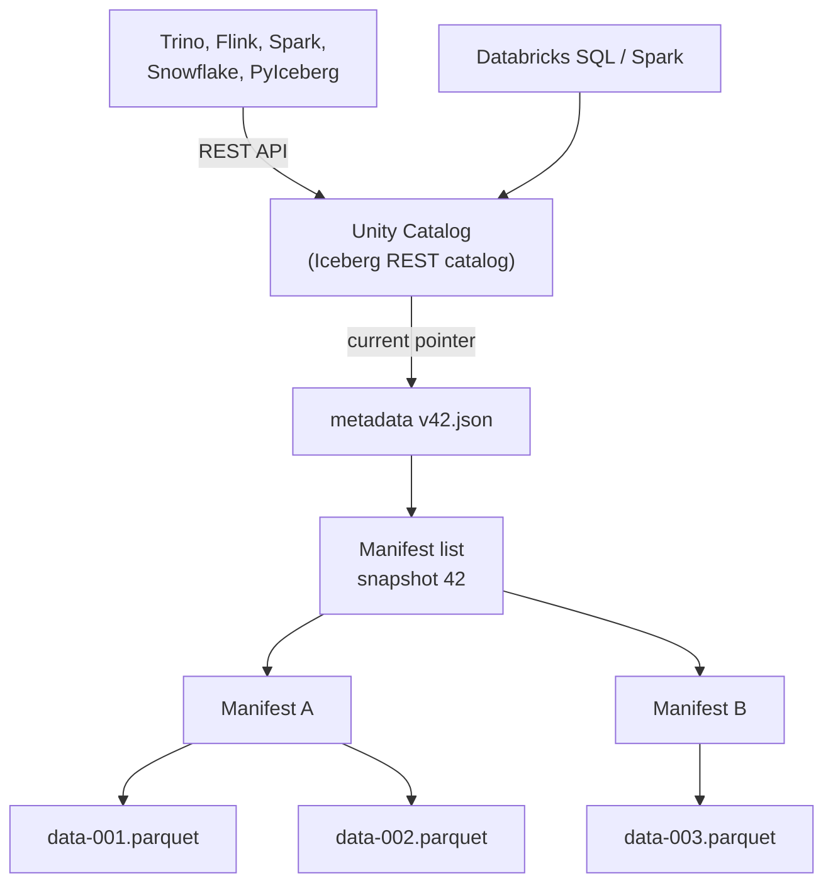

# Apache Iceberg

Mastery: `INPUT[inlineSelect(option(new), option(learning), option(solid)):mastery]`

> [!story] Context
> [[MERGE and Upserts]] completed the core Delta feature set. Apache Iceberg is a separate open table format created at Netflix. It has broad support across engines and vendors, and Unity Catalog supports managed and foreign Iceberg tables alongside Delta.

> [!eli5] Summary
> Apache Iceberg is another open set of rules for turning data files into a table with history and safe changes. It is supported by many tools from many vendors. Databricks supports Iceberg tables alongside its default Delta tables.

> [!analogy]- Analogy: a library with a card catalog in drawers
> - **The books** are Parquet data files.
> - **Each drawer of index cards** is a *manifest*: a list of some data files, with notes on what is in them.
> - **The drawer directory on top** is the *manifest list* for one snapshot of the table.
> - **The head librarian's single sheet saying "today's directory is #42"** is the *metadata file*, and the catalog that points to it is the front desk.
> - **Any library system can read the cards**, because the card format is a published standard.

## Background

Netflix stored large tables on object storage under the [[Apache Hive|Hive]] layout and hit the same limits as everyone else. Ryan Blue and Daniel Weeks developed Iceberg at Netflix, around the same time Delta Lake was created, and donated it to the [[Apache Software Foundation]].

Iceberg's main selling point is **engine neutrality**: many engines implement the same spec. Databricks' docs list Apache Spark, Apache Flink, Trino, and PyIceberg among the clients that can use Unity Catalog's Iceberg REST endpoint. (Iceberg's *hidden partitioning* and *partition evolution*, often cited as design goals, are not covered here because this vault has not confirmed them against Databricks sources.)

Because so many vendors adopted it, Iceberg became the common language for sharing tables between platforms. In June 2024 Databricks acquired **Tabular**, the company founded by Iceberg's original creators, stating that it wanted compatibility between the two formats.

## Overview

> [!todo] Verification pending
> The layer names in the metadata table below are not confirmed against the sources listed for this note. Check the Apache Iceberg spec for the exact file structure.

An Iceberg table is data files plus a **tree of metadata**:

| Layer | File type | Holds |
|---|---|---|
| Catalog pointer | (in the catalog) | Which metadata file is current |
| Metadata file | JSON | Schema, partition spec, snapshot list, properties |
| Manifest list | Avro | One per snapshot: which manifests it uses, with partition summaries |
| Manifest | Avro | A list of data (and delete) files with per-column stats |
| Data files | Parquet (or ORC, Avro) | The rows |

A commit writes new manifests and a new metadata file, then **atomically swaps the catalog pointer**. That swap is the transaction. This is why Iceberg always needs a catalog: Hive Metastore, AWS Glue, a REST catalog, or Unity Catalog.

**Spec versions.** The Iceberg spec page says versions 1, 2, and 3 are complete and adopted, and version 4 is in development. v2 added row-level deletes. **v3** adds deletion vectors (stored in Puffin files), row lineage, the `variant` type, geometry and geography types, nanosecond timestamps, and default column values.

### Iceberg on Databricks (October 2026)

| Capability | Status |
|---|---|
| **Managed Iceberg tables** in Unity Catalog (create, read, write, optimize, govern) | Generally available |
| **Foreign Iceberg tables** (Iceberg tables owned by another catalog, such as Glue or Snowflake, read through Unity Catalog) | Generally available |
| **Iceberg v3** features (deletion vectors, row lineage, variant) | Generally available |
| **Iceberg REST catalog** endpoint so external engines read and write UC tables | Available (`/api/2.1/unity-catalog/iceberg-rest`) |
| **Delta tables readable as Iceberg** | Yes, through [[Delta UniForm]] |

Managed Iceberg needs Unity Catalog and Databricks Runtime 16.4 LTS or above (or serverless). Release notes were not fully consistent about sharing managed Iceberg tables through [[OpenSharing]], with one entry saying GA and another Public Preview; check the current docs before relying on it.

## How it works



Creating and using a managed Iceberg table on Databricks:

```sql
CREATE TABLE shop.sales.orders_ice (
  order_id   BIGINT,
  ordered_at TIMESTAMP,
  total      DECIMAL(10,2)
)
USING ICEBERG
CLUSTER BY AUTO;            -- automatic liquid clustering (Iceberg v3 needs Runtime 18.0+)

INSERT INTO shop.sales.orders_ice VALUES (1, current_timestamp(), 42.00);

MERGE INTO shop.sales.orders_ice t
USING shop.staging.order_updates s ON t.order_id = s.order_id
WHEN MATCHED THEN UPDATE SET *
WHEN NOT MATCHED THEN INSERT *;
```

Reading the same table from outside Databricks with PyIceberg (sketch):

```python
from pyiceberg.catalog import load_catalog

cat = load_catalog("uc", **{
    "type": "rest",
    "uri": "https://<workspace-host>/api/2.1/unity-catalog/iceberg-rest",
    "warehouse": "shop",                 # the Unity Catalog catalog name
    "token": "<oauth-or-pat-token>",
})
tbl = cat.load_table("sales.orders_ice")
print(tbl.scan(row_filter="total > 20").to_pandas())
```

Unity Catalog vends short-lived storage credentials to the external client, so it never needs your bucket keys.

## Small-business considerations

> [!smallbiz] Small-business considerations
> **Default to Delta, and reach for Iceberg when another platform needs your tables.** Typical cases: a partner reads your data from Snowflake, your marketing agency uses a tool that only speaks Iceberg, or you want an exit path that more vendors understand.
>
> You do not have to pick one forever. A Delta table with [[Delta UniForm|Iceberg reads]] enabled is readable by Iceberg clients, and Unity Catalog governs both kinds side by side. There is no extra license for Iceberg; you pay for storage and compute as usual.

## Cloud differences

> [!azure]- Azure Databricks
> Managed Iceberg tables store files in ADLS Gen2. Azure-native Iceberg readers vary by service; check each tool's support for Iceberg REST catalogs before you design around it.

> [!aws]- Databricks on AWS
> Iceberg is common on AWS (Athena, EMR, Glue, Redshift). Unity Catalog can read Iceberg tables registered in AWS Glue as **foreign** tables (see [[AWS Glue and Lake Formation Federation]]), and AWS engines can read UC tables through the Iceberg REST endpoint.

> [!gcp]- Databricks on Google Cloud
> BigQuery supports Iceberg tables, so Iceberg (or UniForm) is the usual bridge between Databricks and BigQuery. See [[BigQuery Integration]].

## Advanced topics

> [!deepdive]- Advanced topics (301–401)
> - **Deletion vectors.** v3 brings deletion vectors, the same idea as Delta's [[Deletion Vectors]]. Iceberg v2 readers do not support them. On Databricks, deletion vectors are enabled by default on new Iceberg v3 tables, and enabling them on an existing Iceberg table upgrades it to v3.
> - **Row lineage.** All v3 tables track stable row IDs and the commit that last changed each row. Databricks uses this for incremental materialized view refresh and for automatic [[Change Data Feed|change data feed]].
> - **Maintenance.** Managed Iceberg tables get [[OPTIMIZE and VACUUM|predictive optimization]] (compaction, snapshot expiry, statistics). VACUUM retention on Iceberg tables is fixed at 7 days.
> - **Variant limits.** You cannot partition by a `VARIANT` column, or use one in `GROUP BY` or `ORDER BY`.
> - **Foreign vs. managed.** Foreign Iceberg tables are owned by another catalog; Databricks reads them, and the other catalog handles commits and maintenance. Managed tables are owned by Unity Catalog, which handles commits and runs maintenance.
> - **Interoperability direction.** The Databricks blog frames 2026 as "unified governance" across formats: one catalog, two formats, shared features (v3 brings Iceberg and Delta feature sets very close).

## Common misconceptions

> [!confusion] Iceberg is not "Delta's enemy" on Databricks any more
> Since 2025–2026 Unity Catalog has managed tables in both formats. The choice is about which external engines need to read or write the table, not about loyalty.

> [!confusion] An Iceberg table without a catalog is incomplete
> Delta can be read from its folder alone. Iceberg needs a catalog to say which metadata file is current. Point engines at the catalog, not the folder.

## Recall

Where was Apache Iceberg created?::At Netflix, by Ryan Blue and Daniel Weeks, who donated it to the Apache Software Foundation.
What makes an Iceberg commit atomic?::Atomically swapping the catalog's pointer to a new metadata file.
Name three Iceberg v3 features Databricks supports.::Deletion vectors, row lineage, and the VARIANT type.
What is the status of Unity Catalog managed Iceberg tables as of October 2026?::Generally available.
What is a foreign Iceberg table in Unity Catalog?::An Iceberg table owned by another catalog (such as Glue or Snowflake) that Unity Catalog can read and govern.
Which company founded by Iceberg's creators did Databricks acquire, and when?::Tabular, in June 2024.
What is Unity Catalog's Iceberg REST endpoint path?::`/api/2.1/unity-catalog/iceberg-rest`.

## Next steps

> [!path] Learning path
> **Needs first:** [[Open Table Formats]], [[Delta Lake]]
> **Unlocks next:** [[Delta UniForm]], [[Unity Catalog]], [[Managed vs External Tables]]

> [!nextup] Next
> [[Apache Hudi]] covers the third open table format, designed for upserts and incremental processing.

> [!sources]- Sources (last verified: 2026-10-25)
> - [What is Apache Iceberg in Databricks? (AWS)](https://docs.databricks.com/aws/en/iceberg/)
> - [Use Apache Iceberg v3 features (AWS)](https://docs.databricks.com/aws/en/iceberg/iceberg-v3)
> - [Use Apache Iceberg v3 features (GCP)](https://docs.databricks.com/gcp/en/iceberg/iceberg-v3)
> - [Access Databricks tables from Apache Iceberg clients (AWS)](https://docs.databricks.com/aws/en/external-access/iceberg)
> - [Unity Catalog credential vending (AWS)](https://docs.databricks.com/aws/en/external-access/credential-vending)
> - [Unity Catalog managed tables for Delta Lake and Apache Iceberg (AWS)](https://docs.databricks.com/aws/en/tables/managed)
> - [Databricks platform release notes (AWS)](https://docs.databricks.com/aws/en/release-notes/product)
> - [May 2026 release notes (AWS)](https://docs.databricks.com/aws/en/release-notes/product/2026/may)
> - [Advancing Apache Iceberg on Databricks: Iceberg v3 GA (Databricks blog)](https://www.databricks.com/blog/unity-catalog-and-next-era-apache-icebergtm)
> - [Announcing full Apache Iceberg support in Databricks (Databricks blog, 2025)](https://www.databricks.com/blog/announcing-full-apache-iceberg-support-databricks)
> - [Databricks agrees to acquire Tabular (press release)](https://www.databricks.com/company/newsroom/press-releases/databricks-agrees-acquire-tabular-company-founded-original-creators)
> - [Variant type support for Apache Iceberg and Delta Lake (AWS)](https://docs.databricks.com/aws/en/tables/features/variant)
> - [Use liquid clustering for tables (AWS)](https://docs.databricks.com/aws/en/tables/clustering)
> - [Apache Iceberg table spec](https://iceberg.apache.org/spec/)
