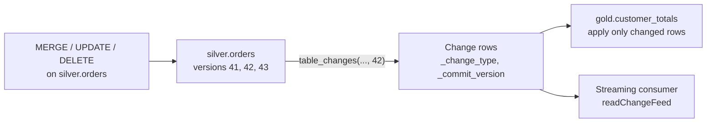

# Change Data Feed

Mastery: `INPUT[inlineSelect(option(new), option(learning), option(solid)):mastery]`

> [!story] Context
> [[Deletion Vectors]] make row-level changes cheap to write. Downstream tables then need to know which rows changed, so they can update incrementally instead of reprocessing the whole source. The change data feed provides that list.

> [!eli5] Summary
> The change data feed is a list of every row that was added, changed, or removed in a table, along with when it happened. Other tables and reports read this list to stay up to date without re-reading everything.

## Background

Without a change feed, a downstream job that maintains a silver or gold table has two options:

- **Full refresh:** re-read the entire source table on every run. Simple, but cost grows with table size.
- **Custom tracking:** add `updated_at` columns and watermarks, and hope every writer maintains them. Deletes are usually lost.

[[Time Travel]] can compare two versions with `EXCEPT`, but that is expensive and does not distinguish updates from inserts. The change data feed records changes at the row level, including deletes and the before and after images of updates.

## Overview

Databricks has two modes. Both return the same shape of result.

| | Legacy change data feed | Automatic change data feed (Auto CDF) |
|---|---|---|
| How changes are computed | At write time; change files are written alongside data | At query time, using [[Delta Transaction Log\|row tracking]] |
| Enable | `delta.enableChangeDataFeed = true` per table | Row tracking on the table; no CDF property |
| Requirements | Delta table | Databricks Runtime 19 or above; UC managed Delta table with row tracking, or an Apache Iceberg v3 table, registered in Unity Catalog |
| Write overhead | Extra change files on each write | None at write time; Databricks reports `MERGE` and `UPDATE` typically about 15% faster on tables queried for changes |
| Status (October 2026) | Supported; Databricks recommends migrating | Generally available (September 2026 release notes); rolling out to all supported regions by the end of October 2026 |

The two modes cannot be used together on one table. To migrate, unset the legacy property:

```sql
ALTER TABLE shop.sales.orders UNSET TBLPROPERTIES ('delta.enableChangeDataFeed');
```

### Output columns

Each change row contains the table's columns plus:

| Column | Values |
|---|---|
| `_change_type` | `insert`, `update_preimage`, `update_postimage`, `delete` |
| `_commit_version` | Table version of the change |
| `_commit_timestamp` | Commit time of the change |

**Auto CDF limitations:** not supported on tables with [[Row Filters and Column Masks|row filters or column masks]]; not queryable by external Iceberg clients; not supported for multi-statement transactions in which the source table changed during the transaction.

## How it works



**Legacy mode: enable on a table**

```sql
CREATE TABLE shop.silver.orders (order_id BIGINT, status STRING, total DECIMAL(10,2))
TBLPROPERTIES ('delta.enableChangeDataFeed' = true);

-- or on an existing table
ALTER TABLE shop.silver.orders SET TBLPROPERTIES ('delta.enableChangeDataFeed' = true);
```

**Read changes in SQL** (versions are inclusive; give only a start version to read to the latest):

```sql
-- All changes from version 42 to the latest
SELECT * FROM table_changes('shop.silver.orders', 42);

-- Changes between two versions
SELECT * FROM table_changes('shop.silver.orders', 42, 45);

-- Only net new and updated rows
SELECT order_id, status, total, _change_type, _commit_version
FROM table_changes('shop.silver.orders', 42)
WHERE _change_type IN ('insert', 'update_postimage');
```

**Read changes as a stream** in Python:

```python
changes = (spark.readStream
    .option("readChangeFeed", "true")
    .option("startingVersion", 42)        # optional; startingTimestamp also works
    .table("shop.silver.orders"))
```

## Small-business considerations

> [!smallbiz] Small-business considerations
> Most small teams do not call the change data feed directly. [[Materialized Views]] and [[Lakeflow Spark Declarative Pipelines]] use row-level change tracking internally to refresh incrementally.
>
> Read the feed directly when you sync a table to another system (a CRM, an email tool, a partner) and want to send only changed rows. Track the last `_commit_version` processed, and start the next run from the following version.

## Cloud differences

> [!aws]- All clouds
> No differences in behavior. Auto CDF availability follows the regional rollout, which Databricks scheduled to complete in all supported regions by the end of October 2026.

## Advanced topics

> [!deepdive]- Advanced topics (301–401)
> - **Only changes after enablement:** The legacy feed records changes made after the property is set. Querying a version before that raises an error.
> - **Schema of results:** Reads use the schema of the latest table version, even for older changes.
> - **Retention:** Change records follow table retention. `VACUUM` deletes legacy change data files along with old data files, so consumers must read changes within the retention window (see [[OPTIMIZE and VACUUM]]).
> - **Row tracking:** Auto CDF depends on row tracking, which assigns stable row IDs and commit versions to rows. Row tracking has been GA since Databricks Runtime 14.0, and automatic upgrades began enabling it on existing tables in July 2026. All Iceberg v3 tables include row tracking.
> - **Sharing:** Auto CDF works with batch queries, Structured Streaming, and sharing (the Auto CDF docs refer to Delta Sharing, now [[OpenSharing]]).
> - **CDF vs. CDC:** [[Change Data Capture]] usually means capturing changes from an operational database and applying them to the lakehouse, often with `MERGE` or `AUTO CDC`. The change data feed is the lakehouse table's own change output, consumed by downstream tables.

## Common misconceptions

> [!confusion] The change data feed is not change data capture from a source database
> CDC brings changes into the lakehouse from systems such as PostgreSQL or SQL Server. The change data feed exposes changes made to a Delta or Iceberg table to downstream consumers.

> [!confusion] An update produces two rows
> `update_preimage` holds the row before the change and `update_postimage` the row after. Filter on `_change_type` to get the shape you need.

## Recall

What does the change data feed provide?::Row-level changes (inserts, updates, deletes) to a table, with the commit version and timestamp of each change.
Which table property enables the legacy change data feed?::`delta.enableChangeDataFeed = true`.
Which function reads changes in SQL?::`table_changes('table', start_version [, end_version])`.
What are the four `_change_type` values?::`insert`, `update_preimage`, `update_postimage`, `delete`.
How does Auto CDF differ from the legacy feed?::It computes changes at query time from row tracking instead of writing change files at write time.
What runtime does Auto CDF require?::Databricks Runtime 19 or above.
What is the status of Auto CDF as of October 2026?::Generally available, rolling out to all supported regions by the end of October 2026.
Which streaming option reads a Delta table's change feed?::`readChangeFeed` set to `true`.
Name one Auto CDF limitation.::Not supported on tables with row filters or column masks (also not readable by external Iceberg clients).

## Next steps

> [!path] Learning path
> **Needs first:** [[Delta Transaction Log]], [[MERGE and Upserts]], [[Time Travel]]
> **Unlocks next:** [[Change Data Capture]], [[Materialized Views]], [[Slowly Changing Dimensions]]

> [!nextup] Next
> [[OPTIMIZE and VACUUM]] covers compacting small files, deleting unreferenced files, and how predictive optimization runs both automatically.

> [!sources]- Sources (last verified: 2026-10-25)
> - [Use change data feed on Databricks (AWS)](https://docs.databricks.com/aws/en/tables/features/change-data-feed)
> - [Use change data feed on Databricks (GCP)](https://docs.databricks.com/gcp/en/delta/delta-change-data-feed)
> - [table_changes table-valued function (AWS)](https://docs.databricks.com/aws/en/sql/language-manual/functions/table_changes)
> - [Row tracking in Databricks (AWS)](https://docs.databricks.com/aws/en/tables/features/row-tracking)
> - [Automatic upgrades (AWS)](https://docs.databricks.com/aws/en/tables/automatic-upgrades)
> - [September 2026 release notes (GCP)](https://docs.databricks.com/gcp/en/release-notes/product/2026/september)
> - [What's coming? (AWS)](https://docs.databricks.com/aws/en/release-notes/whats-coming)
> - [Databricks Runtime 19 release notes (AWS)](https://docs.databricks.com/aws/en/release-notes/runtime/19)
> - [Advanced AUTO CDC topics (AWS)](https://docs.databricks.com/aws/en/ldp/cdc-advanced)
> - [Incremental refresh for materialized views (AWS)](https://docs.databricks.com/aws/en/optimizations/incremental-refresh)
