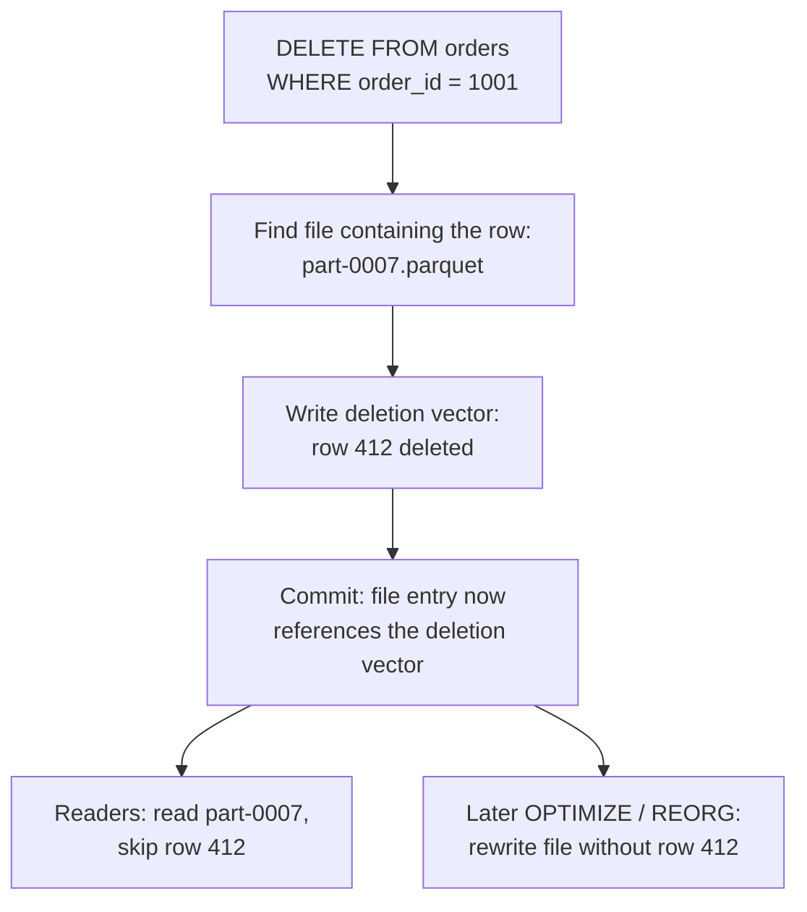

# Deletion Vectors

Mastery: `INPUT[inlineSelect(option(new), option(learning), option(solid)):mastery]`

> [!story] Context
> [[Liquid Clustering]] controls how rows are grouped into files. Those files are [[Apache Parquet|Parquet]] files, which cannot be edited in place. This note covers deletion vectors, which record row-level deletes and updates without rewriting the affected files.

> [!eli5] Summary
> Data files cannot be edited in place. Without deletion vectors, removing one row means rewriting the whole file that holds it. With deletion vectors, the table keeps a small list of removed rows next to the file, and readers skip those rows. The file is rewritten later, in bulk.

> [!analogy]- Analogy: striking lines in a printed ledger
> | Ledger | Deletion vectors |
> |---|---|
> | Reprinting the whole page to remove one line | Copy-on-write: rewrite the Parquet file |
> | Striking the line and noting it in the margin | Writing a deletion vector |
> | Reprinting clean pages at month end | `OPTIMIZE` or `REORG` applying the deletions |

## Background

A Parquet file is immutable. Before deletion vectors, a `DELETE`, `UPDATE`, or `MERGE` that touched one row had to:

1. Read the whole file that contains the row.
2. Write a new file with the row removed or changed.
3. Commit a `remove` of the old file and an `add` of the new one.

For a table with large files and frequent small changes (order status updates, privacy deletions, CDC merges), most of the write work was copying unchanged rows. Databricks' docs describe deletion vectors as a storage optimization that speeds up `DELETE`, `UPDATE`, and `MERGE` on Delta and Iceberg tables, because without them changing one row means rewriting the entire Parquet file that holds it.

## Overview

A deletion vector is a compact record, attached to a data file in the table metadata, of which row positions in that file are deleted. Readers apply it at read time and skip the marked rows.

| Operation | With deletion vectors |
|---|---|
| `DELETE` | Marks rows in the deletion vector; the data file is not rewritten |
| `UPDATE` | Marks the old row versions deleted and writes the new versions to a new file |
| `MERGE` | Same as `UPDATE` for matched rows; inserts go to new files |
| Read | Skips rows marked in the deletion vector |
| `OPTIMIZE` / `REORG` | Rewrites files to physically remove marked rows |

### Default status (October 2026)

| Table type | Default |
|---|---|
| New Apache Iceberg v3 tables | Enabled by default |
| New Delta tables | Controlled by the workspace setting **Auto-enable deletion vectors**. Databricks is rolling out a change so that the **Default** option means *All new tables*; admins can choose **Disabled** instead |
| Materialized views and streaming tables in Hive metastore | Not enabled by default |
| Delta tables with Iceberg reads (`IcebergCompatV2`) | Not allowed together; Iceberg v3 is the path that supports both |

Databricks recommends choosing **Disabled** in the workspace setting if you read newly created tables with clients that do not support deletion vectors.

## How it works



**Enable on a table:**

```sql
ALTER TABLE shop.sales.orders
SET TBLPROPERTIES ('delta.enableDeletionVectors' = true);
```

**Create a table with deletion vectors:**

```sql
CREATE TABLE shop.sales.order_status (
  order_id   BIGINT,
  status     STRING,
  updated_at TIMESTAMP
)
CLUSTER BY AUTO
TBLPROPERTIES ('delta.enableDeletionVectors' = true);
```

**Physically apply deletions**, for example before a reader that does not support deletion vectors reads the table, or to complete a privacy deletion:

```sql
REORG TABLE shop.sales.orders APPLY (PURGE);   -- rewrite files that have deletion vectors
VACUUM shop.sales.orders;                       -- later, remove the old files
```

Check the deletion vectors page for the current `REORG` syntax on your runtime.

## Small-business considerations

> [!smallbiz] Small-business considerations
> Leave deletion vectors at the workspace default unless an external tool must read your tables. The benefit is faster, cheaper `MERGE` and `DELETE` jobs, which matter for incremental syncs from a store or CRM.
>
> Check compatibility before enabling them on tables that outside tools read. If a tool reads the files directly with an older Delta or Iceberg v2 reader, it may fail or return deleted rows. In that case, keep the setting **Disabled** for those tables, or expose the data through [[Delta UniForm|Iceberg v3]] or Unity Catalog's external access APIs.

## Cloud differences

> [!aws]- All clouds
> No differences in the feature. The **Auto-enable deletion vectors** workspace setting's default varies by region, and the rollout of the new default proceeds region by region.

## Advanced topics

> [!deepdive]- Advanced topics (401)
> - **Merge-on-read inside Delta.** Deletion vectors move Delta from pure copy-on-write toward merge-on-read for deletes: writes are cheap and reads do a small amount of extra work until files are compacted. This is the same trade-off [[Apache Hudi]] exposes as table types.
> - **Iceberg v3 alignment.** Iceberg v3 specifies binary deletion vectors, so Delta and Iceberg v3 tables share the approach. Enabling deletion vectors on an existing Iceberg table upgrades it to format version 3. Iceberg v2 readers do not support them.
> - **Protocol impact.** Deletion vectors are a Delta table feature. Enabling them raises the table's reader and writer protocol requirements, so clients without support cannot read the table (see the feature compatibility page).
> - **Privacy deletion.** A `DELETE` with deletion vectors marks rows but leaves the bytes in the original file. For [[GDPR]]-style erasure, run `REORG ... APPLY (PURGE)` to rewrite files, then `VACUUM` after the retention period to remove the old files and their history.
> - **Maintenance.** Files with many deleted rows waste read I/O. [[OPTIMIZE and VACUUM|Predictive optimization]] compacts them on Unity Catalog managed tables.
> - **Concurrency.** Deletion vectors, together with [[Liquid Clustering]], reduce the size of each rewrite, which reduces write conflicts between concurrent `MERGE` and `UPDATE` operations.

## Common misconceptions

> [!confusion] A deleted row is not physically erased immediately
> The deletion vector hides the row from readers, but its bytes remain in the Parquet file until the file is rewritten and the old file is vacuumed.

> [!confusion] Deletion vectors are not only for DELETE
> `UPDATE` and `MERGE` also use them, which is where most of the performance benefit appears.

## Recall

What is a deletion vector?::A compact record attached to a data file that marks which row positions in that file are deleted, so the file does not need to be rewritten.
Which operations do deletion vectors speed up?::`DELETE`, `UPDATE`, and `MERGE`.
Which table property enables deletion vectors on a Delta table?::`delta.enableDeletionVectors = true`.
Are deletion vectors enabled by default on new Iceberg v3 tables on Databricks?::Yes.
Which workspace setting controls deletion vectors on new Delta tables?::**Auto-enable deletion vectors**.
Which command physically removes rows marked by deletion vectors?::`REORG TABLE ... APPLY (PURGE)` (or a rewrite by `OPTIMIZE`), followed by `VACUUM` for the old files.
Can deletion vectors be combined with Iceberg reads under IcebergCompatV2?::No. Iceberg v3 is the path that supports both.
What happens if you enable deletion vectors on an existing Iceberg table?::The table is upgraded to Iceberg format version 3.

## Next steps

> [!path] Learning path
> **Needs first:** [[Delta Transaction Log]], [[MERGE and Upserts]], [[Apache Parquet]]
> **Unlocks next:** [[Change Data Feed]], [[OPTIMIZE and VACUUM]], [[Delta UniForm]]

> [!nextup] Next
> [[Change Data Feed]] covers how downstream jobs read only the rows that changed in a Delta table.

> [!sources]- Sources (last verified: 2026-10-25)
> - [Deletion vectors in Databricks (AWS)](https://docs.databricks.com/aws/en/tables/features/deletion-vectors)
> - [Deletion vectors in Databricks (GCP)](https://docs.databricks.com/gcp/en/tables/features/deletion-vectors)
> - [Auto-enable deletion vectors (AWS)](https://docs.databricks.com/aws/en/admin/workspace-settings/deletion-vectors)
> - [Table properties reference (AWS)](https://docs.databricks.com/aws/en/tables/table-properties)
> - [Use Apache Iceberg v3 features (GCP)](https://docs.databricks.com/gcp/en/iceberg/iceberg-v3)
> - [Read Delta Lake tables with Iceberg clients (GCP)](https://docs.databricks.com/gcp/en/delta/iceberg-reads)
> - [Delta Lake feature compatibility and protocols (AWS)](https://docs.databricks.com/aws/en/tables/features/feature-compatibility)
> - [What is predictive I/O? (GCP)](https://docs.databricks.com/gcp/en/optimizations/predictive-io)
> - [Apache Iceberg table spec](https://iceberg.apache.org/spec/)
