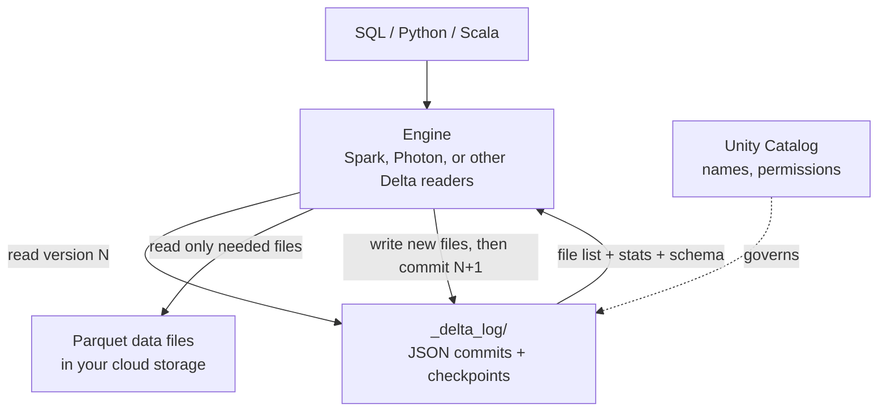

# Delta Lake

Mastery: `INPUT[inlineSelect(option(new), option(learning), option(solid)):mastery]`

> [!story] Context
> [[Open Table Formats]] introduced the three main formats that turn Parquet files into transactional tables. Delta Lake is the one Databricks created, and it is the default format for tables on the platform.

> [!eli5] Summary
> Delta Lake stores a table as ordinary data files plus a log of every change. The log prevents half-saved tables, keeps earlier versions available, and allows individual rows to be changed or removed safely.

> [!analogy]- Analogy: a shared spreadsheet with version history
> - **The cells** are the rows stored in [[Apache Parquet|Parquet]] files.
> - **"Version history"** is the [[Delta Transaction Log|transaction log]]. Every save is a numbered version you can open again ([[Time Travel]]).
> - **The column types you set** (date, number) are the table's schema. Typing text into a number column is refused ([[Schema Enforcement and Evolution]]).
> - **Two people editing at once** get a clean result, or one is told to retry. Neither sees the other's unfinished edit ([[ACID Transactions]]).

## Background

Databricks customers in the late 2010s were running [[Apache Spark]] on data lakes and encountering the same problems: failed jobs left partial data, listing millions of files was slow, rows could not be updated or deleted, and schemas drifted. Lakes degraded into [[Data Swamps|data swamps]], and the usual remedy was to copy data into a warehouse.

Databricks built Delta Lake inside its platform to fix this without leaving the lake. In 2019 it open-sourced the format under the Apache 2.0 license, and in October 2019 the [[Linux Foundation]] began hosting the project under open governance. With Delta Lake 2.0 in 2022, Databricks committed to open-sourcing all Delta Lake APIs and features, including ones that had been Databricks-only.

## Overview

Delta Lake is an open table format plus a set of libraries that read and write it. A **Delta table** is:

- a set of **Parquet data files**, and
- a **`_delta_log/` folder** of ordered JSON commit files and periodic Parquet checkpoints that record exactly which data files make up each version.

On Databricks, Delta is the default format for tables. When you run `CREATE TABLE` without saying otherwise, you get a Delta table, usually a Unity Catalog **managed** table (see [[Managed vs External Tables]]).

What the log gives you:

| Feature | What it does | Note |
|---|---|---|
| ACID transactions | No partial writes, safe concurrent writers | [[ACID Transactions]] |
| Time travel | Query or restore older versions | [[Time Travel]] |
| Schema enforcement and evolution | Reject bad writes, add columns safely | [[Schema Enforcement and Evolution]] |
| `UPDATE`, `DELETE`, `MERGE` | Row-level changes on lake files | [[MERGE and Upserts]] |
| Data skipping | Per-file min/max stats let queries skip files | [[Data Skipping]] |
| Layout optimization | Compaction and clustering | [[OPTIMIZE and VACUUM]], [[Liquid Clustering]] |
| Change tracking | Row-level change feed | [[Change Data Feed]] |
| Streaming | A Delta table can be a streaming source and sink | [[Structured Streaming on Databricks]] |

**Versions.** The open-source project is on the Delta Lake 4.x line, built for Apache Spark 4:

| Release | Highlights |
|---|---|
| Delta Lake 4.0 (2025) | `VARIANT` type supported; coordinated commits (preview); new `DROP FEATURE` that removes table features without truncating history; preview of catalog-managed tables |
| Delta Lake 4.1 (early 2026) | Built on Apache Spark 4.1.0 (also works with 4.0.1); drops Spark 3.5; requires Java 17; catalog-managed tables and server-side planning in preview |

Later 4.x releases followed during 2026; see the Delta Lake releases page. Databricks Runtime ships its own Delta build, so check the runtime release notes for what a given runtime includes.

## How it works



A tour in Databricks SQL:

```sql
-- Create (Delta is the default)
CREATE TABLE shop.sales.orders (
  order_id   BIGINT,
  ordered_at TIMESTAMP,
  email      STRING,
  total      DECIMAL(10,2)
) CLUSTER BY AUTO;                    -- let Databricks choose the layout

INSERT INTO shop.sales.orders VALUES
  (1, '2026-10-24 09:15', 'ana@example.com', 42.00),
  (2, '2026-10-24 10:02', 'bo@example.com',  18.50);

-- Row-level changes, impossible on plain Parquet
UPDATE shop.sales.orders SET total = 40.00 WHERE order_id = 1;
DELETE FROM shop.sales.orders WHERE email = 'bo@example.com';

-- See every change ever made
DESCRIBE HISTORY shop.sales.orders;

-- Read an older version
SELECT * FROM shop.sales.orders VERSION AS OF 1;
```

And the same in PySpark:

```python
df = spark.read.table("shop.sales.orders")
df.filter("total > 20").write.mode("append").saveAsTable("shop.sales.big_orders")
```

## Small-business considerations

> [!smallbiz] Small-business considerations
> Every table created on Databricks is a Delta table unless you specify Iceberg. For a small team, this provides:
> - **Recovery.** After an incorrect `DELETE` or `UPDATE`, [[Time Travel|restore]] the previous version with one command.
> - **Safe reruns.** A failed nightly load leaves nothing half-done.
> - **Privacy requests are easy.** Deleting one customer's rows is a `DELETE`, not a rewrite of a month of files.
> - **No lock-in.** The files are Parquet in your cloud account in an open format, readable by open-source Delta clients if you ever leave.
>
> There is no separate charge for Delta. You pay for storage and for the compute that reads and writes it.

## Cloud differences

> [!azure]- Azure Databricks
> Delta tables live in ADLS Gen2 (`abfss://...`). For how Microsoft's own analytics services relate to Databricks tables, see [[Microsoft Fabric and OneLake vs Databricks]].

> [!aws]- Databricks on AWS
> Delta tables live in S3 (`s3://...`). Databricks handles safe concurrent commits on S3 for you. AWS engines such as Athena or Redshift usually read Databricks tables through [[Delta UniForm|Iceberg reads]].

> [!gcp]- Databricks on Google Cloud
> Delta tables live in GCS. To let BigQuery read them, the usual route is Iceberg-compatible metadata through [[Delta UniForm]] (see [[BigQuery Integration]]).

## Advanced topics

> [!deepdive]- Advanced topics (301–401)
> - **Protocol and table features.** Each Delta table declares a minimum reader and writer protocol, plus named table features (deletion vectors, column mapping, row tracking, variant, and more). A client that does not support a feature cannot read or write the table. Check [[Deletion Vectors]] and [[Delta UniForm]] for features that affect external readers.
> - **External Delta clients.** Unity Catalog can serve managed tables to outside Delta clients and vend short-lived storage credentials (see the Unity REST and credential vending pages in the sources).
> - **Managed is the recommended default on Databricks.** Unity Catalog managed Delta tables get [[OPTIMIZE and VACUUM|predictive optimization]], automatic liquid clustering, and automatic feature upgrades. Predictive optimization does not run on external tables.
> - **Databricks Delta vs. open-source Delta.** The format is the same. Databricks adds runtime features ([[Photon]], predictive I/O) that speed up reads without changing the format. A table written on Databricks stays readable by other Delta clients as long as they support its table features.

## Common misconceptions

> [!confusion] Delta Lake is not a database or a storage service
> It does not run as a server. It is a file layout plus libraries. The storage is your cloud bucket, and the engine is Spark or another reader.

> [!confusion] "Delta Lake" vs "Delta Live Tables" vs "Delta Sharing"
> Only Delta Lake is the table format. Delta Live Tables is now [[Lakeflow Spark Declarative Pipelines]], a pipeline product. Delta Sharing is now [[OpenSharing]], a data-sharing protocol. The old names shared the word "Delta", which caused years of confusion.

## Recall

What two things make up a Delta table on disk?::Parquet data files plus a `_delta_log/` folder of JSON commits and Parquet checkpoints.
When was Delta Lake open-sourced, and who hosts it?::2019; the Linux Foundation has hosted it since October 2019.
What table format do you get by default with CREATE TABLE on Databricks?::Delta Lake.
Name four things Delta Lake adds to plain Parquet.::ACID transactions, time travel, schema enforcement, and row-level UPDATE/DELETE/MERGE (also data skipping, change feed, streaming).
Which SQL command lists every change made to a Delta table?::`DESCRIBE HISTORY table_name`.
Which data type stores semi-structured data such as JSON in Delta and Iceberg tables on Databricks?::VARIANT.
What is the new name of Delta Live Tables?::Lakeflow Spark Declarative Pipelines.
Why can enabling a new Delta table feature break an external reader?::The table's protocol then requires that feature, and readers that do not support it must refuse to read the table.

## Next steps

> [!path] Learning path
> **Needs first:** [[Open Table Formats]], [[Apache Parquet]], [[ACID Transactions]]
> **Unlocks next:** [[Delta Transaction Log]], [[Time Travel]], [[MERGE and Upserts]], [[Unity Catalog]]

> [!nextup] Next
> [[Delta Transaction Log]] describes the `_delta_log` folder that implements Delta's features.

> [!sources]- Sources (last verified: 2026-10-25)
> - [Delta Lake now hosted by the Linux Foundation (Databricks blog, October 2019)](https://www.databricks.com/blog/2019/10/16/delta-lake-now-hosted-by-the-linux-foundation-to-become-the-open-standard-for-data-lakes.html)
> - [Delta Lake 2.0: open-sourcing all of Delta Lake (Databricks blog)](https://www.databricks.com/blog/2022/06/30/open-sourcing-all-of-delta-lake.html)
> - [Access Databricks tables from Delta clients (AWS)](https://docs.databricks.com/aws/en/external-access/unity-rest)
> - [Unity Catalog credential vending (AWS)](https://docs.databricks.com/aws/en/external-access/credential-vending)
> - [Variant type support for Apache Iceberg and Delta Lake (AWS)](https://docs.databricks.com/aws/en/tables/features/variant)
> - [Predictive optimization for Unity Catalog managed tables (AWS)](https://docs.databricks.com/aws/en/optimizations/predictive-optimization)
> - [Tutorial: Create and manage Delta Lake tables (AWS)](https://docs.databricks.com/aws/en/delta/tutorial)
> - [Unity Catalog managed tables for Delta Lake and Apache Iceberg (AWS)](https://docs.databricks.com/aws/en/tables/managed)
> - [Delta Lake feature compatibility and protocols (AWS)](https://docs.databricks.com/aws/en/tables/features/feature-compatibility)
> - [Work with table history (AWS)](https://docs.databricks.com/aws/en/tables/history)
> - [Delta Lake 4.0 (delta.io)](https://delta.io/blog/2025-09-25-delta-lake-40/)
> - [Delta Lake 4.0.0 release notes (GitHub)](https://github.com/delta-io/delta/releases/tag/v4.0.0)
> - [Delta Lake 4.1.0 released (delta.io)](https://delta.io/blog/2026-03-01-delta-lake-4-1-0-released/)
> - [Delta Lake 4.1.0 release notes (GitHub)](https://github.com/delta-io/delta/releases/tag/v4.1.0)
> - [Delta Lake releases (docs.delta.io)](https://docs.delta.io/releases/)
> - [Linux Foundation press release on Delta Lake](https://www.linuxfoundation.org/press/press-release/the-delta-lake-project-turns-to-linux-foundation-to-become-the-open-standard-for-data-lakes)
