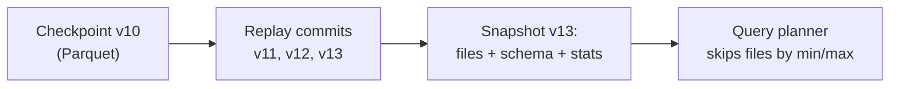

# Delta Transaction Log

Mastery: `INPUT[inlineSelect(option(new), option(learning), option(solid)):mastery]`

> [!story] Context
> [[Delta Lake]] provides transactions, history, and row-level changes on Parquet files. All of these features are implemented by one folder, `_delta_log`, described here.

> [!eli5] Summary
> Next to a Delta table's data files is a folder of numbered change records. Each record lists the files added or removed by one change. Reading the records in order gives the table's current contents, and a change takes effect only when its record is written.

> [!analogy]- Analogy: a bank statement
> - **Each numbered commit file** is one line on the statement: a deposit (files added) or a withdrawal (files removed).
> - **Your current balance** is the table's current version, found by adding up all the lines.
> - **The monthly summary** is a *checkpoint*: a Parquet file that stores the running balance so you do not re-add every line since the account opened.
> - **The rule that a line, once printed, never changes** is why you can always reconstruct last month's balance ([[Time Travel]]).

## Background

A table format needs one place that defines the truth. The old Hive approach used the directory listing plus a database (the [[Hive Metastore]]) that only knew about partitions, not files. That was slow on object storage and gave no atomicity.

Delta's answer is to make the **log the single source of truth**, stored in the same bucket as the data. If a Parquet file is not referenced by the log, it is not part of the table, no matter what the directory holds.

## Overview

The Delta protocol specification (see Sources) defines the log as:

- **Delta files (commits):** one JSON file per table version, named with the version number zero-padded to 20 digits, such as `00000000000000000007.json`. Each holds an atomic set of **actions**. A commit file is the unit of atomicity.
- **Checkpoints:** Parquet files that store the full replayed state of the table at some version, with cancelled-out actions removed. Readers start from the latest checkpoint instead of replaying every commit. The reference implementation writes one every 10 commits by default. Large tables can use multi-part checkpoints.
- **`_last_checkpoint`:** a small JSON pointer to the latest checkpoint, so readers do not need to list the whole folder.
- **Log compaction files** (`x.y.compact.json`): optional files that aggregate a range of commits, reducing how often checkpoints are needed.

### The main action types

| Action | Meaning |
|---|---|
| `metaData` | Table ID, schema, partition columns, table properties (`TBLPROPERTIES`) |
| `protocol` | Minimum reader and writer versions, plus enabled table features |
| `add` | A data file joins the table, with its size, partition values, and column statistics |
| `remove` | A data file leaves the table (it stays on disk until VACUUM) |
| `commitInfo` | Who did what: operation, timestamp, parameters (what `DESCRIBE HISTORY` shows) |
| `txn` | Application transaction IDs, used by streaming writers for exactly-once commits |
| `cdc` | Change data files, written when the [[Change Data Feed]] is enabled |
| `domainMetadata` | Feature-specific state, such as clustering keys for [[Liquid Clustering]] |

## How it works

```text
s3://shop-lake/sales/orders/
├── _delta_log/
│   ├── 00000000000000000000.json        create table (metaData, protocol)
│   ├── 00000000000000000001.json        INSERT (add part-000, part-001)
│   ├── ...
│   ├── 00000000000000000010.json        UPDATE (remove part-001, add part-007)
│   ├── 00000000000000000010.checkpoint.parquet   full state at v10
│   ├── 00000000000000000011.json
│   └── _last_checkpoint                 {"version":10, ...}
├── part-00000-3f1c....snappy.parquet
├── part-00001-a92e....snappy.parquet    (removed in v10, still on disk)
└── part-00007-77b0....snappy.parquet
```

A trimmed commit for an `UPDATE` looks like this (one JSON object per line):

```json
{"commitInfo":{"timestamp":1761300000000,"operation":"UPDATE","operationParameters":{"predicate":"[\"(order_id = 1)\"]"}}}
{"remove":{"path":"part-00001-a92e.snappy.parquet","deletionTimestamp":1761300000000,"dataChange":true}}
{"add":{"path":"part-00007-77b0.snappy.parquet","size":4211,"dataChange":true,"stats":"{\"numRecords\":2,\"minValues\":{\"order_id\":1},\"maxValues\":{\"order_id\":2}}"}}
```

**Reading** version N: load the latest checkpoint at or below N, replay the JSON commits after it up to N, and keep every `add` that was not later `remove`d. The result is the exact file list plus stats.

**Writing**: write the new Parquet files, then try to create the next numbered JSON file. If that name already exists (another writer won), check whether the other commit conflicts. If not, retry as the next number. If it does, fail.



You rarely read the log by hand. SQL exposes it:

```sql
DESCRIBE HISTORY shop.sales.orders;          -- one row per commit
DESCRIBE HISTORY shop.sales.orders LIMIT 5;  -- latest five
DESCRIBE DETAIL  shop.sales.orders;          -- location, file count, size, features
```

## Small-business considerations

> [!smallbiz] Small-business considerations
> You do not need to read `_delta_log` directly. Two practices are useful:
> - **Use `DESCRIBE HISTORY` as an audit trail.** When a number changes unexpectedly, the history shows which job or person wrote to the table and when.
> - **Never delete files from the table folder by hand.** The log still points at them, and the table breaks. Use `DELETE`, `VACUUM`, or `DROP TABLE` instead. With Unity Catalog managed tables you do not touch the folder at all.

## Cloud differences

> [!aws]- All clouds
> The log format is identical on every cloud. Only the storage path changes (`s3://`, `abfss://`, `gs://`), and Databricks handles the atomic "create the next commit file" step on each object store for you.

## Advanced topics

> [!deepdive]- Advanced topics (301–401)
> - **Statistics drive data skipping.** Each `add` action carries per-file column statistics (min, max, null counts) that let queries skip files. Which columns get statistics is controlled by table properties listed in the table properties reference; this vault has not confirmed the default column count. See [[Data Skipping]].
> - **Log retention is separate from data retention.** `delta.logRetentionDuration` (default 30 days) controls how long commit files are kept. `delta.deletedFileRetentionDuration` (default 7 days) controls when VACUUM may delete removed data files. Time travel needs both. See [[Time Travel]].
> - **Tombstones.** A `remove` action is a tombstone. Checkpoints keep tombstones until they expire, so VACUUM knows which files are safe to delete.
> - **Deletion vectors change what `add` means.** With [[Deletion Vectors]], an `add` can carry a pointer to a small bitmap of deleted rows, so a delete updates metadata instead of rewriting a file.
> - **`txn` and idempotent streaming (unconfirmed detail).** Streaming writers record application transaction IDs in the log so a retried micro-batch is not committed twice, which supports [[Exactly-Once Processing|exactly-once]] writes to Delta sinks.

## Common misconceptions

> [!confusion] Removed files are not deleted files
> A `remove` action takes a file out of the current version, but the file stays on disk so older versions still work. Only `VACUUM` physically deletes it, after the retention period.

> [!confusion] The transaction log is not the Hive Metastore or Unity Catalog
> The log describes one table's files and history. The catalog maps names like `shop.sales.orders` to table locations and holds permissions. A table has its own log; the catalog holds many tables.

## Recall

Where does a Delta table keep its transaction log?::In a `_delta_log/` folder next to the data files.
What is in one Delta commit file?::A JSON file holding an atomic set of actions (add, remove, metaData, protocol, commitInfo, and others) for one table version.
How are Delta commit files named?::By version number, zero-padded to 20 digits, e.g. `00000000000000000007.json`.
By default, how often does the reference Delta implementation write a checkpoint?::Every 10 commits.
What is a Delta checkpoint?::A Parquet file storing the full replayed table state at a version, so readers need not replay every earlier commit.
What does the `_last_checkpoint` file do?::Points readers to the latest checkpoint without listing the whole log folder.
Does a `remove` action delete the data file?::No. It only drops the file from the current version. VACUUM deletes it later.
Which SQL command shows the log's commits?::`DESCRIBE HISTORY table_name`.

## Next steps

> [!path] Learning path
> **Needs first:** [[Delta Lake]], [[ACID Transactions]], [[CSV and JSON]]
> **Unlocks next:** [[Time Travel]], [[Change Data Feed]], [[Deletion Vectors]], [[OPTIMIZE and VACUUM]]

> [!nextup] Next
> [[Time Travel]] uses the versions recorded in the log to query and restore earlier table states.

> [!sources]- Sources (last verified: 2026-10-25)
> - [Work with table history (AWS)](https://docs.databricks.com/aws/en/tables/history)
> - [Table properties reference (AWS)](https://docs.databricks.com/aws/en/tables/table-properties)
> - [Delta Lake feature compatibility and protocols (AWS)](https://docs.databricks.com/aws/en/tables/features/feature-compatibility)
> - [Delta Lake protocol specification (delta-io GitHub)](https://github.com/delta-io/delta/blob/4277443703c5ab59a567c1e80189bbcdb7495817/PROTOCOL.md)
> - [Converting from Parquet to Delta Lake (delta.io)](https://delta.io/blog/2022-09-23-convert-parquet-to-delta/)
