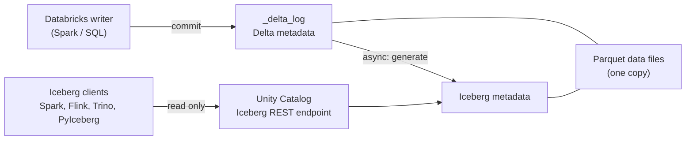

# Delta UniForm

Mastery: `INPUT[inlineSelect(option(new), option(learning), option(solid)):mastery]`

> [!story] Context
> [[Apache Hudi]] completed the set of three open table formats, each with its own readers. Copying data between formats would reintroduce duplication. UniForm lets Iceberg clients read a Delta table without copying its data.

> [!eli5] Summary
> UniForm stores a table once and writes an additional index in the format that Iceberg tools expect. Delta and Iceberg tools can then read the same data without a copy.

> [!analogy]- Analogy: a bilingual menu
> - **The kitchen and the food** are the Parquet data files. There is only one kitchen.
> - **The English menu** is Delta's transaction log.
> - **The Spanish menu printed next to it** is the Iceberg metadata UniForm generates. Same dishes, same prices, different language.
> - **The menu is reprinted shortly after the chef changes a dish**: UniForm writes the Iceberg metadata asynchronously after each Delta commit.
> - **Spanish-speaking guests can order but not cook**: Iceberg clients read UniForm tables but do not write to them.

## Background

By 2023 [[Apache Iceberg]] had become the format many outside engines supported, while Databricks tables were Delta. Customers wanted to use Databricks *and* let other engines read the same tables, without maintaining two copies or giving up Delta features.

UniForm (short for Universal Format) appeared as a Public Preview in Databricks Runtime 13.2 and became generally available in Runtime 14.3 LTS, built on a table feature called `IcebergCompatV2`. After Databricks acquired Tabular, the company founded by Iceberg's creators, in June 2024, it named format compatibility "first inside Delta Lake UniForm" as a stated goal.

## Overview

Databricks' docs now describe this as **reading Delta Lake tables with Iceberg clients**, or enabling **Iceberg reads** on a Delta table. When you enable it, Databricks configures the table to use UniForm for the metadata layer: it **generates Iceberg metadata asynchronously alongside the Delta metadata**, without rewriting data files. One copy of the Parquet files serves both formats.

| Property | Detail |
|---|---|
| What it writes | Iceberg metadata next to the `_delta_log` |
| Data files | Shared, not copied |
| Iceberg access | **Read-only** for Iceberg clients |
| Where clients connect | Unity Catalog's Iceberg REST catalog endpoint, `/api/2.1/unity-catalog/iceberg-rest` |
| Requirements | Table registered in [[Unity Catalog]]; column mapping enabled; writes from Runtime 14.3 LTS or above |
| Enabling on an existing table | Runtime 15.4 LTS or above |
| Deletion vectors | Cannot be on a table with Iceberg reads in the `IcebergCompatV2` setup. Iceberg v3 is the path that allows them together |
| Check it worked | `DESCRIBE EXTENDED` shows the Iceberg settings |

## How it works



**Create a new table with Iceberg reads on:**

```sql
CREATE TABLE shop.sales.orders_shared (
  order_id   BIGINT,
  ordered_at TIMESTAMP,
  total      DECIMAL(10,2)
)
TBLPROPERTIES (
  'delta.columnMapping.mode'            = 'name',
  'delta.enableIcebergCompatV2'         = 'true',
  'delta.universalFormat.enabledFormats' = 'iceberg'
);
```

**Turn it on for an existing table** (Runtime 15.4 LTS or above):

```sql
ALTER TABLE shop.sales.orders SET TBLPROPERTIES (
  'delta.columnMapping.mode'            = 'name',
  'delta.enableIcebergCompatV2'         = 'true',
  'delta.universalFormat.enabledFormats' = 'iceberg'
);

DESCRIBE EXTENDED shop.sales.orders;   -- confirm the Iceberg settings
```

If the table already has deletion vectors, or must be read by engines such as Amazon Athena or Redshift, the docs say you may need to run a `REORG` on it first. Follow the exact command in the "Read Delta Lake tables with Iceberg clients" page for your runtime.

From the outside, a client connects to the Iceberg REST endpoint with a Databricks token and reads the table as `catalog.schema.table`, exactly as it would read any Iceberg table (see the PyIceberg sketch in [[Apache Iceberg]]).

## Small-business considerations

> [!smallbiz] Small-business considerations
> Turn UniForm on only for tables someone outside Databricks needs to read: a partner on another platform, a BI tool that speaks Iceberg, or a data warehouse you are migrating away from slowly. Typically that is a handful of gold tables, not everything.
>
> Two cautions:
> - **It is read-only from outside:** All writes still happen in Databricks.
> - **There is a short delay:** Iceberg metadata is generated after each commit, so an external reader can briefly lag the latest Delta version.

## Cloud differences

> [!azure]- Azure Databricks
> Nothing Azure-specific in the setup. Data stays in ADLS Gen2, and Iceberg clients reach it through Unity Catalog with vended credentials.

> [!aws]- Databricks on AWS
> AWS engines are the most common UniForm readers. The docs single out **Athena** and **Redshift** as readers that may require a `REORG` of the table before they can read it.

> [!gcp]- Databricks on Google Cloud
> UniForm is the usual way to expose Databricks tables to BigQuery as Iceberg tables. See [[BigQuery Integration]] for the BigQuery-side setup.

## Advanced topics

> [!deepdive]- Advanced topics (301–401)
> - **Asynchronous by design:** Iceberg metadata generation runs after the Delta commit. External clients cannot query the new version until it completes. If many commits happen quickly, generation can batch them.
> - **VACUUM affects Iceberg readers too:** VACUUM removes Parquet files that old Delta versions referenced, so Iceberg clients querying out-of-date versions can hit errors. Keep external readers on the latest snapshot.
> - **Iceberg v3 changes the trade-off:** With v3, deletion vectors, row lineage, and VARIANT are available on managed Delta tables with UniForm (May 2026 release notes). Before v3, you had to choose between deletion vectors and Iceberg reads.
> - **UniForm vs. managed Iceberg:** UniForm keeps Delta as the primary format and gives Iceberg readers read-only access. A **managed Iceberg table** is natively Iceberg and lets external engines write through the REST catalog. Choose UniForm when Databricks is the only writer; choose managed Iceberg when other engines must write.
> - **Compatibility Mode** is a separate Databricks feature for exposing tables to external readers (see its docs page in the sources). Check which one your reader needs.
> - **Hudi:** This vault has not confirmed current UniForm support for Hudi output from Databricks sources, so it is not covered here.

## Common misconceptions

> [!confusion] UniForm does not convert your table to Iceberg
> The table stays a Delta table. UniForm adds Iceberg metadata so Iceberg clients can read it. Databricks keeps writing Delta.

> [!confusion] "UniForm" and "Iceberg reads" are the same thing
> Newer Databricks docs describe the feature as enabling Iceberg reads (or reading Delta tables with Iceberg clients). The table properties still say `universalFormat`.

## Recall

What does UniForm do?::Generates Iceberg metadata alongside a Delta table's log, so Iceberg clients can read the same Parquet files without a copy.
Can Iceberg clients write to a UniForm table?::No, Iceberg access to a UniForm table is read-only.
Which two table properties enable Iceberg reads?::`delta.enableIcebergCompatV2 = true` and `delta.universalFormat.enabledFormats = 'iceberg'` (with column mapping enabled).
Is UniForm metadata written synchronously?::No, it is generated asynchronously after each Delta commit.
In which runtime did UniForm become GA?::Databricks Runtime 14.3 LTS.
Before Iceberg v3, which Delta feature could not be combined with Iceberg reads?::Deletion vectors.
Where do Iceberg clients connect to read Databricks tables?::Unity Catalog's Iceberg REST catalog endpoint, `/api/2.1/unity-catalog/iceberg-rest`.
UniForm or managed Iceberg: which lets external engines write?::Managed Iceberg tables.

## Next steps

> [!path] Learning path
> **Needs first:** [[Delta Lake]], [[Apache Iceberg]], [[Unity Catalog]]
> **Unlocks next:** [[BigQuery Integration]], [[OpenSharing]], [[Lakehouse Federation]]

> [!nextup] Next
> [[Medallion Architecture]] covers how to organize raw, cleaned, and business-ready tables in a lakehouse.

> [!sources]- Sources (last verified: 2026-10-25)
> - [Read Delta Lake tables with Iceberg clients (AWS)](https://docs.databricks.com/aws/en/delta/uniform)
> - [Read Delta Lake tables with Iceberg clients (GCP)](https://docs.databricks.com/gcp/en/delta/iceberg-reads)
> - [Access Databricks tables from Apache Iceberg clients (AWS)](https://docs.databricks.com/aws/en/external-access/iceberg)
> - [Compatibility Mode (AWS)](https://docs.databricks.com/aws/en/external-access/compatibility-mode)
> - [Unity Catalog credential vending (AWS)](https://docs.databricks.com/aws/en/external-access/credential-vending)
> - [Databricks Runtime 13.2 release notes (AWS)](https://docs.databricks.com/aws/en/release-notes/runtime/13.2)
> - [Databricks Runtime 14.3 LTS release notes (GCP)](https://docs.databricks.com/gcp/en/release-notes/runtime/14.3lts)
> - [Use Apache Iceberg v3 features (AWS)](https://docs.databricks.com/aws/en/iceberg/iceberg-v3)
> - [May 2026 release notes (AWS)](https://docs.databricks.com/aws/en/release-notes/product/2026/may)
> - [Databricks + Tabular (Databricks blog)](https://www.databricks.com/blog/databricks-tabular)
> - [Databricks agrees to acquire Tabular (press release)](https://www.databricks.com/company/newsroom/press-releases/databricks-agrees-acquire-tabular-company-founded-original-creators)
