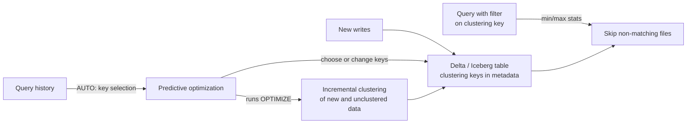

# Liquid Clustering

Mastery: `INPUT[inlineSelect(option(new), option(learning), option(solid)):mastery]`

> [!story] Context
> The [[Medallion Architecture]] organizes tables into layers. This note covers organization inside a single table: how rows are grouped into files so that queries can skip files that cannot match their filters.

> [!eli5] Summary
> Liquid clustering keeps rows with similar values stored near each other, so a search reads fewer files. You name the columns people usually filter on, or let Databricks choose them, and Databricks rearranges the data over time as the table grows.

> [!analogy]- Analogy: a filing cabinet
> | Filing cabinet | Liquid clustering |
> |---|---|
> | Fixed drawers per year, chosen up front | Hive-style [[Partitions\|partitioning]] |
> | Folders kept roughly sorted by customer and date, re-sorted as new papers arrive | Liquid clustering |
> | A clerk who watches what people look up and re-sorts by that | Automatic liquid clustering (`CLUSTER BY AUTO`) |

## Background

Before liquid clustering, Delta tables were laid out with two techniques:

| Technique | How it works | Limitations |
|---|---|---|
| **Partitioning** (`PARTITIONED BY`) | One folder per value of a column, such as `date=2026-10-24/` | Must be chosen at creation; high-cardinality columns create many small files; [[Data Skew\|skewed]] values create uneven partitions; changing it means rewriting the table |
| **Z-ordering** (`OPTIMIZE ... ZORDER BY`) | Co-locates related values within files during `OPTIMIZE` | Not incremental: each run rewrites large parts of the table; must be re-run manually |

Both require the table owner to predict query patterns in advance and to rewrite data when the prediction is wrong.

## Overview

Liquid clustering is a Delta Lake and Iceberg table layout feature on Databricks. You declare **clustering keys** with `CLUSTER BY`, and Databricks groups data by those keys incrementally, without fixed partition folders. Clustering keys can be changed without rewriting existing data; new writes and later `OPTIMIZE` runs use the new keys.

**Automatic liquid clustering** (`CLUSTER BY AUTO`) lets Databricks choose the keys:

- Requires Databricks Runtime 15.4 LTS or above for Unity Catalog managed Delta tables, and Runtime 18.0 or above for managed Apache Iceberg v3 tables.
- Relies on [[OPTIMIZE and VACUUM|predictive optimization]]. Databricks analyzes the table's historical query workload, identifies candidate columns, and changes keys only when the predicted savings from better [[Data Skipping|data skipping]] outweigh the cost of reclustering.
- Also works for [[Materialized Views]] and [[Streaming Tables]] in Lakeflow pipelines.
- Key selection can be skipped, for example when the table is too small to benefit or is rarely queried.

Databricks recommends automatic liquid clustering and predictive optimization for all Unity Catalog managed tables.

| Option | When to use |
|---|---|
| `CLUSTER BY AUTO` | Default for Unity Catalog managed tables |
| `CLUSTER BY (col1, col2)` | Query filters are well known and stable, or automatic selection is not available |
| Partitioning | Existing tables only; convert when practical |

## How it works



**Create a table with automatic clustering:**

```sql
CREATE TABLE shop.sales.orders (
  order_id    BIGINT,
  ordered_at  TIMESTAMP,
  customer_id BIGINT,
  total       DECIMAL(10,2)
)
CLUSTER BY AUTO;
```

**Create a table with explicit keys:**

```sql
CREATE TABLE shop.sales.events (
  event_time TIMESTAMP,
  user_id    BIGINT,
  event_type STRING
)
CLUSTER BY (event_time, user_id);
```

**Change keys on an existing table** (existing data is not rewritten immediately):

```sql
ALTER TABLE shop.sales.events CLUSTER BY (user_id, event_type);
```

**Convert a partitioned table:**

```sql
ALTER TABLE shop.sales.legacy_orders
REPLACE PARTITIONED BY WITH CLUSTER BY AUTO;   -- UC managed tables only; starts from the partition columns
```

**Trigger clustering manually** (predictive optimization does this automatically on UC managed tables):

```sql
OPTIMIZE shop.sales.events;
```

Pipelines use the same clause:

```sql
CREATE OR REFRESH STREAMING TABLE events
CLUSTER BY AUTO
AS SELECT * FROM STREAM read_files('/Volumes/shop/raw/events/', format => 'json');
```

## Small-business considerations

> [!smallbiz] Small-business considerations
> Add `CLUSTER BY AUTO` to every new managed table and leave layout to Databricks. Do not design partitions.
>
> Small tables often see no benefit, and automatic key selection may skip them. That is expected. Clustering starts to matter as order or event history grows into many files.
>
> Clustering runs as compute, either your own `OPTIMIZE` jobs or predictive optimization. See [[How Databricks Pricing Works]] for how that compute is metered.

## Cloud differences

> [!aws]- All clouds
> No differences. Syntax, runtime requirements, and behavior are the same on Azure, AWS, and Google Cloud, subject to predictive optimization being available in the workspace's region.

## Advanced topics

> [!deepdive]- Advanced topics (301–401)
> - **Incremental, not global.** Clustering applies to new and unclustered data on each `OPTIMIZE`, so the cost of each run is proportional to recent changes rather than table size. This is the main operational difference from Z-ordering.
> - **Key choice for manual clustering.** Choose columns used in filters and joins. Put clustering columns among the columns that collect statistics, since data skipping depends on file-level min/max values (see the [[Delta Transaction Log]]).
> - **Interaction with deletion vectors.** Liquid clustering and [[Deletion Vectors]] together reduce rewrite cost for `UPDATE`, `DELETE`, and `MERGE`.
> - **Pipelines.** For materialized views with `CLUSTER BY AUTO`, Lakeflow pipelines drop clustering columns automatically when those columns are removed from the view's schema (2026 pipeline release notes).
> - **Iceberg.** Managed Iceberg v3 tables support `CLUSTER BY AUTO` on Runtime 18.0 and above.
> - **Managed tables only for AUTO.** Automatic key selection and the `REPLACE PARTITIONED BY ... AUTO` conversion require Unity Catalog managed tables.

## Common misconceptions

> [!confusion] Liquid clustering is not partitioning with a new name
> No folders are created per value, the keys can change without a rewrite, and high-cardinality columns are acceptable keys.

> [!confusion] `CLUSTER BY AUTO` does not cluster immediately
> Key selection and clustering run in the background through predictive optimization, based on observed queries. A new table with no query history may not get keys right away.

## Recall

What does liquid clustering replace for most tables?::Hive-style partitioning and Z-ordering.
Which clause enables automatic liquid clustering?::`CLUSTER BY AUTO`.
What runtime does automatic liquid clustering require for UC managed Delta tables?::Databricks Runtime 15.4 LTS or above.
What service selects keys for `CLUSTER BY AUTO`?::Predictive optimization, based on the table's query history.
How do you convert a partitioned UC managed table to automatic liquid clustering?::`ALTER TABLE t REPLACE PARTITIONED BY WITH CLUSTER BY AUTO`.
Does changing clustering keys rewrite existing data immediately?::No. New writes and later OPTIMIZE runs use the new keys.
When might automatic key selection skip a table?::When the table is too small to benefit or is not queried often.

## Next steps

> [!path] Learning path
> **Needs first:** [[Delta Lake]], [[Partitions]], [[Data Skipping]]
> **Unlocks next:** [[OPTIMIZE and VACUUM]], [[Query Performance and Caching]], [[Deletion Vectors]]

> [!nextup] Next
> [[Deletion Vectors]] covers how Delta deletes and updates rows without rewriting whole data files.

> [!sources]- Sources (last verified: 2026-10-25)
> - [Use liquid clustering for tables (AWS)](https://docs.databricks.com/aws/en/tables/clustering)
> - [CLUSTER BY clause (TABLE) (AWS)](https://docs.databricks.com/aws/en/sql/language-manual/sql-ref-syntax-ddl-cluster-by)
> - [Predictive optimization for Unity Catalog managed tables (AWS)](https://docs.databricks.com/aws/en/optimizations/predictive-optimization)
> - [CREATE STREAMING TABLE (pipelines) (AWS)](https://docs.databricks.com/aws/en/ldp/developer/ldp-sql-ref-create-streaming-table)
> - [Lakeflow pipelines release notes 2026 (AWS)](https://docs.databricks.com/aws/en/release-notes/dlt/2026)
> - [August 2025 release notes (GCP)](https://docs.databricks.com/gcp/en/release-notes/product/2025/august)
> - [Variant type support for Apache Iceberg and Delta Lake (AWS)](https://docs.databricks.com/aws/en/tables/features/variant)
> - [Optimize data file layout (AWS)](https://docs.databricks.com/aws/en/tables/operations/optimize)
