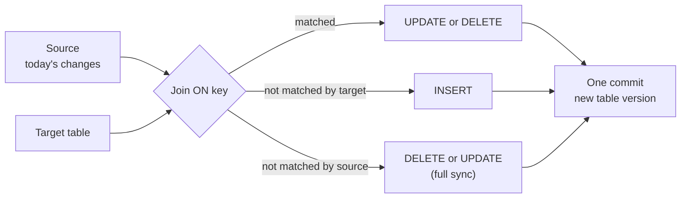

# MERGE and Upserts

Mastery: `INPUT[inlineSelect(option(new), option(learning), option(solid)):mastery]`

> [!story] Context
> [[Schema Enforcement and Evolution]] controls which columns a write may contain. This note covers changing rows that already exist. Incoming data is usually a mix of new records and changes to existing ones, and `MERGE` applies both in one transaction.

> [!eli5] Summary
> `MERGE` compares a set of incoming records with an existing table by a key. Matching rows are updated, new rows are inserted, and rows can optionally be deleted, all in one step that either completes fully or not at all.

> [!analogy]- Analogy: updating a class roster
> - **The roster** is the target table.
> - **The note from the office** ("new student Maya; Leo moved to room 12; Sam left") is the source.
> - **Matching by student ID** is the `ON` condition.
> - **"Update Leo"** is `WHEN MATCHED THEN UPDATE`. **"Add Maya"** is `WHEN NOT MATCHED THEN INSERT`. **"Remove Sam"** is a `DELETE` clause.

## Background

"Upsert" is short for *update or insert*. Without it, keeping a table in sync with a changing source means:

1. Find rows in the source that already exist in the target.
2. Update those rows.
3. Insert the rest.
4. Maybe delete rows that disappeared.

As four separate statements, a failure halfway leaves the table in a mixed state, and readers can see the gap between steps. On a plain data lake, step 2 was not even possible without rewriting files by hand.

`MERGE` makes all four one [[ACID Transactions|atomic transaction]]. It is the core of almost every incremental pipeline: syncing from operational databases ([[Change Data Capture]]), deduplicating streaming data, and maintaining history tables ([[Slowly Changing Dimensions]]).

## Overview

`MERGE INTO` joins a **source** (new or changed data) to a **target** table on a key, then applies clauses based on whether each row matched:

| Clause | Fires when | Allowed actions |
|---|---|---|
| `WHEN MATCHED [AND cond]` | A source row matches a target row | `UPDATE SET ...`, `UPDATE SET *`, `DELETE` |
| `WHEN NOT MATCHED [BY TARGET] [AND cond]` | A source row has no matching target row | `INSERT ...`, `INSERT *` |
| `WHEN NOT MATCHED BY SOURCE [AND cond]` | A target row has no matching source row | `UPDATE SET ...`, `DELETE` |

You can have several clauses of each kind with different conditions. They are checked in order, and only the last clause of a kind may omit its condition.

## How it works



**The classic upsert:**

```sql
MERGE INTO shop.sales.customers AS t
USING shop.staging.customer_updates AS s
ON t.customer_id = s.customer_id
WHEN MATCHED THEN UPDATE SET *        -- copy every column from source
WHEN NOT MATCHED THEN INSERT *;
```

**Conditional update, soft delete, and full sync:**

```sql
MERGE INTO shop.sales.orders AS t
USING shop.staging.orders_snapshot AS s
ON t.order_id = s.order_id
WHEN MATCHED AND s.status = 'cancelled' THEN
  DELETE
WHEN MATCHED AND s.updated_at > t.updated_at THEN
  UPDATE SET t.status = s.status, t.total = s.total, t.updated_at = s.updated_at
WHEN NOT MATCHED THEN
  INSERT (order_id, status, total, updated_at)
  VALUES (s.order_id, s.status, s.total, s.updated_at)
WHEN NOT MATCHED BY SOURCE AND t.ordered_at >= current_date() - INTERVAL 30 DAYS THEN
  DELETE;                              -- gone from the snapshot, so gone here too
```

**Deduplicate before merging.** A `MERGE` fails if several source rows match the same target row, because the result would be ambiguous. Pick one row per key first:

```sql
MERGE INTO shop.sales.customers AS t
USING (
  SELECT * FROM shop.staging.customer_updates
  QUALIFY row_number() OVER (PARTITION BY customer_id ORDER BY updated_at DESC) = 1
) AS s
ON t.customer_id = s.customer_id
WHEN MATCHED THEN UPDATE SET *
WHEN NOT MATCHED THEN INSERT *;
```

**Python (Delta API):**

```python
from delta.tables import DeltaTable

target = DeltaTable.forName(spark, "shop.sales.customers")
(target.alias("t")
   .merge(updates_df.alias("s"), "t.customer_id = s.customer_id")
   .whenMatchedUpdateAll()
   .whenNotMatchedInsertAll()
   .execute())
```

**Inside a stream**, use `foreachBatch` and run the merge on each micro-batch. Databricks' docs say this is how you do Delta merges in Structured Streaming. Note that `WHEN NOT MATCHED BY SOURCE` is not supported in streaming merge flows.

## Small-business considerations

> [!smallbiz] Small-business considerations
> `MERGE` is how you keep a copy of your shop's data in sync without reloading everything every night. Pull "orders changed since yesterday" from your store's API, then merge them into your orders table. New orders are inserted, refunds and status changes update existing rows.
>
> Because the merge is keyed on `order_id`, running it twice gives the same result. That makes the job [[Idempotency|idempotent]]: if a run fails, run it again.
>
> If you would rather not hand-write merges, [[Lakeflow Spark Declarative Pipelines]] has an `AUTO CDC` feature that generates them for change feeds.

## Cloud differences

> [!aws]- All clouds
> Nothing differs. `MERGE INTO` syntax and behavior are the same on Azure, AWS, and Google Cloud.

## Advanced topics

> [!deepdive]- Advanced topics (301–401)
> - **How merge executes.** Delta first finds which target files contain matching rows (a join), then rewrites only those files. **Low shuffle merge**, on by default since Runtime 10.4, avoids reshuffling unchanged rows in those files, which keeps layout from [[Liquid Clustering|clustering]] intact.
> - **Deletion vectors make merges much cheaper.** With [[Deletion Vectors]], updated and deleted rows are marked in a small side file instead of rewriting the whole Parquet file. That is the biggest single speed-up for frequent, small merges.
> - **Prune the target.** Add filters to the `ON` clause that let Delta skip files, such as `AND t.ordered_at >= '2026-10-01'`. Without them, every merge scans the whole target to look for matches. [[Data Skipping|Data skipping]] and dynamic file pruning help only if the join keys or filters line up with the layout.
> - **Conflicts.** Without row-level concurrency, two concurrent merges that modify the same data files conflict under optimistic concurrency, even if they change different rows. On Databricks Runtime 14.3 LTS and above, unpartitioned tables with [[Deletion Vectors|deletion vectors]] enabled get row-level concurrency automatically, so concurrent merges on different rows of the same file can both succeed.
> - **Schema evolution.** `MERGE WITH SCHEMA EVOLUTION` adds new source columns. See [[Schema Enforcement and Evolution]].
> - **Getting changes out.** After a merge, downstream jobs often want only the rows that changed. That is the [[Change Data Feed]].

## Common misconceptions

> [!confusion] MERGE is not the same as INSERT OVERWRITE
> `INSERT OVERWRITE` replaces the table (or a slice of it) with new data. `MERGE` changes only the rows that match and adds new ones. Overwrite is simpler but rewrites far more data.

> [!confusion] "Multiple source rows matched" is a data problem, not a bug
> It means your source has duplicate keys. Deduplicate the source first, as shown above.

## Recall

What does "upsert" mean?::Update the row if it exists, insert it if it does not.
What are the three kinds of MERGE clauses?::`WHEN MATCHED`, `WHEN NOT MATCHED [BY TARGET]`, and `WHEN NOT MATCHED BY SOURCE`.
What does `WHEN NOT MATCHED BY SOURCE` handle?::Target rows that have no match in the source, typically deleted or flagged in a full sync.
Why does a MERGE fail with "multiple source rows matched"?::Several source rows share the same key, so the update would be ambiguous. Deduplicate the source first.
How do you run a Delta MERGE inside Structured Streaming?::Inside `foreachBatch`, once per micro-batch.
Which Delta feature most reduces the cost of frequent small merges?::Deletion vectors, which avoid rewriting whole files.
Why is a keyed MERGE pipeline easy to rerun?::It is idempotent: merging the same source twice gives the same result.

## Next steps

> [!path] Learning path
> **Needs first:** [[Delta Lake]], [[SQL]], [[Primary and Foreign Keys]]
> **Unlocks next:** [[Change Data Capture]], [[Slowly Changing Dimensions]], [[Deletion Vectors]]

> [!nextup] Next
> [[Apache Iceberg]] covers the main alternative open table format and how Unity Catalog supports it.

> [!sources]- Sources (last verified: 2026-10-25)
> - [MERGE INTO (Databricks SQL reference, AWS)](https://docs.databricks.com/aws/en/sql/language-manual/delta-merge-into)
> - [Upsert into a Delta Lake table using merge (AWS)](https://docs.databricks.com/aws/en/delta/merge)
> - [QUALIFY clause (Databricks SQL reference, AWS)](https://docs.databricks.com/aws/en/sql/language-manual/sql-ref-syntax-qry-select-qualify)
> - [Row-level concurrency (AWS)](https://docs.databricks.com/aws/en/optimizations/isolation/row-level-concurrency)
> - [Tutorial: Create and manage Delta Lake tables (AWS)](https://docs.databricks.com/aws/en/delta/tutorial)
> - [Low shuffle merge on Databricks (AWS)](https://docs.databricks.com/aws/en/optimizations/low-shuffle-merge)
> - [Use foreachBatch to write to arbitrary data sinks (GCP)](https://docs.databricks.com/gcp/en/structured-streaming/foreach)
> - [Error conditions in Databricks (AWS)](https://docs.databricks.com/aws/en/error-messages/error-classes)
> - [Use standalone streaming tables (AWS)](https://docs.databricks.com/aws/en/ldp/dbsql/streaming)
> - [Dynamic file pruning (AWS)](https://docs.databricks.com/aws/en/optimizations/dynamic-file-pruning)
> - [Schema evolution in Databricks (AWS)](https://docs.databricks.com/aws/en/data-engineering/schema-evolution)
