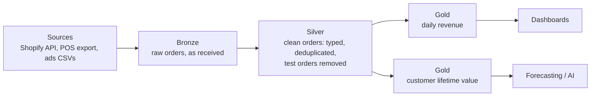

# Medallion Architecture

Mastery: `INPUT[inlineSelect(option(new), option(learning), option(solid)):mastery]`

> [!story] Context
> [[Delta UniForm]] and the preceding notes describe how individual lakehouse tables become reliable and open. The medallion architecture describes how to organize many such tables, so that raw data, cleaned data, and business metrics are kept apart and each has a clear purpose.

> [!eli5] Summary
> Data is stored in three stages. The first stage keeps everything exactly as it arrived. The second stage holds a cleaned, corrected version. The third stage holds the summaries that reports and dashboards use.

> [!analogy]- Analogy: a restaurant kitchen
> | Kitchen | Medallion layer |
> |---|---|
> | Deliveries placed in the walk-in fridge as received | Bronze: raw data, unchanged |
> | Ingredients washed, trimmed, and portioned | Silver: validated, deduplicated records |
> | Plated dishes sent to tables | Gold: aggregated, business-ready tables |

## Background

Without a convention, lakehouse tables accumulate in one place: raw exports, half-cleaned copies, and report tables with similar names. Users cannot tell which table to trust, and fixing a bug in cleaning logic requires re-pulling data from the source system.

The medallion pattern addresses both problems. Raw data is kept unchanged, so every downstream table can be rebuilt from it. Each later layer has one job, so quality improves step by step and errors can be traced to a specific layer.

## Overview

Databricks describes the medallion architecture as a design pattern for logically organizing data in a lakehouse, with the goal of incrementally improving structure and quality as data moves from bronze to silver to gold. It is also called a *multi-hop* architecture.

| Layer | Contains | Typical operations | Recommended processing |
|---|---|---|---|
| **Bronze** | Source data as ingested; append-only; minimal validation | Ingest, add load metadata | Streaming or incremental ingestion ([[Auto Loader]], [[Streaming Tables]]) |
| **Silver** | Validated, cleaned, deduplicated, standardized records; [[Join\|joins]] across sources | Type casting, deduplication, [[Null\|null]] handling, [[Schema Enforcement and Evolution\|schema enforcement]] | Incremental batch, often [[Materialized Views]] |
| **Gold** | Aggregated, business-modeled tables for [[BI Tools\|BI]], [[Machine Learning Basics\|machine learning (ML)]], and data products | Aggregation, [[Star Schema\|dimensional modeling]], [[KPI\|KPIs]] | Batch with incremental refresh |

Databricks recommendations include:

- Keep bronze tables append-only and rich enough to rebuild later layers. Store fields as `STRING`, `VARIANT`, or binary where source schemas change often.
- Keep at least one validated, non-aggregated version of each record in silver.
- Model gold around business needs. Organizations can have several gold areas (for example finance, HR, marketing).
- Use [[Unity Catalog]] schemas to separate layers, for example `sales.bronze_transactions`, `sales.silver_transactions`, and `sales.gold_metrics`.
- Separate ingestion (bronze) from transformation (silver and gold) into distinct pipelines, so each can be scheduled and troubleshot independently.

## How it works



### Worked example: Shopify orders to daily revenue

A small online shop exports Shopify orders as JSON files into a Unity Catalog [[Volumes|volume]] each hour. The goal is a daily revenue table for the owner's dashboard.

**1. Schemas for each layer**

```sql
CREATE SCHEMA IF NOT EXISTS shop.bronze;
CREATE SCHEMA IF NOT EXISTS shop.silver;
CREATE SCHEMA IF NOT EXISTS shop.gold;
```

**2. Bronze: load files as received**

```sql
CREATE TABLE IF NOT EXISTS shop.bronze.shopify_orders AS
SELECT *,
       _metadata.file_path  AS source_file,
       current_timestamp()  AS ingested_at
FROM read_files('/Volumes/shop/raw/shopify/orders/', format => 'json');
```

In production, use [[Auto Loader]] or a streaming table so each run picks up only new files.

**3. Silver: typed, deduplicated, real orders only**

```sql
CREATE OR REPLACE TABLE shop.silver.orders AS
SELECT
  CAST(id AS BIGINT)                    AS order_id,
  CAST(created_at AS TIMESTAMP)         AS ordered_at,
  CAST(total_price AS DECIMAL(10,2))    AS total,
  currency,
  financial_status,
  lower(trim(email))                    AS customer_email
FROM shop.bronze.shopify_orders
WHERE test = false                                -- drop Shopify test orders
  AND financial_status IN ('paid', 'partially_refunded')
QUALIFY row_number() OVER (PARTITION BY id ORDER BY ingested_at DESC) = 1;
```

`QUALIFY` keeps the latest copy of each order, because the hourly export can contain the same order more than once.

**4. Gold: daily revenue**

```sql
CREATE OR REPLACE TABLE shop.gold.daily_revenue AS
SELECT
  date(ordered_at)          AS order_date,
  currency,
  count(*)                  AS orders,
  sum(total)                AS revenue,
  round(avg(total), 2)      AS avg_order_value
FROM shop.silver.orders
GROUP BY ALL;
```

The dashboard reads only `shop.gold.daily_revenue`. If the definition of a valid order changes, update the silver query and rebuild silver and gold from bronze; nothing is re-downloaded from Shopify.

In [[Lakeflow Spark Declarative Pipelines]], the same three steps become a streaming table (bronze) and two materialized views (silver, gold), with dependencies and incremental refresh managed by the pipeline.

## Small-business considerations

> [!smallbiz] Small-business considerations
> Use the pattern from the first table, at small scale:
> - **Three schemas** (`bronze`, `silver`, `gold`) in one catalog are enough for most teams.
> - **Grant analysts and BI tools access to gold only:** This keeps reports on agreed definitions.
> - **Do not over-build:** A shop with one data source may need one silver and two gold tables. Add tables when a report requires them.
> - **Keep bronze:** Raw history allows you to fix a cleaning mistake months later without asking the source system for old data, which many [[SaaS PaaS and IaaS|SaaS]] [[APIs]] do not keep.
>
> Each layer is storage plus the compute that refreshes it. Incremental processing (only new records) keeps that compute small. See [[How Databricks Pricing Works]] for the meters.

## Cloud differences

> [!note] Nothing differs by cloud
> No differences. The pattern, SQL, and Unity Catalog layout are the same on Azure, AWS, and Google Cloud.

## Advanced topics

> [!deepdive]- Advanced topics (301–401)
> - **The layers are logical, not physical:** Layers are a naming and responsibility convention. They can be schemas, catalogs (`bronze`, `silver`, `gold` catalogs per environment), or a mix. Choose based on how you grant access.
> - **Bronze schema strategy:** Databricks recommends a flexible bronze schema (strings, `VARIANT`, or binary) to tolerate source changes. Typed columns are applied in silver, where [[Schema Enforcement and Evolution|enforcement]] belongs.
> - **Incremental by default:** Streaming into bronze and incremental refresh of [[Materialized Views]] for silver and gold avoid reprocessing history. Silver tables that change in place are typically maintained with [[MERGE and Upserts|MERGE]] or `AUTO CDC`, and downstream consumers read changes through the [[Change Data Feed]].
> - **Quality gates:** Attach [[Expectations and Data Quality|expectations]] to silver to drop, quarantine, or fail on bad records, and track the metrics over time.
> - **Gold and dimensional modeling:** Gold often uses a [[Star Schema]] of fact and dimension tables, or [[Metric Views]] that define KPIs once for all BI tools.
> - **Not a mandate for three copies of everything:** Some gold outputs can be views over silver. Materialize only when query cost or latency requires it.

## Common misconceptions

> [!confusion] Medallion is not a Databricks product
> It is a design pattern. No feature has to be enabled, and the names bronze, silver, and gold are conventions.

> [!confusion] More layers do not mean better quality
> Some teams add "platinum" or many intermediate layers. Each extra layer adds latency, storage, and maintenance. Add one only for a clear purpose.

## Recall

What are the three medallion layers?::Bronze (raw), silver (validated and cleaned), and gold (business-ready, often aggregated).
What is the other name for the medallion architecture?::Multi-hop architecture.
Why keep bronze append-only and close to the source?::So silver and gold can be rebuilt from it at any time without re-pulling data from the source system.
Which layer should BI dashboards read from?::Gold.
How does Databricks suggest separating the layers in Unity Catalog?::With schemas (or catalogs), for example `sales.bronze_transactions`, `sales.silver_transactions`, `sales.gold_metrics`.
What processing does Databricks recommend for bronze vs. silver and gold?::Streaming or incremental ingestion for bronze; batch with incremental refresh (often materialized views) for silver and gold.
In the Shopify example, where are test orders and duplicates removed?::In silver.

## Next steps

> [!path] Learning path
> **Needs first:** [[Delta Lake]], [[ETL vs ELT]], [[Schema Enforcement and Evolution]]
> **Unlocks next:** [[Lakeflow Spark Declarative Pipelines]], [[Auto Loader]], [[Materialized Views]], [[Star Schema]]

> [!nextup] Next
> [[Liquid Clustering]] covers how Databricks arranges data within each table's files so queries read less data.

> [!sources]- Sources (last verified: 2026-10-25)
> - [What is the medallion lakehouse architecture? (AWS)](https://docs.databricks.com/aws/en/lakehouse/medallion)
> - [Best practices for reliability (AWS)](https://docs.databricks.com/aws/en/lakehouse-architecture/reliability/best-practices)
> - [Best practices for Lakeflow pipelines (AWS)](https://docs.databricks.com/aws/en/ldp/best-practices/)
> - [Phase 6: Design Delta Lake architecture (AWS)](https://docs.databricks.com/aws/en/lakehouse-architecture/deployment-guide/delta-lake)
> - [Batch vs. streaming data processing in Databricks (AWS)](https://docs.databricks.com/aws/en/data-engineering/batch-vs-streaming)
> - [Data warehousing architecture (AWS)](https://docs.databricks.com/aws/en/sql/get-started/data-warehousing-concepts)
> - [Databricks technical terminology glossary (GCP)](https://docs.databricks.com/gcp/en/resources/glossary)
