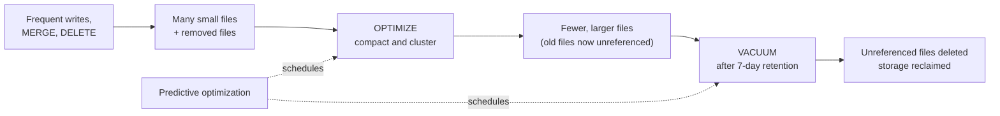

# OPTIMIZE and VACUUM

Mastery: `INPUT[inlineSelect(option(new), option(learning), option(solid)):mastery]`

> [!story] Context
> [[Change Data Feed]], [[Deletion Vectors]], [[Time Travel]], and frequent small writes all leave extra files behind: small data files, files with deleted rows, and removed files kept for history. This note covers the maintenance commands that compact and delete those files, and predictive optimization, which runs them automatically.

> [!eli5] Summary
> Tables collect clutter over time: many small files and old copies kept for undo. `OPTIMIZE` combines small files into larger ones so queries run faster. `VACUUM` deletes old files that are no longer needed. On Databricks, predictive optimization can run both automatically.

## Background

Lakehouse tables accumulate two kinds of files that cost time or money:

- **Small files:** Streaming and frequent incremental writes produce many small Parquet files. Each file has open and metadata overhead, so queries slow down as file counts grow.
- **Unreferenced files:** Every `UPDATE`, `DELETE`, `MERGE`, and `OPTIMIZE` removes files from the current version but leaves them on disk for [[Time Travel|time travel]]. Storage grows until something deletes them.

Before predictive optimization, teams scheduled `OPTIMIZE` and `VACUUM` jobs per table and tuned them by hand.

## Overview

| Command | Purpose | Notes |
|---|---|---|
| `OPTIMIZE` | Rewrites small files into larger ones; applies [[Liquid Clustering\|liquid clustering]] or Z-ordering | Removed files remain for time travel until vacuumed |
| `VACUUM` | Deletes data files no longer referenced by the table and older than the retention threshold | Ends time travel to versions that needed those files |
| `ANALYZE TABLE` | Collects statistics for the query optimizer | Run by predictive optimization on managed tables |

### VACUUM modes

| Mode | Behavior |
|---|---|
| `FULL` (default) | Deletes data files outside the retention duration and all files in the table directory that the table does not reference |
| `LITE` | Uses the transaction log instead of listing the directory, so it is faster on large tables. Does not delete files that are not referenced in the log. Requires at least one successful `VACUUM` within the log retention period (30 days by default) |
| `DRY RUN` | Returns a list of up to 1,000 files that would be deleted, without deleting them |

Sources differ on `LITE` availability: one page lists Public Preview in Databricks Runtime 16.4 LTS and above, and the SQL reference lists `FULL | LITE` for Runtime 16.1 and above.

#### Retention

The retention window is set by `delta.deletedFileRetentionDuration`, default 7 days. Databricks strongly recommends at least 7 days, because a shorter window can delete files that long-running jobs have not yet committed. In Runtime 18.0 and above, `VACUUM` ignores a retention duration argument unless it is 0 hours. For Iceberg tables, the retention period is fixed at 7 days.

### Predictive optimization

Predictive optimization runs maintenance automatically on [[Unity Catalog]] managed tables.

| Item | Detail |
|---|---|
| Operations | `OPTIMIZE`, `VACUUM`, `ANALYZE`; also key selection for `CLUSTER BY AUTO` |
| Tables | Unity Catalog managed tables, Delta Lake and Apache Iceberg. Not external tables or OpenSharing recipient tables |
| Default | Enabled by default for accounts created on or after November 11, 2024. Databricks is enabling existing accounts through a gradual rollout, documented as expected to complete by August 2026 |
| Scope | Account setting inherited by catalogs, schemas, and tables; can be overridden at each level |
| Requirements | Premium plan or above, in a supported region; SQL warehouses or Databricks Runtime 12.2 LTS or above |
| VACUUM minimum | Keeps data files for at least 7 days even if table retention is set lower |

The May 2025 release notes give an earlier completion date for the existing-account rollout than the current docs. The docs page is used here.

## How it works



**Manual maintenance:**

```sql
-- Compact files and apply liquid clustering
OPTIMIZE shop.sales.orders;

-- Z-ordering, for tables that do not use liquid clustering
OPTIMIZE shop.sales.legacy_orders ZORDER BY (customer_id);

-- Preview, then delete unreferenced files past retention
VACUUM shop.sales.orders DRY RUN;
VACUUM shop.sales.orders;          -- FULL mode by default
VACUUM shop.sales.orders LITE;     -- log-based, faster on large tables

-- Collect statistics
ANALYZE TABLE shop.sales.orders COMPUTE STATISTICS;
```

**Predictive optimization controls:**

```sql
-- Turn on for a catalog; schemas and tables inherit
ALTER CATALOG shop ENABLE PREDICTIVE OPTIMIZATION;

-- Opt one table out, or return it to inheritance
ALTER TABLE shop.sales.scratch DISABLE PREDICTIVE OPTIMIZATION;
ALTER TABLE shop.sales.scratch INHERIT PREDICTIVE OPTIMIZATION;

-- Check the effective setting
DESCRIBE TABLE EXTENDED shop.sales.orders;
```

## Small-business considerations

> [!smallbiz] Small-business considerations
> Use Unity Catalog managed tables and leave predictive optimization on. It removes the need to schedule `OPTIMIZE` and `VACUUM` jobs and to tune them per table.
>
> Run maintenance manually only for external tables, which predictive optimization does not cover, or after a large one-time load.
>
> Maintenance consumes compute, and `VACUUM` reduces storage. See [[How Databricks Pricing Works]] and [[Cost Management Basics]] for how both are metered. Do not shorten the 7-day retention to save storage unless you accept losing time travel and the risk to in-flight jobs.

## Cloud differences

> [!aws]- All clouds
> Commands and defaults are the same on Azure, AWS, and Google Cloud. Predictive optimization requires a supported region, and the region list differs by cloud; check the predictive optimization page for your cloud.

## Advanced topics

> [!deepdive]- Advanced topics (301–401)
> - **Idempotent OPTIMIZE:** Running `OPTIMIZE` on an already compacted table does little work. With liquid clustering it is incremental, processing only new or unclustered data.
> - **OPTIMIZE creates work for VACUUM:** Each compaction removes the old small files from the current version. Storage drops only after `VACUUM` deletes them past retention.
> - **Time travel boundary:** `VACUUM` defines how far back [[Time Travel]] works. In Runtime 18.0 and above, time travel beyond `deletedFileRetentionDuration` is blocked for all tables.
> - **Change feed and UniForm readers:** `VACUUM` deletes legacy change data files, and Iceberg clients reading out-of-date UniForm snapshots can fail after `VACUUM`. Consumers must stay within retention.
> - **LITE vs. FULL:** Use `LITE` for routine runs on very large tables and periodic `FULL` runs to remove files that the log never referenced (for example, from failed writes).
> - **Converted tables:** External Delta tables converted to managed tables get predictive optimization enabled automatically unless it was turned off manually. Foreign table conversions get the `INHERIT` setting.
> - **Related automation:** Automatic row deletion with auto time-to-live is a separate feature for deleting expired rows; see its docs page.

## Common misconceptions

> [!confusion] OPTIMIZE does not reduce storage by itself
> It writes new, larger files and marks the old ones removed. Storage decreases only after `VACUUM`.

> [!confusion] VACUUM does not delete rows
> It deletes files that the current table version no longer references. To delete rows, use `DELETE`. To erase deleted rows' bytes, rewrite the files and then vacuum.

## Recall

What does OPTIMIZE do?::Rewrites small files into larger ones and applies liquid clustering or Z-ordering.
What does VACUUM do?::Deletes data files no longer referenced by the table and older than the retention threshold.
What is the default VACUUM retention?::7 days, set by `delta.deletedFileRetentionDuration`.
Which VACUUM mode is the default?::`FULL`.
What does `VACUUM ... LITE` avoid?::Listing the whole table directory; it uses the transaction log instead.
How many files does `VACUUM ... DRY RUN` list at most?::1,000.
Which operations does predictive optimization run?::`OPTIMIZE`, `VACUUM`, and `ANALYZE` (plus key selection for `CLUSTER BY AUTO`).
For which accounts is predictive optimization on by default?::Accounts created on or after November 11, 2024; existing accounts through a gradual rollout.
Does predictive optimization run on external tables?::No, only on Unity Catalog managed tables.
What is the VACUUM retention period for Iceberg tables on Databricks?::Fixed at 7 days.

## Next steps

> [!path] Learning path
> **Needs first:** [[Delta Transaction Log]], [[Time Travel]], [[Liquid Clustering]]
> **Unlocks next:** [[Managed vs External Tables]], [[Query Performance and Caching]], [[Cost Optimization Checklist]]

> [!nextup] Next
> [[Chapter 06 - The Databricks Platform]] covers the managed platform that runs these tables: accounts, workspaces, compute, and the services that automate maintenance.

> [!sources]- Sources (last verified: 2026-10-25)
> - [Predictive optimization for Unity Catalog managed tables (AWS)](https://docs.databricks.com/aws/en/optimizations/predictive-optimization)
> - [Optimize data file layout (AWS)](https://docs.databricks.com/aws/en/tables/operations/optimize)
> - [Remove unused data files with vacuum (AWS)](https://docs.databricks.com/aws/en/tables/operations/vacuum)
> - [Remove unused data files with vacuum (GCP)](https://docs.databricks.com/gcp/en/delta/vacuum)
> - [VACUUM (Databricks SQL reference, AWS)](https://docs.databricks.com/aws/en/sql/language-manual/delta-vacuum)
> - [Databricks Runtime 18.0 release notes (AWS)](https://docs.databricks.com/aws/en/release-notes/runtime/18.0)
> - [May 2025 release notes (AWS)](https://docs.databricks.com/aws/en/release-notes/product/2025/may)
> - [Convert external or foreign Delta tables to managed tables (AWS)](https://docs.databricks.com/aws/en/tables/convert-to-managed)
> - [Control data file size (AWS)](https://docs.databricks.com/aws/en/tables/tune-file-size)
> - [Automatic row deletion with auto time-to-live (AWS)](https://docs.databricks.com/aws/en/tables/operations/auto-ttl)
> - [Best practices for performance efficiency (GCP)](https://docs.databricks.com/gcp/en/lakehouse-architecture/performance-efficiency/best-practices)
