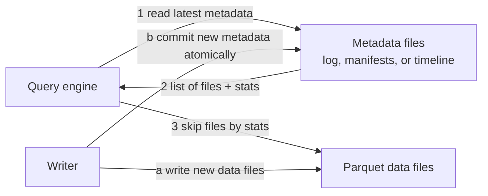

# Open Table Formats

Mastery: `INPUT[inlineSelect(option(new), option(learning), option(solid)):mastery]`

> [!story] Context
> [[ACID Transactions]] lists the guarantees a reliable table needs. Lakehouses provide them with a metadata log stored next to the data files. The specification for that log is called a table format.

> [!eli5] Summary
> A table format is a published set of rules for a small index stored next to data files. The index lists which files belong to the table at each point in time and records every change. Because the rules are public, many different tools can read and write the same table.

> [!analogy]- Analogy: a recipe binder with an index card
> - **The loose recipe cards** are Parquet files. Each one is useful alone.
> - **The index card at the front** is the table format's metadata: "this binder currently holds cards 1, 2, 5, and 9, with these columns."
> - **The rule that you must update the index card last** gives you atomic changes. Until the card is updated, a new recipe is not officially in the binder.
> - **Publishing the index card format** makes it *open*. Any compatible software can read the binder, not only one vendor's.

## Background

[[Apache Hive]] introduced the first widely used idea of a "table on a lake": a table is a directory, and partitions are subdirectories like `date=2026-10-24/`. The [[Hive Metastore]] kept the table's name, schema, and list of partition folders.

That design had deep limits:

- **The file list came from listing directories.** Listing millions of files in object storage is slow, and on older object stores the listing could even be out of date.
- **No transactions.** Writing a partition was not atomic, so readers saw partial data ([[ACID Transactions]] explains why).
- **Updates meant rewriting whole partitions.** Deleting one customer's rows for a privacy request ([[GDPR]]) could mean rewriting a month of data.
- **Schema changes were fragile.** Renaming or reordering columns could silently break readers.
- **Partitioning leaked into queries.** Users had to know the folder layout and filter on the partition column, or the query read everything.

In the second half of the 2010s, three companies hit these limits at scale and built fixes: Netflix built [[Apache Iceberg]], Databricks built [[Delta Lake]] (open-sourced in 2019), and Uber built [[Apache Hudi]].

## Overview

An open table format is a **specification for metadata files** that sit next to data files and describe a table. The specification says:

1. **Which data files make up each version** of the table (an explicit list, not a directory listing).
2. **The schema** and how it has changed over time.
3. **Partitioning or clustering rules**.
4. **Statistics** per file (row counts, min and max values per column) so engines can skip files.
5. **How to commit a change atomically** and resolve conflicts between writers.

The data itself is almost always [[Apache Parquet]]. "Open" means the spec and reference code are open source under neutral foundations, so many engines (Spark, Trino, Flink, DuckDB, Snowflake, BigQuery, Databricks) can read and often write the same table.

| | [[Delta Lake]] | [[Apache Iceberg]] | [[Apache Hudi]] |
|---|---|---|---|
| Born at | Databricks (open-sourced 2019) | Netflix | Uber (built 2016, open-sourced 2017) |
| Home today | [[Linux Foundation]] | [[Apache Software Foundation]] | Apache Software Foundation (top-level project since June 2020) |
| Metadata shape | Ordered log of JSON commits plus Parquet checkpoints in `_delta_log/` | Tree of metadata files, manifest lists, and manifests | A timeline of actions on the table |
| Known for | Deep Spark and Databricks integration | Engine neutrality and wide vendor support | Upserts and incremental processing |
| On Databricks | Default format | Managed and foreign Iceberg tables in Unity Catalog (GA) | Not a Unity Catalog managed table type |

## How it works

All three formats share the same core loop.



A Delta table on disk looks like this:

```text
orders/
├── _delta_log/
│   ├── 00000000000000000000.json      ← version 0: create table
│   ├── 00000000000000000001.json      ← version 1: add files
│   └── 00000000000000000002.json      ← version 2: update
├── part-00000-....snappy.parquet
└── part-00001-....snappy.parquet
```

Iceberg and Hudi keep their own metadata folders with different layouts. Different filing systems, same job.

## Small-business considerations

> [!smallbiz] Small-business considerations
> You will rarely choose a table format directly. On Databricks, `CREATE TABLE` gives you Delta by default, and that is the right choice for nearly every small team. Formats matter in two situations:
> - **Another tool needs to read your data** (Snowflake, BigQuery, a partner's system). Then Iceberg compatibility matters, and [[Delta UniForm]] or managed Iceberg tables cover it.
> - **You worry about lock-in.** Because the formats are open, your data stays readable by other engines even if you leave Databricks.

## Cloud differences

> [!aws]- All clouds
> Nothing differs. The formats are cloud-neutral and work the same on S3, ADLS Gen2, and GCS. What varies is which other cloud services read them (for example AWS Athena, Microsoft Fabric, or BigQuery), which is covered in the per-format notes.

## Advanced topics

> [!deepdive]- Advanced topics (301–401)
> - **The catalog is becoming the commit point.** Iceberg tables always commit through a catalog, and Unity Catalog exposes an Iceberg REST catalog endpoint (`/api/2.1/unity-catalog/iceberg-rest`) so outside engines go through it. That makes the catalog, such as [[Unity Catalog]], the source of truth for both formats.
> - **Convergence.** Iceberg v3 brings deletion vectors, row lineage, and a variant type, features Delta also has, and Databricks made v3 features GA in 2026. Delta added Iceberg-compatible metadata through UniForm. Databricks acquired Tabular (founded by Iceberg's creators) in June 2024 with the stated goal of format compatibility.
> - **Feature flags.** Delta uses reader and writer protocol versions plus named *table features* (see the feature compatibility page). Turning on a new feature can lock out older clients that do not support it.

## Common misconceptions

> [!confusion] A table format is not a file format
> Parquet is a **file** format: how one file stores rows and columns. Delta, Iceberg, and Hudi are **table** formats: how many Parquet files together form one table with history and transactions.

> [!confusion] A table format is not a catalog
> The format describes one table's files. A catalog (Hive Metastore, Unity Catalog, AWS Glue) keeps the list of tables, their names, and who can access them. You need both.

## Recall

What is an open table format?::A public specification for metadata files that sit beside data files and define which files make up each version of a table, its schema, and how to commit changes atomically.
Which file format do Delta, Iceberg, and Hudi tables usually store data in?::Apache Parquet.
Which company created Apache Iceberg?::Netflix.
Which company created Apache Hudi?::Uber.
Which foundation hosts Delta Lake?::The Linux Foundation.
Why was the Hive table layout slow on object storage?::It found a table's files by listing directories, which is slow over millions of objects, and it had no transaction log.
What is the difference between a file format and a table format?::A file format defines one file's layout; a table format defines how many files form one versioned, transactional table.

## Next steps

> [!path] Learning path
> **Needs first:** [[Apache Parquet]], [[ACID Transactions]]
> **Unlocks next:** [[Delta Lake]], [[Apache Iceberg]], [[Apache Hudi]]

> [!nextup] Next
> [[Delta Lake]] covers the table format that Databricks uses by default.

> [!sources]- Sources (last verified: 2026-10-25)
> - [Delta Lake now hosted by the Linux Foundation (Databricks blog, 2019)](https://www.databricks.com/blog/2019/10/16/delta-lake-now-hosted-by-the-linux-foundation-to-become-the-open-standard-for-data-lakes.html)
> - [Databricks agrees to acquire Tabular (press release)](https://www.databricks.com/company/newsroom/press-releases/databricks-agrees-acquire-tabular-company-founded-original-creators)
> - [Delta Lake feature compatibility and protocols (AWS)](https://docs.databricks.com/aws/en/tables/features/feature-compatibility)
> - [What is Apache Iceberg in Databricks? (AWS)](https://docs.databricks.com/aws/en/iceberg/)
> - [Delta Lake protocol specification (delta-io GitHub)](https://github.com/delta-io/delta/blob/4277443703c5ab59a567c1e80189bbcdb7495817/PROTOCOL.md)
> - [Apache Iceberg table spec](https://iceberg.apache.org/spec/)
> - [Apache Hudi concepts](https://hudi.apache.org/docs/concepts/)
> - [The ASF announces Apache Hudi as a top-level project](https://news.apache.org/foundation/entry/the-apache-software-foundation-announces64)
