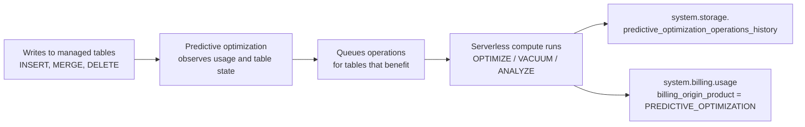

# Predictive Optimization

Mastery: `INPUT[inlineSelect(option(new), option(learning), option(solid)):mastery]`

> [!story] Context
> [[OPTIMIZE and VACUUM]] covered the maintenance commands that compact small files, delete unreferenced ones, and collect statistics. Running them by hand means choosing tables, schedules, and compute for each one. Predictive optimization moves that work to Databricks.

> [!eli5] Summary
> Tables slowly fill up with small and outdated files, which makes queries slower and storage larger. Predictive optimization is a Databricks service that watches your tables and cleans them up automatically, at the times it judges most useful, so nobody has to schedule maintenance.

## Background

Lakehouse tables need regular maintenance. Frequent writes create the [[Small Files Problem|small files problem]], `MERGE` and `DELETE` leave files that are no longer referenced, and the query optimizer needs fresh statistics. Before predictive optimization, a data team had to:

1. Decide which tables need `OPTIMIZE`, `VACUUM`, and `ANALYZE`.
2. Write and schedule a job for each, on compute they size and pay for.
3. Tune the schedule as usage changes, and notice when a table is missed.

This is easy to get wrong in both directions: running maintenance too often wastes compute, and running it too rarely leaves tables slow and storage bloated.

## Overview

Predictive optimization identifies [[Unity Catalog]] managed tables that would benefit from maintenance and runs the operations for you on [[Serverless Compute|serverless compute]].

| Item | Detail |
|---|---|
| Operations | `OPTIMIZE` (compaction and [[Liquid Clustering\|clustering]]), `VACUUM`, and `ANALYZE` (statistics). Also selects clustering keys for automatic liquid clustering (`CLUSTER BY AUTO`) |
| Tables covered | Unity Catalog managed tables, both [[Delta Lake]] and [[Apache Iceberg]]. Not external tables |
| Default | Enabled by default for accounts created on or after November 11, 2024. Existing accounts are enabled through a gradual rollout that the docs list as expected to complete by August 2026 |
| Scope | An account-level setting inherited by catalogs, schemas, and tables, each of which can override it |
| Requirements | Premium plan or above, in a supported region; SQL warehouses or Databricks Runtime 12.2 LTS or above |
| Compute and billing | Runs on serverless compute, billed under a serverless jobs SKU |
| Monitoring | `system.storage.predictive_optimization_operations_history` (Public Preview) and `system.billing.usage` |

Related features that depend on it:

- **Automatic liquid clustering:** `CLUSTER BY AUTO` became generally available on June 12, 2025. It requires predictive optimization to choose clustering keys and run clustering.
- **Statistics on write:** Predictive optimization also collects statistics when data is written to a managed table, which supports [[Data Skipping|data skipping]].
- **Variant shredding:** The July 2026 general availability announcement for the [[VARIANT Data Type|VARIANT]] type states that variant shredding uses predictive optimization to improve query performance on variant data.

## How it works



### Settings and inheritance

The setting has three values at each level below the account: `ENABLE`, `DISABLE`, and `INHERIT`. A new catalog, schema, or table inherits from its parent unless you override it.

```sql
-- Turn on for one catalog; its schemas and tables inherit
ALTER CATALOG shop ENABLE PREDICTIVE OPTIMIZATION;

-- Opt out a scratch schema
ALTER SCHEMA shop.scratch DISABLE PREDICTIVE OPTIMIZATION;

-- Return a table to whatever its schema uses
ALTER TABLE shop.sales.orders INHERIT PREDICTIVE OPTIMIZATION;

-- Check the effective setting and where it came from
DESCRIBE CATALOG EXTENDED shop;
DESCRIBE TABLE EXTENDED shop.sales.orders;
```

An account admin sets the account-level default in the account console. Catalogs, schemas, and tables then override it with the SQL above.

### Monitoring what it did

The operations history system table records each operation. It updates within about two hours, while billing data can take up to 24 hours.

```sql
-- Recent maintenance on one catalog
SELECT start_time, schema_name, table_name, operation_type, operation_status
FROM system.storage.predictive_optimization_operations_history
WHERE catalog_name = 'shop'
ORDER BY start_time DESC
LIMIT 50;

-- What predictive optimization consumed, by day
SELECT usage_date, SUM(usage_quantity) AS dbus
FROM system.billing.usage
WHERE billing_origin_product = 'PREDICTIVE_OPTIMIZATION'
GROUP BY usage_date
ORDER BY usage_date DESC;
```

Column names in the operations history table can change while it is in Public Preview. Run `DESCRIBE system.storage.predictive_optimization_operations_history` to confirm them in your workspace.

### Enabling it on an existing workspace

1. Confirm that the workspace is on the Premium plan or above and in a supported region.
2. Confirm that your tables are Unity Catalog managed tables. Convert external tables first if needed (see [[Managed vs External Tables]]).
3. In the account console, set predictive optimization to enabled for the account, or run `ALTER CATALOG ... ENABLE PREDICTIVE OPTIMIZATION` for selected catalogs.
4. Remove any scheduled `OPTIMIZE` and `VACUUM` jobs for the covered tables.
5. After a few days, query the operations history table to confirm that operations are running.

## Small-business considerations

> [!smallbiz] Small-business considerations
> Leave predictive optimization on and use Unity Catalog managed tables. For a team without a dedicated platform engineer, it removes a class of maintenance jobs that are easy to forget.
>
> - **When to care:** Any time you write to tables daily or more often, or use `MERGE`.
> - **When to skip:** External tables are not covered. If you must keep them external, schedule `OPTIMIZE` and `VACUUM` yourself.
> - **Cost:** Maintenance runs on serverless compute and is metered in [[DBUs]] under a serverless jobs SKU. It also reduces storage and query compute. Track it with the billing query above and see [[How Databricks Pricing Works]] and the [Databricks pricing page](https://www.databricks.com/product/pricing).

## Cloud differences

The feature, SQL, and system tables are the same on all three clouds. The supported regions differ by cloud, and a metastore in an unsupported region is not enabled.

> [!azure]- Azure Databricks
> Requires the Premium tier. Check the Azure Databricks "Predictive optimization for Unity Catalog managed tables" page and the regional availability list for your Azure region.

> [!aws]- Databricks on AWS
> Requires the Premium plan or above. Check the AWS feature region support page for your AWS region.

> [!gcp]- Databricks on Google Cloud
> Predictive optimization has limited regional availability on Google Cloud. Check "Features with limited regional availability" for your GCP region before relying on it.

## Advanced topics

> [!deepdive]- Advanced topics (301–401)
> - **VACUUM retention floor:** Predictive optimization keeps data files for at least 7 days, even if a table's `delta.deletedFileRetentionDuration` is set lower. This protects [[Time Travel]] and in-flight readers.
> - **Converted tables:** When you convert an external Delta table to a managed table, predictive optimization is enabled automatically unless it was manually disabled. Conversions of foreign tables get the `INHERIT` setting.
> - **Automatic upgrades:** Automatic liquid clustering applies to new tables. Existing tables keep their layout until you change their clustering.
> - **Manual commands still work:** You can still run `OPTIMIZE` or `VACUUM` manually on a covered table, for example after a large one-time backfill. Remove scheduled maintenance jobs for covered tables to avoid paying for the same work twice.
> - **Billing attribution:** Charges appear in `system.billing.usage` with `billing_origin_product = 'PREDICTIVE_OPTIMIZATION'`. Join with `system.billing.list_prices` to estimate cost, and see [[Budgets and Usage Dashboards]].
> - **System table retention:** The operations history table is regional, does not support streaming reads, and has a 180-day retention period.

## Common misconceptions

> [!confusion] Predictive optimization is not a query optimizer
> It maintains table files and statistics. It does not rewrite your queries. Query planning is the job of the optimizer and [[Photon]]; predictive optimization gives them better-organized data to work with.

> [!confusion] It does not cover every table
> Only Unity Catalog managed tables are covered. External tables, and tables you read through federation or sharing, need their own maintenance.

> [!confusion] "Predictive Optimization" and "OPTIMIZE" are different things
> `OPTIMIZE` is one SQL command. Predictive optimization is the service that decides when to run `OPTIMIZE`, `VACUUM`, and `ANALYZE`.

## Recall

What does predictive optimization do?::It automatically runs `OPTIMIZE`, `VACUUM`, and `ANALYZE` on Unity Catalog managed tables that would benefit.
Which tables does predictive optimization cover?::Unity Catalog managed tables, Delta Lake and Apache Iceberg. Not external tables.
Which accounts have predictive optimization on by default?::Accounts created on or after November 11, 2024. Existing accounts through a gradual rollout.
What three values can the setting take on a catalog, schema, or table?::`ENABLE`, `DISABLE`, and `INHERIT`.
What compute does predictive optimization use, and how is it billed?::Serverless compute, billed under a serverless jobs SKU.
Which system table records predictive optimization operations?::`system.storage.predictive_optimization_operations_history`.
How do you find predictive optimization charges in billing data?::Filter `system.billing.usage` on `billing_origin_product = 'PREDICTIVE_OPTIMIZATION'`.
Which feature requires predictive optimization to pick clustering keys?::Automatic liquid clustering (`CLUSTER BY AUTO`).
What is the minimum file retention predictive optimization uses for VACUUM?::7 days.

## Next steps

> [!path] Learning path
> **Needs first:** [[OPTIMIZE and VACUUM]], [[Managed vs External Tables]], [[Unity Catalog]]
> **Unlocks next:** [[System Tables]], [[Serverless Compute]], [[Cost Optimization Checklist]]

> [!nextup] Next
> [[Chapter 06 - The Databricks Platform]] covers the managed platform that runs these tables: accounts, workspaces, compute, and the services, such as predictive optimization, that automate their upkeep.

> [!sources]- Sources (last verified: 2026-10-25)
> - [Predictive optimization for Unity Catalog managed tables (AWS)](https://docs.databricks.com/aws/en/optimizations/predictive-optimization)
> - [Predictive optimization for Unity Catalog managed tables (Azure Databricks)](https://learn.microsoft.com/en-us/azure/databricks/optimizations/predictive-optimization)
> - [Predictive optimization for Unity Catalog managed tables (GCP)](https://docs.databricks.com/gcp/en/optimizations/predictive-optimization)
> - [Predictive optimization system table reference (AWS)](https://docs.databricks.com/aws/en/admin/system-tables/predictive-optimization)
> - [System tables reference (GCP)](https://docs.databricks.com/gcp/en/admin/system-tables)
> - [Monitor the cost of serverless compute (AWS)](https://docs.databricks.com/aws/en/admin/system-tables/serverless-billing)
> - [ALTER CATALOG (AWS)](https://docs.databricks.com/aws/en/sql/language-manual/sql-ref-syntax-ddl-alter-catalog)
> - [Use liquid clustering for tables (GCP)](https://docs.databricks.com/gcp/en/tables/clustering)
> - [Automatic upgrades (GCP)](https://docs.databricks.com/gcp/en/tables/automatic-upgrades)
> - [Features with limited regional availability (GCP)](https://docs.databricks.com/gcp/en/resources/feature-region-support)
> - [Convert external or foreign Delta Lake tables to Unity Catalog managed tables (AWS)](https://docs.databricks.com/aws/en/tables/convert-to-managed)
> - [Ingest semi-structured data faster and more efficiently with Variant, now generally available (Databricks blog)](https://www.databricks.com/blog/ingest-semi-structured-data-faster-and-more-efficiently-variant-now-generally-available)
