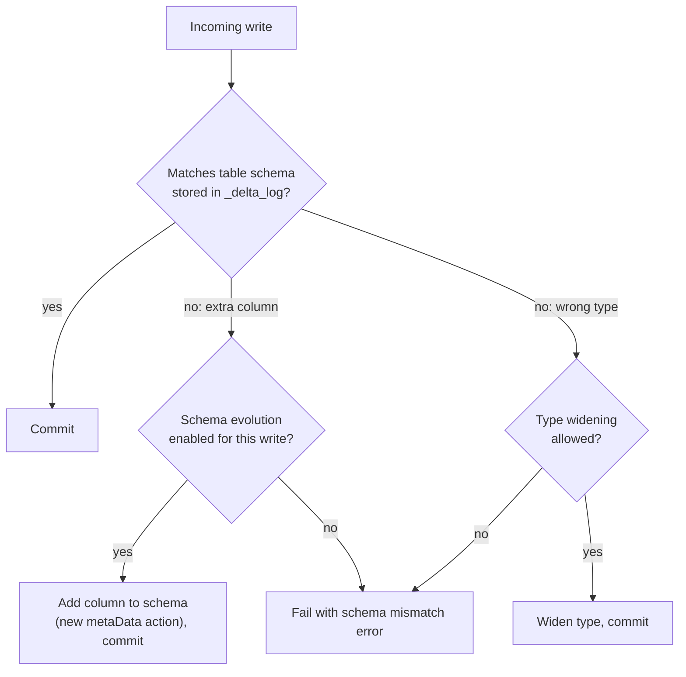

# Schema Enforcement and Evolution

Mastery: `INPUT[inlineSelect(option(new), option(learning), option(solid)):mastery]`

> [!story] Context
> [[Time Travel]] reverses bad writes after the fact. Schema enforcement prevents one common class of bad write: data whose columns or types do not match the table. Delta stores the table's [[Schema|schema]] in its log and validates writes against it.

> [!eli5] Summary
> A table records its columns and the type of value each column holds. Writes that do not match are rejected. When the data legitimately gains a new column, you allow the change explicitly.

> [!analogy]- Analogy: a printed form at a clinic
> - **The form's boxes** are the columns: name, date of birth, phone number.
> - **The receptionist who rejects a form with "next Tuesday" in the date-of-birth box** is schema enforcement.
> - **Printing a new version of the form with an "email" box** is schema evolution. It is a deliberate change, and old forms are still valid (their email box is empty).

## Background

Early data lakes used **schema-on-read**: write any file, figure out the columns when you read it. That is flexible, and it is how lakes turned into [[Data Swamps|swamps]]:

- A source system renames `customer_id` to `customerId`. Some files use one name and some the other, and every query must handle both.
- A CSV export starts writing prices as `"12,50"` text. Sums silently skip them.
- An upstream team adds 40 columns. Downstream tables break or ignore them, depending on the tool.

Warehouses always used **schema-on-write**: the table has a fixed schema, and writes that do not match fail. Delta brings schema-on-write to the lake, with a controlled way to change the schema when it should change.

## Overview

**Schema enforcement** (also called schema validation) means a write to a Delta table is rejected if its data does not match the table's schema. Specifically, a write fails if it:

- contains a column that does not exist in the table,
- has a column whose [[Data Type|data type]] cannot be safely written into the table's type, or
- has column names that differ only by case in a way the table cannot hold.

Columns that are in the table but missing from the write are filled with `NULL`.

**Schema evolution** means you explicitly allow a write to change the table's schema, usually to **add new columns**. Databricks recommends turning it on **per write**, not for the whole session:

| How | Where | Notes |
|---|---|---|
| `.option("mergeSchema", "true")` | DataFrame writes and streaming writes | New columns are added to the end of the schema |
| `MERGE WITH SCHEMA EVOLUTION INTO ...` | SQL `MERGE` | Adds source columns used in insert or update actions. Docs list Runtime 15.2+ on the reference page and 15.4 LTS+ in the guide |
| `INSERT WITH SCHEMA EVOLUTION INTO ...` | SQL `INSERT` | Runtime 18.1 and above. On 18.0 and below, use `mergeSchema` |
| `.withSchemaEvolution()` | Python/Scala `DeltaTable.merge` builder | Same as the SQL clause |
| `spark.databricks.delta.schema.autoMerge.enabled` | Session config | Legacy. Applies to every write in the session, so avoid it |

Other schema changes are explicit DDL:

```sql
ALTER TABLE shop.sales.orders ADD COLUMNS (discount_code STRING);
ALTER TABLE shop.sales.orders ALTER COLUMN total COMMENT 'Order total incl. tax';
-- Renames and drops need column mapping enabled
ALTER TABLE shop.sales.orders SET TBLPROPERTIES ('delta.columnMapping.mode' = 'name');
ALTER TABLE shop.sales.orders RENAME COLUMN email TO customer_email;
```

**Type widening** lets a column's type grow without rewriting the data (for example `INT` to `BIGINT`). It must be enabled on the table, and for automatic widening during writes, `mergeSchema` must be on as well.

## How it works



The schema lives in the `metaData` action of the [[Delta Transaction Log]]. Evolving it is a commit with a new `metaData` action, so it is atomic and visible in [[Time Travel|history]].

**Enforcement in action:**

```python
from pyspark.sql import Row
new = spark.createDataFrame([Row(order_id=3, total=12.0, coupon="FALL10")])

new.write.mode("append").saveAsTable("shop.sales.orders")
# AnalysisException: A schema mismatch detected when writing to the Delta table ...
#   coupon is not in the table schema

new.write.mode("append").option("mergeSchema", "true").saveAsTable("shop.sales.orders")
# Succeeds: 'coupon' is added as a new nullable column
```

**Evolution inside a MERGE:**

```sql
MERGE WITH SCHEMA EVOLUTION INTO shop.sales.customers t
USING shop.staging.customer_updates s
ON t.customer_id = s.customer_id
WHEN MATCHED THEN UPDATE SET *
WHEN NOT MATCHED THEN INSERT *;
-- any new column in customer_updates is added to customers
```

## Small-business considerations

> [!smallbiz] Small-business considerations
> A practical rule that covers most teams:
> - **Raw tables (bronze): be flexible:** Let new columns in (with [[Auto Loader]]'s schema evolution, or by storing whole records as `VARIANT` or `STRING`). Ingestion should not stop because a source such as Shopify adds a field.
> - **Clean and reporting tables (silver, gold): be strict:** Keep enforcement on and change the schema with deliberate `ALTER TABLE` statements. Your dashboards depend on these columns. See [[Medallion Architecture]].
>
> When a write fails with a schema mismatch, that is the system working. Read the error, decide whether the new column belongs, and then evolve on purpose.

## Cloud differences

> [!aws]- All clouds
> Nothing differs. Schema enforcement and evolution are Delta features and behave the same on every cloud.

## Advanced topics

> [!deepdive]- Advanced topics (301–401)
> - **Some writes match columns by name, others by position:** `saveAsTable` and `MERGE ... UPDATE SET *` / `INSERT *` match columns by name. `INSERT INTO t SELECT ...` without a column list matches by position, in the order the table defines. List the columns or use `INSERT INTO t BY NAME` (Runtime 13.3 LTS and above) to match by name. Positional inserts are a common source of silently swapped columns. On Delta tables, nested struct fields are matched by position even with `BY NAME`.
> - **[[Column Mapping|Column mapping]]** (`delta.columnMapping.mode = 'name'`) decouples logical column names from the physical Parquet names, which is what makes `RENAME COLUMN` and `DROP COLUMN` metadata-only. It is required for [[Delta UniForm|Iceberg reads]]. It needs reader protocol version 2 and writer version 5 or above, and reading the table requires Databricks Runtime 10.4 LTS or above, so older readers cannot read it.
> - **Streaming and schema changes:** A streaming read from a Delta table fails if the table's schema changes after the stream starts. For most schema changes, restarting the stream resolves the mismatch. On Databricks Runtime 12.2 LTS and below, you cannot stream from a table with column mapping that has had non-additive changes such as renamed or dropped columns.
> - **Recent fixes:** The June 2026 Databricks SQL release notes fix `MERGE WITH SCHEMA EVOLUTION` with `WHEN MATCHED THEN DELETE` and with nested columns referenced by alias. The May 2026 notes changed how NULL structs are handled during evolution. Pin behavior with tests if you depend on edge cases.
> - **Constraints go further than types:** `ALTER TABLE ... ADD CONSTRAINT valid_total CHECK (total >= 0)` and `NOT NULL` make Delta reject rows that break business rules. For pipeline-level rules with metrics, see [[Expectations and Data Quality]].

## Common misconceptions

> [!confusion] Schema evolution is not automatic by default
> Delta rejects mismatched writes unless you opt in for that write. That default is a feature.

> [!confusion] "Schema" here is the column list, not the Unity Catalog schema
> In `catalog.schema.table`, a schema is a container of tables. This note is about a table's schema: its columns and types. See [[Schema]].

## Recall

What is schema enforcement in Delta Lake?::Rejecting writes whose columns or types do not match the table's schema stored in the transaction log.
What happens to table columns missing from a write?::They are filled with NULL.
Which DataFrame option enables schema evolution for one write?::`.option("mergeSchema", "true")`.
What SQL clause adds new source columns during a MERGE?::`MERGE WITH SCHEMA EVOLUTION INTO ...`.
Why does Databricks advise against `spark.databricks.delta.schema.autoMerge.enabled`?::It turns evolution on for every write in the session; per-write options are safer.
What must be enabled to rename or drop columns as metadata-only changes?::Column mapping (`delta.columnMapping.mode = 'name'`).
What is type widening?::Changing a column to a wider type (such as INT to BIGINT) without rewriting data files.
Schema-on-read vs schema-on-write: which does Delta use?::Schema-on-write, with opt-in evolution.

## Next steps

> [!path] Learning path
> **Needs first:** [[Delta Lake]], [[Schema]], [[Data Type]]
> **Unlocks next:** [[MERGE and Upserts]], [[Auto Loader]], [[Expectations and Data Quality]]

> [!nextup] Next
> [[MERGE and Upserts]] covers updating existing rows and inserting new ones in a single statement.

> [!sources]- Sources (last verified: 2026-10-25)
> - [Rename and drop columns with Delta Lake column mapping (AWS)](https://docs.databricks.com/aws/en/tables/features/column-mapping)
> - [INSERT (Databricks SQL reference, AWS)](https://docs.databricks.com/aws/en/sql/language-manual/sql-ref-syntax-dml-insert-into)
> - [Constraints on Databricks (AWS)](https://docs.databricks.com/aws/en/tables/constraints)
> - [Delta table streaming reads and writes (AWS)](https://docs.databricks.com/aws/en/structured-streaming/delta-lake)
> - [Read Delta tables with Iceberg clients (AWS)](https://docs.databricks.com/aws/en/delta/iceberg-reads)
> - [DataFrameWriter.saveAsTable (PySpark API reference)](https://spark.apache.org/docs/latest/api/python/reference/pyspark.sql/api/pyspark.sql.DataFrameWriter.saveAsTable.html)
> - [Schema enforcement (AWS)](https://docs.databricks.com/aws/en/tables/schema-enforcement)
> - [Schema evolution in Databricks (AWS)](https://docs.databricks.com/aws/en/data-engineering/schema-evolution)
> - [Update table schemas with schema evolution (AWS)](https://docs.databricks.com/aws/en/tables/update-schema)
> - [MERGE INTO (Databricks SQL reference, AWS)](https://docs.databricks.com/aws/en/sql/language-manual/delta-merge-into)
> - [Type widening (GCP)](https://docs.databricks.com/gcp/en/delta/type-widening)
> - [Databricks SQL release notes 2026 (AWS)](https://docs.databricks.com/aws/en/sql/release-notes/2026)
