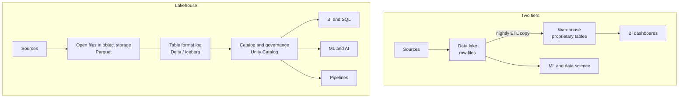

# The Lakehouse Idea

Mastery: `INPUT[inlineSelect(option(new), option(learning), option(solid)):mastery]`

> [!story] Context
> [[Chapter 05 - The Lakehouse|Chapter 05]] starts from [[The Two-Tier Architecture Problem]]: a [[Data Lakes|data lake]] for raw files and a [[Data Warehouses|data warehouse]] for curated tables, connected by copy jobs. That design duplicates storage and governance and leaves the warehouse copy stale. The lakehouse replaces both tiers with one.

> [!eli5] Summary
> A lakehouse keeps all of an organization's data in one low-cost storage location, in file formats that many tools can open. A record of every change makes that storage as dependable as a traditional reporting database. One copy of the data serves reports, analysis, and AI.

> [!analogy]- Analogy: a warehouse store with a stock ledger
> - **The big, cheap building** is [[Object Storage|cloud object storage]] (S3, ADLS, GCS). It holds anything, in any amount, at low cost.
> - **The boxes on the shelves** are open data files, mostly [[Apache Parquet]]. Any forklift (engine) can lift them.
> - **The stock ledger at the front desk** is the [[Open Table Formats|table format]] (such as [[Delta Lake]]). Every delivery and removal is written down, so the count is always right, even while trucks are unloading.
> - **The shop counter** is the set of tools on top: SQL, dashboards, Python, machine learning. They all read the same shelves.

## Background

By the late 2010s most companies with significant data had both a lake and a warehouse:

| | Data lake | Data warehouse |
|---|---|---|
| Storage | Cheap object storage | Proprietary storage inside the warehouse |
| Data types | Anything: logs, images, JSON, CSV | Mostly tables with fixed columns |
| Reliability | No transactions, half-written files, no rules on columns | Strong [[ACID Transactions\|transactions]] and [[Schema\|schemas]] |
| Good for | Data science, machine learning, raw history | [[BI Tools\|BI]] dashboards and SQL reporting |
| Weak at | Fast SQL, trust, updates and deletes | Machine learning, open access, cost at scale |

Running both meant [[ETL vs ELT|ETL]] jobs copying data from the lake into the warehouse. The warehouse copy was always a few hours stale, and the lake copy was never quite trustworthy. A lake left without rules turned into a [[Data Swamps|data swamp]].

The lakehouse approach makes the lake itself reliable and fast enough that the second copy is no longer needed.

## Overview

Databricks' docs describe a data lakehouse as a data management system that combines the benefits of data lakes and data warehouses. In practice it has four components:

1. **Open files on cheap storage:** Data stays as [[Apache Parquet|Parquet]] files in your own cloud bucket. No proprietary format restricts access to it.
2. **A transactional [[Metadata|metadata]] layer:** A table format such as [[Delta Lake]], [[Apache Iceberg]], or [[Apache Hudi]] keeps a log of which files make up the table right now. That log gives you ACID transactions, [[Time Travel|time travel]], and [[Schema Enforcement and Evolution|schema enforcement]].
3. **Fast engines:** Query engines like [[Apache Spark]] and [[Photon]] use the metadata (file statistics, [[Data Skipping|data skipping]], [[Liquid Clustering|clustering]]) to read only what they need. The aim is warehouse speed on lake files.
4. **One governance layer:** A catalog such as [[Unity Catalog]] controls who can see what, across SQL, Python, and AI tools alike.

The outcome is a single copy of the data that BI analysts, data engineers, and data scientists all use directly.

## How it works



The central change is that the "table" is no longer a thing locked inside a database server. It is a folder of Parquet files plus a log that says which files count. Any engine that understands the log can read the table, and any engine that follows the log's rules can write to it safely.

A minimal lakehouse table in Databricks SQL:

```sql
-- Creates a Delta table: Parquet files plus a _delta_log folder
CREATE TABLE shop.sales.orders (
  order_id    BIGINT,
  ordered_at  TIMESTAMP,
  customer_id BIGINT,
  total       DECIMAL(10,2)
);

-- Warehouse-style operations on lake storage
INSERT INTO shop.sales.orders VALUES (1001, current_timestamp(), 42, 59.90);
UPDATE shop.sales.orders SET total = 54.90 WHERE order_id = 1001;
SELECT * FROM shop.sales.orders VERSION AS OF 1;   -- the table before the UPDATE
```

On a plain data lake, that `UPDATE` would mean rewriting files by hand, with nothing to stop a reader from seeing a half-written result. On a lakehouse it is one atomic commit.

## Small-business considerations

> [!smallbiz] Small-business considerations
> A lakehouse matters to a small business less for scale and more for **simplicity**. You keep one copy of your sales, inventory, and marketing data, not a lake plus a warehouse plus spreadsheets. The same tables feed your [[AI-BI Dashboards|dashboards]], your accountant's exports, and any AI experiments later.
>
> You also keep ownership. The files sit in your cloud account in open formats, so leaving a vendor does not mean exporting everything. That lowers [[Vendor Lock-In|lock-in]] risk, which matters when you are small and cannot afford a big migration later.
>
> The cost meter is storage (cheap, billed by your cloud provider) plus compute while queries run. See [[How Databricks Pricing Works]] rather than any fixed number.

## Cloud differences

> [!azure]- Azure Databricks
> The lakehouse files live in **Azure Data Lake Storage Gen2** ([[Azure Data Lake Storage]]), with paths like `abfss://container@account.dfs.core.windows.net/...`. Access goes through an Access Connector (see [[ADLS and Access Connectors]]).

> [!aws]- Databricks on AWS
> The files live in **[[Amazon S3]]** buckets (`s3://bucket/...`), reached through an IAM role (see [[S3 Access via Unity Catalog]]).

> [!gcp]- Databricks on Google Cloud
> The files live in **[[Google Cloud Storage]]** buckets (`gs://bucket/...`), reached through a Databricks-generated service account (see [[GCS Access via Unity Catalog]]). The idea and the SQL are identical on all three clouds; only the storage service differs.

## Advanced topics

> [!deepdive]- Advanced topics (301–401)
> - **The hard part is performance, not storage:** Warehouses were fast because they controlled their own storage layout, indexes, and caches. A lakehouse has to get similar speed from open files. It does this with file-level statistics in the log, clustering ([[Liquid Clustering]]), caching ([[Query Performance and Caching]]), and vectorized engines like [[Photon]]. [[The Lakehouse Paper]] argues these are enough, and shows TPC-DS results to back it.
> - **"Open" has layers:** Open file format (Parquet), open table format (Delta, Iceberg), open catalog API (Unity Catalog's Iceberg REST endpoint), and open engine (Spark). A lakehouse can be open at some layers and closed at others. Ask which layers a vendor means.
> - **From competing formats to interoperability:** For a few years Delta, Iceberg, and Hudi competed. By 2024–2026 the industry moved to reading each other's metadata ([[Delta UniForm]]) and to catalogs that serve both formats. Unity Catalog now has managed Delta and managed Iceberg tables side by side.
> - **The next layer:** Databricks later framed its platform as [[The Data Intelligence Platform]]: the lakehouse plus AI that understands your data's meaning.

## Common misconceptions

> [!confusion] A lakehouse is not a product you buy
> It is an architecture pattern. Databricks sells a platform built on it, but you could assemble a lakehouse from open-source pieces (Spark, Delta or Iceberg, an open catalog) on any cloud.

> [!confusion] A lakehouse is not "just a data lake"
> A lake is a pile of files. A lakehouse is files **plus** a transactional table format **plus** governance. Without the middle layer you still have a swamp.

> [!confusion] "One copy" does not mean "one table"
> You still keep raw, cleaned, and business-ready tables (see [[Medallion Architecture]]). "One copy" means you do not duplicate the same data into a second, separate system.

## Recall

What is a lakehouse in one sentence?::A data architecture that keeps one copy of data as open files in cheap object storage and adds a transactional table format and governance so it works like a warehouse.
Which two systems did the lakehouse aim to merge?::The data lake and the data warehouse.
What file format sits underneath most lakehouse tables?::Apache Parquet.
Name three open table formats.::Delta Lake, Apache Iceberg, Apache Hudi.
What turns a folder of Parquet files into a reliable table?::A transaction log (metadata layer) that records which files make up the table at each version.
What problem with two-tier architectures does the lakehouse remove?::The nightly copy from lake to warehouse, with its stale data, double storage, and double governance.
Where do a lakehouse's data files physically live?::In the customer's cloud object storage: S3, ADLS Gen2, or GCS.

## Next steps

> [!path] Learning path
> **Needs first:** [[Data Lakes]], [[Data Warehouses]], [[The Two-Tier Architecture Problem]]
> **Unlocks next:** [[The Lakehouse Paper]], [[Open Table Formats]], [[Delta Lake]]

> [!nextup] Next
> [[The Lakehouse Paper]] is the January 2021 CIDR paper that named this architecture and set out the argument for it.

> [!sources]- Sources (last verified: 2026-10-25)
> - [What is a data lakehouse? (Databricks docs, AWS)](https://docs.databricks.com/aws/en/lakehouse/)
> - [Lakehouse: A New Generation of Open Platforms (CIDR 2021, Databricks research page)](https://www.databricks.com/research/lakehouse-a-new-generation-of-open-platforms-that-unify-data-warehousing-and-advanced-analytics)
> - [Lakehouse architecture realized (Databricks blog, January 2021)](https://www.databricks.com/blog/2021/01/08/lakehouse-architecture-realized-enabling-data-teams-with-faster-cheaper-and-more-reliable-open-architectures.html)
> - [What is an open lakehouse? (Databricks blog)](https://www.databricks.com/blog/what-open-lakehouse-open-data-standards-explained)
> - [What is Apache Iceberg in Databricks? (AWS)](https://docs.databricks.com/aws/en/iceberg/)
> - [Unity Catalog managed tables for Delta Lake and Apache Iceberg (AWS)](https://docs.databricks.com/aws/en/tables/managed)
