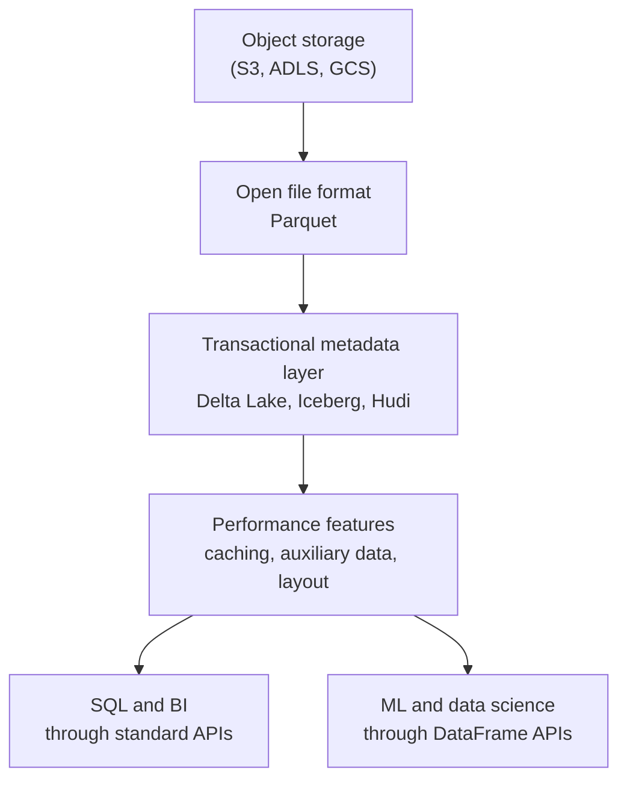

# The Lakehouse Paper

Mastery: `INPUT[inlineSelect(option(new), option(learning), option(solid)):mastery]`

> [!story] Context
> [[The Lakehouse Idea]] describes one copy of data in open files with warehouse-grade reliability. This note covers the 2021 research paper that named the pattern and argued that it would replace the two-tier design.

> [!eli5] Summary
> In January 2021 the founders of Databricks published a short research paper arguing that companies no longer need two separate data systems. It named the combined design the "lakehouse" and included early performance results.

> [!analogy]- Analogy: an architect's proposal for a combined building
> - **The old city** had two buildings: a warehouse for neat goods and a yard for everything else, with trucks shuttling between them.
> - **The proposal** is the paper: tear down the wall, roof over the yard, and put a proper inventory desk at the door.
> - **The cost estimate and the test build** are the paper's benchmark results.
> - **The building code it relies on** is the open-file standard (Parquet) and the inventory system (Delta Lake).

## Background

Academic database research has a tradition of short "vision" papers that argue for a direction before it is proven. The Conference on Innovative Data Systems Research (CIDR) is a venue for exactly that kind of paper.

By 2020 Databricks had built [[Delta Lake]] and was selling a platform on top of lakes. But "lake plus warehouse" was still the accepted design, and most analysts assumed warehouses would stay at the center. The founders needed to make the case, to researchers and to the industry, that the center of gravity should move to open storage.

## Overview

**Title:** *Lakehouse: A New Generation of Open Platforms that Unify Data Warehousing and Advanced Analytics*

**Authors:** Michael Armbrust, Ali Ghodsi, Reynold Xin, and Matei Zaharia, with affiliations at Databricks, UC Berkeley, and Stanford.

**Venue:** CIDR '21, the Conference on Innovative Data Systems Research, held online in January 2021.

**The thesis, in the paper's terms:** the data warehouse architecture as we know it will wither in the coming years and be replaced by a new architectural pattern, the lakehouse, which will

1. be based on **open direct-access data formats** such as [[Apache Parquet]],
2. have **first-class support for machine learning and data science**, and
3. offer **state-of-the-art performance**.

**The problems it lists with the two-tier world:**

| Problem | What it means in practice |
|---|---|
| Reliability | Keeping the lake and the warehouse consistent is hard. Every ETL step is a chance for bugs and drift. |
| Data staleness | Warehouse data lags the lake by hours or days. |
| Limited support for advanced analytics | ML libraries need to read lots of data directly. Pulling it through a warehouse's SQL interface is slow. |
| Total cost of ownership | You pay to store everything twice and to run the copy jobs. See [[Total Cost of Ownership]]. |
| Lock-in | Data inside a proprietary warehouse format is hard to take elsewhere. |

**The evidence:** the paper reports a prototype built on Parquet and Delta Lake that is competitive with popular cloud data warehouses on the TPC-DS benchmark.

## How it works

The paper's proposed architecture has three layers above object storage:

Its central technical claims:

1. **A metadata layer gives you management features.** A transaction log that records which files belong to a table version provides ACID transactions, versioning, and schema enforcement, without moving data out of open files. This is exactly what [[Delta Transaction Log|Delta's transaction log]] does.
2. **Performance can come from outside the file format.** The paper names caching hot data on fast local SSDs, keeping auxiliary data (statistics, indexes) in the metadata layer, and optimizing data layout (clustering, sort orders). None of this needs a proprietary format.
3. **Declarative DataFrame APIs let ML benefit too.** Because Spark-style DataFrame APIs build a query plan before running ([[Lazy Evaluation]]), ML code can get the same optimizations as SQL, such as reading only the needed columns.

## Small-business considerations

> [!smallbiz] Small-business considerations
> You do not need to read the paper to use Databricks. It is worth ten minutes for one reason: its list of problems (stale data, double cost, lock-in) is a good checklist when you evaluate any data platform. Ask each vendor how they answer those five rows in the table above.

## Cloud differences

> [!aws]- All clouds
> Nothing differs. The paper is cloud-neutral and names S3, ADLS, and GCS interchangeably as the object storage layer.

## Advanced topics

> [!deepdive]- Advanced topics (301–401)
> - **Read it next to the Delta Lake VLDB paper.** The CIDR paper is the vision. Databricks' January 2021 blog post points readers to it alongside the earlier Delta Lake paper published at VLDB, which holds the engineering detail behind the metadata layer.
> - **The benchmark is the authors' own system.** The TPC-DS comparison was run by Databricks on its own engine. Treat it as evidence that the design is plausible, not as an independent shoot-out.
> - **The predictions mostly held on Databricks' side.** By 2026 Unity Catalog manages both Delta and Iceberg tables and serves them to outside engines through the Iceberg REST protocol. Whether warehouses "withered" or converged is a matter of reading; this vault does not make claims about other vendors' roadmaps.
> - **Open questions.** The paper closes with research questions about metadata layer design, caching and layout, and ML APIs. Features like [[Liquid Clustering]], [[Deletion Vectors]], and [[OPTIMIZE and VACUUM|predictive optimization]] in later chapters are answers to those questions.
> - **Lineage of ideas.** The approach echoes the [[Google File System and MapReduce Papers]]: put commodity storage at the center, then build smarter software on top.

## Common misconceptions

> [!confusion] The paper did not invent Delta Lake
> Delta Lake was open-sourced in 2019. The 2021 paper generalized the idea and named the architecture. It uses Delta Lake as its main example.

> [!confusion] "Lakehouse" is not a Databricks trademark for one product
> The paper describes a pattern that any vendor or open-source stack can implement. Others (Snowflake, Google, AWS, Microsoft) now use the word for their own offerings.

## Recall

Who wrote the lakehouse paper?::Michael Armbrust, Ali Ghodsi, Reynold Xin, and Matei Zaharia.
Where and when was the lakehouse paper published?::CIDR 2021, the Conference on Innovative Data Systems Research, January 2021 (online).
What three properties does the paper say a lakehouse must have?::Open direct-access data formats, first-class support for ML and data science, and state-of-the-art performance.
What benchmark did the paper use to argue lakehouse performance?::TPC-DS.
Name three problems of the two-tier lake-plus-warehouse design listed in the paper.::Reliability, data staleness, limited support for advanced analytics, total cost of ownership, and lock-in (any three).
What does the paper say provides ACID transactions and versioning on a lake?::A transactional metadata layer over the files, such as Delta Lake.

## Next steps

> [!path] Learning path
> **Needs first:** [[The Lakehouse Idea]], [[Data Warehouses]]
> **Unlocks next:** [[ACID Transactions]], [[Open Table Formats]], [[Delta Lake]]

> [!nextup] Next
> [[ACID Transactions]] defines the reliability guarantees that the paper's metadata layer provides.

> [!sources]- Sources (last verified: 2026-10-25)
> - [Lakehouse paper (PDF, Databricks)](https://www.databricks.com/wp-content/uploads/2020/12/cidr_lakehouse.pdf)
> - [Databricks research page for the paper](https://www.databricks.com/research/lakehouse-a-new-generation-of-open-platforms-that-unify-data-warehousing-and-advanced-analytics)
> - [Lakehouse architecture realized (Databricks blog, January 2021)](https://www.databricks.com/blog/2021/01/08/lakehouse-architecture-realized-enabling-data-teams-with-faster-cheaper-and-more-reliable-open-architectures.html)
> - [CIDR 2021 paper page (vldb.org)](https://vldb.org/cidrdb/2021/lakehouse-a-new-generation-of-open-platforms-that-unify-data-warehousing-and-advanced-analytics.html)
