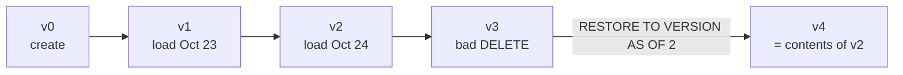

# Time Travel

Mastery: `INPUT[inlineSelect(option(new), option(learning), option(solid)):mastery]`

> [!story] Context
> The [[Delta Transaction Log]] records every table version, and removed data files remain on disk until `VACUUM` deletes them. Time travel is the set of commands that reads and restores those earlier versions.

> [!eli5] Summary
> A Delta table keeps its earlier versions for a period of time. You can query the table as it was at a past moment, compare versions, or restore an earlier version after a mistake.

> [!analogy]- Analogy: "undo history" in a document editor
> - **Each save** is a numbered version.
> - **Opening an old version read-only** is `VERSION AS OF` or `TIMESTAMP AS OF`.
> - **"Restore this version"** is `RESTORE`. It does not erase later history; it adds a new save that matches the old one.
> - **The editor only keeping 30 days of history** is the retention setting. Older versions eventually get cleaned up.

## Background

Mistakes happen in data work constantly: a `DELETE` without a `WHERE`, a pipeline that writes duplicates, a bad upstream file. On a plain data lake, the old files are overwritten and gone. You restore from backups, if you have them.

Time travel also answers questions that are not about mistakes:

- **Audits:** reproduce the revenue table exactly as it was on the date a quarterly report was filed.
- **Reproducibility:** retrain a machine learning model on exactly the data it was first trained on.
- **Debugging:** compare today's table with yesterday's to find the rows that changed.

## Overview

Delta Lake (and Iceberg) let you query any version still covered by retention, by **version number** or by **timestamp**, and roll the whole table back with `RESTORE`.

Two table properties decide how far back you can go:

| Property | Default | Controls |
|---|---|---|
| `delta.logRetentionDuration` | 30 days | How long commit history is kept in `_delta_log` |
| `delta.deletedFileRetentionDuration` | 7 days | How long removed data files are kept before `VACUUM` may delete them |

Time travel needs **both** the log entry and the data files. In practice, the usable window is the shorter of the two: by default, about 7 days after a `VACUUM` runs. In Databricks Runtime 18.0 and above, time travel queries older than `deletedFileRetentionDuration` are blocked for all tables. The docs also restrict how the two properties relate to each other, so change them together.

## How it works



**See the history first:**

```sql
DESCRIBE HISTORY shop.sales.orders;
-- version | timestamp           | operation | operationParameters      | userName
-- 3       | 2026-10-25 08:12:40 | DELETE    | {"predicate":"[]"}       | sam@shop.com   <- DELETE with no WHERE clause
-- 2       | 2026-10-24 02:00:05 | MERGE     | ...                      | nightly-job
```

**Read the past:**

```sql
-- By version number
SELECT count(*) FROM shop.sales.orders VERSION AS OF 2;

-- By timestamp (any timestamp expression works)
SELECT * FROM shop.sales.orders TIMESTAMP AS OF '2026-10-24 12:00:00';
SELECT * FROM shop.sales.orders TIMESTAMP AS OF date_sub(current_date(), 1);

-- Shorthand with @ (version, or timestamp as yyyyMMddHHmmssSSS)
SELECT * FROM shop.sales.orders@v2;
SELECT * FROM shop.sales.orders@20261024120000000;
```

**Find what changed between two versions:**

```sql
SELECT * FROM shop.sales.orders VERSION AS OF 2
EXCEPT
SELECT * FROM shop.sales.orders VERSION AS OF 3;   -- the rows the DELETE removed
```

**Undo:**

```sql
RESTORE TABLE shop.sales.orders TO VERSION AS OF 2;
-- or
RESTORE TABLE shop.sales.orders TO TIMESTAMP AS OF '2026-10-24 12:00:00';
```

`RESTORE` is itself a commit (v4 above), so you can even undo the undo.

**In Python:**

```python
df = (spark.read
      .option("versionAsOf", 2)          # or .option("timestampAsOf", "2026-10-24")
      .table("shop.sales.orders"))
```

**Keep history longer** (costs more storage):

```sql
ALTER TABLE shop.sales.orders SET TBLPROPERTIES (
  'delta.logRetentionDuration'         = 'interval 60 days',
  'delta.deletedFileRetentionDuration' = 'interval 30 days'
);
```

## Small-business considerations

> [!smallbiz] Small-business considerations
> Time travel is the first recovery tool for accidental changes. The procedure is:
>
> `DESCRIBE HISTORY` to find the last good version, then `RESTORE TABLE ... TO VERSION AS OF n`.
>
> It covers about a week by default. It is **not** a backup: if the storage account is deleted, history goes with it. For month-end or year-end snapshots you must keep, write a copy to its own table (`CREATE TABLE shop.sales.orders_2026_09 AS SELECT * FROM shop.sales.orders`) or keep a real backup. See [[Disaster Recovery]].

## Cloud differences

> [!aws]- All clouds
> Nothing differs. The syntax and retention defaults are the same on Azure, AWS, and Google Cloud.

## Advanced topics

> [!deepdive]- Advanced topics (301–401)
> - **VACUUM is what ends time travel:** Until VACUUM runs, old files stay. On Unity Catalog managed tables, [[OPTIMIZE and VACUUM|predictive optimization]] runs VACUUM for you, so assume the 7-day window is real.
> - **Iceberg tables work the same way:** Iceberg keeps snapshots, so Unity Catalog managed Iceberg tables can also be read as of an earlier point. Their VACUUM retention is fixed at 7 days.
> - **Governance still applies to the past:** Querying an old version applies today's [[Row Filters and Column Masks|row filters, column masks]] and ABAC policies. You cannot time travel around a permission.
> - **Privacy deletes:** Deleting a customer's rows does not remove them from old versions until VACUUM has run past retention. For [[GDPR]] "right to be forgotten" work, delete, then make sure VACUUM runs (and consider shorter retention on the affected tables).
> - **Restore can fail** if a data file it needs has already been vacuumed. Check the RESTORE reference for the options available in that case.

## Common misconceptions

> [!confusion] Time travel is not a backup
> It lives in the same storage as the table and is bounded by retention. A backup lives elsewhere and lasts as long as you say.

> [!confusion] RESTORE does not delete history
> It writes a new version whose contents match the old one. Later versions are still in the history.

## Recall

What two clauses query an older Delta table version?::`VERSION AS OF n` and `TIMESTAMP AS OF 'ts'`.
Which command rolls a table back?::`RESTORE TABLE name TO VERSION AS OF n` (or `TO TIMESTAMP AS OF`).
What is the default `delta.logRetentionDuration`?::30 days.
What is the default `delta.deletedFileRetentionDuration`?::7 days.
Which operation physically ends your ability to time travel to old versions?::VACUUM, which deletes removed data files older than the retention period.
Is RESTORE itself recorded in history?::Yes, it creates a new version, so it can be undone too.
Is time travel a backup?::No. It lives in the same storage and is limited by retention.
What changed in Databricks Runtime 18.0 for old time travel queries?::Queries older than `deletedFileRetentionDuration` are blocked for all tables.

## Next steps

> [!path] Learning path
> **Needs first:** [[Delta Transaction Log]], [[SQL]]
> **Unlocks next:** [[Schema Enforcement and Evolution]], [[Change Data Feed]], [[OPTIMIZE and VACUUM]]

> [!nextup] Next
> [[Schema Enforcement and Evolution]] covers how Delta rejects mismatched writes and how to change a schema deliberately.

> [!sources]- Sources (last verified: 2026-10-25)
> - [Work with table history (AWS)](https://docs.databricks.com/aws/en/tables/history)
> - [RESTORE (Databricks SQL reference, AWS)](https://docs.databricks.com/aws/en/sql/language-manual/delta-restore)
> - [Databricks Runtime 18 LTS release notes (AWS)](https://docs.databricks.com/aws/en/release-notes/runtime/18)
> - [Remove unused data files with vacuum (AWS)](https://docs.databricks.com/aws/en/tables/operations/vacuum)
> - [Remove unused data files with vacuum (GCP)](https://docs.databricks.com/gcp/en/delta/vacuum)
> - [Time travel with ABAC policies (AWS)](https://docs.databricks.com/aws/en/data-governance/unity-catalog/abac/time-travel)
> - [Table properties reference (AWS)](https://docs.databricks.com/aws/en/tables/table-properties)
