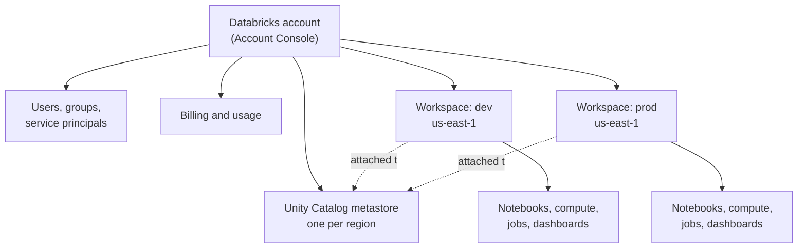

# Accounts and Workspaces

Mastery: `INPUT[inlineSelect(option(new), option(learning), option(solid)):mastery]`

> [!story] Context
> [[The Data Intelligence Platform]] describes Databricks at a high level: open storage, one catalog, many workloads. When a company signs up, it receives two containers, the **account** and the **workspace**. Most admin questions, such as access and billing, depend on which of the two owns the object in question.

> [!eli5] Summary
> The account is a company's overall membership with Databricks. A workspace is one area inside that membership where a team does its work: writing code, running reports, and scheduling jobs. A company has one account and one or more workspaces.

> [!analogy]- Analogy: a company and its offices
> | Company | Databricks |
> |---|---|
> | Headquarters: staff list, billing, master rules | The account |
> | Branch office with its own desks, machines, and schedules | A workspace (notebooks, compute, jobs) |
> | Staff directory kept at headquarters, badges per office | [[Users Groups and Service Principals\|Users and groups]], assigned to workspaces |
> | Shared filing room used by every office | [[Unity Catalog]] |

## Background

Originally, each Databricks workspace was self-contained. Users, permissions, and the list of tables ([[Hive Metastore]]) were all set inside it. Companies that needed separate development and production environments, or one environment per department, copied users and data between workspaces.

Databricks added a level above the workspace. The **account** now owns the things that should be the same everywhere: identity, governance, billing, and network settings. Workspaces keep the things that belong to one team: notebooks, compute, jobs, and dashboards.

## Overview

| | **Account** | **Workspace** |
|---|---|---|
| What it is | Your organization's top-level Databricks entity | A deployment where people work |
| How many | Usually one per company (per cloud) | One to hundreds |
| Lives at | The [[Account Console]] | Its own URL, for example `https://dbc-a1b2c3d4-e5f6.cloud.databricks.com` |
| Owns | Users, groups, service principals; Unity Catalog [[Metastore\|metastores]]; billing and usage; network and encryption configs; workspace creation | Notebooks, files, [[Git Folders and Workspace Files\|Git folders]], compute, [[Lakeflow Jobs\|jobs]], pipelines, SQL warehouses, dashboards, secrets |
| Admin role | Account admin | Workspace admin |
| Tied to | A cloud (an AWS account, Azure tenant, or Google Cloud organization) | One cloud [[Region\|region]] |

Key rules:

- **A workspace lives in exactly one region.** Its compute runs there, and it attaches to the one Unity Catalog metastore for that region.
- **Identities are account-level.** You add people once, usually by syncing from your [[Identity Provider|identity provider]] with [[SCIM Provisioning|SCIM]], then assign them to workspaces. See [[Users Groups and Service Principals]].
- **Data is not in the workspace.** Tables live in Unity Catalog catalogs, which many workspaces can share. Deleting a workspace does not delete your catalogs.

## How it works



Inside a workspace, the left sidebar lists the main areas: **Workspace** (files and notebooks), **Catalog** (Unity Catalog browser), **Jobs & Pipelines**, **Compute**, **SQL Editor**, **Dashboards**, **Genie**, and more. Admin settings sit under your user menu.

You can see the account-to-workspace relationship from the [[Databricks CLI]]:

```bash
# Log in to the account (not a workspace) and list its workspaces
databricks auth login --host https://accounts.cloud.databricks.com --account-id <account-id>
databricks account workspaces list

# Log in to one workspace and check who you are
databricks auth login --host https://dbc-a1b2c3d4-e5f6.cloud.databricks.com
databricks current-user me
```

A common layout for a growing company:

| Pattern | When to use it |
|---|---|
| **One workspace** | Small teams. Separate dev and prod with catalogs (`dev`, `prod`) and permissions. |
| **Dev + prod workspaces** | When you want production jobs isolated from experiments, or different network rules. |
| **One workspace per business unit** | Large companies with separate budgets and admins. Unity Catalog still gives one shared view of data. |

## Small-business considerations

> [!smallbiz] Small-business considerations
> Start with **one account and one workspace**. Use catalogs to separate `dev` and `prod` data, and groups to control who sees what. Add a second workspace only when you have a concrete reason, such as a production [[Lakeflow Jobs|job]] that must never be touched by experiments, or a regulator that wants separation. Each additional workspace adds security and administration work. To evaluate the platform, [[Databricks Free Edition and Trials|Free Edition or a trial]] gives you a workspace without any cloud setup.

## Cloud differences

The resources a workspace *creates in your cloud* and the format of its URL differ by cloud.

> [!azure]- Azure Databricks
> - **Creating it:** an Azure Databricks workspace is an Azure resource. You create it in the Azure portal (or with ARM, Bicep, or Terraform) inside a resource group and subscription. The account is tied to your **Microsoft Entra ID tenant**, and the first person with the right role becomes an account admin. Account console: `https://accounts.azuredatabricks.net`. See [[Creating an Azure Databricks Workspace]].
> - **URL:** `https://adb-<workspace-id>.<n>.azuredatabricks.net`, where the number after `adb-` is the workspace ID.
> - **What it creates:** a locked [[Managed Resource Group|managed resource group]] (named like `databricks-rg-<workspace>-<suffix>`) holding the workspace storage account (DBFS root), a virtual network and network security group (unless you use [[VNet Injection]]), and a managed identity. Cluster VMs appear in it when compute runs. You usually also create an **Access Connector for Azure Databricks** for Unity Catalog storage access.
> - **Billing:** on your Azure invoice. See [[Azure Billing and Commit Units]].

> [!aws]- Databricks on AWS
> - **Creating it:** from the account console at `https://accounts.cloud.databricks.com`, using a guided setup, an AWS CloudFormation quickstart, or Terraform. You can subscribe directly or through AWS Marketplace. See [[Account Setup on AWS]].
> - **URL:** `https://<deployment-name>.cloud.databricks.com` (auto-generated names look like `dbc-a1b2c3d4-e5f6`).
> - **What it creates or uses in your AWS account:** a [[Workspace Storage Bucket|workspace root S3 bucket]], a [[Cross-Account IAM Role|cross-account IAM role]] that lets the control plane launch EC2 instances, and a VPC (Databricks-managed, or your own via [[Customer-Managed VPC on AWS]]). Classic compute runs as EC2 instances in that VPC.
> - **Serverless option:** Databricks also offers workspaces where compute and default storage are run by Databricks, so no VPC or bucket is needed up front. Check the AWS docs for its current status.

> [!gcp]- Databricks on Google Cloud
> - **Creating it:** subscribe through Google Cloud Marketplace, then create workspaces from the account console at `https://accounts.gcp.databricks.com`, choosing a Google Cloud project and region. See [[Account Setup on Google Cloud]].
> - **URL:** `https://<workspace-id>.<n>.gcp.databricks.com`.
> - **What it creates:** Cloud Storage buckets for workspace storage, [[Google Service Accounts|service accounts]] that compute runs as, and a VPC (Databricks-managed, or your own via [[Customer-Managed VPC on Google Cloud]]). Classic compute runs on Compute Engine VMs. See [[Compute on Google Cloud]].

## Advanced topics

> [!deepdive]- Advanced topics (301–401)
> - **Workspace ID and `?o=`.** Every workspace has a numeric ID. Older URLs show it as `?o=<workspace-id>`. APIs, system tables (`workspace_id` column), and audit logs all key on it.
> - **Workspace-catalog binding.** By default every catalog on a metastore is visible to every attached workspace. Bind a catalog to specific workspaces to make, for example, `prod` readable only from the prod workspace.
> - **Identity federation.** Workspaces created after Unity Catalog became the default use account-level identities. Older workspaces may still have workspace-local users and groups, which should be migrated to account groups.
> - **Limits.** There are per-account limits on workspaces and per-workspace limits on objects (jobs, notebooks, concurrent runs). Check the resource limits page for your cloud before designing a hundred-workspace layout.
> - **Workspace as code.** Workspaces, network configs, and metastore assignments are commonly managed with the [[Terraform Provider]], while the contents of a workspace (jobs, pipelines) are managed with [[Declarative Automation Bundles]].

## Common misconceptions

> [!confusion] The account is not your cloud account
> Your **Databricks account** is separate from your **AWS account**, **Azure subscription**, or **Google Cloud project**. The Databricks account *uses* resources in your cloud account (for classic compute and storage), but the two have different admins and different consoles.

> [!confusion] Workspace data vs catalog data
> Notebooks and files are stored in the workspace. Tables and volumes are stored in Unity Catalog, which sits at the account level and can be shared by many workspaces.

## Recall

What is a Databricks account?::The top-level entity for an organization, holding identities, Unity Catalog metastores, billing, and workspace creation.
What is a workspace?::A deployment in one cloud region where users work with notebooks, compute, jobs, and dashboards.
How many regions does a workspace live in?::Exactly one.
Where are users and groups defined in modern Databricks?::At the account level, then assigned to workspaces.
What does an Azure Databricks workspace URL look like?::`https://adb-<workspace-id>.<n>.azuredatabricks.net`.
What does an AWS workspace URL look like?::`https://<deployment-name>.cloud.databricks.com`.
What locked Azure resource holds a workspace's storage account and network?::The managed resource group.
On AWS, what lets the Databricks control plane launch EC2 instances in your account?::A cross-account IAM role.
What is the simplest workspace layout for a small business?::One workspace, with dev and prod separated by catalogs and groups.

## Next steps

> [!path] Learning path
> **Needs first:** [[The Data Intelligence Platform]], [[Servers and the Cloud]]
> **Unlocks next:** [[Control Plane and Compute Plane]], [[Unity Catalog]], [[Users Groups and Service Principals]]

> [!nextup] Next
> [[Control Plane and Compute Plane]] explains which parts of a workspace run in the Databricks cloud account, which run in yours, and what that means for security.

> [!sources]- Sources (last verified: 2026-10-25)
> - [High-level architecture (AWS)](https://docs.databricks.com/aws/en/getting-started/high-level-architecture)
> - [High-level architecture (Azure Databricks)](https://learn.microsoft.com/en-us/azure/databricks/getting-started/high-level-architecture)
> - [High-level architecture (Google Cloud)](https://docs.databricks.com/gcp/en/getting-started/high-level-architecture)
> - [Databricks CLI tutorial (AWS)](https://docs.databricks.com/aws/en/dev-tools/cli/tutorial)
> - [auth command group (AWS)](https://docs.databricks.com/aws/en/dev-tools/cli/reference/auth-commands)
> - [Phase 4: Design network architecture (AWS)](https://docs.databricks.com/aws/en/lakehouse-architecture/deployment-guide/network)
> - [Phase 4: Design network architecture (Azure Databricks)](https://learn.microsoft.com/en-us/azure/databricks/lakehouse-architecture/deployment-guide/network)
