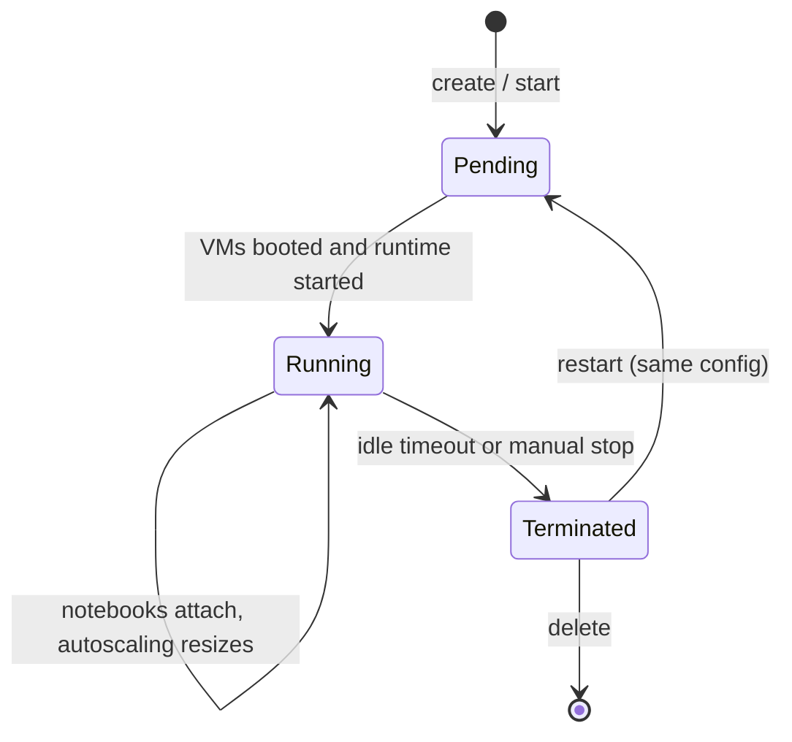

# All-Purpose Compute

Mastery: `INPUT[inlineSelect(option(new), option(learning), option(solid)):mastery]`

> [!story] Previously
> [[Compute Types]] laid out the map. The oldest region on it is all-purpose compute: the interactive cluster that the first Databricks notebooks attached to back in 2014. It is still the most flexible kind of compute, and the easiest one to leave running by accident.

> [!eli5] In one breath
> An all-purpose cluster is a group of rented computers that you switch on, use while you work, and share with teammates. It stays on until you or a timer turns it off. It can do almost anything, but you pay for every minute it is on, even while you are at lunch.

> [!analogy] Analogy: a shared workshop
> - **The workshop** is the cluster. You unlock it in the morning and the tools are ready.
> - **The workbenches** are the worker machines, and **the foreman** is the driver ([[Driver and Executors]]).
> - **The tool cabinet** is the set of [[Libraries and Environments|libraries]] installed on it. Everyone in the workshop uses the same cabinet.
> - **The timer on the lights** is [[Auto Termination]]. Without it, the lights (and the bill) stay on all night.

## Why it exists

Interactive work needs a machine that is **already running**. When you run a notebook cell, you want an answer in seconds, not a five-minute wait for VMs to boot. You also want to install a library once and have it there for the rest of the day, and let a teammate attach to the same cluster to debug with you.

All-purpose compute provides that. It is the classic answer to "I need a Spark environment right now" and it supports everything classic compute can do: any [[Databricks Runtime|runtime]], R, GPUs, init scripts, custom networking, and cluster-scoped libraries.

## What it actually is

An all-purpose cluster is classic compute that:

- You **create manually** (UI, [[Databricks CLI|CLI]], API, or [[Declarative Automation Bundles|bundles]]).
- **Persists** after use: you can stop it, restart it, and edit it. Its configuration is kept even while it is terminated.
- Can be **attached to many notebooks** and used by several people at once (in standard access mode) or by one user or group (dedicated mode).
- Is billed at the **all-purpose DBU rate**, which is higher than the jobs rate. See [[DBUs]].

Main settings:

| Setting | What to choose | Why |
|---|---|---|
| Access mode | Standard (or Dedicated for R/GPU/RDD) | See [[Compute Types]] |
| Runtime | Latest LTS, or DBR ML for data science | Stability |
| Node type | General-purpose to start; memory-optimized for big joins | Cost vs speed |
| Workers | Autoscaling, e.g. min 1, max 4 | Pay for what you use |
| Auto termination | 20–60 minutes | Stops idle billing |
| Photon | On for SQL/DataFrame heavy work | Faster, but higher DBU rate |
| Single node | For pandas, small data, ML on one machine | No workers, cheapest |

## How it works



Create a small, cost-safe interactive cluster with the CLI:

```bash
databricks clusters create --json '{
  "cluster_name": "team-explore",
  "spark_version": "17.3.x-scala2.13",
  "node_type_id": "i3.xlarge",
  "autoscale": { "min_workers": 1, "max_workers": 4 },
  "autotermination_minutes": 30,
  "data_security_mode": "USER_ISOLATION",
  "custom_tags": { "team": "analytics" }
}'

databricks clusters list
databricks clusters start  <cluster-id>
databricks clusters delete <cluster-id>   # "delete" terminates; permanent-delete removes it
```

A few behaviors to know:

- **Termination is not deletion.** A terminated cluster keeps its config and can be restarted. Databricks keeps terminated all-purpose clusters for a limited time unless an admin pins them.
- **Libraries reinstall on start.** Cluster libraries install every time the cluster starts. Notebook-scoped installs (`%pip install`) vanish when the Python process restarts.
- **Restarts pick up runtime maintenance updates.** Long-running clusters miss security patches until restarted.
- **Debugging tools.** Every classic cluster has the [[Spark UI]], driver logs, and metrics pages.

> [!smallbiz] For a small business
> All-purpose clusters are the most common source of surprise bills: someone creates a big cluster, works for an hour, and leaves it on for the weekend. Three habits prevent this:
> 1. **Prefer [[Serverless Compute|serverless notebooks]]** for everyday work, so there is no cluster to forget.
> 2. **If you need a cluster, set auto-termination to 30 minutes or less** and use a [[Compute Policies|compute policy]] that caps size and enforces the timer.
> 3. **Never schedule production jobs on an all-purpose cluster.** Use [[Jobs Compute]] or serverless jobs, which cost less and shut down by themselves.

## On each cloud

> [!azure]- Azure Databricks
> Node types are Azure VM sizes (for example `Standard_D4ds_v5`). VMs appear in the workspace's [[Managed Resource Group|managed resource group]] while the cluster runs, and you need enough regional vCPU quota in your subscription. Spot capacity is called **Azure Spot VMs**.

> [!aws]- Databricks on AWS
> Node types are EC2 instance types (for example `i3.xlarge`, `m6gd.xlarge` for Graviton). You can set spot vs on-demand with `aws_attributes` and attach [[Instance Profiles|instance profiles]] for legacy S3 access (Unity Catalog is preferred). See [[EC2 Instance Types and Graviton]].

> [!gcp]- Databricks on Google Cloud
> Node types are Compute Engine machine types (for example `n2-standard-4`). Preemptible capacity is set with `gcp_attributes`. Clusters run as a [[Google Service Accounts|Google service account]]. See [[Compute on Google Cloud]].

## Going deeper

> [!deepdive]- Expert notes (301–401)
> - **Cluster pinning and retention.** Terminated all-purpose clusters are removed after a retention window unless pinned by an admin. Pin long-lived team clusters so their IDs (used in Databricks Connect profiles and scripts) stay stable.
> - **Instance pools.** Pools keep idle VMs warm so clusters start faster. You pay the cloud provider for idle pool VMs, but no DBUs while idle.
> - **Init scripts.** Cluster-scoped init scripts run on every node at start. Store them in Unity Catalog [[Volumes]] or workspace files; DBFS-stored init scripts are legacy. On standard access mode they must be on the metastore allowlist.
> - **Single-node clusters.** A driver-only cluster is ideal for pandas, scikit-learn, or small Spark jobs. It is not suitable for standard access mode sharing at scale.
> - **Policies as guardrails.** [[Compute Policies]] can fix the runtime, cap workers, force tags, hide fields, and set `autotermination_minutes`. The "Personal Compute" policy lets users create single-node dedicated clusters for themselves.
> - **Event log.** The cluster event log (UI or `databricks clusters events <id>`) shows why a cluster resized, restarted, or failed to start (for example, cloud quota or spot capacity errors).

## Common confusions

> [!confusion] All-purpose is not the same as interactive-only
> You *can* run a job on an all-purpose cluster, but you pay the higher all-purpose rate and share it with interactive users. Production jobs belong on [[Jobs Compute]] or serverless.

> [!confusion] "Terminate" vs "delete"
> In the CLI, `clusters delete` terminates (stops) a cluster. `clusters permanent-delete` removes it and its configuration.

## Recall

What is all-purpose compute for?::Interactive work in notebooks: exploration, development, and collaboration.
Is all-purpose compute billed at a higher or lower DBU rate than jobs compute?::Higher.
Which setting stops an idle all-purpose cluster from billing?::Auto termination (`autotermination_minutes`).
What happens to a terminated all-purpose cluster's configuration?::It is kept, so the cluster can be restarted, until it is permanently deleted or removed after the retention window.
Why should production jobs not run on all-purpose clusters?::They cost more per DBU and share resources with interactive users; jobs compute or serverless jobs are cheaper and isolated.
What CLI command permanently removes a cluster?::`databricks clusters permanent-delete <cluster-id>`.
What is a single-node cluster good for?::Small data, pandas, and single-machine ML, with no worker nodes to pay for.

## Where next

> [!path] Learning path
> **Needs first:** [[Compute Types]], [[Databricks Runtime]], [[Driver and Executors]]
> **Unlocks next:** [[Notebooks]], [[Jobs Compute]], [[Compute Policies]]

> [!nextup] Up next in the story
> Interactive clusters are great for exploring but wasteful for scheduled work. What if a cluster existed only for the length of one run? That is [[Jobs Compute]].

> [!sources]- Sources (last verified: 2026-10-25)
> - [Classic compute overview (AWS)](https://docs.databricks.com/aws/en/compute/use-compute)
> - [Compute configuration reference (AWS)](https://docs.databricks.com/aws/en/compute/configure)
> - [Compute configuration reference (Azure Databricks)](https://learn.microsoft.com/en-us/azure/databricks/compute/configure)
> - [Classic compute configuration best practices (AWS)](https://docs.databricks.com/aws/en/compute/cluster-config-best-practices)
> - [Compute selection recommendations (AWS)](https://docs.databricks.com/aws/en/compute/choose-compute)
> - [Use the simple form to manage compute (Google Cloud)](https://docs.databricks.com/gcp/en/compute/simple-form)
